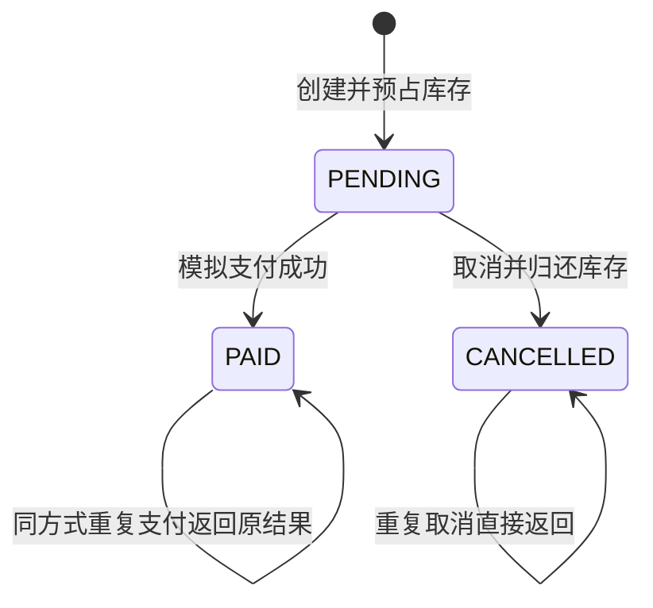
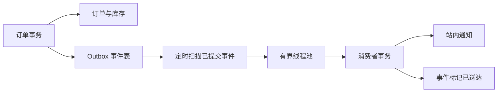

# 从零学习 Spring Boot：用一个小商城串起后端开发

这份教程对应本项目的真实源码。建议边读边运行，不需要先背完所有注解。第一次阅读只完成第 0–5 章；能解释一次商品查询之后，再进入事务、并发和消息。

## 目录与目标

| 章节              | 你将能回答的问题                    | 建议投入           |
| ----------------- | ----------------------------------- | ------------------ |
| 0. 必要基础       | Java、HTTP、数据库分别做什么？      | 1–3 天，取决于基础 |
| 1. 跑起来         | Maven 和 Spring Boot 怎样启动网站？ | 半天               |
| 2. 项目导航       | 一次请求会经过哪些类？              | 半天               |
| 3. IoC 与 DI      | 谁创建对象，谁把对象交给我？        | 1 天               |
| 4. MVC 与参数校验 | URL 怎么进入 Java 方法？            | 1 天               |
| 5. SQL 与数据访问 | 数据怎样存下来？                    | 1 天               |
| 6. AOP 与代理     | 不修改业务代码，如何统一计时？      | 1 天               |
| 7. 事务           | 扣库存成功但写订单失败怎么办？      | 1 天               |
| 8. 幂等           | 用户多点一次，如何不多下一个订单？  | 1 天               |
| 9. 并发           | 最后一件商品被多人同时买怎么办？    | 1–2 天             |
| 10. 消息与线程池  | 如何可靠地异步通知？                | 2 天               |
| 11. 安全与配置    | 登录、权限、环境配置在哪里？        | 1 天               |
| 12. 测试与调试    | 怎样证明代码在异常场景下仍正确？    | 1–2 天             |
| 13. 扩展练习      | 如何独立添加一个功能？              | 按需               |

时间只是学习节奏参考，不是完成期限。没有 Java 基础时，先把第 0 章的小练习独立写出来。

## 0. 开始之前：只补本项目需要的基础

### 0.1 Java 是业务代码，Spring 是对象管理框架

- **JDK**：编译和运行 Java 的工具箱。`javac` 编译，`java` 运行。
- **类与对象**：类是定义，对象是运行时实例。`new ProductService(...)` 会创建一个对象。
- **接口**：描述“能做什么”，不规定所有实现细节。本项目 `PaymentGateway` 规定 `method()` 和 `pay()`，两种模拟支付各自实现。
- **方法与构造器**：方法执行行为；构造器在创建对象时接收依赖并完成初始化。
- **Spring Framework**：负责管理组件、注入依赖、代理事务、处理 Web 请求等。
- **Spring Boot**：在 Spring 上提供依赖组合、自动配置、内嵌服务器和启动约定，减少重复配置。

先看这段独立 Java：

```java
interface Greeting { String say(); }
class ChineseGreeting implements Greeting {
    public String say() { return "你好"; }
}
class Welcome {
    private final Greeting greeting;
    Welcome(Greeting greeting) { this.greeting = greeting; }
    String show() { return greeting.say(); }
}
// 没有 Spring 时由你装配：
// Welcome welcome = new Welcome(new ChineseGreeting());
```

`Welcome` 只依赖 `Greeting` 的约定。把另一种实现传入构造器，就能改变问候方式而不改 `Welcome`。后面 IoC 所管理的正是这类对象装配。

还需要认识：`List` 表示有序集合，`Map` 表示键值映射，`Optional` 表示可能没有结果，`record` 是声明数据载体的简洁语法。`ProductView` 就是 record；它的 `price()` 是自动生成的访问方法。record 只提供浅层不可变，不会把里面的可变 List 自动变成不可变。

`stream().map(...).toList()` 表示逐个转换元素再收集。看不懂时可先在纸上改写成 `for` 循环。`throw` 抛出异常，`try/catch` 处理异常，`finally` 无论正常或异常都会执行。后面的事务回滚依赖异常是否越过代理边界。

**练习**：自己创建 `EnglishGreeting`，不用 Spring，把它传入 `Welcome`。说明“依赖接口”的好处。

### 0.2 浏览器怎样和服务器说话

浏览器发出 HTTP 请求，服务器返回 HTTP 响应。一条请求有：方法、路径、请求头、请求体。例子：

```http
POST /api/orders
Content-Type: application/json
Idempotency-Key: demo-request-001

{"items":[{"productId":1,"quantity":2}]}
```

`GET` 用于读取；本项目 `POST` 用于下单、支付、取消。JSON 是数据格式，和 Java 类不是同一回事：Spring/Jackson 在两者间转换。

常见状态码：200 成功，400 输入不合法，401 未登录，403 安全校验失败，404 资源不存在，409 当前状态或请求内容冲突，500 服务器异常。返回错误 JSON 不等于 HTTP 成功；本项目会同时设置对应状态码。

打开浏览器开发者工具的 **Network** 面板，点击“加入购物车”时并没有下单请求，因为购物车先保存在浏览器。点击“提交订单”才会发送 POST。

### 0.3 数据库和 SQL

表类似有约束的数据表格。一行代表一个记录，一列代表一个属性。主键唯一标识一行，外键保证引用的记录存在，唯一约束拒绝重复组合。

```sql
SELECT id, name, price, stock FROM product ORDER BY id;
UPDATE product SET stock = stock - 1 WHERE id = 1 AND stock >= 1;
```

第一句查询；第二句只在有库存时扣减。本项目选择 SQL 可见的 JDBC，帮助你直接理解数据库行为。以后学 JPA/MyBatis 时，这些底层知识仍然适用。

## 1. 启动你的第一个 Spring Boot 项目

### 1.1 验证环境

```shell
java -version
mvn -version
```

两条都应成功，Java 主版本应为 21。Maven 显示的 Java 版本也要检查：IDE、终端和 Maven 可能指向不同 JDK。

在项目根目录运行 `mvn spring-boot:run`。Windows 可双击 `start.cmd`。出现 `Started MallApplication` 后访问 `http://localhost:8080`。

首次启动会自动建表并导入 6 件商品。登录 `student / learn12345`，买一件商品，再去订单里模拟支付。切换到消息中心，稍等几秒看到通知。

### 1.2 pom.xml 在做什么

Maven 按 `groupId:artifactId:version` 定位依赖。`spring-boot-starter-parent` 管理兼容依赖版本，所以大多数依赖不需要各自写版本。

- `starter-web`：Spring MVC、JSON 转换、内嵌 Tomcat。
- `starter-thymeleaf`：服务器端 HTML 模板。
- `starter-jdbc`：数据库连接池、JDBC 访问和事务基础设施。
- `starter-validation`：Jakarta Bean Validation。
- `starter-aop`：基于代理的切面能力。
- `starter-security`：认证、授权、会话和 CSRF。
- `starter-actuator`：健康检查等运维能力。
- `flyway-core`：按版本执行数据库变更。
- `h2`：本地内嵌数据库。
- `starter-test` 和 `security-test`：测试支持，只在测试阶段使用。

`mvn test` 编译并执行测试；`mvn package` 还会打包；`mvn verify` 执行到验证阶段。`spring-boot-maven-plugin` 把应用和依赖打进可以 `java -jar` 运行的包。

### 1.3 main 方法为何能启动网站

打开 `MallApplication`。`SpringApplication.run(...)` 会建立应用上下文，扫描组件，执行自动配置，创建数据库连接池并启动内嵌 Web 服务器。

`@SpringBootApplication` 汇集了配置类、组件扫描与自动配置相关能力。启动类放在 `dev.learning.mall` 根包，所以子包中的组件能被扫描到。把类放到完全无关的包，可能导致找不到 Bean。

自动配置不是“魔法生成业务”。它依据 classpath、已有 Bean 和配置属性选择合适的基础设施。你仍然负责业务规则、SQL 和边界条件。

**练习**：通过启动参数 `--server.port=8088` 启动已打包的 jar，确认新地址可用。不要只改浏览器地址而不改服务端监听端口。

## 2. 先掌握地图，再逐行看代码

源码根目录：`src/main/java/dev/learning/mall`。

```text
浏览器 GET /api/products
  → Spring Security 过滤器（允许匿名商品查询）
  → DispatcherServlet（Spring MVC 入口）
  → ProductController.list()
  → ProductCatalog 接口 / ProductService 实现
  → ProductRepository.list()
  → JdbcClient / Hikari 连接池 / H2
  → ProductView 列表 → Jackson JSON → 浏览器绘制商品卡片
```

层的分工：

| 层               | 主要职责                                   | 避免做什么                       |
| ---------------- | ------------------------------------------ | -------------------------------- |
| Controller       | 接收参数、获得当前用户、调用服务、返回结果 | 不在订单 Controller 里扣库存     |
| Service / Facade | 组织业务用例、校验业务规则、划定事务边界   | 不拼接 HTML                      |
| Repository       | 执行 SQL、映射数据库记录                   | 不决定支付成功后要不要取消       |
| API / DTO        | 模块间契约、接口输入输出数据               | 不把数据库实现泄漏给其他业务模块 |

`catalog`、`order`、`payment`、`messaging` 是业务模块，内部再分 `api/internal/web`。订单通过 `ProductCatalog` 访问商品、通过 `DomainEventPublisher` 发布事件，不直接 import 其他模块的 Repository。

这不是零耦合：订单确实需要商品的能力。目标是**让依赖显式且尽量稳定**，而不是用大量接口把简单功能藏起来。某些实现只用于本模块，没有单独抽象接口。

**练习**：在 IDE 从 `ProductController` 跳转到 `ProductCatalog` 的实现，再跳到 SQL。说出哪里决定 URL，哪里决定查询表名。

## 3. IoC、Bean、DI：对象是怎样装配起来的

### 3.1 概念和实际位置

**IoC（控制反转）**：对象的创建和装配交给容器管理。**DI（依赖注入）**：容器把一个对象需要的其他对象提供给它，是实现 IoC 的常见方式。**Bean**：交给 Spring 管理的对象。

```java
@Service
public class ProductService implements ProductCatalog {
    private final ProductRepository repository;
    public ProductService(ProductRepository repository) {
        this.repository = repository;
    }
}
```

`@Service` 让它参与扫描；构造器声明依赖。只有一个构造器时通常不必再加 `@Autowired`。`final` 表示引用在构造后不重新赋值，有助于清晰表达必需依赖。

- `@Component`：通用组件。
- `@Service`：业务服务语义。
- `@Repository`：数据访问语义，也参与 Spring 数据访问异常体系。
- `@Controller` / `@RestController`：Web 控制器。
- `@Configuration` + `@Bean`：用工厂方法注册对象，例如线程池、密码编码器、安全过滤链。

### 3.2 单例不等于线程安全

默认 Bean 通常是单例：一个应用上下文中共享同一个实例。多个请求线程会同时调用同一个 `OrderTransactions`。不要把“当前用户”“当前订单”“可变购物车”放进 Service 的实例字段。

本项目 Service 字段只有依赖引用，每次请求的数据放在方法参数和局部变量中。库存竞争交给数据库处理，而不是靠 Java 字段记录。

### 3.3 接口 + 多实现 + 策略模式

`DemoCardPayment` 和 `DemoWalletPayment` 都实现 `PaymentGateway` 并带 `@Component`。Spring 把全部实现注入 `PaymentRouter(List<PaymentGateway> gateways)`。

路由器建立 `method → 实现` 的 Map。订单只写 `payments.get(method).pay(...)`。新增一种模拟方式时，新建实现即可加入装配；页面下拉选项仍需显式增加。若两个实现返回相同 method，Map 创建会失败，让配置错误在启动时暴露。

`@Qualifier("messageExecutor")` 用于有多个候选时明确指定 Bean；`@Primary` 则可设置默认候选。不要遇到多个 Bean 冲突就随意删除某个实现，应先想清楚需要哪一个。

### 3.4 常见错误

“找不到 Bean”：检查是否在扫描包内、是否有组件注解、是否满足条件配置。

“循环依赖”：A 要 B、B 又要 A。优先调整职责与接口方向，不要第一反应开启允许循环引用。

“注解没生效”：你可能用了 `new OrderTransactions(...)`，这个对象没有经过容器代理。测试纯业务对象时可以自行 new；验证事务/AOP 时要从 Spring 上下文拿 Bean。

**练习**：增加 `DemoGiftPayment` 策略，method 返回 `DEMO_GIFT`，返回固定前缀的模拟流水。在 `PaymentRouter` 中不增加 if/else，通过测试验证能选中它。

## 4. Spring MVC、模板、JSON 和参数校验

### 4.1 两类 Controller

`PageController` 的 `@Controller` 返回 `"index"`，表示渲染 `templates/index.html` 模板。`Model` 中的用户名用于展示登录状态。Thymeleaf 还把 CSRF token 放进 meta 标签。

`ProductController` 的 `@RestController` 把返回值写入 HTTP 响应体，通常转换成 JSON。它不是在找名为 ProductView 的 HTML 模板。

`@RequestMapping("/api/orders")` 定义公共前缀，`@PostMapping("/{id}/pay")` 定义具体路径。`@PathVariable` 接收路径部分；`@RequestBody` 从 JSON 反序列化；`@RequestHeader` 接收幂等键；`Principal` 由认证系统提供当前用户。

不接收前端随意传来的 `username` 作为订单所有者。所有者来自登录会话，这样不能通过改请求体去操作他人的订单。

### 4.2 输入校验有几层

`CreateOrderRequest` 使用 `@NotEmpty`、`@Size`、`@Min`、`@Max`、容器元素 `@NotNull` 和 `@Valid`。Controller 参数上还要有 `@Valid`，才能在请求入口触发校验。

语法合法不等于业务合法。库存是否足够、订单是否已支付、幂等键是否对应相同正文，属于 Service 里的业务规则。数据库再提供 CHECK、唯一键等最终约束。

例如 `quantity=0` 在入口返回 400；`quantity=9` 但库存只剩 3，在业务层返回 409。缺少 CSRF 时安全过滤器先返回 403，尚未执行 Controller。

### 4.3 全局异常处理

`ApiExceptionHandler` 使用 `@RestControllerAdvice` 和 `@ExceptionHandler`。业务异常保留明确 code/message；未知异常详细记录到服务器日志，只向客户端返回一般错误信息。

登录和 CSRF 错误发生在 MVC 之前的安全过滤链，不能只靠 ControllerAdvice 处理，所以 `SecurityConfig` 另行定义 API 的 401/403 响应。

### 4.4 前端的边界

`static/js/app.js` 使用 `fetch` 请求接口，维护浏览器购物车，渲染订单。购物车合计仅作展示，服务器从商品表读取价格并重新计算。页面渲染通过 `esc()` 转义动态文本，防止把数据直接当 HTML 执行。

**练习**：打开 Network 面板查看 `/api/products` 的 JSON。在已登录页面的开发者工具里构造一个 quantity 为 0 的请求，带上 CSRF，观察 400。具体代码见实验手册。

## 5. JDBC、SQL、数据库迁移和金额

### 5.1 为什么选择 JdbcClient

`JdbcClient` 是 Spring 提供的 JDBC 访问门面。写 SQL、绑定参数、映射结果的过程比较直观：

```java
jdbc.sql("SELECT * FROM product WHERE id = :id")
    .param("id", id)
    .query(ProductView.class)
    .optional();
```

不要把用户输入拼进 SQL 字符串。这里使用绑定参数，参数值不会成为 SQL 结构。源码中拼接 `FOR UPDATE` 是由服务端 boolean 控制的固定片段，不来自用户输入。

### 5.2 五张业务表的关系

`product` 保存商品、价格、当前可售库存；`mall_order` 保存用户、幂等键、请求指纹、金额和状态；`order_item` 保存购买当时的名称、单价和数量快照；`outbox_event` 保存待投递事件；`notification` 保存消费成功的站内通知。

订单项不只保存商品编号，还保存名称和价格。这样将来商品改名或涨价，旧订单仍能展示购买当时的信息。

### 5.3 金额用 BigDecimal

二进制浮点数不能精确表示很多十进制小数。Java 金额使用 `BigDecimal`，数据库使用 `DECIMAL(12,2)`。计算：`unitPrice.multiply(BigDecimal.valueOf(quantity))`。

从代码常量创建金额时优先 `new BigDecimal("39.00")`，避免 `new BigDecimal(0.1)`。比较金额用 `compareTo`；`equals` 还区分 scale，因此 `1.0` 和 `1.00` 可能不 equals。测试中的 `isEqualByComparingTo` 对应数值比较。

### 5.4 Flyway 与持久化

`V1__create_mall.sql` 建表，`V2__seed_products.sql` 添加商品。Flyway 在 `flyway_schema_history` 中记录已执行版本。重启不会重新把库存改回初始值。

不要在一个已迁移的数据库上随意修改旧迁移文件；校验和会不一致。结构变化应新增 `V3__...sql`。全新练习数据可通过更换数据库路径建立，不必删除原数据。

默认是 H2 文件数据库；测试 profile 是 H2 内存库。文件库适合本机单进程学习，不代表已验证 MySQL/PostgreSQL 行为。迁移到其他数据库后，需要调整方言、驱动、迁移支持并重新跑并发测试。

**练习**：画出订单和订单项的一对多关系。说明为什么把购物车传来的 total 直接保存到订单是不正确的。

## 6. AOP：把统一能力放到业务逻辑外面

### 6.1 为什么不用每个方法都手写计时

如果下单、支付、取消都需要日志，复制计时代码会把核心业务淹没。AOP 把这类跨多个业务方法的行为集中处理。

本项目的 `@Observed("pay-order")` 是自定义注解；`TimingAspect` 使用 `@Aspect` 声明切面，`@Around("@annotation(observed)")` 找到带该注解的方法。

`ProceedingJoinPoint.proceed()` 执行后续拦截链/目标方法。切面记录开始时间，在 finally 中输出耗时、结果和线程名。即使抛出异常也能记录，且不吞异常。

术语只需先认识四个：**连接点**是可拦截的方法执行；**切点**是匹配哪些执行的规则；**通知**是拦截时做的工作；**切面**组合规则和工作。

### 6.2 Spring AOP 的关键：调用经过代理

```text
调用者 → Spring 代理 → 计时/事务等拦截器 → 目标对象的方法
```

Spring 常见的 AOP 是代理式 AOP。类中 `this.someMethod()` 属于目标对象内部调用，一般不会重新经过外部代理。给被自调用的方法贴注解，不代表一定生效。

本项目故意拆开：`OrderFacade → OrderTransactions`；`MessageWorker → MessageProcessor`。调用发生在不同 Bean 之间，事务代理才有清晰入口。

`OrderTransactions.create()` 内部调用 `get()` 是有意的：它已经处在外层事务中，不依赖 get 上的注解再开新事务。若未来要求 `get()` 使用不同传播行为，就不能沿用这种自调用方式。

不要把事务方法设计成 private 然后期待基于代理的事务生效，也要注意 final 方法/类对代理方式的限制。

### 6.3 日志不等于审计和提交凭证

`@Observed` 是教学计时切面，记录方法执行结果。多个切面的顺序可能影响是否包含事务提交耗时；此日志不能替代数据库提交结果，也不是合规审计系统。不要把密码、完整请求体、支付敏感信息写进统一日志。

**练习**：在 IDE 给 `TimingAspect.time()` 打断点，进行一次支付，观察调用栈。然后解释为什么直接 new 出来的对象没有此行为。

## 7. 事务：让相关修改一起成功或失败

### 7.1 一次下单包含多个数据库修改

订单头写入 → 商品库存扣减 → 订单项写入 → Outbox 事件写入。任何一步失败，都应该恢复到这次下单之前的状态。

`OrderTransactions.create()` 标注 `@Transactional`。调用进入代理时开启事务，正常返回后提交，发生符合回滚规则的异常则回滚。Spring 默认对 RuntimeException 和 Error 回滚；检查型异常若也要回滚，需要明确配置如 `rollbackFor = Exception.class`。

本项目 `BusinessException` 继承 RuntimeException。库存不足时向外抛出，之前已经扣掉的其他商品库存也一起回滚。

### 7.2 ACID 对本项目意味着什么

- 原子性：库存、订单、事件一起提交或一起回滚。
- 一致性：操作前后仍满足库存非负、主键唯一等规则；也需要正确业务逻辑，不能只靠数据库自动理解业务。
- 隔离性：并发事务互不随意看到对方未提交的中间数据，但具体行为取决于隔离级别和 SQL。
- 持久性：提交后数据进入持久化存储，正常重启不会丢失。

事务不是“方法加注解后自动解决所有并发”。先查询库存再无条件写回，即使在事务里仍可能有问题。第 9 章会把 SQL 与锁一起考虑。

### 7.3 传播行为和线程边界

`@Transactional` 默认 REQUIRED：已有事务就加入，没有就创建。商品 `reserve/release` 和事件发布 `publish` 使用 MANDATORY：必须有上层事务，否则立刻失败。这能防止有人脱离订单事务单独扣库存或发事件。

`readOnly=true` 表达读事务意图，也可能帮助框架优化，不是所有数据库都把它当成强制禁止写入的防线。

常规 JDBC 事务绑定当前线程。把代码扔到线程池，不会自动把请求线程的事务搬过去。所以订单事务只写 Outbox，消息线程在自己的事务中消费已提交的事件。

### 7.4 不要在失败的事务里硬继续

订单唯一键冲突在 `OrderTransactions.create` 内抛出，然后代理先回滚，最外层 `OrderFacade` 才 catch 并查询已有订单。

如果把 facade 也包进同一个大事务，再 catch 唯一键异常继续查询，可能碰到事务已标记 rollback-only、连接处于失败状态等问题。不同数据库细节有差异，清晰地退出失败事务更可靠。

**练习**：运行测试 `insufficientSecondProductRollsBackEarlierDeductionAndOrder`。阅读它如何让第二件商品缺货，并断言第一件库存也没有被扣掉。再看 `outboxWriteFailureRollsBackBusinessTransaction`，说明为何事件表失败也要回滚订单。

## 8. 幂等：同一个业务请求重试，不产生第二份结果

### 8.1 什么时候需要

用户连点按钮、浏览器超时重试、网络代理重放，都可能让服务器收到相同业务请求。禁用按钮只改善交互，不能承担最终正确性。

客户端为一次结算生成 UUID，放进 `Idempotency-Key` 请求头。正文与 key 在发送之前一起存入 localStorage。若响应丢失，原购物车重新提交仍使用这个 key；成功后保存为“上次下单请求”。购物车内容改变则构成新请求，生成新 key。

### 8.2 数据库唯一键负责最终去重

`mall_order` 有 `UNIQUE(username, idempotency_key)`。用户范围隔离保证两位用户可以使用相同 key。Java 中先查只是减少常见重试开销，无法取代唯一约束。

```text
第一次：没有旧订单 → 事务插入订单头 → 扣库存 → 写事件 → 提交
重复：查到旧订单 → 验证指纹一致 → 返回旧订单
并发重复：两个都没查到 → 唯一键只有一个能插入 → 另一事务回滚 → 查询并返回已提交订单
```

真正保护并发的不是 `if (existing)`，而是数据库唯一约束。代码里也没有依赖仅在单进程有效的 `synchronized` 去重。

### 8.3 同一 key 配不同正文怎么办

若第一次买 1 件，第二次把同一 key 用来买 2 件，静默返回旧订单会让调用者误以为改动已生效。因此先按商品编号排序，将 `productId:quantity;` 组成规范字符串并计算 SHA-256 指纹。

同 key + 相同指纹 → 返回已有订单；同 key + 不同指纹 → 409 `IDEMPOTENCY_CONFLICT`。排序使 A/B 与 B/A 两种商品排列拥有同一指纹。重复商品行会被拒绝，要求先合并数量。

价格不来自请求，也不参与客户端请求指纹。重放原请求返回原订单价格快照，不会因后来商品价格变化而重新计价。

### 8.4 这份实现的边界

key 随订单记录长期保留；教学项目没有清理策略。重发一个已取消订单的创建请求，返回的是那个已取消订单，不会重新扣库存。想再次购买，必须发新的业务请求和 key。

接口重放返回当前订单状态，不是逐字节缓存最初 HTTP 响应。这里保证“业务效果不重复”，并不保证不同时间重试响应的 status 字段永远一样。

**练习**：在订单页点击“重发上次下单请求”，确认编号不变、订单数不变。使用实验手册的脚本改正文但保留 key，观察 409。

## 9. 并发：库存和订单状态分别怎样保护

### 9.1 先查后改为什么危险

错误思路：A 读到库存 1，B 也读到 1；A 认为能买，B 也认为能买。两个判断各自成立，不代表整体正确。

本项目把判断和扣减放进同一 SQL：

```sql
UPDATE product
SET stock = stock - :qty
WHERE id = :id AND stock >= :qty;
```

判断受影响行数：1 表示成功扣减，0 表示库存不足（商品不存在会在更早的商品查询中报 404）。并发修改由数据库协调。`CHECK(stock >= 0)` 是另一道约束，但不是主要业务实现。

这不是带 version 字段的经典乐观锁；它是条件更新。不要看到 WHERE 就统称“用了 version 乐观锁”。

### 9.2 多商品固定加锁顺序

订单 A 先锁商品 1 再锁商品 2，而订单 B 反过来，容易形成循环等待。创建订单前按商品编号排序，取消时查询订单项也按商品编号排序，让库存行的加锁顺序一致。

一致顺序降低死锁风险，不代表所有数据库和未来所有逻辑都不可能死锁。数据库死锁/锁超时可能仍需返回可重试错误，本项目并发数据访问异常映射为 409 BUSY，创建订单重试要沿用原 key。

### 9.3 支付、取消是一台小状态机



这里没有“支付后直接取消”或“取消后支付”的转换。这是简化业务规则，不代表现实商城没有退款；退款应是独立流程。

支付和取消先执行 `SELECT ... FOR UPDATE`，且查询带用户名。在订单事务结束前，持有同一订单行的锁。第二个线程等第一个提交，再检查最新状态。

- 重复支付：返回同一模拟流水，不生成第二条支付事件。
- 重复取消：直接返回，不重复增加库存。
- 支付与取消竞争：只允许一个终态成功；另一个看到已终结状态，返回 409。
- 已支付订单换一种支付方式重放：409 `PAYMENT_MISMATCH`。

### 9.4 为什么只锁订单还不够

同一订单用订单行锁保护状态，多份不同订单会竞争同一商品，所以还需要商品库存条件更新。锁的对象取决于保护的资源，不能用一把“订单锁”解释所有并发正确性。

本项目不预留真正银行支付的钱，`PaymentGateway` 只是返回确定的模拟流水。真实支付网络调用不能照搬到长数据库事务里：应有支付单、支付请求幂等、外部回调校验、状态机和对账。

**练习**：运行 `competingRequestsCannotOversell`，它把库存设为 7 并同时发起 24 次下单，断言成功数为 7 且库存为 0。再解释为什么测试自己的线程池必须足以让所有请求同时到达栅栏。

## 10. 持久化消息、线程池、重试与消费幂等

### 10.1 为什么下单不直接通知

通知可能慢、失败或者依赖暂时不可用的系统。用户不需要等通知完成才能拿到订单结果。但简单地 `new Thread(...).start()` 会带来线程无限增长、进程退出丢任务、不可观察等问题。

只发布内存 Spring Event 也不能自动跨重启保存消息。即使使用事务提交后的监听器，提交之后到真正投递之前仍可能进程退出。这个学习项目使用 **Transactional Outbox**：业务事务里将待通知事件保存到数据库。



订单与事件共享一个本地数据库事务；通知与已送达标记共享另一个本地事务。这个性质是当前演示可靠性的基础。

### 10.2 生产、投递、消费、确认

1. `OutboxPublisher.publish` 将事件保存为 PENDING，强制要求已有事务。
2. `OutboxDispatcher.dispatch` 由 `@Scheduled` 触发，查询到期 PENDING 事件，一批最多 20 条。
3. 本进程 `inFlight` 集合避免同一个事件在每次扫描时反复进入线程池；它只是减轻重复调度，不承担持久化正确性。
4. 线程池执行 `MessageWorker.handle`，工作线程名以 `mall-message-` 开头。
5. `MessageProcessor.process` 开启事务，对事件行 `FOR UPDATE`，重新检查状态和到期时间。
6. 写入站内通知，再把事件改成 DELIVERED，一起提交。

数据库保存待办事实，内存队列只是执行缓冲。即使进程在“已入内存队列但尚未执行”时退出，事件依然是 PENDING，重启会重新扫描。

### 10.3 线程池参数怎样影响行为

`ExecutorConfig` 创建 `ThreadPoolTaskExecutor`：核心 2、最大 4、队列容量 32。大致顺序是先使用核心线程；核心繁忙时排队；队列满后才扩张到最大线程；线程和队列都满后拒绝。

因此 max=4 并不意味着一有任务就启动 4 个线程。消息中心看到 active=0 也正常，站内写库任务通常很快，页面采样时已经完成。

拒绝策略为 AbortPolicy。Dispatcher 捕获拒绝异常，清除本次 inFlight 标记并停止这轮继续提交。没有标记已送达，也没有删数据库事件；后续扫描可重投。

不能用无限队列掩盖压力：积压会吃内存。也不能捕获拒绝后假装任务完成。`DispatcherBackpressureTest` 专门验证队列满后下次仍能投递。

停机时允许已接收任务完成，等待窗口为 15 秒；若进程被强制终止，未提交事务回滚，尚待处理事件仍可恢复。此机制依赖数据库持久化，而不是承诺停机一定等完所有任务。

本项目显式调用 executor，以清楚展示提交和拒绝处理。`@Async` 是另一种提交方式，使用时要 `@EnableAsync`、指定 executor，并理解代理自调用、异常收集和事务不跨线程。它不是自动可靠消息系统。

### 10.4 至少一次处理下的幂等消费

扫描可能重复，进程可能在边界退出。不要假设调度恰好一次。本项目允许再次尝试，再用数据约束让本地通知效果不重复。

消费端锁住事件行并检查 DELIVERED；通知表的主键是 `event_id`，写通知还会判断记录是否已经存在。两个消费者同时处理同一事件，后者拿到锁时能看到前者已完成。

当前“通知写入”和“事件确认”在同一个数据库事务里，所以没有本地一半提交的问题。换成真实邮件/短信 HTTP 调用后，外部系统不参加这个事务：短信可能已发出，但数据库确认前进程退出。必须向外部提供幂等 eventId、使用其去重能力，或建立对账/补偿。不能声称这份 Outbox 自动提供跨系统 exactly-once。

事件不保证严格按订单发生顺序被用户看到：不同工作线程可能先完成后来的事件。业务若依赖严格顺序，应按订单分区或增加版本/序号检查；当前通知仅展示独立事实，不靠顺序驱动订单状态。

### 10.5 重试、退避与死信

消费出错时，process 事务先回滚；`MessageWorker` 再调用另一个事务记录失败次数。避免“通知已回滚，但失败次数也随着同一事务回滚掉”。

默认重试间隔按 2、4、8、16…秒递增，上限 60 秒；第 5 次失败标为 DEAD，不再自动执行。attempts 表示本轮失败次数，不等于总投递次数。成功时保留既有失败计数，清除 last_error；手工重投会把计数清零。

消息中心可重新投递自己拥有的 DEAD 消息。先排除故障再重投，否则只会再次变成死信。修改启动配置 `mall.messaging.simulate-failure=true` 可以稳定制造故障，实验手册给出完整操作。

### 10.6 与独立 MQ 的差别

这里没有 RabbitMQ/Kafka broker，也不提供分区吞吐、复杂路由、跨服务订阅、Broker 运维指标。优点是不用额外安装服务，容易看清可靠性边界。

接 RabbitMQ 时可以保留业务侧 Outbox，把投递器换成 broker 发布适配器；处理发布确认、可能重复发布、消费 ACK/NACK、重试队列、死信交换机和消费去重。订单业务不应因此直接依赖 RabbitMQ 客户端 API。

**练习**：把核心/最大线程都改成 1，用失败开关观察积压和重试。回答：内存队列为空，是否代表数据库中已经没有待处理消息？答案是否定的，尚未到期的重试和死信不一定在内存里。

## 11. 安全、配置与运行环境

### 11.1 认证和授权是两件事

认证回答“你是谁”，授权回答“你能操作什么”。`SecurityConfig` 使用内存用户源，BCrypt 编码演示密码，表单登录后由 Session 维护身份。它不是数据库用户管理系统，没有注册和找回密码。

商品接口允许匿名读取；订单、消息和学习地图要求登录。订单 SQL 带 `username` 条件，因此知道别人的订单 UUID 也不能读取、支付或取消。没有权限的订单按 404 返回，减少泄漏是否存在。

用户 A 退出后用户 B 登录，前端购物车 key 按账号分开。服务器始终以会话中的 Principal 为准，不相信 localStorage 的身份。退出使用带 CSRF 的 POST。

### 11.2 CSRF 和 XSS 不是同一个问题

浏览器会自动带上同源 Cookie，攻击页面可能诱使浏览器提交恶意请求。CSRF token 用来验证修改请求来自持有 token 的页面。Thymeleaf 的登录/退出表单自动加入 token；JSON 请求从 meta 标签读取 token，放到 `_csrf_header` 指定的请求头。

登录会更新安全上下文，前端通过整页跳转获得新的 token。不要为了让一个手写接口脚本方便，就把 CSRF 整体关掉。

XSS 是攻击者把脚本注入你的页面。Thymeleaf 默认文本输出和前端 esc 转义处理动态内容。生产项目还应结合内容安全策略、依赖维护、输入输出约束等。本项目没有把用户文本作为原生 HTML 插入。

### 11.3 外部化配置

`application.yml` 提供默认值；环境变量、命令行参数可覆盖。比如：

```powershell
$env:PORT = '8088'
$env:MALL_DEMO_PASSWORD = 'your-new-demo-password'
.\start.cmd
```

两个内存演示账号共享此配置密码，登录页展示的初始密码说明不会读取你设置的新密码。学习结束可关闭终端，或删除该终端中的环境变量以恢复默认。

`MessagingProperties` 用 `@ConfigurationProperties(prefix="mall.messaging")` 把一组参数绑定成对象，并通过 `@Validated` 和 `@Min` 检查。比到处复制 `@Value` 更适合成组配置。

`@ActiveProfiles("test")` 启用 `application-test.yml`：测试用独立内存数据库并停用定时扫描，避免后台任务干扰断言。生产项目可按需要建立 dev/test/prod 配置，但不要把凭证提交进仓库。

### 11.4 Actuator 和运维常识

`/actuator/health` 提供健康状态；只暴露 health/info，并且不公开详细健康信息。不要把所有管理端点都匿名暴露。

默认绑定 127.0.0.1；这是一份本地教学应用。账号、文件数据库、无注册和简化支付都是刻意控制学习范围的选择。真正对外运行前需要独立身份管理、数据库备份、HTTPS、部署和监控策略。

## 12. 如何测试、读日志和排错

### 12.1 从慢到快选择反馈

先跑一个相关测试，再跑全部测试。下面命令在项目根目录执行：

```shell
mvn -Dtest=MallIntegrationTest#replayReturnsOriginalButChangedPayloadConflicts test
mvn -Dtest=MallIntegrationTest#competingRequestsCannotOversell test
mvn clean verify
```

PowerShell 中遇到 `#` 或参数解析问题时，把整个参数加单引号，例如 `mvn '-Dtest=MallIntegrationTest#competingRequestsCannotOversell' test`。

Windows `verify.cmd` 会设置当前用户 Maven 缓存路径。如果环境把默认缓存错误地指向不可写目录，可以沿用该脚本。无需改业务源码解决工具目录权限问题。

### 12.2 三种测试如何分工

- `MallIntegrationTest` 启动完整 Spring 上下文 + 独立 H2。真实执行 SQL、事务、安全过滤器，用 MockMvc 检查 HTTP 输入和响应。
- `DispatcherBackpressureTest` 小范围验证线程池饱和。用假的消息来源/消费者，真实运行有界线程池，验证拒绝后的再次提交。
- `RestartPersistenceTest` 用临时文件库启动应用、关闭、再次启动，验证幂等记录、库存、待投递事件跨重启保留。

MockMvc 不是真的浏览器；它不能证明 JS 按钮和页面渲染正确。另有可选的 `tests/browser-smoke.cjs` 使用 Chromium，验证商品筛选、登录、下单、重放、支付、取消、通知和手机宽度。运行方法见验证记录。

### 12.3 并发测试中的关键细节

不能给整组并发测试套一个测试线程的 `@Transactional`，然后以为其他工作线程会加入。事务是线程绑定的，而且未提交的准备数据可能对其他线程不可见。

本项目每个测试先清理独立测试数据库，随后让各业务请求自行提交。`CountDownLatch` 等所有工作线程就绪，再统一放行。断言不仅看请求成功数，也检查库存、订单、事件数量。

用 MockitoSpyBean 制造指定位置的故障，既保留真实执行，又能在通知写入后抛异常，从而验证“已经执行的 SQL 也会回滚”。这种测试比只验证某个方法被调用更有价值。

### 12.4 排错路线

| 现象               | 优先检查                                                     |
| ------------------ | ------------------------------------------------------------ |
| 启动提示端口占用   | 换端口或停止自己之前启动的商城进程                           |
| Java 编译版本错误  | `mvn -version` 实际使用的 JDK 是否为 21                      |
| Maven 下载失败     | 网络/仓库配置；不是业务逻辑错误                              |
| 页面出现 403       | 是否重新登录/刷新、POST 是否带最新 CSRF token                |
| API 返回 401       | 登录会话是否过期                                             |
| 库存没有恢复       | 订单是否 PAID；本项目已支付不可取消                          |
| 请求返回 409       | 看 code：库存、状态、幂等正文冲突还是锁竞争                  |
| 重启库存回到初始值 | 工作目录或数据源 URL 是否换了，是否用了内存库                |
| H2 文件已被占用    | 不要同时启动两个进程连接同一个嵌入式文件库                   |
| 通知长时间 PENDING | 消费是否启用、是否未到 next_attempt_at、后台线程是否出错     |
| 通知 DEAD          | 故障开关/消费者异常；恢复后手动重投                          |
| 事务没有回滚       | 是否自调用、异常被吞掉、不是 Spring Bean、异常类型不满足规则 |

断点建议按这个顺序设：`OrderController.create` → `OrderFacade.create` → `OrderTransactions.create` → `ProductRepository.deduct` → `OutboxPublisher.publish`。异步消费断点不会在 HTTP 请求线程上命中，注意线程名。

## 13. 从模仿走向独立开发

每完成一项，先写下输入、状态变化和失败后的预期，再改代码。

### 入门：增加商品详情页

复用 `GET /api/products/{id}`。练习路径参数、404、模板/前端渲染。先不要加入新数据库表。验收：不存在编号有明确提示，价格和库存来自接口。

### 入门：增加商品分页与数据库查询条件

当前 6 件商品都加载到前端，搜索和分类在浏览器完成。扩展时新增查询 DTO、Repository 参数化筛选和分页。不要直接把用户给出的排序字段拼到 SQL，使用白名单。

### 进阶：给未支付订单设置有效期

增加 `expires_at`，定时扫描到期订单，复用状态检查、行锁和库存归还。必须验证“支付与到期关闭同时发生”不会既支付又归还库存。时间建议通过注入 `Clock` 控制测试，避免大量真实等待。

### 进阶：把内存用户改成数据库用户

新增用户表、迁移、UserDetailsService；密码只存编码结果，用户名加唯一约束。再做注册输入校验与重复注册测试。订单所有者需要稳定用户 ID；用户名变更不应让历史订单丢失关联。

### 进阶：把模块边界变成自动检查

目前 `api/internal/web` 是包约定，部分 Java 类 public 是为框架/本模块调用提供访问；不是编译器强制隔离所有 internal。可加入 ArchUnit 或 Spring Modulith，检查其他业务模块不得 import internal，检查依赖无环。更大项目再考虑 Maven 多模块。

### 进阶：接 MySQL/PostgreSQL 或 RabbitMQ

先保持用例与接口，再替换基础设施。数据库要重跑迁移、唯一键冲突和锁行为；MQ 要验证确认、重投、死信、消费幂等。不把“引入 starter 能启动”当成集成完成。

### 进阶：真实支付的草图

独立支付单 → 本地保存支付意图 → 事务外调用支付网关（携带稳定幂等编号） → 验证签名的回调/主动查询 → 状态转移 → Outbox 通知 → 对账与补偿。不要把第三方网络调用简单替换到当前 `pay()` 的锁内位置。

## 14. 自测问题与参考答案

1. **IoC 和 DI 是一回事吗？** IoC 是控制权交给容器的设计思想，DI 是把依赖提供给对象的机制。
2. **为什么单例 Service 没有当前订单字段？** 它会被多个请求线程共享，存请求状态会相互污染。
3. **ControllerAdvice 能处理所有安全错误吗？** 不能，安全过滤链里的认证/CSRF 错误在 MVC 前面。
4. **加了事务就不会超卖吗？** 不一定，需要正确的原子 SQL/锁和业务约束。
5. **先查幂等键再插入就够吗？** 不够，两个请求可能同时查不到；数据库唯一约束才是竞争时的最终保护。
6. **为什么捕获唯一键异常放在外层 facade？** 先让失败事务完整退出，再读取已提交结果。
7. **取消两次为什么不多加库存？** 对订单加行锁，再检查 CANCELLED 状态，只有第一次归还。
8. **线程池能持久化任务吗？** 不能，内存任务随进程消失；数据库 Outbox 保存待办事实。
9. **Outbox 能让任意短信严格只发一次吗？** 不能，需要外部发送方幂等支持或对账补偿。
10. **核心 2、最大 4 时，为什么常常只有 2 个线程？** 核心线程满后优先进入队列，队列满后才扩张。
11. **事务注解在同类自调用时一定生效吗？** 一般不会重新经过代理，应明确调用边界。
12. **重复下单为什么还可能显示 PAID？** 重放返回同一订单的当前状态，业务效果幂等不等于响应永远逐字节相同。

## 官方参考资料

阅读源码时优先用对应版本文档；不要盲目混用 Spring Boot 2/3/4 的示例。

- [Spring Boot 3.5 系统要求](https://docs.spring.io/spring-boot/3.5/system-requirements.html)
- [Spring Boot 3.5 官方文档](https://docs.spring.io/spring-boot/3.5/index.html)
- [Spring IoC 容器](https://docs.spring.io/spring-framework/reference/core/beans.html)
- [Spring AOP](https://docs.spring.io/spring-framework/reference/core/aop.html)
- [Spring MVC](https://docs.spring.io/spring-framework/reference/web/webmvc.html)
- [声明式事务的实现原理](https://docs.spring.io/spring-framework/reference/data-access/transaction/declarative/tx-decl-explained.html)
- [任务执行与调度](https://docs.spring.io/spring-framework/reference/integration/scheduling.html)

这些资料支持框架概念与用法；商城状态机、幂等范围、重试策略是本项目的设计决定，不是 Spring 强制的业务规则。
