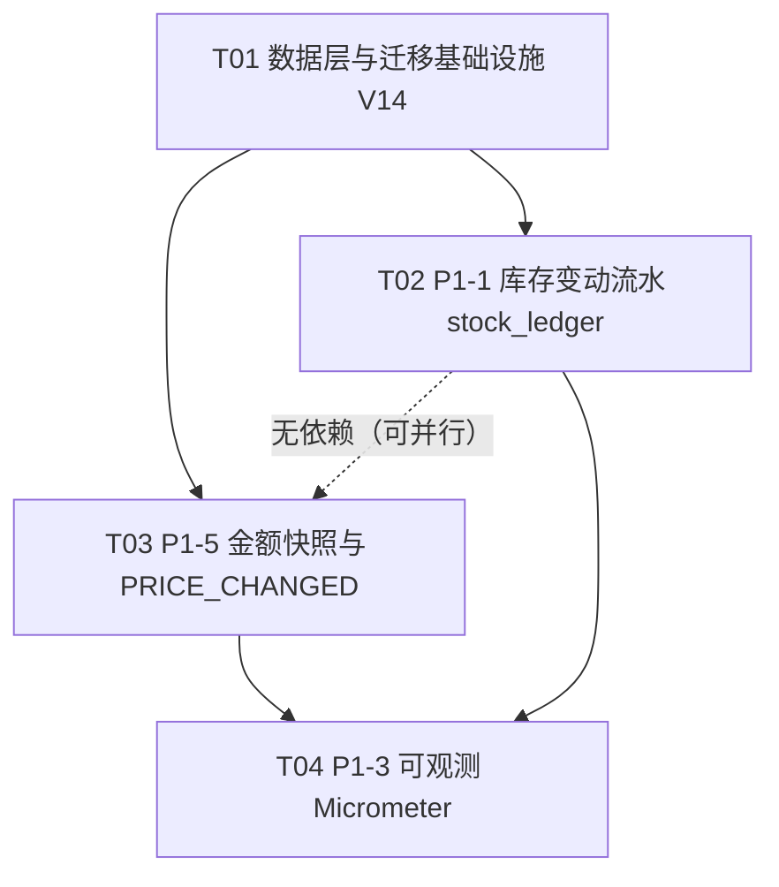

# P1 优化计划：库存流水 / 价格变动提示 / 可观测

> 承接 `docs/优化计划.md` §B10 的 P1 六条。**P1-6（服务端清袋）已实施完成**，**P2-1（服务端搜索下推）已实测推翻、不再立项**，故本计划只覆盖 **P1-1 / P1-3 / P1-5** 三条。
>
> **P1-2（Q3 退款）与 P1-4（Q5 外发合规）属待拍板项，本计划不替用户决定，单列在 §7。**

---

## 0. 已吸收的三条纠正（写在前头，避免重犯）

| # | 纠正 | 对本计划的影响 |
| - | ---- | -------------- |
| 1 | **改 `product.stock` 的入口是三个，不是两个**：`deduct`→`ProductService.reserve`、`restore`→`release`、`setStock`→`updateStock`（店员补货，L63-74） | P1-1 的流水写入点必须覆盖**三个**；只写前两个会让「最需要对账的补货」不入账 |
| 2 | **`micrometer-core` 已在 classpath**（`spring-boot-starter-actuator` 传递依赖，实测 `micrometer-core:1.15.12`） | P1-3 **不新增任何 Maven 依赖**，`MeterRegistry` 直接注入 |
| 3 | **P2-1 不成立**（300 件全表扫描 4~45ms；`AgentLoop` L475 已有 `maxToolResultChars=4000` 截断且 `AgentLoopTest` L223-247 有测试守着） | 不再立项，**不重复造轮子** |
| 4 | **P1-6 已完成**（`OrderPlacedEvent` 事务内同步发布 + `CartClearingOnOrderPlaced` 清袋；`CartCheckout` 端口已删） | 本计划不含清袋；新增代码不得再引入 `CartCheckout` |
| 5 | **P0 反向验证踩过的坑**：串行重复确认被 `resolve()` 的**预检**拦住，根本走不到原子迁移 | 本计划每条反向验证都**标注它实际覆盖的是哪一层**（预检层 / 事务层 / 数据库约束层 / 配置层 / 注册表层） |

---

## 1. 任务拆解（4 个，按依赖排序）



| 任务 | 内容 | 依赖 | 说明 |
| ---- | ---- | ---- | ---- |
| **T01** | V14 迁移：`stock_ledger` + `price_quote` + `assistant_pending_action.quote_id` | 无 | 必须先落，T02/T03 都建在它上面 |
| **T02** | **P1-1** 库存变动流水：三个写入口入账 + 对账断言 | T01 | 独立，可与 T03 并行开发 |
| **T03** | **P1-5** 金额快照：`QuoteSnapshot` 端口 + 两条路径共用 + 409 `PRICE_CHANGED` | T01 | 助手路径与页面路径**同一套机制** |
| **T04** | **P1-3** 可观测：四项 Micrometer 指标 + 暴露 `metrics` 端点 | T02/T03（弱：仅为跑全量回归） | 不新增依赖 |

> 依赖尽量浅：T02 与 T03 互不相干；T04 只消费它们新埋的调用点。

---

## 2. 文件清单（新增 / 修改 / 删除）

### T01　数据层与迁移基础设施（V14）

| 文件 | 动作 | 说明 |
| ---- | ---- | ---- |
| `src/main/resources/db/migration/V14__stock_ledger_and_price_quote.sql` | **新增** | 见 §4 完整 SQL |
| `src/test/java/dev/learning/mall/V14MigrationTest.java` | **新增** | 命名约束存在 / 建账回填可重复执行 / 快照表约束生效 |
| `docs/接口与数据结构.md` | 修改 | 登记两张新表 + `quote_id` 列 |

### T02　P1-1 库存变动流水

| 文件 | 动作 | 说明 |
| ---- | ---- | ---- |
| `src/main/java/dev/learning/mall/catalog/api/StockReason.java` | **新增** | `enum StockReason { RESERVE, RELEASE, RESTOCK }` |
| `src/main/java/dev/learning/mall/catalog/internal/StockLedgerRepository.java` | **新增** | 只做 `append` 一件事（对账查询由测试直接用 `JdbcClient`） |
| `src/main/java/dev/learning/mall/catalog/api/ProductCatalog.java` | 修改 | `reserve`/`release`/`updateStock` 增加 `actor`（`updateStock`）与 `actor + orderId`（前两者） |
| `src/main/java/dev/learning/mall/catalog/internal/ProductService.java` | 修改 | 三个方法内写流水（**唯一写入层**）；`updateStock` 补 `actor` |
| `src/main/java/dev/learning/mall/catalog/internal/ProductRepository.java` | 修改 | 新增 `stockForUpdate(id)`（`SELECT stock … FOR UPDATE`） |
| `src/main/java/dev/learning/mall/catalog/web/ProductController.java` | 修改 | `updateStock` 增加 `Principal`，用 `principal.getName()` 作 `actor` |
| `src/main/java/dev/learning/mall/order/internal/OrderTransactions.java` | 修改 | 两处调用点（L65 `reserve`、L139 `release`）补 `user` / `row.username()` 与订单号 |
| `src/test/java/dev/learning/mall/StockLedgerTest.java` | **新增** | 5 条，含**「补货不入账」哨兵** |

### T03　P1-5 金额快照与 `PRICE_CHANGED`

| 文件 | 动作 | 说明 |
| ---- | ---- | ---- |
| `src/main/java/dev/learning/mall/order/api/QuoteSnapshot.java` | **新增** | 端口：`capture` / `find` |
| `src/main/java/dev/learning/mall/order/internal/QuoteSnapshotService.java` | **新增** | 存 `price_quote`，取价走 `OrderPricing` |
| `src/main/java/dev/learning/mall/order/internal/OrderPricing.java` | **新增** | **包可见**，`lines → Pricer.Quote` 的唯一映射（落单与快照共用） |
| `src/main/java/dev/learning/mall/order/api/CreateOrderRequest.java` | 修改 | 增加 `quoteId`（**保留单参构造**，既有调用点零改动） |
| `src/main/java/dev/learning/mall/order/internal/OrderFacade.java` | 修改 | 取快照 → 传 `expectedPayable` |
| `src/main/java/dev/learning/mall/order/internal/OrderTransactions.java` | 修改 | `create` 增 `expectedPayable`；比价在 insert/reserve **之前** |
| `src/main/java/dev/learning/mall/order/web/QuoteController.java` | **新增** | `POST /api/quotes`（页面路径拍快照） |
| `src/main/java/dev/learning/mall/assistant/action/PendingActionService.java` | 修改 | `requestOrderCreate` 去掉 `amount` 参数（改为由快照产出），落 `quote_id` |
| `src/main/java/dev/learning/mall/assistant/internal/OrderTools.java` | 修改 | 适配新签名 |
| `src/main/resources/static/js/app.js` | 修改 | `loadCart()` 后拍快照，`checkout()` 带 `quoteId` |
| `src/test/java/dev/learning/mall/PriceChangeGuardTest.java` | **新增** | 5 条，含**「页面路径也有守卫」哨兵** |
| `src/test/java/dev/learning/mall/AgentOrderCheckoutTest.java` | 修改 | L332 适配 `requestOrderCreate` 新签名 |

> **不改动** `src/main/resources/static/js/assistant.js`：其 `resolveHitl` 的 catch 已经把失败卡片标成「已失效」并 `toast(e.message)`（L365-369），`PRICE_CHANGED` 的文案自带当前应付金额，无需新增分支。

### T04　P1-3 可观测

| 文件 | 动作 | 说明 |
| ---- | ---- | ---- |
| `src/main/resources/application.yml` | 修改 | `exposure.include: health,info,metrics` |
| `src/main/java/dev/learning/mall/common/TimingAspect.java` | 修改 | 注入 `MeterRegistry`，`@Observed` 额外记 Timer |
| `src/main/java/dev/learning/mall/assistant/harness/AgentLoop.java` | 修改 | 注入 `MeterRegistry`；停止原因 / 工具成功率 / 轮次耗时 / 首字延迟四个埋点 |
| `src/main/java/dev/learning/mall/order/internal/OrderExpiryService.java` | 修改 | 积压量 Gauge |
| `src/test/java/dev/learning/mall/ObservabilityMetricsTest.java` | **新增** | 5 条 |

**删除的文件：无。**

---

## 3. 既有机制核查（每个任务开工前先读这一行）

> 本项目已三次因跳过这步而立项错误（P0 的 `request_hash` 死列、B10 的 Micrometer 依赖假设、P2-1 的「慢查询」）。开工前逐条对照。

| 任务 | 现在有没有代码在管？ | 缺口到底是哪一段？ |
| ---- | -------------------- | ------------------ |
| **T02 / P1-1** | **有**：`ProductService.reserve/release/updateStock` 三个方法已经在改 `product.stock`；`ProductChangedEvent(STOCK)` 已经在广播「库存变了」（主动服务据此发补货提醒）；`OrderTransactions.close` 已经在归还库存 | **缺的是「留痕」**：没有任何地方记「谁、什么时候、因为什么、从多少变到多少」。`product.stock` 与归因都无从对账；**店员补货（`updateStock`）连「变了」之外的信息都没有** |
| **T03 / P1-5** | **有**：`assistant_pending_action.amount` 存了卡片金额；V13 的 `lines_json` 存行；`Pricer` 已是唯一算法；`OrderFacade` 的 `request_hash` 已防「同键不同行」；`optimistic` 的 `A5-#8` 已明示「P0 不处理价格变动」 | **缺的是「比对」**：金额只在**助手**的待确认动作上有，**页面路径根本没有这一步**；确认时一律按当时价重算，与用户看到的那个数没有任何比对 |
| **T04 / P1-3** | **有**：`@Observed` + `TimingAspect` 给 4 个操作记耗时到日志；`assistant_run_trace.stop_reason` 落库、`RunTraceRepository.countByStopReason` 可查；`OrderExpiryService.closeExpired()` 已返回 `backlog` | **缺的是「可聚合、可查询」**：全是散落的日志与返回值。首字延迟、工具成功率**完全没有埋点**；停止原因只有 SQL count，没有时序；积压量算出来就丢 |

---

## 4. V14 迁移完整 SQL（H2 2.3.232 已实测）

**实测方式（未触碰 `data/mall.mv.db`）**：把 V1~V13 拼成 `base.sql`，用 `org.h2.tools.RunScript` 在 `target/p1-verify/db` 建库，再跑 V14 与探针脚本。结果见 §4.3。

### 4.1 脚本正文

```sql
-- V14：库存变动流水（P1-1）+ 下单金额快照（P1-5）。
--
-- 注意：Q3 退款状态机（P1-2）与 Q5 外发合规（P1-4）尚未拍板，本脚本不涉及；拍板后走 V15，
-- 不要回头改已经执行过的 V14。

-- ===================================================================
-- 一、stock_ledger：每一笔库存变动都要留痕
-- ===================================================================
-- 为什么需要它：product.stock 只有「现在是多少」，没有「为什么变成这样」。
-- 库存告警因此无法归因（「货到了」说不清是关单退回的还是店员补的），
-- 对账也无从下手——流水与现货对不上时，没有任何一处会报错。
--
-- 写入口收在 ProductService 的三个方法里（reserve / release / updateStock），
-- 因为全项目只有这三个地方改 product.stock。写在调用方（订单模块）会漏掉店员补货。

CREATE TABLE stock_ledger (
  id BIGINT GENERATED BY DEFAULT AS IDENTITY PRIMARY KEY,
  product_id BIGINT NOT NULL REFERENCES product(id),
  delta INT NOT NULL,
  stock_before INT NOT NULL,
  stock_after INT NOT NULL,
  reason VARCHAR(20) NOT NULL,
  actor VARCHAR(100) NOT NULL,
  -- 刻意不加 REFERENCES mall_order(id)：流水是审计留痕，不该随订单的生命周期被级联删掉；
  -- 且订单表在测试与排障中会被清空，加了外键会让「删订单」变成「删证据」。
  order_id VARCHAR(36),
  created_at TIMESTAMP NOT NULL DEFAULT CURRENT_TIMESTAMP
);
CREATE INDEX idx_ledger_product ON stock_ledger(product_id, id);
CREATE INDEX idx_ledger_order ON stock_ledger(order_id);

-- 显式命名约束：H2 给内联 CHECK 起的是 CONSTRAINT_x 这类自动名，
-- 写进后续迁移脚本跨环境会失配（V10 的教训，V12/V13 已沿用此做法）。
ALTER TABLE stock_ledger ADD CONSTRAINT ck_ledger_reason
  CHECK (reason IN ('RESERVE','RELEASE','RESTOCK'));
-- delta = 0 的行没有信息量，也不该存在（无变化就不写流水）。
ALTER TABLE stock_ledger ADD CONSTRAINT ck_ledger_delta_nonzero CHECK (delta <> 0);
ALTER TABLE stock_ledger ADD CONSTRAINT ck_ledger_stock_nonneg
  CHECK (stock_before >= 0 AND stock_after >= 0);
-- 这条是整张表的地基：流水的「前 + 变化 = 后」由数据库保证，不靠调用方算对。
ALTER TABLE stock_ledger ADD CONSTRAINT ck_ledger_arithmetic
  CHECK (stock_after = stock_before + delta);

-- 期初建账：历史库存无从追溯，按「这批货从无到有」记一条基线，
-- 于是「某商品的现货 = 它所有流水 delta 之和」这条对账恒等式从迁移完成那一刻起就成立。
-- 条件用 NOT EXISTS 而不是无条件：V14 会被重复执行（测试库重建 / 多环境回放），
-- 无条件 INSERT 会重复建账，反而把对账恒等式打破。
INSERT INTO stock_ledger(product_id, delta, stock_before, stock_after, reason, actor)
SELECT p.id, p.stock, 0, p.stock, 'RESTOCK', 'flyway-v14'
  FROM product p
 WHERE p.stock > 0
   AND NOT EXISTS (SELECT 1 FROM stock_ledger l WHERE l.product_id = p.id);

-- ===================================================================
-- 二、price_quote：下单前用户看到的那个金额
-- ===================================================================
-- 为什么需要它：助手路径的 lines_json 只存商品与数量、不含价格（V13 的既定设计），
-- 所以「用户确认时看到的金额」在服务端没有任何记录。
-- 商品在「发起确认」与「确认下单」之间被改价，用户就会按下单时的新价付款，
-- 而卡片上写的还是旧价——这正是 P1-5 要拦的 PRICE_CHANGED。
--
-- 页面路径与助手路径共用这一张表：快照只有一处产地，价格校验也只有一份实现。
CREATE TABLE price_quote (
  id VARCHAR(36) PRIMARY KEY,
  username VARCHAR(100) NOT NULL,
  lines_json VARCHAR(2000) NOT NULL,
  subtotal DECIMAL(12,2) NOT NULL,
  discount DECIMAL(12,2) NOT NULL,
  shipping_fee DECIMAL(12,2) NOT NULL,
  pay_amount DECIMAL(12,2) NOT NULL,
  created_at TIMESTAMP NOT NULL DEFAULT CURRENT_TIMESTAMP,
  expires_at TIMESTAMP NOT NULL
);
CREATE INDEX idx_quote_user ON price_quote(username, created_at);
ALTER TABLE price_quote ADD CONSTRAINT ck_quote_payable
  CHECK (pay_amount = subtotal - discount + shipping_fee);

-- 助手路径把快照挂到待确认动作上：确认时原样取出，与 lines_json 同源、同生命周期。
ALTER TABLE assistant_pending_action ADD COLUMN quote_id VARCHAR(36);
```

### 4.2 H2 2.3.232 注意点（逐条，都是踩过的）

1. **命名 CHECK**：内联 `CHECK` 会得到 `CONSTRAINT_x` 自动名，跨环境失配 → 一律 `ALTER TABLE … ADD CONSTRAINT ck_xxx`（V12/V13 已如此）。实测错误信息为 `Check constraint violation: "CK_LEDGER_ARITHMETIC: "`，名字可见、可断言。
2. **存量回填可重复执行**：建账 INSERT 用 `NOT EXISTS` 守卫；实测第二次执行影响 **0 行**。
3. **`order_id` 不加外键**：订单表在测试的 `@AfterEach` 里被 `DELETE`（10+ 个测试类），加外键会逼着所有测试类改清理顺序，且审计留痕本就不该被级联删除。
4. **`product_id` 加外键**：`product` 只被 seed、从不被删，安全，且能挡住孤儿流水。
5. **不回填历史明细**：历史无从追溯，只建期初基线（`stock_before = 0`）。因此「现货 = Σdelta」只对**迁移完成之后**成立，文档与测试都按这个口径写。
6. **`delta` / `reason` / `actor` 均非 H2 保留字**，无需引号（已实测）。
7. **新列一律可空或不带破坏性默认**：`quote_id` 可空（既有待确认动作无快照 = 不校验，向后兼容，既有测试不会因此变红）。

### 4.3 实测记录（临时库 `target/p1-verify/db`，非 `data/mall.mv.db`）

| 探针 | 结果 |
| ---- | ---- |
| 建账 INSERT 执行两次 | 第二次 `(Update count: 0)` ✅ 幂等 |
| `product.stock ≠ Σdelta` 的商品数（建账后） | `0` ✅ |
| 相邻流水首尾相接（`LEAD` 窗口函数）断裂数 | `0` ✅ |
| 模拟 RESERVE 后 `stock` vs `Σdelta` | `27 / 27` ✅ |
| **模拟「改 stock 不写流水」后** 同一条 SQL | `1` ✅ **哨兵有效** |
| 插入 `before=30, delta=-1, after=30` | 拒绝，`CK_LEDGER_ARITHMETIC` ✅ |
| 插入 `delta=0` | 拒绝，`CK_LEDGER_DELTA_NONZERO` ✅ |
| 插入 `reason='OOPS'` | 拒绝，`CK_LEDGER_REASON` ✅ |
| 插入 `pay_amount ≠ subtotal-discount+shipping` 的快照 | 拒绝，`CK_QUOTE_PAYABLE` ✅ |

---

## 5. 关键接口（照抄级签名）

### 5.1 T02　库存流水

```java
// catalog/api/StockReason.java（新）
public enum StockReason { RESERVE, RELEASE, RESTOCK }

// catalog/api/ProductCatalog.java（改）
void reserve(long productId, int quantity, String actor, String orderId);
void release(long productId, int quantity, String actor, String orderId);
ProductView updateStock(long productId, int stock, String actor);   // orderId 为 null

// catalog/internal/StockLedgerRepository.java（新，包可见）
@Repository
class StockLedgerRepository {
    StockLedgerRepository(JdbcClient jdbc) { … }
    void append(long productId, int delta, int stockBefore, int stockAfter,
                StockReason reason, String actor, String orderId);
}

// catalog/internal/ProductRepository.java（增）
/** 取当前库存并加行锁：保证「读到的前值」与接下来的写入之间无人插队。 */
int stockForUpdate(long id);   // SELECT stock FROM product WHERE id = :id FOR UPDATE
```

写入纪律（**写在 `ProductService` 的三个方法里，不写在调用方**）：

```java
@Transactional(propagation = Propagation.MANDATORY)
public void reserve(long id, int quantity, String actor, String orderId) {
    if (quantity <= 0) throw new IllegalArgumentException("quantity must be positive");
    int before = repository.stockForUpdate(id);
    if (repository.deduct(id, quantity) != 1)
        throw BusinessException.conflict("OUT_OF_STOCK", "库存不足，请减少数量或换一件商品");
    ledger.append(id, -quantity, before, before - quantity, StockReason.RESERVE, actor, orderId);
}

@Transactional(propagation = Propagation.MANDATORY)
public void release(long id, int quantity, String actor, String orderId) {
    if (quantity <= 0) throw new IllegalArgumentException("quantity must be positive");
    int before = repository.stockForUpdate(id);
    repository.restore(id, quantity);
    ledger.append(id, quantity, before, before + quantity, StockReason.RELEASE, actor, orderId);
}

@Transactional
public ProductView updateStock(long productId, int stock, String actor) {
    // …原有校验…
    int before = repository.stockForUpdate(productId);
    repository.setStock(productId, stock);
    if (before != stock)   // 无变化就不写流水（ck_ledger_delta_nonzero 会拒绝 delta = 0）
        ledger.append(productId, stock - before, before, stock, StockReason.RESTOCK, actor, null);
    // …原有 ProductChangedEvent 广播…
}
```

> **为什么用 `stockForUpdate` 而不是「写后再读一次」**：读与写之间若被别的事务插队，`stock_before` 就是脏的，`ck_ledger_arithmetic` 会把整笔事务打回——那是一次**响亮的误报**。`FOR UPDATE` 让读与写在同一个行锁下完成，`before` 必然准确。三个方法原本就要写这一行，多一次加锁没有额外代价。

调用点改动：
```java
// OrderTransactions.create（L65）
catalog.reserve(item.productId(), item.quantity(), user, id);
// OrderTransactions.close（L139）
catalog.release(item.productId(), item.quantity(), row.username(), row.id());
// ProductController（L38）
public ProductView updateStock(@PathVariable long id, Principal principal,
                               @Valid @RequestBody StockRequest request)
```

### 5.2 T03　金额快照

```java
// order/api/QuoteSnapshot.java（新）
public interface QuoteSnapshot {
    /** 为这批行拍一张金额快照。价格一律由服务端当场查商品表算出，不接受调用方传价。 */
    Snapshot capture(String username, List<CreateOrderRequest.Line> lines);

    /** 取出本人未过期的快照；他人的、过期的、不存在的都返回空——「没有快照」不阻断下单。 */
    Optional<Snapshot> find(String id, String username);

    record Snapshot(String id, List<CreateOrderRequest.Line> lines, Pricer.Quote quote) {}
}

// order/internal/OrderPricing.java（新，包可见）
/** lines → Pricer.Quote 的唯一映射。落单与拍快照共用它，
 *  于是「快照里的价」和「落单时的价」在结构上同源，不可能算出两个算法。 */
static Pricer.Quote quoteOf(ProductCatalog catalog, Pricer pricer,
                            List<CreateOrderRequest.Line> lines)

// order/api/CreateOrderRequest.java（改）
public record CreateOrderRequest(
        @NotEmpty(message = "购物车不能为空") @Size(max = 20) List<@NotNull @Valid Line> items,
        @Size(max = 36) String quoteId) {
    public CreateOrderRequest(List<Line> items) { this(items, null); }   // 既有调用点零改动
    public record Line(@Positive long productId,
                       @Min(1) @Max(99) int quantity) {}
}

// order/internal/OrderTransactions.java（改）
@Transactional
@Observed("create-order-transaction")
public OrderView create(String user, String key, String hash,
                        List<CreateOrderRequest.Line> lines, BigDecimal expectedPayable) {
    Pricer.Quote quote = OrderPricing.quoteOf(catalog, pricer, lines);
    // 比价必须在 insert 与 reserve 之前：拦在这里，订单没建、库存没占。
    if (expectedPayable != null && quote.payable().compareTo(expectedPayable) != 0)
        throw BusinessException.conflict("PRICE_CHANGED",
                "商品价格已变动：发起时 ¥" + expectedPayable + "，当前应付 ¥" + quote.payable() + "，请确认后重新提交");
    …
}

// order/internal/OrderFacade.java（改）
BigDecimal expected = quotes.find(request.quoteId(), user).map(s -> s.quote().payable()).orElse(null);
return transactions.create(user, key, hash, lines, expected);

// order/web/QuoteController.java（新）
@RestController @RequestMapping("/api/quotes")
@PostMapping
public QuoteResponse capture(Principal principal, @Valid @RequestBody QuoteRequest request)
public record QuoteRequest(@NotEmpty List<@Valid CreateOrderRequest.Line> items) {}
public record QuoteResponse(String id, BigDecimal subtotal, BigDecimal discount,
                            BigDecimal shippingFee, BigDecimal payAmount, LocalDateTime expiresAt) {}

// assistant/action/PendingActionService.java（改）
public PendingActionView requestOrderCreate(String username, List<CreateOrderRequest.Line> lines) {
    // amount 不再由调用方传：卡片上的数与快照里的数必须是同一个。
    QuoteSnapshot.Snapshot snapshot = quotes.capture(username, lines);
    … INSERT … quote_id = snapshot.id(), amount = snapshot.quote().payable() …
}
// execute 的 ORDER_CREATE 分支
checkout.create(username, row.idempotencyKey(),
        new CreateOrderRequest(readLines(row.linesJson()), row.quoteId()));
```

**页面路径（`app.js`）的唯一改动**：快照必须在**用户看到金额那一刻**拍，不是提交那一刻。

```js
// loadCart() 成功后：拿当前袋子的行去拍一张快照（服务端算价，前端不算钱）
const quote = await api("/api/quotes", { method: "POST", body: JSON.stringify({ items: cartEntries() }) });
currentQuoteId = quote.id;

// checkout()：把 quoteId 一起提交
const body = { items: entries…, quoteId: currentQuoteId };
```

快照失效（缺失 / 他人 / 过期）时**跳过校验**而不是拒绝下单：快照是给用户的保护，不是权限边界；拿不到就拒绝会让前端一次抖动演变成「买不了」。
> 注：`replay()` 用的是 `localStorage` 里存的历史 body，没有 `quoteId` → 跳过校验，行为与今天一致。

### 5.3 T04　可观测（四项指标）

```java
// common/TimingAspect.java（改）
TimingAspect(MeterRegistry registry)
Timer.builder("mall.operation.duration").tag("operation", observed.value()).register(registry)

// assistant/harness/AgentLoop.java（改，构造参数追加在最后）
AgentLoop(ToolRegistry toolRegistry, ObjectMapper json, AssistantAudit audit,
          AssistantProperties properties, OutputGuard outputGuard,
          Optional<StreamingChatModel> streamingModel, MeterRegistry registry)
```

| 指标 | 类型 | 标签 | 埋点位置 |
| ---- | ---- | ---- | -------- |
| `mall.assistant.stop` | Counter | `reason=DONE/TIMEOUT/MAX_STEPS/STALLED` | `AgentLoop.run` L272-280 |
| `mall.assistant.tool.calls` | Counter | `tool=<名>`、`status=OK/ERROR/TIMEOUT/DUPLICATE` | `AgentLoop.invoke` L473 |
| `mall.assistant.first.token.latency` | Timer（`.publishPercentiles(0.95)`） | — | `TokenStreamer.onPartialResponse`（L362）首次触发 |
| `mall.order.expiry.backlog` | Gauge | — | `OrderExpiryService.closeExpired()` 末尾写入 `AtomicLong` |
| `mall.assistant.turn.duration` | Timer | `stop=<原因>` | `AgentLoop.run` 结尾 |

`application.yml`：
```yaml
management:
  endpoints:
    web:
      exposure:
        include: health,info,metrics
```

> **不接 Prometheus**：`micrometer-registry-prometheus` 不在依赖里，加它就是新增 Maven 依赖（违反约束）。`/actuator/metrics` 端点由 actuator 自带的 `SimpleMeterRegistry` 支撑，够用。
> **安全**：`/actuator/**` 落在 `SecurityConfig` 的 `anyRequest().authenticated()`（L43），`/actuator/metrics` 需登录——运营数据不外露。测试里用 `@AutoConfigureMockMvc` + 登录用户。

---

## 6. 反向验证（逐条：注回什么 bug、哪个测试必须变红、覆盖哪一层）

> P0 的教训：第 4 条反向验证没变红，因为它测的是**预检层**，而被注回的 bug 在**事务层**。以下每条都标注层。

### T02　库存流水

| # | 注回的 bug | 必须变红的测试 | **这条断言实际覆盖的层** |
| - | ---------- | -------------- | ------------------------ |
| 1 | 删掉 `ProductService.updateStock` 里的 `ledger.append`（**补货不入账**——P0 计划就漏过这条） | `StockLedgerTest#restockIsRecordedAndReconciles` | **应用层对账**：Java 断言 `stock == baseline + Σ(delta where id > baselineId)`。它**不**覆盖事务层（写一半回滚它看不见） |
| 2 | 把流水的 `stock_after` 写成 `before`（忘记加 delta） | `StockLedgerTest#ledgerArithmeticIsEnforcedByDatabase` | **数据库约束层**：`CK_LEDGER_ARITHMETIC` 抛 `DataIntegrityViolationException`，事务直接回滚 |
| 3 | 把 `append` 从 `ProductService` 挪到 `OrderTransactions`（写在调用方） | 同 #1（`restockIsRecordedAndReconciles`）——店员补货路径立刻无流水 | **应用层对账**（同上）。这条证明「入口收在一处」不是风格问题 |
| 4 | `stockForUpdate` 改成普通 `stockOf`（去掉 `FOR UPDATE`） | `StockLedgerTest#concurrentReservesKeepBeforeValueExact`（可选，见风险 §8） | **事务层 / 行锁**：并发下 `stock_before` 变脏 → `CK_LEDGER_ARITHMETIC` 拒绝 → 事务回滚 |
| 5 | `release` 时传错 `orderId`（传 `null`） | `StockLedgerTest#releaseCarriesTheOrderId`（断言 `order_id` 非空且等于关单那笔） | **应用层数据断言**：只验字段赋值，**不**验事务顺序 |

哨兵自证（**证明断言不是空断言**）：`StockLedgerTest#reconciliationQueryDetectsUnloggedChange`——直接 `UPDATE product SET stock = …` 不写流水，断言对账 SQL 返回 `1`。若这条不红，说明对账 SQL 本身写错了。

### T03　价格快照

| # | 注回的 bug | 必须变红的测试 | **这条断言实际覆盖的层** |
| - | ---------- | -------------- | ------------------------ |
| 1 | 删掉 `OrderTransactions.create` 里的 `expectedPayable` 比对 | `PriceChangeGuardTest#confirmAfterPriceChangeIsRejected` | **预检层**：在 `insert`/`reserve` **之前**抛 409；断言「订单零新增 + 库存未变」。**不**覆盖事务层（它根本没进事务里的写） |
| 2 | 把比价挪到 `orders.insert` 之后 | `PriceChangeGuardTest#rejectedBeforeAnyWrite`（断言 `mall_order` 零行、`stock` 未变、`stock_ledger` 无 RESERVE） | **预检层 vs 事务层**的分界：这条专测「比价发生在写之前」 |
| 3 | `QuoteSnapshot.find` 去掉 `AND username = :user` | `PriceChangeGuardTest#foreignQuoteIsNotApplied`（用他人的 quoteId 下单，价格已变 → 仍成功） | **归属校验层**（查询条件），不是权限拦截 |
| 4 | 只给助手路径接快照（页面路径 `quoteId` 恒为 null） | `PriceChangeGuardTest#pagePathIsGuardedToo`（走 `POST /api/quotes` + `POST /api/orders` 全链路，**不经浏览器**） | **预检层**。这条是「两条路径长出第二份实现」的分叉哨兵 |
| 5 | `QuoteSnapshotService` 自己 `catalog.get` 取价（不走 `OrderPricing`） | `PriceChangeGuardTest#snapshotAndOrderUseTheSamePricing`（快照金额 == 同组行的购物袋金额，差值为 0） | **应用层一致性**：守护「只有一份取价实现」 |

**注**：#1 的反向验证必须是**改价后**确认才有意义——测试流程是「拍快照 → 店员改价 → 确认/提交」。

### T04　可观测

| # | 注回的 bug | 必须变红的测试 | **这条断言实际覆盖的层** |
| - | ---------- | -------------- | ------------------------ |
| 1 | 移除 `mall.assistant.stop` 计数 | `ObservabilityMetricsTest#stopReasonIsCounted` | **注册表层**（`MeterRegistry` 内存），**不**是 DB、不是日志 |
| 2 | 工具失败时仍记 `status=OK` | `ObservabilityMetricsTest#toolFailureIsCounted` | **注册表层** |
| 3 | 首字 Timer 记在整轮结束时 | `ObservabilityMetricsTest#firstTokenLatencyIsSmallerThanWholeTurn` | **注册表层**（断言 `firstToken ≤ turn` 且 `count == 1`） |
| 4 | `application.yml` 去掉 `metrics` | `ObservabilityMetricsTest#metricsEndpointExposesMallMeters`（MockMvc `GET /actuator/metrics/mall.assistant.stop` → 200）+ 未登录 → 401 | **配置层 + 安全配置层** |
| 5 | 积压 Gauge 不更新（写死 0） | `ObservabilityMetricsTest#backlogGaugeTracksLastScan` | **应用层**（持有值），**不**覆盖调度时序 |

---

## 7. 待拍板项（**不替用户决定**）

| 项 | 内容 | 需要用户拍板的**具体问题** | 我的倾向（供参考，非决定） |
| - | ---- | -------------------------- | -------------------------- |
| **P1-2**（PM **Q3**） | 支付后状态机延伸：`PAID → REFUNDING → REFUNDED` + 申请入口，**不接真实资金** | ① 演示「付完能反悔」是不是这个项目的必要场景？<br>② 退款要不要店员审批（HITL）？<br>③ 退款后库存回不回？ | 若要做，走 V15（`mall_order.status` 扩值 + `refund` 表），**复用 HITL 的 `kind=ORDER_REFUND` 而不是新建闸门** |
| **P1-4**（PM **Q5**） | `NotificationChannel` 抽象 + 已读/已送达/退订状态位（**先定接口，不接服务商**） | ① 是否会真的外发邮件/短信？<br>② 若外发，退订与频率的合规口径谁定？<br>③ 「站内信」算不算可靠投递（PM 已排除）？ | 在拍板前**不写任何代码**：接口先画在文档里即可，写了没人用就是死代码 |

> 这两项**都不进 V14**。若后续拍板通过，另起 V15，不动已执行的 V14。

**另有两项需要主理人知晓（不是阻塞项，属实施取舍）**：

1. **助手路径价格变动后的卡片**：`resolve()` 抛 `PRICE_CHANGED` → 事务回滚 → 待确认动作仍是 `PENDING`。前端 `resolveHitl` 的 catch 会把卡片标成「已失效」并 toast 新金额（既有逻辑，L365-369），用户需重新发起。**备选**（若认为应自动作废）：在 `execute` 外以独立事务把动作改 `EXPIRED`——需要 `REQUIRES_NEW`，代价是给 HITL 这条安全关键路径加一个事务分支，**我不建议**。
2. **`ProductCatalog.reserve/release` 签名变更**：三个方法各加 2 个参数。这是「流水必须知道是谁、因哪笔订单」的必然代价；替代方案（用上下文传递）会引入 ThreadLocal，本项目已明确拒绝。

---

## 8. 风险与注意事项

1. **签名变更的连带改动**：`ProductCatalog`（3 方法）、`ProductController.updateStock`、`PendingActionService.requestOrderCreate`、`OrderTransactions.create` 都是公开/跨模块签名。受影响调用点已全部列在 §2（测试侧仅 `AgentOrderCheckoutTest` L332 一处）。
2. **测试库污染**：`stock_ledger` / `price_quote` 不会被既有测试类的 `@AfterEach` 清理。**不要**去改 10+ 个测试类的 reset 列表——新测试的断言一律带**基线**（`MAX(id)` 快照 / 本人 + 本轮 scope），天然免疫。
3. **`UPDATE product SET stock = 50` 会打破全局对账**：既有测试都这么重置库存。因此**不写**「全表 `stock == Σdelta`」的全局断言，只在 V14MigrationTest 里断言「建账行存在且唯一 + 回填幂等」。
4. **首字延迟只在流式路径有值**：`TokenStreamer` 仅在 `progress.consumesTokens() && streamingModel.isPresent()` 时生效（L298）。非流式轮次不埋点，测试要按这个前提写。
5. **并发用例（T02 #4）风险最高**：需要 `TransactionTemplate` + 双线程，写不好会偶发红。建议**最后做**，做不稳就降级为「串行两条流水首尾相接」的断言（`LEAD` 窗口函数，已在临时库实测可用）。
6. **不要动 `data/mall.mv.db`**：所有迁移验证一律用临时库（本计划用 `target/p1-verify/db`）。

---

## 9. 验收方式

1. `mvn -o test` 全绿：**276 + 约 18 条新增**（T01 3 / T02 5 / T03 5 / T04 5）。
2. 启动应用（`mvn spring-boot:run`，`NO_PROXY='*'`），Flyway 从 V13 升到 V14 无报错；`GET /actuator/metrics/mall.assistant.stop`（登录后）返回 200。
3. 真机冒烟三条：
   - 店员改库存 → `stock_ledger` 多一条 `RESTOCK`，且 `product.stock` 与流水之和对得上；
   - 页面加购 → 店员改价 → 提交订单 → 409 提示「当前应付 ¥X」→ 重新渲染金额后再提交成功；
   - 助手说「帮我下单」→ 中间改价 → 点「确认下单」→ 卡片变「已失效」并提示新金额。
4. 每条反向验证按 §6 逐个注回、逐个变红、逐个还原。
