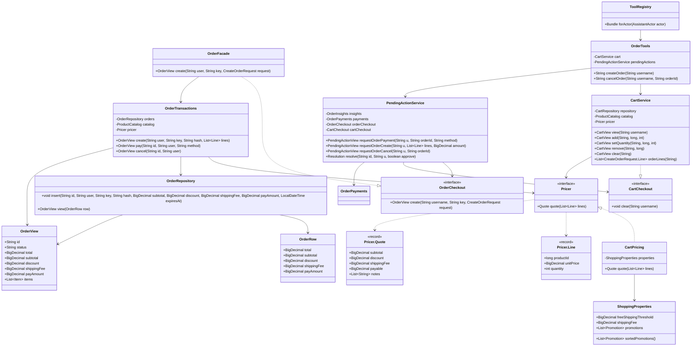
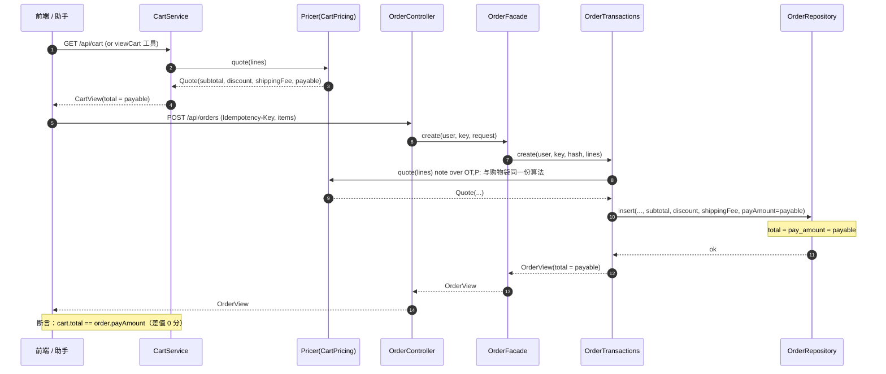
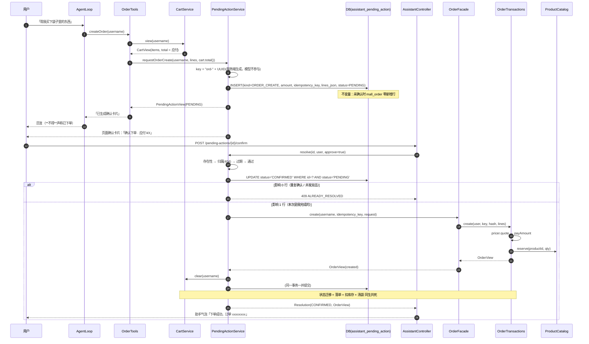
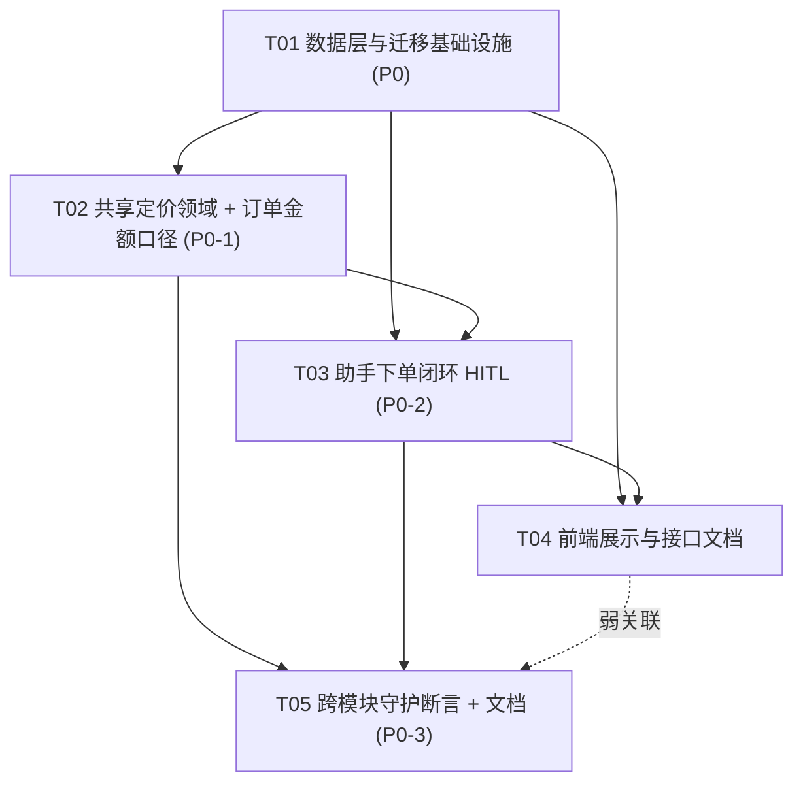

# 对标淘宝 · 技术差距评估与分阶段优化计划

> 角色：架构师（高见远 / Bob）｜日期：2026-10-16
> 上游：`docs/对标淘宝差距分析.md`（PM 许清楚，G1–G17 / P0-P2 / Q1–Q9）、`docs/会话上下文摘要.md`（项目级决策）
> 对象：`springboot-learning-mall`（128 类 / 257 测试全绿 / Flyway V1–V11 / H2 文件库）
> 定位：**本文件是下一步实施的依据**——精确到文件路径、接口签名、SQL 迁移语句与任务依赖。**不含实现代码**。

> ## ✅ 实施状态：P0 三条已全部完成（2026-10-16）
>
> | 任务 | 状态 | 结果 |
> | ---- | ---- | ---- |
> | T01 数据层与迁移（V12 / V13） | ✅ 完成 | Flyway v13；真实文件库首次应用无报错 |
> | T02 共享定价领域（P0-1） | ✅ 完成 | `pricing` 包成立，`OrderTransactions#create` 走 `Pricer` |
> | T03 助手下单闭环（P0-2） | ✅ 完成 | `createOrder` / `cancelOrder` + HITL 三类泛化 |
> | T04 前端展示与接口文档 | ✅ 完成 | 订单卡四行金额；确认卡片三态 |
> | T05 跨模块守护断言（P0-3） | ✅ 完成 | 新增 15 例，**四条反向验证全部通过**（第 4 条第一次失败后修正，见下） |
> | T06 反向验证 + 全量回归 + 冒烟 | ✅ 完成 | `mvn -o test` **272 全绿**；真机冒烟 18/18 |
>
> **与计划的偏差（三处，均已记录理由）**：
> 1. V13 去掉了计划里的 `request_hash` 列——`OrderFacade` 自己会算请求哈希并对不上就报错，该列没有消费者，是死列。
> 2. `CartCheckout#clear` 返回值由计划的 `void` 改为 `CartView`——`CartController` 与 `CartTools` 两处既有调用方要用返回值。
> 3. **第 4 条反向验证第一次没变红**。原用例只证明了「预检有效」，没证明「一次性原子迁移有效」；
>    已改名为 `secondConfirmIsRejectedByPrecheck`，另加并发用例 `concurrentConfirmProducesExactlyOneOrder`，
>    重做后第 0 轮就红（`expected: 1L but was: 2L`）。
>
> 完整记录见 [验证记录](验证记录.md) 附录 K。下一步：P1（六条）与 P2（九条），见文末路线图。

---

## 零、给实施者的一段话（先读）

1. **不另写第二份实现**：下单永远走 `OrderFacade.create`，金额永远走 `Pricer`（由既有 `CartPricing` 搬入 `pricing` 包，算法一字未改）。这是项目决策第 2 条「安全关键逻辑只有一份实现」。
2. **P0 只有三条**：P0-1 金额口径对齐、P0-2 助手下单闭环、P0-3 跨模块守护。P1 六条、P2 九条**不进任务列表**，见文末路线图。
3. **一处必须正视的既有测试改动**：`MallIntegrationTest#priceComesFromDatabaseAndSnapshotIsStored` 第 91 行断言的 `78.00` **正是 P0-1 要修掉的裸求和值**，改造后应为 `86.00`（小计 78 + 运费 8）。改的是**断言的字面值**，不是测试数量（仍 257 个用例、全绿）。理由与前后对照见附录 A。
4. **迁移已实测**：V12 / V13 的全部语句已在 **H2 2.3.232**（本项目运行版本）上跑通，包括 `ALTER COLUMN ... SET NULL` 与按 `kind` 分支的命名 CHECK。脚本见 §A2 / §A3。

---

# Part A：技术方案

## A1. 实现方案（P0 三条的技术路径）

### P0-1　下单金额与购物袋 / 助手报价对齐，并落库明细

**难点**：金额规则（满减 / 包邮 / 运费）住在 `cart.internal.CartPricing`，而订单包完全不认识它（`grep -rn cart src/main/java/.../order/` 零命中）。要在不复制第二份算法的前提下，让订单也走它。

**路径**：
1. **抽共享定价领域 `dev.learning.mall.pricing`**（不是把 `CartPricing` 塞进 `cart.api`）。新增 `pricing.api.Pricer` 接口与 `Quote` / `Line` 值对象；把既有 `CartPricing`（算法不变）、`ShoppingProperties` 搬进 `pricing.internal`。
2. **订单与购物车都依赖 `pricer`**：`OrderTransactions.create` 用 `pricer.quote(lines)` 算金额；`CartService` 改调 `Pricer` 再映射回 `CartView`（字段不变）。
3. **金额明细落库**：V12 为 `mall_order` 加 `subtotal / discount / shipping_fee / pay_amount` 四列，`total` 语义升级为「应付」并恒等于 `pay_amount`。

**取舍**：不采用「撤掉满减 / 运费只留小计」——`CartPricing` 是项目最好的设计之一，且助手已在对用户报这个价，撤掉等于自废武功（与 PM Q1 倾向一致）。

### P0-2　Agent 下单闭环（工具 + HITL + 幂等 + 清袋）

**难点**：助手写操作只到「加购」与「发起支付」，中间缺「提交订单」；而下单比加购更重（占用库存），必须进 HITL，但既有 HITL 表 `assistant_pending_action` 是**支付专用**（`order_id`/`payment_method` 均 `NOT NULL`）。

**路径**：
1. **新增 `OrderTools`**：`createOrder(username)` 生成一条 `kind = ORDER_CREATE` 的待确认动作（**零副作用**，不建订单），`cancelOrder(username, orderId)` 生成 `kind = ORDER_CANCEL`。
2. **泛化 HITL 表**（V13）：`order_id`/`payment_method` 改为可空，新增 `idempotency_key` / `request_hash` / `lines_json`，并用**命名 CHECK** 表达「每类 kind 各自的必填字段」。**不新建表**——HITL 的安全逻辑（归属校验 / 一次性原子迁移 / TTL / 审计）是安全关键代码，复制第二份就是分叉的开始（项目决策第 2 条）。
3. **确认执行**：`PendingActionService.execute` 按 kind 分支——`ORDER_PAYMENT` 走既有支付；`ORDER_CREATE` 走 `OrderFacade.create` + 清袋，**同一事务**。
4. **幂等**：服务端生成幂等键（模型不传 UUID），随待确认记录持久化；重复确认由「一次性迁移」+「订单唯一键」双重兜底。

### P0-3　为「架构承诺」建立跨模块守护

**难点**：项目有严格的反向验证方法论，但只用在单模块内部；`CartPricing` 的「三入口共用」承诺从未被任何跨模块断言守住（257 全绿却漏了 G1）。

**路径**：
1. 新增 `CheckoutAmountConsistencyTest`：对同一组行断言 `GET /api/cart` 的 `total` 与 `POST /api/orders` 的 `pay_amount` **差值恒为 0**，覆盖 3 组场景。
2. 增加不变量断言：`SELECT COUNT(*) FROM mall_order WHERE total <> pay_amount` 恒为 0。
3. 修正文档不符之处：`docs/导购闭环与记忆.md`、`CartPricing` / `ShoppingProperties` 类注释、`application.yml` 注释——**改造后承诺变为事实**，文档同步改为「现在真的三处共用」。

---

## A2. 文件清单

### 新增（new）

| 路径 | 说明 | 任务 |
| --- | --- | --- |
| `src/main/resources/db/migration/V12__order_amount_details.sql` | `mall_order` 金额明细列 + 存量回填 + 命名 CHECK | T01 |
| `src/main/resources/db/migration/V13__pending_action_generalize.sql` | `assistant_pending_action` 泛化（可空 + 载荷 + kind 断言） | T01 |
| `src/main/java/dev/learning/mall/pricing/api/Pricer.java` | 定价接口 + `Line` / `Quote` 值对象 | T02 |
| `src/main/java/dev/learning/mall/pricing/internal/CartPricing.java` | 既有实现，搬入本包（算法不变），`implements Pricer` | T02 |
| `src/main/java/dev/learning/mall/pricing/internal/ShoppingProperties.java` | 既有促销规则，搬入本包 | T02 |
| `src/main/java/dev/learning/mall/pricing/internal/PricingConfig.java` | `@EnableConfigurationProperties(ShoppingProperties.class)` | T02 |
| `src/main/java/dev/learning/mall/order/api/OrderCheckout.java` | 下单端口（供 assistant 依赖） | T02 |
| `src/main/java/dev/learning/mall/cart/api/CartCheckout.java` | 清袋端口（供 assistant 依赖） | T03 |
| `src/main/java/dev/learning/mall/assistant/internal/OrderTools.java` | `createOrder` / `cancelOrder` 工具 | T03 |
| `src/test/java/dev/learning/mall/CheckoutAmountConsistencyTest.java` | **P0-3 跨模块守护断言** | T05 |
| `src/test/java/dev/learning/mall/AgentOrderCheckoutTest.java` | P0-2 端到端（工具→确认→落单+扣库存+清袋） | T05 |

### 修改（modify）

| 路径 | 改动 | 任务 |
| --- | --- | --- |
| `src/main/java/dev/learning/mall/order/internal/OrderRow.java` | 增 `subtotal` / `discount` / `shippingFee` / `payAmount` 字段 | T01 |
| `src/main/java/dev/learning/mall/order/internal/OrderRepository.java` | `insert(...)` 新增四参数；`view()` 透传 | T01 |
| `src/main/java/dev/learning/mall/order/api/OrderView.java` | 暴露四项金额 | T01 |
| `src/main/java/dev/learning/mall/order/internal/OrderInsightsService.java` | 营收改用 `SUM(pay_amount)` | T01 |
| `src/main/java/dev/learning/mall/order/internal/OrderTransactions.java` | 注入 `Pricer`；`create` 走 `quote` | T02 |
| `src/main/java/dev/learning/mall/order/internal/OrderFacade.java` | `implements OrderCheckout` | T02 |
| `src/main/java/dev/learning/mall/cart/internal/CartService.java` | 依赖 `Pricer`；`implements CartCheckout` | T02 / T03 |
| `src/main/java/dev/learning/mall/cart/internal/CartConfig.java` | **删除**（注册职责移交 `PricingConfig`） | T02 |
| `src/main/java/dev/learning/mall/assistant/action/PendingActionService.java` | `requestOrderCreate` / `requestOrderCancel`；`execute` 按 kind 分支 | T03 |
| `src/main/java/dev/learning/mall/assistant/internal/ToolRegistry.java` | 注册 `orderTools` | T03 |
| `src/main/java/dev/learning/mall/assistant/web/TurnStreamSink.java` | 补 `createOrder` / `cancelOrder` 中文文案 | T03 |
| `src/main/java/dev/learning/mall/assistant/internal/AssistantService.java` | 系统提示「下单与支付」段改写；确认结果消息按 kind | T03 |
| `src/main/resources/static/js/assistant.js` | 确认卡片按 `kind` 区分；确认后文案 | T04 |
| `src/main/resources/static/js/app.js` | 订单卡片展示「小计 / 优惠 / 运费 / 应付」四行 | T04 |
| `docs/接口与数据结构.md` | 补 `mall_order` 四列、`assistant_pending_action` 三列 | T04 |
| `docs/导购闭环与记忆.md` | 把「三入口共用」修正为改造后的事实 | T05 |
| `src/test/java/dev/learning/mall/MallIntegrationTest.java` | 第 91 行断言 `78.00 → 86.00`（见附录 A） | T05 |

---

## A3. 数据结构与接口（Mermaid classDiagram）



### 关键接口签名（工程师照抄）

**`pricing.api.Pricer`**（新增）
```java
public interface Pricer {
    Quote quote(List<Line> lines);

    /** 一行「单价 × 数量」。定价只认这两个字段，不关心谁在调用。 */
    record Line(long productId, BigDecimal unitPrice, int quantity) {}

    /** 试算结果。payable = subtotal - discount + shippingFee，恒为两位小数（HALF_UP）。 */
    record Quote(BigDecimal subtotal, BigDecimal discount, BigDecimal shippingFee,
                 BigDecimal payable, List<String> notes) {}
}
```

**`order.api.OrderCheckout`**（新增）
```java
public interface OrderCheckout {
    /** 与页面 POST /api/orders 完全同一条实现（OrderFacade.create）。 */
    OrderView create(String username, String idempotencyKey, CreateOrderRequest request);
}
```

**`cart.api.CartCheckout`**（新增）
```java
public interface CartCheckout {
    /** 下单成功后清空该用户购物袋；同一事务内调用，与落单同生共死。 */
    void clear(String username);
}
```

**`OrderTransactions.create`**（修改后）
```java
@Transactional
@Observed("create-order-transaction")
public OrderView create(String user, String key, String hash, List<CreateOrderRequest.Line> lines) {
    List<OrderView.Item> items = /* 同现状：catalog.get → OrderView.Item */;
    Pricer.Quote quote = pricer.quote(items.stream()
            .map(i -> new Pricer.Line(i.productId(), i.unitPrice(), i.quantity())).toList());
    // ...
    orders.insert(id, user, key, hash,
            quote.subtotal(), quote.discount(), quote.shippingFee(), quote.payable(), expiresAt);
    // total 与 pay_amount 都写入 quote.payable()，见 §A2 与 §B8
    // ...
}
```

**`OrderRepository.insert`**（修改后）
```java
void insert(String id, String user, String key, String hash,
            BigDecimal subtotal, BigDecimal discount, BigDecimal shippingFee,
            BigDecimal payAmount, LocalDateTime expiresAt) {
    jdbc.sql("INSERT INTO mall_order(id,username,idempotency_key,request_hash,"
            + "total,subtotal,discount,shipping_fee,pay_amount,status,expires_at) "
            + "VALUES(:id,:user,:key,:hash,:pay,:subtotal,:discount,:shippingFee,:pay,'PENDING',:expiresAt)")
        .param("id", id).param("user", user).param("key", key).param("hash", hash)
        .param("pay", payAmount).param("subtotal", subtotal).param("discount", discount)
        .param("shippingFee", shippingFee).param("expiresAt", expiresAt).update();
}
```

**`PendingActionService`**（新增方法）
```java
public static final String KIND_ORDER_PAYMENT = "ORDER_PAYMENT";
public static final String KIND_ORDER_CREATE  = "ORDER_CREATE";
public static final String KIND_ORDER_CANCEL  = "ORDER_CANCEL";

/** 工具入口：为本人「购物袋」创建一条下单确认请求。<b>不建订单、不扣库存</b>。 */
public PendingActionView requestOrderCreate(String username, List<CreateOrderRequest.Line> lines, BigDecimal amount);

/** 工具入口：为本人一笔待支付订单创建取消确认请求。<b>不取消</b>。 */
public PendingActionView requestOrderCancel(String username, String orderId);
```

**`OrderTools`**（新增）
```java
@Effectful("写库（创建待确认记录），且产物需要回流到调用线程的轮次上下文")
@Component
public class OrderTools {
    @Tool("...当用户说「帮我下单／买了／结算袋子里的东西」时使用...")
    public String createOrder(@ToolMemoryId String username);

    @Tool("...当用户说「这单我不要了／取消订单」时使用...")
    public String cancelOrder(@ToolMemoryId String username, String orderId);
}
```

---

## A4. 调用流程（Mermaid sequenceDiagram）

### 图 A4-1　下单金额与购物袋口径对齐



### 图 A4-2　助手发起下单 → HITL 确认 → 落单 + 扣库存 + 清袋



---

## A5. 待明确事项与我的假设

| # | 事项 | 我的决定 / 假设 | 若被推翻的影响 |
| - | ---- | -------------- | -------------- |
| 1 | **G1 是 bug 还是设计**（PM Q1） | 按 **bug 修**：下单走 `Pricer`，保留满减 / 运费 | 若选「只留小计」，T02/T05 作废，`CartPricing` 变成死代码 |
| 2 | **`total` 语义**（见 §B8） | **`total` 升级为「应付」，恒等于 `pay_amount`**；`subtotal` 才是商品小计 | 若坚持 `total`=小计：`PaymentConfirmationTest` 卡面金额会错、`app.js` 订单卡要改，反而更贵（附录 A） |
| 3 | **`MallIntegrationTest` 改断言** | 第 91 行 `78.00 → 86.00`（它断言的正是裸求和值） | 若要「零测试改动」，只能让 `total`=小计并接受上文代价；**不推荐** |
| 4 | **直接 `POST /api/orders`（非购物袋）是否也加运费/满减** | **是**：口径统一，`Pricer` 对任何行一视同仁 | 否则「同一组行、桌面端与助手端两个价」又回来了 |
| 5 | **取消订单工具是否进 P0** | **进**（PM 列在 P0-2，标 `should`）；复用 `kind=ORDER_CANCEL`，成本极低 | 退为 P1：V13 的 `ck_pending_kind_fields` 去掉 `ORDER_CANCEL` 分支即可 |
| 6 | **HITL 泛化 vs 新建表** | **泛化现有表**（安全闸门只有一份实现） | 新建第二张表 = 复制闸门 = 项目最忌讳的分叉，**不建议** |
| 7 | **清袋事务边界** | **同一事务**（本地写，非外部调用） | 见 §B8 第 5 条论证 |
| 8 | **价格在「发起确认」与「确认下单」之间变动**（G17 / P1-5） | **P0 不处理**：写入 `lines_json` 后在确认时按当时价重算，二者不一致属 P1-5 的 `PRICE_CHANGED` 范畴 | 若要求 P0 就锁价，需要订单行价格快照语义，超出 5 任务上限 |
| 9 | **合规口径**（PM Q5 外发 / Q3 退款） | **P0 完全不涉及**；外发通道与退款状态机均在 P1/P2 路线图，等主理人拍板 Q3/Q5 | 无 |
| 10 | **Q2 下单确认卡片文案** | 与支付卡片**显式区分**（标题 / 按钮 / 说明三处都不同），避免用户对确认麻木 | 无 |

**继承 PM 的其余倾向**：Q4（暂不加地址）、Q6（库存流水纳入 P1）、Q7（商品长期 6 件则 P2 不启动）、Q8（评价做最简版）、Q9（代码为事实、文档为意图）。这些不影响 P0 任务，直接落到路线图。

---

# Part B：任务拆解

> 硬约束：**最多 5 个任务**；第一个任务必须是「数据层与迁移基础设施」；每任务 ≥ 3 个文件；按功能分组、不按单文件拆分；覆盖 P0 三条全部。

## B6. 所需依赖

**Maven 新增依赖：无。** 全部改动基于既有栈（Spring Boot 3.5.16 / JdbcClient / Flyway / H2 / LangChain4j / vanilla JS）。刻意不引入 Micrometer、MQ、缓存等——它们属 P1/P2，见路线图。

## B7. 任务列表（按依赖排序）

### T01　数据层与迁移基础设施　【P0】
- **涉及文件**
  - `src/main/resources/db/migration/V12__order_amount_details.sql`（new）
  - `src/main/resources/db/migration/V13__pending_action_generalize.sql`（new）
  - `src/main/java/dev/learning/mall/order/internal/OrderRow.java`（mod）
  - `src/main/java/dev/learning/mall/order/internal/OrderRepository.java`（mod）
  - `src/main/java/dev/learning/mall/order/api/OrderView.java`（mod）
  - `src/main/java/dev/learning/mall/order/internal/OrderInsightsService.java`（mod）
- **依赖**：无
- **要点**
  - 全部迁移语句**已在 H2 2.3.232 实测通过**（见 §A2/§A3 脚本）。
  - `OrderRow` / `OrderView` 新增四字段；`OrderRepository.insert` 增四参数（`total` 与 `pay_amount` 同写 `payable`）。
  - `OrderInsightsService` 营收改 `SUM(pay_amount)`（否则「已支付金额」少算运费、多算满减）。
- **验收方式**
  1. `mvn -q -DskipTests package` 通过；`mvn test` 中所有涉及 `mall_order` 的用例不因缺列而失败（关键是 `OrderExpiryTest` 的两条**裸 INSERT**——新列带 `DEFAULT 0` 才不会炸，见 §A2）。
  2. 启动应用（`mvn spring-boot:run`，`NO_PROXY='*'`）观察 Flyway 从 V11 顺利升到 V13。
- **反向验证**
  - 把 V12 的 `NOT NULL DEFAULT 0` 去掉（只留 `NOT NULL`）→ 重跑 `OrderExpiryTest#orderWithoutDeadlineIsNeverClosedByMistake`，**必须变红**（裸 INSERT 缺列插入失败）。变红说明迁移确实在兜住存量/裸插入路径。

### T02　共享定价领域与订单金额口径对齐　【P0-1】
- **涉及文件**
  - `src/main/java/dev/learning/mall/pricing/api/Pricer.java`（new）
  - `src/main/java/dev/learning/mall/pricing/internal/CartPricing.java`（new，由 `cart/internal` 搬迁，算法不变）
  - `src/main/java/dev/learning/mall/pricing/internal/ShoppingProperties.java`（new，搬迁）
  - `src/main/java/dev/learning/mall/pricing/internal/PricingConfig.java`（new）
  - `src/main/java/dev/learning/mall/cart/internal/CartConfig.java`（**删除**）
  - `src/main/java/dev/learning/mall/cart/internal/CartService.java`（mod）
  - `src/main/java/dev/learning/mall/order/internal/OrderTransactions.java`（mod）
  - `src/main/java/dev/learning/mall/order/api/OrderCheckout.java`（new）+ `OrderFacade.java`（mod）
- **依赖**：T01（`OrderRepository.insert` 新签名、`OrderRow` 新字段）
- **要点**
  - `CartPricing` 逻辑逐行搬移，`quote` 的**输出数值必须与迁移前完全一致**。
  - `CartService` 公开 API 不变（`view/add/setQuantity/remove/clear/orderLines` 签名不动），仅内部换成 `Pricer` 并把 `Quote` 映射回 `CartView`。
  - `OrderFacade.create` 不变，仅 `implements OrderCheckout`。
- **验收方式**
  - `ShoppingCartTest`（13 条）全绿——证明搬迁零行为变化。
  - `MallIntegrationTest#priceComesFromDatabaseAndSnapshotIsStored` 在 T05 更新断言后为 `86.00`。
- **反向验证**
  - 把 `OrderTransactions.create` 临时改回裸求和（`items.stream().map(i -> i.unitPrice().multiply(...)).reduce(ZERO, add)`，令 `payable = subtotal`）→ T05 的 `CheckoutAmountConsistencyTest` 场景①（78）与②（199）**必须变红**。这是本项目第三次用反向验证抓盲区。

### T03　助手下单闭环：工具 + HITL 泛化 + 幂等 + 清袋　【P0-2】
- **涉及文件**
  - `src/main/java/dev/learning/mall/assistant/internal/OrderTools.java`（new）
  - `src/main/java/dev/learning/mall/assistant/action/PendingActionService.java`（mod）
  - `src/main/java/dev/learning/mall/assistant/internal/ToolRegistry.java`（mod）
  - `src/main/java/dev/learning/mall/assistant/web/TurnStreamSink.java`（mod）
  - `src/main/java/dev/learning/mall/assistant/internal/AssistantService.java`（mod）
  - `src/main/java/dev/learning/mall/cart/api/CartCheckout.java`（new）+ `cart/internal/CartService.java`（mod `implements`）
- **依赖**：T01、T02
- **要点**
  - `createOrder` / `cancelOrder` 标 `@Effectful`；`ToolRegistry.forActor` 对**所有登录用户**注册 `orderTools`（无店员逻辑）。
  - **必须在 `TurnStreamSink.TOOL_LABELS` 补两条中文文案**——否则 `ToolProgressLabelTest#everyUserVisibleToolHasAChineseLabel` 会失败并点名缺哪个。
  - 幂等键服务端生成：`"ord-" + UUID.randomUUID().toString().replace("-", "")`（36 字符，满足 `OrderFacade` 的 `[A-Za-z0-9_-]{8,80}`）。
  - `execute` 按 kind 分支；`ORDER_CREATE` 在**同一事务**内 `orderCheckout.create(...)` + `cartCheckout.clear(...)`。
  - 系统提示「下单与支付」段改写：模型**可以发起**下单确认，但**确认前不得声称已下单**。
- **验收方式**
  - `ToolRegistry` 顾客可见 `createOrder`、不可见 `customerOrders`；`AgentLoopTest#effectfulClassification` 增断言 `isEffectful("createOrder")==true`。
  - 端到端见 T05 的 `AgentOrderCheckoutTest`。
- **反向验证**
  - 把 `createOrder` 的实现临时改为「直接调 `OrderFacade.create` 而不建待确认记录」→ `AgentOrderCheckoutTest#unconfirmedCreatesNoOrder`（断言 `mall_order` 零新增）**必须变红**。变红证明 HITL 闸门真的拦住了副作用。

### T04　前端展示与接口文档　【P0 体验 / P1 收尾】
- **涉及文件**
  - `src/main/resources/static/js/app.js`（mod）：订单卡片展示「小计 / 优惠 −¥ / 运费 ¥ / 应付 ¥」四行，应付取 `order.payAmount`（≈`order.total`）。
  - `src/main/resources/static/js/assistant.js`（mod）：`renderHitlCard` 按 `action.kind` 分支渲染（支付卡 vs 下单卡）；`resolveHitl` 成功文案按 kind。
  - `docs/接口与数据结构.md`（mod）：补 `mall_order` 四列、`assistant_pending_action` 三列。
- **依赖**：T01、T03
- **要点**
  - 卡片文案区分（三处都不同）：支付卡「支付确认 / 确认支付」；下单卡「确认下单 / 确认下单」+ 副标题「由助手发起，需你本人确认后才会生成订单」。
  - 下单卡金额一律显示服务端算出的 `amount`，前端不算钱。
- **验收方式**
  - `NO_PROXY='*'` 起应用后真机冒烟：购物袋下单 → 订单卡四行金额自洽（小计−优惠+运费=应付）；助手下单 → 卡片文案为「确认下单」而非「支付确认」。
  - `mvn test` 全绿（无后端断言受影响）。
- **反向验证**
  - 把 `app.js` 订单卡的应付改回读 `order.subtotal` → 真机冒烟应看到「订单卡金额 ≠ 购物袋金额」，与 T05 的跨模块断言形成前后端双重守护（人工确认即可，不强制测试化）。

### T05　跨模块守护断言与文档一致性　【P0-3】
- **涉及文件**
  - `src/test/java/dev/learning/mall/CheckoutAmountConsistencyTest.java`（new）
  - `src/test/java/dev/learning/mall/AgentOrderCheckoutTest.java`（new）
  - `src/test/java/dev/learning/mall/MallIntegrationTest.java`（mod，第 91 行断言 `78.00 → 86.00`）
  - `docs/导购闭环与记忆.md`（mod）
- **依赖**：T02、T03
- **要点（这是 P0-3 的落点）**

  **① 跨模块金额断言落在 `CheckoutAmountConsistencyTest`**（新建类，唯一职责：守住「金额单一口径」这条架构承诺）。至少覆盖 3 组：

  | 场景 | 行 | 购物袋 `total`（=预期 `pay_amount`） |
  | ---- | -- | ---- |
  | ① 未达满减门槛且含运费 | 商品1 ×2（39×2=78） | 78 + 8 = **86** |
  | ② 命中满减且包邮 | 商品5 ×1（199） | 199 − 25 = **174** |
  | ③ 恰好卡门槛 | 商品? 凑到 99 | 99 − 10 = **89**（折后 89 < 99 仍需运费？见下注） |

  > 注：场景③「恰好卡 99」— 折后 89 仍 < 99 **不包邮**，故应付 = 99 − 10 + 8 = **97**；实施时以 `CartPricing` 实算为准，断言只比较两者相等（差值 0），不硬编码绝对值，避免规则微调即碎。

  断言样例：
  ```java
  CartView cart = cartService.view(user);              // GET /api/cart 的口径
  OrderView order = facade.create(user, key, request); // POST /api/orders 的口径
  assertThat(order.payAmount()).isEqualByComparingTo(cart.total());
  ```
  另加**不变量断言**：
  ```java
  assertThat(jdbc.sql("SELECT COUNT(*) FROM mall_order WHERE total <> pay_amount")
             .query(Integer.class).single()).isZero();
  ```

  **② P0-2 端到端落在 `AgentOrderCheckoutTest`**（Mock `ChatModel`，精确断言）：
  - `unconfirmedCreatesNoOrder`：工具调用后 `mall_order` **零新增行**；`assistant_pending_action` 有 1 条 `PENDING`。
  - `confirmCreatesOrderAndClearsCart`：确认后 `mall_order` 新增 1 行、`stock` 按量扣减（差值可断言）、`mall_cart_item` 归零。
  - `doubleConfirmProducesOneOrder`：重复确认 → 第二次 `ALREADY_RESOLVED`，且 `mall_order` 仍只有 1 行。
  - `foreignConfirmIsRejected` / `expiredIsRejected`：复用既有 HITL 归属与 TTL 语义（404 / `CONFIRM_EXPIRED`）。
  - 角色边界：普通顾客 `ToolRegistry` 可见 `createOrder`，不可见任何店员工具。

  **③ 文档一致性**：`docs/导购闭环与记忆.md` 的「三入口共用 `CartPricing`」改造后**变为事实**，把 L28–36 的三入口图改为指向新的 `pricing` 包，并在表格里把「金额 ✅」标注为「P0-1 修复后成立」。（按 PM Q9：以代码为事实、以文档为意图，此处两者收敛为同一事实。）

- **验收方式**：`mvn test` → **257 个用例全绿**（含 1 处断言字面值更新 + 2 个新测试类新增用例）。
- **反向验证（逐条，必须变红）**
  1. `OrderTransactions.create` 改回裸求和 → `CheckoutAmountConsistencyTest` 场景①②**红**。
  2. `OrderTransactions.create` 里把 `pay_amount` 误写成 `subtotal` → 不变量断言 `total <> pay_amount` 计数 > 0 → **红**。
  3. `requestOrderCreate` 改为直接建单 → `AgentOrderCheckoutTest#unconfirmedCreatesNoOrder` **红**。
  4. `execute` 去掉 `AND status='PENDING'` 条件 → `doubleConfirmProducesOneOrder` **红**（会落两笔或抛错）。

---

## B8. 共享约定（跨文件，务必一致）

1. **金额列语义（V12 后）**
   - `subtotal` = 商品小计 = Σ(单价 × 数量)
   - `discount` = 满减优惠（取最高一档，不叠加）
   - `shipping_fee` = 运费（折后未达包邮门槛时为 8）
   - `pay_amount` = 应付 = `subtotal − discount + shipping_fee`
   - `total` = **应付**（历史列，语义升级；恒等于 `pay_amount`，仅为兼容保留）
   - 所有金额**两位小数、HALF_UP**，与 `CartPricing.scale` 一致。
2. **`total ≡ pay_amount` 不变量**：二者只在 `OrderRepository.insert` 一处、用同一个值写入；写入后不可变 → 不可能漂移。由 `CheckoutAmountConsistencyTest` 的 SQL 断言守护。
3. **`Pricer` 是唯一金额算法**：任何模块要算钱，只能 `pricer.quote(lines)`；禁止 `BigDecimal::add` 裸求和出现在业务代码里。
4. **错误码**
   | code | HTTP | 场景 |
   | ---- | ---- | ---- |
   | `CART_EMPTY` | 400 | 购物袋为空时发起下单 |
   | `CONFIRM_EXPIRED` | 409 | `ORDER_CREATE` 确认已过期 |
   | `PAYMENT_EXPIRED` | 409 | `ORDER_PAYMENT` 确认已过期（**沿用既有**） |
   | `ALREADY_RESOLVED` | 409 | 重复确认（沿用既有） |
   | `IDEMPOTENCY_CONFLICT` | 409 | 同键不同行（沿用既有） |
   | `INVALID_STATE` | 409 | 订单状态不允许（沿用既有） |
   | `PRICE_CHANGED` | 409 | **P1-5 预留，P0 不实现** |
5. **幂等键生成位置**：仅在服务端、由 `PendingActionService.requestOrderCreate` 生成，格式 `ord-<32hex>`，落 `assistant_pending_action.idempotency_key`；唯一约束仍是 `mall_order(username, idempotency_key)`。模型物理上没有传键的入口。
6. **确认卡片文案区分**（避免用户对确认麻木）
   - `ORDER_PAYMENT`：标题「支付确认」，按钮「确认支付 / 取消」
   - `ORDER_CREATE`：标题「确认下单」，按钮「确认下单 / 取消」，副标题强调「确认后才会占用库存、生成订单」
7. **新增工具的强制配套**：新工具必须（a）在 `TurnStreamSink.TOOL_LABELS` 补中文文案（否则 `ToolProgressLabelTest` 红）；（b）写操作必须标 `@Effectful`（否则并行调度会丢轮次上下文，卡片静默消失）。
8. **安全边界不放宽**：新工具对普通顾客开放、作用域限本人；`ORDER_CREATE` 的确认仍走 `AssistantController` 的登录态 + CSRF 接口，模型无路径触达。

---

## B9. 任务依赖图



> 依赖尽量浅：T02 只依赖 T01；T04 只依赖 T01/T03；不产生长线性链。

---

## B10. 分期路线图（P1 六条 / P2 九条 —— 不进任务列表）

> 受「最多 5 个任务」约束，P1/P2 仅在此登记。所有条目前置决策对应 PM 的 Q1–Q9。

### P1（Should have）

| 阶段 | 内容 | 依赖 | 触发阈值 | 前置决策 |
| ---- | ---- | ---- | -------- | -------- |
| P1-1 | 库存变动流水 `stock_ledger`（谁/何时/原因/前后值/关联订单） | T01（迁移基建）、`ProductCatalog.reserve/release` 同事务写流水 | 常态：`inventoryAlerts` 要能归因 | **Q6 纳入** |
| P1-2 | 支付后状态机延伸（`PAID → REFUNDING → REFUNDED` + 申请入口，**不接真实资金**） | V14 迁移 + `OrderTransactions` 状态机 | 需要「付完能反悔」演示 | **Q3 拍板** |
| P1-3 | 可观测：Micrometer + `metrics` 端点（首字 P95 / 工具成功率 / 停止原因分布 / 关单积压） | 加 `micrometer-core` 依赖；`application.yml` 扩端点 | 需要排障 / 演示 SLO | 无 |
| P1-4 | `NotificationChannel` 抽象 + 已读/已送达/退订状态位（**先定接口，不接服务商**） | V14 迁移（`notification`/`mall_alert` 加通道与状态列） | 一旦要外发邮件/短信 | **Q5 合规口径** |
| P1-5 | 价格变动提示（下单前比对「所见金额」与「服务端当前金额」→ 409 `PRICE_CHANGED` + 新金额） | T02（`Pricer` 可复用）、`lines_json` 快照 | 改价与下单可能竞争 | 无（承接 A5-#8） |
| P1-6 | 下单成功后**服务端**清空购物袋（把 `app.js` L253 的职责上移） | T03（`CartCheckout` 已有 `clear`） | API 直调路径出现袋子残留 | 无 |

### P2（Nice to have）

| 阶段 | 内容 | 依赖 | 触发阈值 | 前置决策 |
| ---- | ---- | ---- | -------- | -------- |
| P2-1 | 服务端搜索 / 排序 / 分页下推 SQL | `ProductRepository` + `ProductController` + `CatalogTools` | **商品数 > 200** 或需服务端排序 | **Q7** |
| P2-2 | 商品评价与评分（可写可读、用户隔离、喂给 `recommendByBudget`） | V14 迁移 + `catalog` | 需要「口碑」作说服信号 | **Q8 做最简版** |
| P2-3 | 图片 embedding + 向量检索 | `assistant/vision` + 向量库 | **商品数 > 100** | **Q7** |
| P2-4 | 行为埋点 + 个性化推荐 | 需行为数据 | 有行为数据且商品过百 | Q7 |
| P2-5 | 订单地址快照字段（下单存字符串，**不做地址簿**） | V14 迁移 | 要演示物流 / 真实交易 | **Q4 暂不加** |
| P2-6 | 多实例改造（限流/闸门/定时任务选主） | 无（正确性已由幂等保证） | **部署第 2 个实例** | 无 |
| P2-7 | 优惠券 / 券码 | — | 已明确不在范围 | **仅登记不排期** |
| P2-8 | 「是否展示思考过程」开关 | 前端 | 纯体验 | 无 |
| P2-9 | 支付调用移出长事务 + 支付单/回调幂等 | `OrderTransactions.pay` | **接真实支付时升为 P0** | 无 |

---

## 附录 A　关于 `MallIntegrationTest` 的那一处改动（必须让主理人知情）

**现状**（`src/test/java/dev/learning/mall/MallIntegrationTest.java:89-95`）：
```java
@Test void priceComesFromDatabaseAndSnapshotIsStored() {
    var order = facade.create("student", "pricing-request", request(2)); // 商品1 ×2
    assertThat(order.total()).isEqualByComparingTo("78.00");  // ← 裸求和值
    ...
}
```
`request(2)` = 商品1（39 元）×2 → 裸求和 = 78。这正是 G1 的病灶：**下单没有走满减/运费**。P0-1 修好后，同一组行的正确应付 = 78（小计）+ 8（运费）= **86**。

**改动**：`78.00 → 86.00`，可顺带补 `subtotal==78 / shippingFee==8` 断言以强化意图。

**为什么不能两全**：想同时保留「下单走 `Pricer`（86）」与「`order.total()==78`」在数学上不成立。要让该断言原样通过，只能把 `total` 定义成「小计」，但那会让**支付卡片与支付金额**都停在 78（少收 8 元），`app.js` 订单卡也要改，**改动面反而更大、语义更错**（详见 A5-#2/#3）。因此：
- **257 个用例仍然全绿**，其中 1 个用例的**断言字面值**按修复后的正确语义修正。
- 这是「测试锁住了 bug」的典型场景，符合项目「先论证再动手、反向验证」的方法论，而非放宽质量门。

---

## 附录 B　决策速查（回答主理人的 6 个指定问题）

| # | 问题 | 决定 | 一句话理由 |
| - | ---- | ---- | ---------- |
| 1 | **依赖方向**：`CartPricing` 怎么给订单用 | **②新建共享领域 `pricing/`**（`api.Pricer` + `internal.CartPricing`） | 金额是 cart 与 order 的**共同**领域，谁都不该依赖对方；放进 `cart.api` 会让 order 依赖 cart（方向错），且其返回类型 `CartView` 是 cart 的展示结构。对 `CartService` 影响：**公开 API 不变**，仅内部换实现并映射 `Quote→CartView`，13 条 `ShoppingCartTest` 不受影响 |
| 2 | **V12 迁移设计** | `total` **升级为应付**并恒等于 `pay_amount`；`subtotal/discount/shipping_fee/pay_amount` 四列 `NOT NULL DEFAULT 0`；存量回填 `subtotal=total, discount=0, shipping=0, pay_amount=total`；**不用生成列/视图**（H2 无法把既有列改成生成列） | `total=pay_amount` 让支付/卡片/营收语义天然正确，改动面最小（仅 1 处断言）；`DEFAULT 0` 是保证 `OrderExpiryTest` 两条裸 INSERT 不炸的关键。SQL 见 §A2 |
| 3 | **HITL 表演进** | **①泛化现有表**：两列改可空 + 三个载荷列 + 命名 CHECK 按 kind 分支 | HITL 是安全关键代码，「安全逻辑只有一份实现」；表本就有 `kind` 列，泛化是既定方向。对既有支付确认**完全兼容**（`ORDER_PAYMENT` 仍填 `order_id`/`payment_method`）。SQL 见 §A3 |
| 4 | **幂等键生成位置** | **服务端**在 `PendingActionService.requestOrderCreate` 生成 `ord-<32hex>`，落 `idempotency_key` 列；确认时 `OrderFacade.create(username, key, request)` | 模型传值可被注入篡改（同 `conversationId` 的服务端注入理由）。「重复确认只落一笔」由**一次性迁移**（`UPDATE ... WHERE status='PENDING'`）+ **`mall_order` 唯一键**双重保证——幂等来自条件更新与唯一约束，不来自先查再决定 |
| 5 | **清袋时机** | **同一事务**（`PendingActionService.execute` 的 `@Transactional` 内，`orderCheckout.create` + `cartCheckout.clear` 一起提交） | 二者都是**本地 DB 写**，原子化成本极低；分开会出现「订单已建、袋子还在」的幽灵袋。注意：这与「支付/消息必须移出长事务」并不矛盾——那条针对的是**外部调用**，本地写没有该约束 |
| 6 | **P0-3 断言落点 + 反向验证** | 落在**新建** `CheckoutAmountConsistencyTest`（守金额口径）+ `AgentOrderCheckoutTest`（守 HITL 不变量） | 反向验证 4 条见 T05：①`create` 改回裸求和 → 场景①②红；②`pay_amount` 写成 `subtotal` → 不变量断言红；③`requestOrderCreate` 直接建单 → `unconfirmedCreatesNoOrder` 红；④`execute` 去掉 `status='PENDING'` 条件 → `doubleConfirmProducesOneOrder` 红 |

**未推翻任何既有取舍**：本计划不复活 PM 附录排除的 7 条（Kafka、`close_reason` 四态、关单游标、提醒冷却、购物车乐观锁、提醒复用 outbox、站内信当可靠投递）。唯一触及的「提醒外发」仅登记在 P1-4，且沿用「先定接口、不接服务商」的既有结论。

---

## 附录 C　已实测通过的迁移脚本（H2 2.3.232）

**`V12__order_amount_details.sql`**
```sql
-- 把「金额明细」落到订单上：小计 / 满减 / 运费 / 应付。
-- 背景：购物袋与下单各自算钱（G1）。修法是让两者走同一个 Pricer（见 pricing 包），
-- 并把明细落库，使「订单金额 = 购物袋金额」可被查询与断言。
ALTER TABLE mall_order ADD COLUMN subtotal DECIMAL(12,2) NOT NULL DEFAULT 0;
ALTER TABLE mall_order ADD COLUMN discount DECIMAL(12,2) NOT NULL DEFAULT 0;
ALTER TABLE mall_order ADD COLUMN shipping_fee DECIMAL(12,2) NOT NULL DEFAULT 0;
ALTER TABLE mall_order ADD COLUMN pay_amount DECIMAL(12,2) NOT NULL DEFAULT 0;

-- 存量订单当时无满减/运费概念，total 即商品小计 → subtotal=total、pay_amount=total。
-- 回填后 total 恒等于 pay_amount（不变量对存量行也成立）。
UPDATE mall_order SET subtotal = total, discount = 0, shipping_fee = 0, pay_amount = total
 WHERE pay_amount = 0;

-- 显式命名约束（不依赖 H2 自动名，见 V10 教训：内联 CHECK 会被起成 CONSTRAINT_x）。
ALTER TABLE mall_order ADD CONSTRAINT ck_order_amount_nonneg
  CHECK (subtotal >= 0 AND discount >= 0 AND shipping_fee >= 0 AND pay_amount >= 0);
```

**`V13__pending_action_generalize.sql`**
```sql
-- HITL 从「支付专用」泛化为「多类写操作共用同一道人类闸门」。
-- 泛化而非新建表：HITL 的安全逻辑（归属/一次性/TTL/审计）必须只有一份实现。
ALTER TABLE assistant_pending_action ALTER COLUMN order_id SET NULL;
ALTER TABLE assistant_pending_action ALTER COLUMN payment_method SET NULL;
ALTER TABLE assistant_pending_action ADD COLUMN idempotency_key VARCHAR(80);
ALTER TABLE assistant_pending_action ADD COLUMN request_hash VARCHAR(64);
ALTER TABLE assistant_pending_action ADD COLUMN lines_json VARCHAR(2000);

-- 每类 kind 各自的必填字段，显式命名。
ALTER TABLE assistant_pending_action ADD CONSTRAINT ck_pending_kind_fields
  CHECK (
    (kind = 'ORDER_PAYMENT' AND order_id IS NOT NULL AND payment_method IS NOT NULL)
    OR (kind = 'ORDER_CREATE'  AND idempotency_key IS NOT NULL AND lines_json IS NOT NULL)
    OR (kind = 'ORDER_CANCEL'  AND order_id IS NOT NULL)
  );
CREATE INDEX idx_pending_kind ON assistant_pending_action(kind, status);
```

> 上述两条脚本已用 `h2-2.3.232.jar` 的 `RunScript` 逐句执行验证（含 `ALTER ... SET NULL`、命名 CHECK 拦截缺字段的 `ORDER_CREATE` 插入），全部通过。
