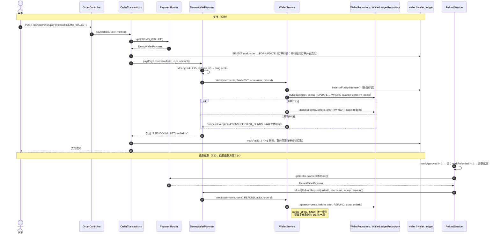

# 内置钱包设计方案

> **本文只回答一件事**：给站内置一个虚拟钱包（`wallet` + `wallet_ledger`），
> 让「钱」在系统里第一次成为可以断言、可以对账的<b>存量</b>，而不是只在订单上改个状态。
>
> 起因是用户的一句话：「对于金额这一块，你也可以尝试给网站弄一个内置的钱包，直接交易，这样就不用外部的交易信息了」。
> 但真正把它从「锦上添花」变成「必须做」的理由更硬：**退款目前没有落点**。
> 退款如果只是 `refund.status='REFUNDED'` + 一行库存流水，那么「钱回到买家手里」这件事
> 在系统里<b>不存在</b>——无法断言、无法对账、也无法演示。有了钱包，退款就是一笔
> <b>真实的反向资金流动</b>。
>
> 编号：迁移走 **V17**，任务走全局编号 **T16–T20**（T01–T06 已完结，T11–T15 归退款与履约）。
>
> 约束沿用全项目硬约定：不新增 Maven 依赖；金额唯一口径仍是 `Pricer`；所有约束显式命名；
> 不留死代码；状态转换靠条件 UPDATE 拿转换权；**一个决策一个迁移编号**。

---

## 0. 拍板结论

先把结论摆出来，下面是理由。

| # | 问题 | 结论 | 一句话理由 |
| - | ---- | ---- | ---------- |
| 1 | 余额类型 | **`BIGINT` 分**，换算点唯一：`pricing/api/MoneyUnits` | 用 `BigDecimal` 元就要在钱包里再立一套 `setScale`，那就是第二套金额口径 |
| 2 | 要不要流水表 | **必须**，`wallet_ledger` 照 `stock_ledger` 的形状 | 没有流水的余额只是一个可以被凭空改掉的数字，对账无从下手 |
| 3 | 并发扣款 | 条件 UPDATE **＋ 行锁 `SELECT … FOR UPDATE`**，两者都不能少 | 行锁不是为了「数据不败」，是为了流水的 `balance_before` 不记到别人的中间态 |
| 3b | 错误码 | **一个**：`INSUFFICIENT_FUNDS`（409）。不设「并发竞争」专用码 | 有了行锁，竞争**退化**成一次明确的业务拒绝，不存在第三种结果 |
| 4 | 幂等 | 支付/退款：**应用层 + 唯一索引双保险**（`uq_wallet_ledger_order_reason`）。充值：**不用幂等键，改用累计上限** | 支付/退款有天然业务键（订单号）；充值没有外部重试语义，硬造幂等键才是过度设计 |
| 5 | `pay` 签名 | **改成请求对象**：`pay(PayRequest)` / `refund(RefundRequest)` | `refund` 需要 4 个参数，其中两个 `String`，位置写反不会报错只会记错账 |
| 6 | 退款入哪张表 | **同一张 `wallet_ledger`**，正负 delta | 开两张表就拆成了两条对账恒等式，且永远无法互证 |
| 7 | 「不接真实资金」 | **仍成立**。充值 = 受限的演示性授予，有固定档位与累计上限 | 钱包是站内数字，不连银行、不清算、不出对账文件 |
| 8 | `DemoCardPayment` | **保留**，它不是死代码 | 它有真实消费者（UI 下拉、助手卡片、`8+` 个既有测试）；但要新增一条测试钉死「它不碰钱包」 |
| 9 | 初始额度 | **不写进迁移**，放 `application.yml`，首次触达时懒开户 | 迁移读不到 `application.yml`；写死在 SQL 里就是第二个真相来源 |
| 10 | 迁移编号 | **钱包 = V17**（退款仍是 V16）。**V16 与 V17 两个文件必须同一次提交落盘** | Flyway 默认禁止 out-of-order，这是一条会当场炸的真实陷阱 |
| 11 | HITL | **不新增任何卡片类型**，也不新增助手充值工具 | 余额不足是一次确定性拒绝；为绕过它加确认链路，等于把硬约束改成软约束 |
| 12 | **助手代付的默认支付方式** | **切成 `DEMO_WALLET`**（银行卡保留，仍可手动选）— **用户 2026-10-18 拍板** | 见 §6.5：默认走银行卡的话，助手代下的单退款时钱没有真实落点，钱包对退款的价值归零 |
| 13 | **充值策略** | **受限演示授予**：固定档位 + 累计上限 + 总开关 — **用户 2026-10-18 拍板** | 无限额度的充值会让「余额不足」这条路永远走不到，扣款失败与余额校验形同虚设 |

> **关于迁移编号的一条追加决定（2026-10-18）**：方案正文把钱包定为 V17、退款为 V16，并要求
> 两个文件同一次提交落盘以规避 Flyway out-of-order。实际开发顺序改为**先做钱包**，因此
> **`wallet` 迁移最终落在 `V16__wallet.sql`，退款迁移顺延为 `V17`**（依赖不变：它仍然只对 V14 有依赖）。
> 这样实现顺序与迁移顺序一致，也不必为了让编号不倒挂而提前建一张暂时无人消费的退款表。
> 退款方案中「V16」的引用需同步改为「V17」——见 T16 任务清单。

**我不同意 / 要修正你的两处**（证据在 §3.2、§9）：

- **「并发竞争会自动退化成重试或失败」——方向对，但退化的机制不是你以为的那个。**
  真正挡住并发的**不是**条件 UPDATE，而是行锁。条件 UPDATE 单独也能把余额算对
  （推导见 §3.2），它挡不住的是**流水的 `balance_before` 记到别人的中间态**。
  更关键的是：**`ck_wallet_ledger_arithmetic` 抓不到这个错**
  （因为 `after` 是 Java 用同一个 `before` 算出来的，恒等式天然成立）。
  能抓到它的**只有**「相邻流水首尾相接」那条窗口查询——这一条直接决定了 §9 的哨兵怎么写。
- **「建账迁移给每个既有账号一笔初始额度」——这一条我改掉了。**
  迁移里写死金额会造出第二个真相来源（§6.3）。改成配置驱动 + 懒开户，
  代价是 V17 迁移**不做任何 `INSERT`**，与 V14 的「期初建账」写法不同，理由写在 §6.3。

**另外补一条你没问、但会悄悄架空整个方案的前提**（§6.5）：
一笔用 `DEMO_CARD` 支付的订单，退款时**仍然没有真实放款**——钱本来就没进过钱包。
「退款有真实落点」这句话只在 `DEMO_WALLET` 支付路径上成立。
**用户已拍板（2026-10-18）：助手代付的默认支付方式切成 `DEMO_WALLET`**，
「可配」保留（配置项仍存在），但默认值已经是钱包。

---

## 1. 既有机制核查（开工前先读这一行）

> 本项目已四次栽在「跳过核查、从结论倒推现状」上。`DemoWalletPayment` 本身就是一个教训：
> 名字像钱包，实现是 `return "SIM-WALLET-" + orderId;`。

| 项 | 现状（已核实） | 缺口 |
| -- | -------------- | ---- |
| `PaymentGateway` | `src/main/java/dev/learning/mall/payment/api/PaymentGateway.java` 全文 8 行，只有 `method()` 与 `pay(orderId, amount)`，**无 `refund`** | 钱包要知道「扣谁的钱」；退款要知道「退给谁」 |
| `PaymentRouter` | Spring 注入 `List<PaymentGateway>` → `Map`；`get()` 找不到抛 `INVALID_PAYMENT`；`methods()` 返回全部 key | **本次不改**（key 仍是 `method()`） |
| `DemoWalletPayment` | `pay()` 只有一行 `return "SIM-WALLET-" + orderId;`，不查余额、不扣款、不落账 | 整个部门的 "wallet" 是一个名字，不是一个东西 |
| `DemoCardPayment` | 同样一行 `return "SIM-CARD-" + orderId;` | 同上，但它是**有意**的外部支付模拟，见 §6.5 |
| 金额口径 | `pricing/api/Pricer.java` 是唯一算钱入口；`Quote` 契约明确「四个金额都为两位小数（HALF_UP）」 | 钱包只要再写一次 `setScale`，就破功 |
| 库存流水范式 | `V14__stock_ledger_and_price_quote.sql`：`delta / stock_before / stock_after / reason / actor / order_id`，四条**显式命名**约束，其中 `ck_ledger_arithmetic` 由数据库保证「前 + 变化 = 后」 | 钱包照抄这个形状（§2） |
| 行锁写法 | `ProductRepository:43` `SELECT stock FROM product WHERE id = :id FOR UPDATE`；`ProductService.reserve` 是「锁 → 读前值 → 条件扣减 → 写流水」四步 | 钱包照抄这四步（§3） |
| 订单支付入口 | `OrderTransactions.pay`（L86-104）：`payments.get(method)` → `owned(id,user,true)`（订单行锁）→ `gateway.pay(id, row.total())` → `markPaid(...) != 1` 就抛 | 钱包要在 `gateway.pay` 这一步接管真实余额 |
| 助手支付默认值 | `PendingActionService:142` —— **`method` 缺省是 `DEMO_CARD`** | 助手路径默认碰不到钱包；这是 §6.5 那个前提的直接来源 |
| 退款放款 | `docs/退款与履约设计方案.md` §5.2 `disburse`：`payments.get(order.paymentMethod()).refund(orderId, receipt, amount)` | 钱包要把它从「返回模拟凭证」改成「真放款」 |
| UI 支付方式 | `static/js/app.js:370` 下拉里 `DEMO_CARD` / `DEMO_WALLET` 并列；`static/js/assistant.js:305` `HITL_METHODS` 两个都有中文名 | 两个方式都有真实用户入口，**删 `DemoCardPayment` 等于砍掉一个 UI 选项** |
| H2 实测特性 | 不支持条件唯一索引；**生成列 + 唯一索引可行**且 UPDATE 会重算；唯一索引允许多个 `NULL` | 钱包用不到生成列，但要用到「多个 NULL」这条（§4.2） |

---

## 2. 数据模型：两张表，一张管的存量，一张管的变动

### 2.1 为什么必须是两张

`wallet.balance_cents` 只回答「现在是多少」，回答不了「为什么变成这样」。
单表方案的唯一替代品是把流水分摊到订单表里——那正是现在的样子，也正是「退款没有落点」的根因。

和库存一模一样的三个理由：

1. **归因**：关单归还叫 `RELEASE`，退款归还叫 `REFUND`（V16 已为这事改过 `ck_ledger_reason`）；
   钱也一样——`PAYMENT`（买东西扣的）/`REFUND`（退款退的）/`TOPUP`（演示充值）/`OPENING`（开户授予）
   混用一个 reason，事后就答不出「这笔钱是怎么来的」。
2. **幂等**：「这笔订单的钱扣过没有」需要一个可查询的事实，而不是一个被改过的数字（§4）。
3. **对账**：`余额 == 开户 + 所有 delta 之和` 这条恒等式，是唯一能揪出「有人绕过服务手改了余额」的尺子（§9 哨兵）。

### 2.2 V17 迁移 SQL（写法全部取自 H2 2.3.232 已实测的 V14 / V15）

```sql
-- V17：内置钱包（站内虚拟余额 + 资金流水）。
--
-- 依赖：本文件<b>不引用</b> V16(refund) 的任何表，V16 也不引用本文件的表，二者物理上互不依赖。
-- ⚠ Flyway out-of-order：本文件必须与 V16 同一次提交落盘，理由见 §7.2。

-- ===================================================================
-- 一、wallet：当前余额。刻意只有两列。
-- ===================================================================
-- 为什么不放 created_at / updated_at：当前没有任何消费者。
-- 「不留死代码」这条约定在列级别同样适用——V13 砍掉 request_hash 用的就是同一把尺子。
-- 将来钱包管理页真要展示开户时间，再在后续迁移里加列，不要现在预留。
CREATE TABLE wallet (
  username VARCHAR(100) PRIMARY KEY,
  -- BIGINT「分」，不是 DECIMAL「元」。理由见 §0 第 1 条与 §5.1。
  balance_cents BIGINT NOT NULL,
  -- 余额不允许为负：这是「不能超扣」这条规则在数据库里的那一半。
  -- 显式命名，理由同 V14：H2 给内联 CHECK 起的 CONSTRAINT_x 跨环境会失配。
  CONSTRAINT ck_wallet_balance_nonneg CHECK (balance_cents >= 0)
);

-- ===================================================================
-- 二、wallet_ledger：每一笔资金变动都要留痕（照 stock_ledger 的形状）
-- ===================================================================
-- 刻意不加 REFERENCES：username 没有对应的用户表（SecurityConfig 是 InMemoryUserDetailsManager），
-- order_id 则与 V14 同一个理由——订单表在测试的 @AfterEach 里被 DELETE，
-- 加外键会把「删订单」变成「删证据」。
CREATE TABLE wallet_ledger (
  id BIGINT GENERATED BY DEFAULT AS IDENTITY PRIMARY KEY,
  username VARCHAR(100) NOT NULL,
  delta_cents BIGINT NOT NULL,          -- 正=入账，负=出账
  balance_before_cents BIGINT NOT NULL,
  balance_after_cents BIGINT NOT NULL,
  reason VARCHAR(20) NOT NULL,          -- OPENING / TOPUP / PAYMENT / REFUND
  actor VARCHAR(100) NOT NULL,          -- 谁动的；系统路径写 'SYSTEM' 或 'flyway-v17'
  order_id VARCHAR(36),                 -- PAYMENT / REFUND 必有；OPENING / TOPUP 为 NULL
  created_at TIMESTAMP NOT NULL DEFAULT CURRENT_TIMESTAMP
);
CREATE INDEX idx_wallet_ledger_user  ON wallet_ledger(username, id);
CREATE INDEX idx_wallet_ledger_order ON wallet_ledger(order_id);

-- 四条约束与 V14 的库存流水一一对应，名字只换了前缀。
ALTER TABLE wallet_ledger ADD CONSTRAINT ck_wallet_ledger_reason
  CHECK (reason IN ('OPENING','TOPUP','PAYMENT','REFUND'));
ALTER TABLE wallet_ledger ADD CONSTRAINT ck_wallet_ledger_delta_nonzero
  CHECK (delta_cents <> 0);
ALTER TABLE wallet_ledger ADD CONSTRAINT ck_wallet_ledger_balance_nonneg
  CHECK (balance_before_cents >= 0 AND balance_after_cents >= 0);
-- 整张表的地基：流水的「前 + 变化 = 后」由数据库保证，不靠调用方算对。
-- ⚠ 注意：这条约束<b>抓不到</b>「漏了行锁」这个 bug（推导见 §3.2），别指望它。
ALTER TABLE wallet_ledger ADD CONSTRAINT ck_wallet_ledger_arithmetic
  CHECK (balance_after_cents = balance_before_cents + delta_cents);

-- 方向约束：钱的方向写反也会通过 ck_wallet_ledger_arithmetic（它是无方向的恒等式），
-- 所以「PAYMENT 必须是出账、REFUND 必须是入账」要单独钉一条。
-- 没有这条，一个符号写反的支付会变成「充了值」，而对账恒等式照样成立。
ALTER TABLE wallet_ledger ADD CONSTRAINT ck_wallet_ledger_payment_is_outflow
  CHECK (reason <> 'PAYMENT' OR delta_cents < 0);
ALTER TABLE wallet_ledger ADD CONSTRAINT ck_wallet_ledger_refund_is_inflow
  CHECK (reason <> 'REFUND' OR delta_cents > 0);

-- ===================================================================
-- 三、一笔订单在同一件事上只能有一次（幂等的数据库那一半）
-- ===================================================================
-- H2 2.3.232 实测：唯一索引允许多个 NULL（退款方案 §4.4 的 uq_refund_inflight 已经验证过这条）。
-- 于是 OPENING / TOPUP 这些 order_id 为 NULL 的行不受约束（本来就该允许多次充值），
-- 而 PAYMENT / REFUND 这两种「必须唯一的业务事件」被钉死：同一个 order_id + reason 只允许一行。
--
-- ⚠ 耦合点：这里的隐含假设是「一笔订单最多退款一次」。
--   它与 docs/退款与履约设计方案.md §10「本次 amount 恒等于订单应付额（全额退款）」是同一个决策。
--   将来放开部分退款（同一订单多笔 refund），这个索引必须换成以 refund.id 为粒度，
--   **否则第二笔退款放款会被数据库拒掉**。反向验证见 §9 #6b。
CREATE UNIQUE INDEX uq_wallet_ledger_order_reason ON wallet_ledger(order_id, reason);
```

### 2.3 为什么要用「分」（BIGINT）而不是「元」（DECIMAL）

三条理由，按重量排序：

1. **口径**。全项目只有 `Pricer` 能算钱。如果余额是 `BigDecimal` 元，
   那么每一笔 `before + delta` 都得再 `setScale(2, HALF_UP)` 一次——
   钱包里凭空多出一个「决定小数位数」的地方。
   精度的主人只要有第二个，就会有第三个；等到两处用了不同 `RoundingMode`，
   差异不会报错，只会在某次偶然的对账里以「差 1 分」的形态出现。
2. **整数算术是精确的**。`SUM(delta_cents)` 与 `balance_after = balance_before + delta`
   在 `BIGINT` 下不存在任何舍入歧义，对账 SQL 的 `=` 就是真正的 `=`。
3. **给梢兵一个干净的答案**。对账要断言的是「相等」而不是「相差在容差内」。
   一旦引入浮点或小数容差，§9 那条哨兵就从「相等/不等」退化成「相差多少算不对」——
   那正是本项目已经栽过一次的 `<=` 假绿形态。

代价是元↔分要转换，**转换点必须唯一**，见 §5.1。

---

## 3. 并发扣款：条件 UPDATE + 行锁，两个都不能少

### 3.1 写法（与 `ProductService.reserve` 四步完全同一形状）

```java
// WalletService —— 转账唯一的写入节点
@Transactional(propagation = Propagation.MANDATORY)
public void debit(String username, long cents, WalletReason reason, String actor, String orderId) {
    if (cents <= 0) throw BusinessException.badRequest("INVALID_AMOUNT", "金额必须大于 0");
    ensureAccount(username);                                  // ① 懒开户（幂等，§6.3）
    long before = accounts.balanceForUpdate(username);        // ② 行锁 + 读前值
    long after = before - cents;
    // ③ 条件 UPDATE 拿「扣款权」：影响 1 行才算这一笔真的发生了
    if (accounts.tryDeduct(username, cents) != 1)
        throw BusinessException.conflict("INSUFFICIENT_FUNDS",
                "钱包余额不足：当前 ¥" + MoneyUnits.toYuan(before)
                        + "，本次需要 ¥" + MoneyUnits.toYuan(cents));
    // ④ 拿到扣款权才写流水；三者同事务，于是「扣了钱没流水」与「有流水没扣成」都不可能存在
    ledger.append(username, -cents, before, after, reason, actor, orderId);
}
```

```sql
-- WalletRepository.balanceForUpdate
SELECT balance_cents FROM wallet WHERE username = :user FOR UPDATE

-- WalletRepository.tryDeduct：带条件更新，余额不足则影响 0 行
UPDATE wallet SET balance_cents = balance_cents - :cents
 WHERE username = :user AND balance_cents >= :cents
```

### 3.2 行锁到底守住了什么（这一节是 §9 哨兵的依据）

**结论：`tryDeduct` 的条件 UPDATE 单独已经足够保证「余额不出错、不超扣」。
行锁唯一守住的东西是流水的 `balance_before` 不记到别人的中间态。**

推导一遍（同一个钱包的两笔并发扣款，初值 `X`，分别扣 `a`、`b`，`X ≥ a + b`）：

| 步骤 | 有行锁 | 无行锁 |
| ---- | ------ | ------ |
| 读 before | 后到的那个在锁上等到前者提交，**读到 `X-a`** | 两个都读到 **`X`** |
| UPDATE | 正常串行 | 后到的那个在写锁上等待，提交后才重新求值 `balance_cents >= b`，拿到的是 `X-a` |
| 最终余额 | `X-a-b` ✅ | `X-a-b` ✅ **也是对的** |
| A 的流水 | `before=X,  after=X-a` ✅ | `before=X,  after=X-a` ✅ |
| B 的流水 | `before=X-a, after=X-a-b` ✅ | `before=X, after=X-b` ❌ **漏了一格** |
| `ck_wallet_ledger_arithmetic` | 通过 | **也通过**——`after` 是 Java 用同一个 `before` 算的，恒等式恒真 |
| 对账恒等式 `余额 == 开户 + SUM(delta)` | 通过 | **也通过**——`-a-b` 两头都对得上 |

所以能抓住它的**只有** `chainMismatch`——「相邻流水的 `after` 必须等于下一条的 `before`」那条窗口查询。
这与既有的 `StockLedgerTest#concurrentReservesKeepBeforeValueExact` 是同一个判据，
也顺带说明 §9 里「断言最终余额正确」是一条**守不住行锁**的弱断言。

> 顺手更正一处既有注释：`StockLedgerTest` 里写「漏了行锁……`ck_ledger_arithmetic`
> 会把它当成数据错误抛出来」——按上面同一套推导，那条 CHECK **不会**抓住它
> （`after` 是用同一个 `before` 算出来的）。真正抓住它的还是 `chainMismatch`。
> 结论不变（行锁必须留），但**理由要换**，否则将来有人按这句话去简化测试就会失守。

### 3.3 余额不足 vs 并发竞争：一个错误码，还是两个？

**一个：`INSUFFICIENT_FUNDS`（409 CONFLICT）。不设并发专用码。**

带上了 `@Transactional` + 行锁之后，竞态只有两种确定的结局，**没有第三种**：

- 前者提交后余额**还够** → 后者被锁串行化等待，然后**成功**，这是个正常的成功，不是错误；
- 前者提交后余额**不够** → 后者拿到的是真实的、扣完之后的最新余额，
  于是它面对的是一次**货真价实的余额不足**，错误消息里的「当前余额」也是准确的。

也就是说：**并发竞争在这个写法下退化为业务拒绝，而不是退化为重试**。
「请重试」这种语义只有在乐观锁（版本号冲突）里才成立，那不是本项目任何一处使用的写法
（`ProductService.reserve` 用的是同一个写法，也只抛一个 `OUT_OF_STOCK`）。
给「并发竞争」单独一个错误码的代价，是调用方必须写一条永远走不到或不该重试的分支——
那是纯粹的心智负担。

**但有一件事必须说清楚**：这个「一个码」的成立**依赖行锁**。
如果把 `balanceForUpdate` 的 `FOR UPDATE` 去掉，§3.2 表格最后一列那种漏格的流水
**不会**表现为 `INSUFFICIENT_FUNDS`，而会在别的地方以别的形态冒出来。
所以 §9.2 的 #11 那条哨兵必须走真实并发路径，不能用单线程重放代替。

---

## 4. 幂等

### 4.1 支付：三层，缺一不可

| 层 | 机制 | 现状 |
| -- | ---- | ---- |
| 应用层（主） | `OrderTransactions.pay` L89-93：已 `PAID` 且方式不同 → `PAYMENT_MISMATCH`；方式相同 → **直接返回既有视图**，不再调 gateway | **已有**，不用动 |
| 事务层 | `owned(id, user, true)` 拿订单行锁 → 同订单并发支付被串行化；第二个进来时看到 `PAID`，走上面的早返回 | **已有**，不用动 |
| 数据层（最后一道） | `uq_wallet_ledger_order_reason`：`(order_id, 'PAYMENT')` 只能有一行 | **本方案新增** |

为什么还要第三层：前两层都在订单侧。**退款、充值、未来的转账**都不走订单行锁，
一旦有人新写一个「不经过 `OrderTransactions.pay` 的扣款入口」，前两层同时失效。
而钱包这片区域的错误是全项目唯一「看不见的钱的问题」，多一道 0 成本的 DB 保险是划算的。

### 4.2 退款：应用层为主 + 同一条索引兜底

退款方案 §5.2 已经给了应用层的主闸门：
`markApproved(...) != 1` 就抛、`markRefunded(...) != 1` 就安静返回。
**本方案不动它**，只在下面加 `(order_id, 'REFUND')` 唯一这一层。

两条关于这条索引的注意事项：

- 它是**兜底**，不是替代品。删掉应用层的 `markApproved` 守卫，
  指望唯一索引来保证「不重复放款」是错的——主键违反会以
  `DataIntegrityViolationException` 的形态冒出来（500），而不是一个干净的语义错误。
  §9 #6a / #6b 分别对此写了两层不同的证据。
- 它依赖「一笔订单最多退一次」这个假设（§2.2 的注解）。
  放开部分退款那天，这个索引要换成 `refund.id` 粒度。

### 4.3 充值：刻意不用幂等键

充值**没有**外部重试语义：它不是支付回调，不会被第三方重放，不存在「同一笔充值到账两次」。
给它造一个客户端幂等键，等于为一个不存在的问题写一套协议。

它需要的不是幂等，而是**上限**——否则钱包会失去「余额不足」这个真实的教学约束（§6.2）。
做法：另外一个已经存在于流水里的事实就够了，不需要新列：

```sql
-- 累计已授予额度（含开户）：一次 SUM 就够了，不需要额外的列去维护
SELECT COALESCE(SUM(delta_cents), 0) FROM wallet_ledger
 WHERE username = :user AND reason IN ('OPENING','TOPUP')
```

超过即拒绝：`TOPUP_LIMIT_EXCEEDED`（409）。这条 SUM 必须**在钱包行锁内**执行，
否则两个并发充值各自读到「还没超」。

### 4.4 HITL：不新增任何东西

助手路径的支付已经被 `PendingActionService` 单一用例化（既有机制），不存在重复确认。
队列론它 file **不新增列、不新增 `kind`**——因为**不新增助手充值工具**（§6.4），
没有工具就没有 `kind`，也就不存在 §11 担心的「为了绕过余额不足去加一条确认链路」。

---

## 5. 接口改造

### 5.1 元↔分换算的唯一落点：`pricing/api/MoneyUnits`

```java
package dev.learning.mall.pricing.api;

/**
 * 元 ↔ 分 的唯一换算点。
 *
 * <p><b>关键契约：它绝不四舍五入。</b>
 * 「元」的小数位超过两位时一律抛异常，而不是悄悄抹掉。
 * 理由：{@link Pricer} 的 {@code Quote} 已经保证四个金额都是两位小数，
 * 出现三位小数说明上游出了 bug——让它在换算这一步炸掉，
 * 比把它抹平成一分钱、然后散落到对账里要便宜得多。
 */
public final class MoneyUnits {
    private MoneyUnits() {}

    public static long toCents(BigDecimal yuan) {
        if (yuan == null) throw new IllegalArgumentException("金额不能为空");
        if (yuan.scale() > 2) throw new IllegalArgumentException("金额精度超过「分」：" + yuan);
        return yuan.movePointRight(2).longValueExact();   // 有残余小数 → ArithmeticException
    }

    /** 分 → 元（两位小数）。仅用于展示，任何落库路径都不该用它。 */
    public static BigDecimal toYuan(long cents) {
        return BigDecimal.valueOf(cents, 2);
    }
}
```

**为什么放 `pricing` 而不是 `wallet`？**
换算虽然不是「算钱」，但它是关于「钱怎么表示」的知识，和 `Pricer` 同居一个包，
才能保证全项目关于钱的原语只有一处。方向上 `wallet → pricing` 也是对的
（反正 `order` 早已依赖 `pricing`，不会有循环依赖）。

**怎么保证没人绕过它？** 四道，从强到弱：

1. **类型**：`WalletRepository` / `WalletLedgerRepository` 的**所有**金额参数与返回值都是 `long`。
   钱包内部根本不存在 `BigDecimal`，想绕也拿不到入口。
2. **契约**：`toCents` 在失衡时抛异常而不是舍入。任何「我随手 `multiply(100)` 一下」
   的等价写法都会丢掉这条检查。
3. **源码扫描测试**（本项目尚无先例，是第一条例外 Revenue）：
   `MoneyUnitsTest#noRawCentConversionOutsideMoneyUnits` 扫描 `src/main/java`，
   除 `MoneyUnits` 自身外不许出现 `movePointRight` / `movePointLeft` /
   `multiply(BigDecimal.valueOf(100))` / `doubleValue()` 等可疑模式。
   **找不到源码目录时必须 fail，不许 skip**——会 skip 的守卫等于会消失的守卫。
4. **Review 判据**：新增任何钱相关列时，问一句「它是 `long cents` 吗」。

> 诚实说明成本：第 3 条需要解析源码目录位置，是本仓库第一个读源码的测试，
> 也就多一层脆弱性。**但我认为它值得**——前三次都栽在「写完就绿的测试其实什么也没守住」，
> 而这一条恰好是唯一能在编译期之外证明「换算点确实唯一」的手段。

### 5.2 `PaymentGateway` 签名改造

现在的 `pay(String orderId, BigDecimal amount)` 有三个问题：
钱包不知道扣谁的钱、`refund` 不存在、以及将来 `refund` 会有两个相邻 `String` 参数可以写反。

**改成请求对象**：

```java
public interface PaymentGateway {
    String method();

    /** 收款。返回支付凭证。 */
    String pay(PayRequest request);

    /**
     * 放款（退款）。外力：真正一笔订单是否被放款、放款几次，由订单/退款侧的状态机决定，
     * gateway 只负责「钱真的动一下」。
     */
    String refund(RefundRequest request);

    /** 收款请求。orderId 与 amount 都是 String/long 混合，用 record 消除位置写反的可能。 */
    record PayRequest(String orderId, String username, BigDecimal amount) {}

    /** 放款请求。originalReceipt 是 {@link #pay} 当初返回的凭证（可供幂等追踪）。 */
    record RefundRequest(String orderId, String username, String originalReceipt, BigDecimal amount) {}
}
```

**为什么是 record 而不是加两个参数？**
`refund(orderId, username, originalReceipt, amount)` 里 `orderId` 与 `originalReceipt`
同为 `String`、位置相邻，写反**编译通过、运行通过、只在对账时才发现**。
这里恰好适用一条经验：**位置写反的成本是不对称的**。

**为什么不是一个共用 record？**
因为 `PayRequest` 没有 `originalReceipt`——用同一个 record 就得让它可空，
可空字段是把「写成＝没有」这种暧昧引进来，不划算。

**影响清单**（逐核验）：

| 文件 | 动作 | 说明 |
| ---- | ---- | ---- |
| `payment/api/PaymentGateway.java` | 改 | 上面这段 |
| `payment/api/PayRequest.java` / `RefundRequest.java` | **新增** | 两个 record |
| `payment/api/PaymentRouter.java` | **不改** | key 仍是 `method()`，`methods()` 不变 |
| `payment/internal/DemoCardPayment.java` | 改 | 签名跟上；行为不变（返回 `SIM-CARD-<orderId>`），**不碰钱包** |
| `payment/internal/DemoWalletPayment.java` | **改成真的** | 注入 `WalletService`；`pay` → `debit(..., PAYMENT, ...)`；`refund` → `credit(..., REFUND, ...)` |
| `order/internal/OrderTransactions.java` L96 | 改 | `gateway.pay(id, row.total())` → `gateway.pay(new PayRequest(id, user, row.total()))` |
| `order/internal/RefundService.java` §5.2 | 改（T14 之后） | `.refund(new RefundRequest(orderId, order.username(), receipt, amount))` |
| `assistant/internal/PaymentTools.java` / `PendingActionService.java` | **不改** | 它们传的是方法名字符串，不是金额参数 |
| 测试里的 mock / stub | 改 | 目前签名无敌被调用的 stub，影响面应当是 0，需 `grep PaymentGateway` 兜一次 |

**依赖方向**：`payment → wallet → pricing`。单向，无环。 `wallet` **不依赖** `order`。

### 5.3 调用时序



---

## 6. 边界：它当然还是「不接真实资金」

### 6.1 这条边界仍然成立，而且要说清楚

**成立。** 钱包是站内的虚拟余额：不连银行、不连第三方支付、不发生清算、不产生对账文件、
没有回调、没有汇率。它从头到尾就是 JdbcClient 的一次 UPDATE。
新增的那点持久性只是「我们把总额的减法记下来了」，不是「我们开始处理钱了」。

这条边界要写在三个地方：`DemoWalletPayment` 的类注释、`docs/接口与数据结构.md`、
以及 UI 上「模拟钱包」这四个字。

### 6.2 充值在这个前提下是什么语义

**受限的演示性授予，不是充值。** 三条限制：

| 限制 | 配置 | 目的 |
| ---- | ---- | ---- |
| 固定档位，不可自定义金额 | `topup-amount-cents` | 它没有 `amount` 入参，所以「刷一波充值」不可能发生 |
| 累计授予上限 | `topup-ceiling-cents` | 让「余额不足」成为一个**可达且永久**的状态 |
| 可整体关闭 | `topup-enabled` | 演示「没钱了」的教学场景；**默认 open，因为它有真实 UI 消费者，不是死代码** |

```yaml
mall:
  wallet:
    # 演示初始额度：首次触达钱包时开户并一次性授予（¥500）
    initial-grant-cents: 50000
    # 演示充值：固定档位 ¥100；累计授予（含初始额度）上限 ¥1000。
    # 上限存在的唯一理由：保住「余额不足」这个真实约束——
    # 能无限充值的钱包会让 §0 那条教学价值当场归零。
    topup-enabled: true
    topup-amount-cents: 10000
    topup-ceiling-cents: 100000
    # 订单 / 助手支付缺省使用哪种方式。改成 DEMO_WALLET 之后，
    # 「退款有真实放款落点」这条才对所有新订单成立（§6.5）。
    default-payment-method: DEMO_WALLET
```

### 6.3 初始额度怎么给：不写进迁移（这里我改了你的方案）

**结论：`application.yml` 配置 + 首次触达时懒开户，V17 迁移里一个 `INSERT` 都不写。**

理由只有一条，但足够硬：**迁移脚本读不到 `application.yml`**。
在 SQL 里写死 `50000` 就等于建立了第二个真相来源：
改配置的人以为改了额度，`data/mall.mv.db` 里已经开户的用户还是旧额度，
而新人拿到的是新额度——这个差异不报错，只表现为「我的钱包比你多 50 块」。

这与 V14 的「期初建账」写法不同，值得把差异讲清楚：

| | V14 `stock_ledger` | V17 `wallet` |
| - | ------------------ | ------------ |
| 历史数据有没有别的来源 | 没有，那批货的来源无从追溯 | 有，就是配置 |
| 为什么必须 seeding | 不 seeding，「现货 == 流水之和」从迁移那一刻起就是错的 | 不 seeding 也成立：开户与 `OPENING` 流水同在一个事务里写，开户那一刻恒等式就成立 |
| 结论 | 必须写进迁移 | **不该**写进迁移 |

懒开户 shape（必须与后续读余额在同一事务里，且在行锁之前）：

```sql
-- ensureAccount：插表用了 NOT EXISTS，重复调用影响 0 行，天然幂等
INSERT INTO wallet(username, balance_cents)
SELECT :user, :grant WHERE NOT EXISTS (SELECT 1 FROM wallet WHERE username = :user);
-- 影响 1 行时才补一条 OPENING 流水；grant = 0 时不写（会被 ck_wallet_ledger_delta_nonzero 拒）
```

并发首次触达：第二个 INSERT 会阻塞在主键上，等前者提交后重算 `NOT EXISTS` 拿到 0 行，
随后照常读余额。不会重复授予。

### 6.4 `DemoCardPayment` 的去留：**保留**

它**不是死代码**，它有四个真实消费者：

1. `static/js/app.js:370` 的下拉框里它是第一个选项；
2. `static/js/assistant.js:305` 的 `HITL_METHODS` 里有它的中文名；
3. `AssistantService:519` 把它渲染进卡片；
4. `PaymentTools` 的入参描述里写着「缺省 DEMO_CARD」，**助手路径的默认支付方式就是它**
   （`PendingActionService:142`）。

删它，`PaymentRouter` 的 `List → Map` 策略注入就退化成语焉不详的单例注入，
整个「策略模式」的教学价值也没了。**删它不是执行「不留死代码」，是误伤。**

但它要配一条新测试钉死边界：`WalletLedgerTest#cardPaymentWritesNoWalletRows` ——
用 `DEMO_CARD` 走完一次完整支付后，`wallet` 表没有该用户的行、`wallet_ledger` **零行**。
这样「外部支付方式不进钱包」就从一句注释升级成一个断言。

### 6.5 一个会架空整个方案的前提（你没问，但必须说）

**一笔用 `DEMO_CARD` 支付的订单，退款时依然没有真实放款**——钱本来就没进过钱包，
自然也退不回来。也就是说「退款终于有落点了」这句话，**只在 `DEMO_WALLET` 路径上成立**。

两件事要做：

1. 把默认支付方式做成可配并在实施时改成 `DEMO_WALLET`（§6.2 的 `default-payment-method`）。
   这一步会改变 `PendingActionService:142` 的缺省值，`PaymentTools` 的描述文案要同步改。
2. 在 UI 退款成功的文案里说明去向：是「退回模拟钱包」还是「退回你的银行卡」，
   按 `order.paymentMethod()` 分支，跟 `AssistantService:519` 那个 mapping 复用同一份词表。

---

## 7. 迁移编号与依赖顺序

### 7.1 钱包 = V17

「一个决策一个迁移编号」是硬约定，所以**不能塞进退款的 V16**。
否则「退款有问题要把钱包一起回滚」——你担心的那件事会发生，而且会同时毁掉两件事的可诊断性。

物理依赖方向：

```
V14 (stock_ledger)  ←  V16 (refund)      ←┐ 无循环
                                          │
V17 (wallet)  ←  不依赖任何表             ┘
```

V16 不引用 `wallet` 的任何表，V17 也不引用 `refund`。**Flyway 顺序不构成依赖，二者可以换开发顺序。**

### 7.2 ⚠ 真实陷阱：Flyway out-of-order

这是本节最重要的一条。
`V17` 比 `V16` 大，所以**如果 V17 先于 V16 被应用**（比如钱包先开发完并入，
任何人起一次应用），之后再把 `V16__refund_and_delivery.sql` 加进来时，
Flyway 默认校验会因为在已应用的最大版本（17）之前发现一个未应用的迁移（16）而**直接拒绝启动**。

三条路，推荐第一条：

1. **（推荐）`V16` 与 `V17` 两个文件同一次提交落盘。** 谁先写 Java 代码无所谓，
   但版本号必须同时存在。第一个真正被 migrate 的环境于是自然按 16 → 17 走。
2. 若坚持钱包先落地且不愿先起草 V16，则须显式开启
   `spring.flyway.out-of-order=true`。**我不推荐**：它把一个一次性问题变成永久配置，
   且会让「迁移顺序即依赖保证」这句文档惯例（V16 脚本头部写着的）失去效力。
3. 把钱包编号为 V16、退款顺延到 V17。**不推荐**：退款方案已被采纳，
   §4.4 / §11.1 的实测记录是按 V16 写的，改号会让那些记录与脚本名对不上。

### 7.3 开发顺序建议

**建议先做钱包（T16–T19），再做退款（退款方案的 T14）**，
让 `PaymentGateway.refund` 从第一天就是真实放款，不留「先用 mock 顶着」的中间状态。
上面 §7.2 第 1 条已经把这个顺序的陷阱排除了。

若退款先做完：也没事，它的 `refund()` 会先返回一个模拟凭证——
但**必须在 `DemoWalletPayment` 落地的同一个 PR 里改掉**，且这条要先记进退款方案的 TODO。

---

## 8. 文件清单与任务拆分

### 8.1 文件清单

| 文件 | 动作 | 说明 |
| ---- | ---- | ---- |
| `src/main/resources/db/migration/V17__wallet.sql` | **新增** | §2.2 |
| `src/main/java/dev/learning/mall/pricing/api/MoneyUnits.java` | **新增** | §5.1，换算唯一落点 |
| `src/main/java/dev/learning/mall/wallet/api/WalletBalance.java` | **新增** | record：`username / balanceCents / balanceYuan` |
| `src/main/java/dev/learning/mall/wallet/api/WalletAccounts.java` | **新增** | 对外接口：`ensureAccount / balanceOf / topUp`（订单与 web 都用它） |
| `src/main/java/dev/learning/mall/wallet/internal/WalletProperties.java` | **新增** | `@ConfigurationProperties("mall.wallet")` |
| `src/main/java/dev/learning/mall/wallet/internal/WalletRepository.java` | **新增** | `balanceForUpdate / tryDeduct / add / ensureRow` |
| `src/main/java/dev/learning/mall/wallet/internal/WalletLedgerRepository.java` | **新增** | `append / reconcileMismatch / grantedCents`（唯一的流水写入口） |
| `src/main/java/dev/learning/mall/wallet/internal/WalletService.java` | **新增** | `ensureAccount / debit / credit / topUp / balanceOf`；**改钱的唯一入口** |
| `src/main/java/dev/learning/mall/wallet/web/WalletController.java` | **新增** | `GET /api/wallet`（本人余额）、`POST /api/wallet/topups`（演示充值，固定档位） |
| `src/main/java/dev/learning/mall/payment/api/PayRequest.java` | **新增** | §5.2 |
| `src/main/java/dev/learning/mall/payment/api/RefundRequest.java` | **新增** | §5.2 |
| `src/main/java/dev/learning/mall/payment/api/PaymentGateway.java` | 修改 | 加 `refund`；`pay` 改签名 |
| `src/main/java/dev/learning/mall/payment/internal/DemoCardPayment.java` | 修改 | 只跟签名 |
| `src/main/java/dev/learning/mall/payment/internal/DemoWalletPayment.java` | **重写** | 从空壳变成真的（注入 `WalletService`） |
| `src/main/java/dev/learning/mall/order/internal/OrderTransactions.java` | 修改 | L96 改一行；建议同步使用配好的默认方式 |
| `src/main/java/dev/learning/mall/assistant/action/PendingActionService.java` | 修改 | L142 缺省方式改为读配置（§6.5） |
| `src/main/java/dev/learning/mall/order/internal/RefundService.java` | 修改（T14 之后） | §5.2 放款接到钱包 |
| `src/main/resources/application.yml` | 修改 | `mall.wallet.*`、`mall.payment.default-payment-method` |
| `src/main/resources/static/js/app.js` | 修改 | 页面顶部显示余额；退款文案按支付方式分支 |
| `src/main/resources/static/js/assistant.js` | 修改 | HITL 卡片显示余额不足时的提示 |
| `docs/接口与数据结构.md` | 修改 | 登记 2 张新表、2 个新接口 |
| `docs/退款与履约设计方案.md` | **追加** | §13 交叉引用（**不重写**） |
| `src/test/java/dev/learning/mall/V17MigrationTest.java` | **新增** | 约束存在 + 显式命名 |
| `src/test/java/dev/learning/mall/WalletLedgerTest.java` | **新增** | 对账 / 首尾相接 / 哨兵 / 幂等 / DEMO_CARD 边界 |
| `src/test/java/dev/learning/mall/WalletConcurrencyTest.java` | **新增** | 并发扣款的行锁证据、余额不足语义 |
| `src/test/java/dev/learning/mall/MoneyUnitsTest.java` | **新增** | 精度拒绝 / 源码扫描守卫 |
| `src/test/java/dev/learning/mall/RefundWalletTest.java` | **新增**（T14 之后） | 退款真放款 |

**删除的文件：无。**（`DemoCardPayment` 保留，§6.4）

### 8.2 任务清单（5 个，按依赖排序）

| 任务 | 内容 | 依赖 | 优先级 |
| ---- | ---- | ---- | ------ |
| **T16** | V17 迁移 + `MoneyUnits` + `WalletProperties` + `application.yml` + `V17MigrationTest` | 无 | P0 |
| **T17** | `WalletRepository` / `WalletLedgerRepository` / `WalletService` / `WalletBalance` / `WalletAccounts` + `MoneyUnitsTest` + `WalletLedgerTest`（含哨兵） | T16 | P0 |
| **T18** | 支付通道改造：`PayRequest` / `RefundRequest` / `PaymentGateway` / `DemoCardPayment` / `DemoWalletPayment` / `OrderTransactions.pay` + `WalletConcurrencyTest` | T17 | P0 |
| **T19** | `WalletController` + `app.js` / `assistant.js` 余额展示与文案 + 收紧 `MallIntegrationTest` 的弱断言 | T17（可与 T18 并行） | P1 |
| **T20** | `RefundService.disburse` 放款接到钱包 + `PendingActionService` 默认方式可配 + `RefundWalletTest` + 两份文档的交叉引用 | T18 + **退款方案 T14** | P1 |

> T20 依赖退款方案的 T14。若 T14 尚未开工，T16–T19 可独立做完，
> 届时 `PaymentGateway.refund` 会先由 `DemoWalletPayment` 提供一个「暂时无人调用」的实现——
> **这与「不留死代码」不冲突**：它是接口契定的对称方法，且其测试覆盖率由 T20 的
> `RefundWalletTest` 补齐；真正无消费者的东西（比如现在就去加一个助手充值工具）才是不许做的。

---

## 9. 反向验证

> 每条都标明了**这条断言实际上覆盖哪一层**。
> 本项目已经四次栽在「写完就绿的测试其实什么也没守住」上，其中一次是裸 SQL 守不住 Java 层，
> 一次是断言强度不足（`<=` 会假绿）。下面 §9.4 单列一节专门讲这两类错配在本方案里的对应点。

### 9.1 T16 / T17　迁移、换算与钱包写入

| # | 注回的 bug | 必须出现的失败 / 验证证据 | 实际覆盖的层 | 分层复核 |
| - | ---------- | -------------------------- | ------------ | -------- |
| 1 | V17 的 CHECK 改回内联写法 | `V17MigrationTest#walletConstraintsAreNamedAndPresent`：断言 `CK_WALLET_BALANCE_NONNEG` / `CK_WALLET_LEDGER_REASON` / `CK_WALLET_LEDGER_DELTA_NONZERO` / `CK_WALLET_LEDGER_BALANCE_NONNEG` / `CK_WALLET_LEDGER_ARITHMETIC` 五个名字都在，且**没有一个**以 `CONSTRAINT_` 开头 | **迁移 / 数据库约束层** | 层匹配（照 V14 那条） |
| 2 | 把 `ck_wallet_balance_nonneg` 去掉，允许余额为负 | `WalletConcurrencyTest#overdraftIsRejectedAsCleanConflict`：必须断言抛出的是 **`BusinessException` 且 code == `INSUFFICIENT_FUNDS`**，而不是任何异常；**禁止**只写 `assertThatThrownBy(...).isInstanceOf(Exception.class)` | **Java 服务层 → 数据库约束层联动** | **注意**：若只删 DB 约束而 Java 的 `>=` 守卫还在，这条不会红；它实际守的是「必须有一个干净的 409，而不是从 DB 漏出来的 500」 |
| 3 | `MoneyUnits.toCents` 改成 `setScale(2, HALF_UP)` 静默舍入 | `MoneyUnitsTest#fractionalYuanIsRejectedNotRounded`：传入 `new BigDecimal("19.999")` 必须**抛异常**（不许返回 1999 也不许返回 2000） | **换算契约层** | 层匹配；这条守的是「永不舍入」，是所有金额断言的前置 |
| 4 | 有人在 `WalletService` 里绕过 `MoneyUnits`，直接 `.multiply(BigDecimal.valueOf(100))` | `MoneyUnitsTest#noRawCentConversionOutsideMoneyUnits`：扫描 `src/main/java`，除 `MoneyUnits.java` 外不许出现 `movePointRight` / `multiply(BigDecimal.valueOf(100))` / `multiply(new BigDecimal("100"))` / `doubleValue()`。**定位不到源码目录时 fail，不许 skip** | **源码静态层**（本方案唯一一条静态断言） | 层匹配；它守的是「换算点唯一」这条 `@Review` 判据，无法被运行时测试替代 |
| 5 | `debit` 里忘记写流水（只 `tryDeduct` 不 `append`） | `WalletLedgerTest#reconciliationDetectsPhantomBalance`（对账哨兵，见 §9.3）必须返回 1 | **Java writer → 数据层** | **必须走 `WalletService.debit`**，不能用裸 SQL 代替；否则这条会退化成「守住了 ad hoc SQL」 |
| 6 | `tryDeduct` 的条件 `AND balance_cents >= :cents` 被去掉 | `WalletConcurrencyTest#debitCannotOverdraw`：余额 100 分时扣 150 分 → 抛出 409 `INSUFFICIENT_FUNDS`，且**余额与流水都零变化** | **条件 UPDATE 层** | 层匹配；叠加 #2 的 DB 约束，形成双重证据 |
| 7 | `ensureAccount` 重复调用会重开户 / 重复授予 | `WalletLedgerTest#ensureAccountIsIdempotent`：连续调用两次 `ensureAccount`，断言余额相等且 `reason='OPENING'` 的流水**只有一行** | **应用层幂等** | 层匹配 |
| 8 | `.wallet.ledger` 的 `PAYMENT` 方向写反（记成 `+delta`） | `WalletLedgerTest#paymentIsRecordedAsOutflow`：真实支付后断言该行 `delta_cents < 0`；另有一条迁移层断言 `V17MigrationTest#paymentOutflowIsConstraintEnforced`（裸 SQL 插 `('PAYMENT', +100)` 必须被 `CK_WALLET_LEDGER_PAYMENT_IS_OUTFLOW` 拒） | **Java writer 层 + 数据库约束层（两条分列）** | **按分层拆成两条**：只留前者守不住「换个地方写」 |
| 9 | 充值上限只看本次、不看累计（删掉 `SUM`） | `WalletLedgerTest#topupCeilingIsCumulative`：绕过 `topUp` 的上限后，第二次充值必须被 `TOPUP_LIMIT_EXCEEDED` 拒；断言必须基于**累计**而非单次金额 | **应用层额度控制** | 层匹配 |
| 10 | 充值上限的 `SUM` 放在钱包行锁**之外** | `WalletConcurrencyTest#ceilingSurvivesConcurrentTopup`：初始额度接近上限时并发充值 N 次，断言最终累计授予 ≤ 上限（**不许断言 `<上限+单次` 这类放宽的不等式**） | **事务层 / 行锁** | **注意**：这是「断言强度不足」的高发区——用 `<= 上限 + 单次` 会在 bug 存在时假绿，必须写成 `<= 上限` |

### 9.2 T18　并发与支付通道

| # | 注回的 bug | 必须出现的失败 / 验证证据 | 实际覆盖的层 | 分层复核 |
| - | ---------- | -------------------------- | ------------ | -------- |
| 11 | **去掉 `balanceForUpdate` 的 `FOR UPDATE`** | `WalletConcurrencyTest#concurrentDebitsKeepLedgerChainConsistent`：双线程经**真实** `WalletService.debit` 并发扣同一钱包，断言 `chainMismatch == 0`（相邻流水首尾相接） | **事务层 / 行锁** | **这是本方案最关键的一条，也是最容易写错的一条**：§3.2 已推导，此时「最终余额正确」「对账恒等式成立」「`ck_wallet_ledger_arithmetic` 不报错」**全部仍然为真**，唯一变红的是首尾相接那条。任何只断言最终余额的并发测试都守不住这个 bug |
| 12 | 同上（对照组，证明 #11 不是假绿） | `WalletConcurrencyTest#finalBalanceIsCorrectUnderRace`：断言最终余额 == 初值 − 成功扣款之和。这条在有无行锁时都绿，**因此它不能作为行锁的证据**——它在这里的作用是**反向定位**：一旦这条也红了，说明测试 Catherine 错在别处 | **事务层 / 条件 UPDATE**（不含行锁） | 刻意标注为「**非**证据」，防止后人误把它当作行锁的守卫删掉 #11 |
| 13 | `DemoWalletPayment.pay` 更新了余额但不写流水 | `WalletLedgerTest#reconciliationDetectsPhantomBalance`（§9.3 哨兵）必须返回 1 | **Java 调用路径 → 数据层** | 层匹配；必须走 `DemoWalletPayment` 而非直接 `UPDATE wallet` |
| 14 | `DemoCardPayment` 误接了钱包（开始扣款） | `WalletLedgerTest#cardPaymentWritesNoWalletRows`：走完一次真实的 `DEMO_CARD` 支付后，断言 `wallet_ledger` 零行、该用户在 `wallet` 表无行 | **策略实现边界层** | 层匹配；这条把 §6.4「保留它不是因为它无害」钉成了断言 |
| 15 | 删掉 `uq_wallet_ledger_order_reason` | `WalletLedgerTest#sameOrderCannotBeChargedTwice`：通过真实的 `WalletLedgerRepository.append` 连写两条 `(order_id='x', reason='PAYMENT')`，第二条必须被拒且异常含 `UQ_WALLET_LEDGER_ORDER_REASON` | **数据库唯一索引层**（走生产 writer） | **必须走生产 Repository**：在测试里复制一份 INSERT 只能证明「测试里的 SQL」，这是本项目已经踩过的「自带 SQL」错配 |
| 16 | 退款放款忘接钱包（仍是 mock 凭证） | `RefundWalletTest#refundCreditsBuyerWallet`：真实退款放款路径执行后，断言**钱包余额增加 amount**且 `reason='REFUND'` 的流水恰有一条。**禁止只断言 `refund.status='REFUNDED'`** | **Java 调用路径 → 资金层** | **原断言层错配的高危区**：只查 `refund.status` 在「放款仍是 mock」时也全绿 |
| 17 | 同一个异步信号量里的退款被执行两次放款 | `RefundWalletTest#doubleDisburseIsRejectedNot silentlyIgnored`：第二次放款必须或被 `markRefunded` 挡掉（安静返回）、或被唯一索引挡掉（一条**明确**的异常），**且最终余额只增加一次** | **应用层闸门 + DB 索引纵深防御** | 层匹配；断言必须落在余额上，不能落在「没有报错」上 |
| 18 | 订单付款金额在 `row.total()` 与 `row.payAmount()` 之间取错 | `PaymentAmountConsistencyTest`（可并入既有 `CheckoutAmountConsistencyTest`）：断言钱包扣款的分值 == `total` 的分值，且 `mall_order.total = pay_amount` 这条既有事实不变 | **金额取值一致性层** | 层匹配；目前 insert 同值写入使两者恒等，这条是防止将来有人改坏 insert |

### 9.3 哨兵自证（证明上面那些尺子不是空的）

| 哨兵 | 做法 | 它证明什么 |
| ---- | ---- | ---------- |
| `WalletLedgerTest#reconciliationDetectsPhantomBalance` | 手工 `UPDATE wallet SET balance_cents = balance_cents + 50000 WHERE username=?`（**不写流水**），对账 SQL 必须返回 1；还原后必须回到 0 | 对账 SQL 真的能看见凭空出现的钱。它是 #5 / #13 两条的前提 |
| `WalletLedgerTest#reconciliationSqlIsNotVacuous`（对照组） | 走真实 `WalletService.debit` 扣一笔，对账 SQL 必须返回 0 | 上面的哨兵不是在「无论如何都返回 1」地假红 |
| `WalletLedgerTest#chainQueryIsNotVacuous` | 手工插入两条「故意错开一格」的流水，断言 `chainMismatch >= 1` | #11 那条窗口查询本身是有效的；否则 #11 是一条恒绿的空断言 |
| `V17MigrationTest#orderReasonIndexIsNotVacuous` | 裸 SQL 为同一 `(order_id, reason)` 插两行 → 第二笔必须被拒且异常含 `UQ_WALLET_LEDGER_ORDER_REASON`；再插一条 `order_id IS NULL` 的同 reason → **必须通过**（证明它对 `OPENING`/`TOPUP` 不生效） | 索引不是空的，且它的 NULL 语义与设计一致 |
| `MoneyUnitsTest#guardTestSeesTheSourceTree` | 断言扫描到的 `.java` 文件数 > 某个下限（例如 80） | 源码扫描守卫真的看见了源码；否则 #4 是一条永远通过的空守卫 |

### 9.4 本方案刻意避开的两种错配（写应急预案）

| 错配类型 | 在本方案里的具体形态 | 处置 |
| -------- | -------------------- | ---- |
| **裸 SQL 守不住 Java 层** | #8 / #15：数据库约束在线 ≠ `WalletService` 写对了 | 成对写「数据库层断言（裸 SQL）+ Java writer 断言（走真实入口）」 |
| **断言强度不足导致假绿** | #10（`<= 上限 + 单次`）、#12（只断言最终余额）、#16（只查 `refund.status`） | 全部收紧到精确等式；并为每一条配一个 `#...IsNotVacuous` 哨兵 |
| **`isInstanceOf` 太宽**（**既有债，非本方案引入**） | `MallIntegrationTest:178/184/201` 现在只断言 `isInstanceOf(BusinessException.class)`。钱包落地后，这些位置的异常语义会变（多了 `INSUFFICIENT_FUNDS` 一种可能），**但代码不会变红** | T19 里收紧为断言 `code()`（`PAYMENT_MISMATCH` / `INVALID_STATE` / `ORDER_EXPIRED`）。这条不改，前三种 bug 全部可以从这些断言底下溜过去 |

---

## 10. 明确不做 / 性价比低的部分

| 不做 | 理由 |
| ---- | ---- |
| **助手充值工具** | 它会触发「新增 HITL `kind` + `ck_pending_kind_fields` 再改一轮」。而你（和我）的结论是「余额不足就该是一次拒绝」。不建工具，就不需要新 `kind`——这是省掉一整条链子的最省事办法 |
| **提现 / 转账 / 冻结 / 保证金** | 无任何教学 surf value，且每个都要一套新的 reason 与对账口径 |
| **钱包明细 UI 页** | 第一阶段 `app.js` 顶部只显示余额数字。流水的消费者目前只有对账 SQL 与测试；加一页 UI 会让 `wallet_ledger.created_at` 之外再要求排序/分页/筛选，性价比低。**等有人真的要看明细再做**，那时再加列也不迟 |
| **多币种、精度参数化** | 违反「金额唯一口径」，也会让 `MoneyUnits` 变成第二个 `Pricer` |
| **在 V17 里 seeding 初始额度** | §6.3，会造出第二个真相来源 |
| **把 `wallet_ledger` 与 `stock_ledger` 合并成一张通用流水表** | 看起来很聪明，代价是 delta 的语义（库存 vs 分）、`reason` 枚举、以及对账判据全部要按 type 分支。两张表各 30 行 SQL，换来的是两处各自清晰 |
| **乐观锁版本号** | 会让「并发竞争」重新变成一种必须重试的状态，进而逼出第二个错误码与重试策略。这与 §3.3 的结论冲突 |

---

## 11. 风险（按危险程度排序）

| # | 风险 | 处置 |
| - | ---- | ---- |
| 1 | **Flyway out-of-order**：V17 单独先落 → 之后 V16 加不进来，应用起不来 | §7.2 第 1 条：两个文件同一次提交。`V17MigrationTest` 之外，人工检查一次 `flyway_schema_history` |
| 2 | **行锁被后来的优化者删掉**（「反正条件 UPDATE 已经够了」） | §3.2 那张表格必须写进 `WalletService.debit` 的注释里；#11 / #12 两条对照测试是唯一的自动防线 |
| 3 | **`BigDecimal` 元口径暗中回归** | #4 源码扫描 + 「Repository 只收 `long`」双向夹逼 |
| 4 | **`refund` 一直用 mock 顶着**，`PaymentGateway.refund` 成了假接口 | T20 必须与 T14 绑定；`RefundWalletTest` 是唯一，且亘古不变地宣布「退款没钱是真 bug」 |
| 5 | 助手默认 `DEMO_CARD`，于是「钱包」在助手 demo 里一次也碰不到 | §6.5：默认方式改为可配并在实施时切到 `DEMO_WALLET`；改的时候注意 `PaymentTools` 描述文案与 `AssistantService` 的卡片词表 |
| 6 | 初始额度配置被调大，教学价值静默归零 | 上限 (`topup-ceiling-cents`) 独立于初始额度存在，因此即便初始额度被调大，使用者也不能无限续杯 |

---

## 12. 验收方式（不改生产代码、不跑 maven 也能先验的部分）

1. 用一个临时库复刻 V17：`jdbc:h2:file:./target/wallet-verify/db`（**不碰 `data/mall.mv.db`**），
   依次验证：DDL 通过 → 五个命名约束存在且无 `CONSTRAINT_` 自动名 →
   插两条同 `(order_id,'PAYMENT')` 第二笔被拒 → 插 `('PAYMENT', +100)` 被
   `CK_WALLET_LEDGER_PAYMENT_IS_OUTFLOW` 拒 → `order_id IS NULL` 的同 reason 可插多行。
2. 按 §3.2 的表格手工重放一遍「有锁 / 无锁」两列，确认实际结果与推导一致
   （尤其确认「无锁时算术 CHECK 与对账恒等式**都不报**」这条反直觉结论）。
3. 确认 `data/mall.mv.db` 的 `flyway_schema_history` 当前最大版本号为 15。

---

## 13. 与其它文档的关系

- **`docs/退款与履约设计方案.md`**：本方案的 §6.5、§9.2 #16/#17 直接改变了它的
  §5.2（`disburse` 的放款语义）与 §10（「真实资金结算」那条不改，仍然成立）。
  该文档末尾已追加一节指向本文。
- **`docs/接口与数据结构.md`**：需登记 `wallet`、`wallet_ledger` 两张表与
  `GET /api/wallet`、`POST /api/wallet/topups` 两个接口。
- **`docs/实验手册.md`**：建议补一节「让服务全班不是 saga」的实验——
  手工 `UPDATE wallet SET balance_cents = balance_cents + 50000` 然后跑对账 SQL，
  这是教学价值最高的一步。
