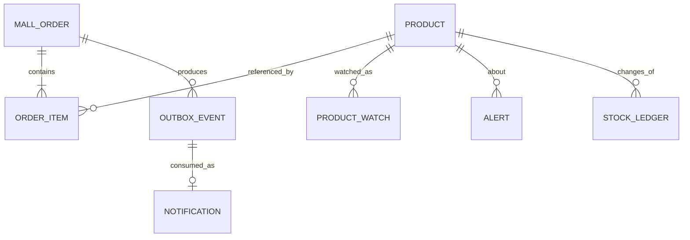

# 接口与数据结构

基础地址：`http://localhost:8080`。全部修改请求需要会话 Cookie + CSRF token；下单额外需要 `Idempotency-Key`。最方便的调用方式是在已登录页面使用实验手册中的 mallLab 辅助函数。

## 页面与认证

| 方法 | 路径               | 说明                                                |
| ---- | ------------------ | --------------------------------------------------- |
| GET  | `/`                | 商城首页，匿名可看                                  |
| GET  | `/login`           | 登录页                                              |
| POST | `/login`           | 表单字段 username、password、\_csrf；不是 JSON 登录 |
| POST | `/logout`          | 带 CSRF 的表单退出                                  |
| GET  | `/learn`           | 登录后的学习地图                                    |
| GET  | `/actuator/health` | 公开的简要健康状态                                  |
| GET  | `/actuator/metrics` | 需登录：可查询的指标名清单                          |
| GET  | `/actuator/metrics/{name}` | 需登录：单个指标（如 `mall.assistant.stop`） |

| 指标                                  | 类型   | 标签                                          | 含义                                     |
| ------------------------------------- | ------ | --------------------------------------------- | ---------------------------------------- |
| `mall.operation.duration`             | Timer  | `operation`                                   | `@Observed` 标注的业务操作耗时           |
| `mall.assistant.stop`                 | Counter | `reason=DONE/TIMEOUT/MAX_STEPS/STALLED`      | 每轮 agent 循环的停止原因                |
| `mall.assistant.tool.calls`           | Counter | `tool`、`status=OK/ERROR/TIMEOUT/DUPLICATE`  | 工具调用结果（含被短路与超时的调用）     |
| `mall.assistant.first.token.latency`  | Timer  | —（含 p95）                                   | 一轮开始到收到第一个字的延迟             |
| `mall.assistant.turn.duration`        | Timer  | `stop`                                        | 整轮耗时                                 |
| `mall.order.expiry.backlog`           | Gauge  | —                                             | 最近一次超时关单扫描后的积压订单数       |

登录后会话默认 30 分钟无活动过期。API 未登录返回 JSON 401，页面未登录跳转登录页。
`/actuator/**` 除 `health` 外一律需要登录，未登录返回 JSON 401（不是跳登录页）——
运营数据不外露，也避免监控脚本把「登录页 200」误判成「指标接口正常」。

> **这个 401 守的是授权规则，不是入口改写。** 让 `/actuator/**` 需要登录的是
> `SecurityConfig` 里的 `anyRequest().authenticated()`；把它改成 `permitAll()`，匿名访问立刻变 200
> （已由变异验证证实）。而 `exceptionHandling` 里那个把 `/api/**` 与 `/actuator/**` 拼在一起的
> `OrRequestMatcher` **当前是空操作**：Spring Security 的
> `ExceptionHandlingConfigurer.createDefaultEntryPoint()` 在 `defaultAuthenticationEntryPointFor`
> 只注册了 1 条时会完全不看 matcher、直接把它当全局默认入口返回，只有 ≥2 条才走
> `DelegatingAuthenticationEntryPoint`。实测把 `/actuator/**` 那一半撤掉后，匿名访问
> `/cart`、`/orders`、`/some/unknown/path` 依然全部返回 401 + 这段 JSON。
> 所以撤掉它不会让任何测试变红——它保留下来的意义是显式防御：将来若再加第二个
> `defaultAuthenticationEntryPointFor`，delegation 生效，缺了它 `/actuator/**` 才会掉回 302 跳登录页。
本项目只接了 actuator 自带的 `SimpleMeterRegistry`（进程内聚合），**没有** Prometheus 导出端点。

## 商品

| 方法 | 路径                 | 说明                                             |
| ---- | -------------------- | ------------------------------------------------ |
| GET  | `/api/products`      | 6 件商品列表，匿名可读；本版搜索和分类在前端执行 |
| GET  | `/api/products/{id}` | 单个商品，不存在返回 404                         |
| POST | `/api/products/{id}/price` | **仅 STAFF**。`{"price":34.00}`，范围 0.01-99999.00。改价成功且值真的变化时广播 `ProductChangedEvent`，主动服务据此触发降价提醒。其他角色 403 |
| POST | `/api/products/{id}/stock` | **仅 STAFF**。`{"stock":8}`，范围 0-9999。用途同上（补货提醒的触发源） |

示例对象：

```json
{
  "id": 1,
  "name": "云朵马克杯",
  "description": "温润陶瓷，陪你写完第一行 Java。",
  "category": "生活",
  "illustration": "cup",
  "price": 39.0,
  "stock": 30
}
```

价格由服务器提供。illustration 是本地 SVG 文件名，不是客户端上传路径。

## 购物袋

购物袋存在服务端（不是浏览器本地存储），所以同一账号跨标签页、跨设备一致，
助手也能替用户往里加东西——用户在首页刷新就能看到。

| 方法   | 路径                        | 请求内容                              | 结果                                             |
| ------ | --------------------------- | ------------------------------------- | ------------------------------------------------ |
| GET    | `/api/cart`                 | —                                     | 购物袋内容 + 结算试算（小计/满减/运费/应付 + 说明） |
| POST   | `/api/cart/items`           | `{"productId":1,"quantity":3}`        | 加购（数量为增量）；返回加购后的完整试算          |
| PUT    | `/api/cart/items/{productId}`| `{"productId":1,"quantity":2}`       | 直接设置数量；`quantity <= 0` 视为移除            |
| DELETE | `/api/cart/items/{productId}`| —                                    | 移除某件商品                                     |
| DELETE | `/api/cart`                 | —                                     | 清空购物袋                                       |

返回结构（所有写操作与 GET 返回同一个结构，前端无需再查一次）：

```json
{
  "items": [{ "productId": 1, "name": "云朵马克杯", "unitPrice": 39.00, "quantity": 3,
              "stock": 30, "subtotal": 117.00, "available": true }],
  "itemCount": 3, "subtotal": 117.00, "discount": 10.00,
  "shippingFee": 0.00, "total": 107.00,
  "notes": ["已享满 99 减 10", "已包邮", "再买 82.00 元可减 25"]
}
```

金额、满减档位与包邮门槛全部由服务端 `CartPricing` 计算（规则见 `mall.shopping` 配置），
页面与助手对话引用的是同一份结果——不存在第二个算法的可能。

约束与错误：库存不足 409 `OUT_OF_STOCK`；单件超过 99 件 400 `QUANTITY_TOO_LARGE`；
购物袋超过 20 种商品 400 `CART_FULL`；数量非法 400 `INVALID_QUANTITY`。

## 订单

| 方法 | 路径                      | 请求内容                | 结果                               |
| ---- | ------------------------- | ----------------------- | ---------------------------------- |
| POST | `/api/quotes`             | items                   | 服务端金额快照 + 有效期（QuoteResponse） |
| POST | `/api/orders`             | items + quoteId + Idempotency-Key | 新建或重放都返回 200 + OrderView |
| GET  | `/api/orders`             | 无                      | 本人最近 50 笔，按创建时间倒序     |
| GET  | `/api/orders/{id}`        | 无                      | 本人一笔订单；他人/不存在均为 404  |
| POST | `/api/orders/{id}/pay`    | method                  | 模拟支付结果，重复同方式返回同流水 |
| POST | `/api/orders/{id}/cancel` | 无                      | 取消结果，重复取消不重复恢复库存   |

### 金额快照：`POST /api/quotes`

在**用户看到金额时**由服务端拍一张快照，而不是等到提交时才拍。请求体只提交商品编号与数量，
**不接受任何价格字段**——价格一律由服务端读商品表、交给唯一的 `Pricer` 计算，
客户端价格进不了可信链路。

请求（`QuoteRequest`）：

```json
{
  "items": [
    { "productId": 1, "quantity": 2 },
    { "productId": 2, "quantity": 1 }
  ]
}
```

响应（`QuoteResponse`）：

```json
{
  "id": "UUID",
  "subtotal": 117.0,
  "discount": 10.0,
  "shippingFee": 0.0,
  "payAmount": 107.0,
  "expiresAt": "2026-09-20T14:15:00"
}
```

| 字段          | 说明                                                              |
| ------------- | ----------------------------------------------------------------- |
| `id`          | 快照编号，下单时作为 `quoteId` 回传                                |
| `subtotal`    | 商品原价小计                                                      |
| `discount`    | 满减（取满足条件的最高一档，不叠加）                              |
| `shippingFee` | 运费（折后未达包邮门槛时收取）                                    |
| `payAmount`   | 应付 `= subtotal − discount + shippingFee`，唯一该拿去收钱的数字   |
| `expiresAt`   | 快照有效期 = 拍摄时刻 + `mall.order.payment-timeout-minutes`       |

快照落在 `price_quote` 表（见「数据结构与约束」）。`items` 的校验与下单请求一致
（1–20 种商品、每种 1–99 件），为空返回 400。

### 创建订单

创建请求：

```json
{
  "items": [
    { "productId": 1, "quantity": 2 },
    { "productId": 2, "quantity": 1 }
  ],
  "quoteId": "UUID"
}
```

`quoteId` **可选**，最长 36 位；它就是 `POST /api/quotes` 返回的 `id`。

**金额快照的语义与失效行为**（务必按这个口径理解，它决定了 409 会不会出现）：

- 快照是在**用户看到金额时**拍的（购物袋/结算页渲染时），不是提交时拍的。
  二者的区别正是这个机制存在的理由：从看到金额到点提交之间，运营可能改过价。
- 下单时服务端会按 `quoteId` 取出快照，并用**当前**商品价重算一遍应付金额，两者比较。
- 快照**缺失 / 属于他人 / 已过期**时，`quoteId` 视同没传：**跳过这次比对**，
  照常按当前价下单，而不是拒绝。快照是用户保护，不是下单权限边界——
  一次拿不到快照（页面停留太久、换了浏览器）不该让用户买不成东西。
- 只有「取到了**本人、未过期**的快照，且重算出的应付金额与快照不一致」时，
  才返回 `409 PRICE_CHANGED`，不做任何写入（比价发生在任何写调用之前）。
  客户端应重新拉一次 `/api/quotes` 并让用户确认新金额后再提交。

幂等键须为 8–80 位字母、数字、下划线或横线，推荐 UUID。1–20 种商品，每种 1–99 件；不接受重复商品行。金额、用户名、状态由服务器决定。按商品编号排序后计算请求指纹。

模拟支付请求：

```json
{ "method": "DEMO_CARD" }
```

method 可选 `DEMO_CARD`、`DEMO_WALLET`。不是支付宝/微信支付接口，没有金额结算和扣款。

OrderView 示例：

```json
{
  "id": "UUID",
  "status": "PENDING",
  "subtotal": 117.0,
  "discount": 10.0,
  "shippingFee": 0.0,
  "payAmount": 107.0,
  "total": 107.0,
  "paymentMethod": null,
  "paymentReceipt": null,
  "createdAt": "2026-09-20T14:00:00",
  "expiresAt": "2026-09-20T14:15:00",
  "closeReason": null,
  "closedAt": null,
  "items": [
    {
      "productId": 1,
      "productName": "云朵马克杯",
      "unitPrice": 39.0,
      "quantity": 2
    },
    {
      "productId": 2,
      "productName": "灵感笔记本",
      "unitPrice": 29.0,
      "quantity": 1
    }
  ]
}
```

金额四列的口径：`subtotal` 是商品原价小计，`discount` 是满减，`shippingFee` 是运费，
`payAmount = subtotal − discount + shippingFee`，是**唯一该拿去收钱的数字**。
`total` 是历史列，与 `payAmount` 在同一条 INSERT 里用同一个值写入，不可变——
新代码一律读 `payAmount`，`total` 只是为了不让既有调用方在迁移当天集体改签名。
四列的唯一生产者是 `dev.learning.mall.pricing` 包下的 `Pricer`；
业务代码里出现 `BigDecimal::add` 裸求和，就是在绕过满减和运费。

`expiresAt` 在下单那一刻算好并落库（下单时刻 + `mall.order.payment-timeout-minutes`），
之后即使运营改了支付时限，存量订单的截止时间也不会跳变——用户看到的倒计时必须和下单时说的一致。
`closeReason` 只有订单被关闭时才有值：`USER`（本人取消）/ `TIMEOUT`（超时未支付自动关闭）。
两者在数据上同为 `CANCELLED`，但对用户、对运营是两个不同的故事（后者才会触发弃单召回）。

超时订单由定时扫描关闭（`mall.order.auto-close-*`），关闭与归还预占库存在同一个事务里，
并发出 `ORDER_CLOSED_TIMEOUT` 事件。此时再调 `pay` 会得到 `409 ORDER_EXPIRED` 与明确文案。

createdAt 是本地日期时间，没有 UTC offset。本地教学默认按运行机器时间处理；多时区部署建议改用 Instant/UTC 持久化和明确的 API 时区。
超时判定以**服务端时间**为准，前端倒计时只是体验。

## 退款

退款是**独立于订单**的一张表，而不是 `mall_order.status` 的第五个取值：
订单的 `status` 回答的是「钱有没有收到」，而一笔订单可以被退多次、需要留下多条历史，
状态列只有一个位置，装不下。做成正交实体之后，订单可以停在 `PAID`，
退款走到哪一步由 `refund.status` 回答，两边互不挤占。

| 方法 | 路径                              | 可用角色        | 说明                                                    |
| ---- | --------------------------------- | --------------- | ------------------------------------------------------- |
| POST | `/api/orders/{orderId}/refunds`   | 订单归属人      | 申请退款。注意路径是复数 `refunds`，不是 `/refund`       |
| GET  | `/api/refunds/mine`               | 本人            | 我发起过的退款（含在途与终态），倒序                    |
| GET  | `/api/refunds/pending`            | STAFF/MERCHANT  | 待审批队列，先申请的排在前面，单次上限 50 条            |
| POST | `/api/refunds/{refundId}/approve` | **仅 MERCHANT** | 批准。**批准就是放款**                                  |
| POST | `/api/refunds/{refundId}/reject`  | **仅 MERCHANT** | 驳回：不放款、不动库存                                  |

审批意见（`note`）可以整个不发：前端「直接点批准/驳回」时不带 body 即可，
那不代表审批意见是空字符串。驳回时建议填写理由——它会作为站内信正文回给买家。

退款视图（`RefundView`）：

```json
{
  "id": "…", "orderId": "…", "username": "student", "amount": 47.00,
  "reasonCode": "NO_REASON", "reasonText": null,
  "route": "AUTO", "status": "REFUNDED",
  "requestedBy": "student", "decidedBy": "SYSTEM",
  "decidedAt": "2026-10-18T17:40:00", "decisionNote": null,
  "stockReturned": true, "createdAt": "2026-10-18T17:39:58"
}
```

分流（只有一份实现，页面与助手共用）：`AUTO` = 无理由 + 未发货 + 在自动退款窗口内
（默认 24 小时）+ 金额不超过阈值（默认 ¥200），立刻放款；其余一律 `MERCHANT_APPROVAL`。
三个「谁」容易混淆，一次说清：`username` 是**这笔钱是谁的**（放款一定退到这个人的钱包）、
`requestedBy` 是**谁发起的**、`decidedBy` 是**谁批的**（`AUTO` 固定 `SYSTEM`，
数据库有 `ck_refund_auto_decided_by_system` 钉着「AUTO 路径不许出现人类审批人」）。

`stockReturned` 为 `false` **不**代表漏还：已发货/已收货的订单退款只退钱、不还货
（货在买家手上，还回去就是凭空造货），那种情况下 `false` 才是正确答案。
库存只能跟着 `REFUNDED` 走，不能「还没批就先退货」。

`reasonCode` 取值 `NO_REASON` / `DAMAGED` / `WRONG_ITEM` / `OTHER`；不填即无理由退款，
认不出来的码会被明确拒绝（400），而不是悄悄变成 `NO_REASON`。
`amount` 可以为空：本次只支持全额退款，空就是「退这笔订单实付的全部」。

## 钱包

内置钱包是**站内虚拟余额**：不连银行、不做清算、不出对账文件。
它新增的只是「总额的减法被记下来了」，不是「我们开始处理钱了」。
余额一律是 BIGINT「分」，「元」的形态只在对外视图里出现，由 `pricing.api.MoneyUnits` 换算——
任何落库、比较、求和都只拿 `...Cents`。

| 方法 | 路径                  | 请求内容 | 结果                                                    |
| ---- | --------------------- | -------- | ------------------------------------------------------- |
| GET  | `/api/wallet`         | —        | 本人余额 + 最近 20 条流水（新的在前）；首次调用即懒开户 |
| POST | `/api/wallet/top-up`  | 无请求体 | 演示充值（固定档位），返回充值后的同一份视图            |

```json
{
  "balance": { "username": "student", "balanceCents": 50000, "balanceYuan": 500.00 },
  "recent": [
    { "id": 1, "username": "student", "deltaCents": 50000, "deltaYuan": 500.00,
      "balanceBeforeCents": 0, "balanceAfterCents": 50000, "balanceAfterYuan": 500.00,
      "reason": "OPENING", "actor": "SYSTEM", "orderId": null,
      "createdAt": "2026-10-18T17:39:58" },
    { "id": 2, "username": "student", "deltaCents": -4700, "deltaYuan": -47.00,
      "balanceBeforeCents": 50000, "balanceAfterCents": 45300, "balanceAfterYuan": 453.00,
      "reason": "PAYMENT", "actor": "student", "orderId": "…",
      "createdAt": "2026-10-18T17:41:03" }
  ]
}
```

`reason` 只有四类，因为全项目动余额的地方只有四个：`OPENING`（开户授予）、
`TOPUP`（演示充值）、`PAYMENT`（下单支付，**必然出账**）、`REFUND`（退款放款，**必然入账**）。
`deltaCents` 的符号是信息的一部分：少了它，一笔支付看起来就像一笔充值。

**充值为什么没有 `amount` 入参**：它能被自定义，就等于把「累计上限」当成倍率而不是天花板。
它也没有幂等键——充值不是支付回调，不存在被第三方重放的场景，给它造一个客户端幂等键
是为不存在的问题写协议；它需要的不是幂等，而是上限。
超出上限返回 `409 TOPUP_LIMIT_EXCEEDED`，总开关关闭时返回 `409 TOPUP_DISABLED`。

用户名只取自 `Principal`，请求体、查询参数、路径里都没有「查谁的钱包」这个输入，
于是「查别人的余额」在接口层面没有表达方式。端点本身不需要角色规则：
`SecurityConfig` 的 `anyRequest().authenticated()` 已经把匿名挡在门外（未登录是 401，不是 500）。

## 消息与通知

| 方法 | 路径                       | 说明                                                                 |
| ---- | -------------------------- | -------------------------------------------------------------------- |
| GET  | `/api/messages`            | 本人最近 50 条 events、最近 50 条 notifications、全局线程池概况 pool |
| POST | `/api/messages/{id}/retry` | 本人 DEAD 事件重新投递；成功 200 空响应，其他状态/用户 409           |

事件字段包括 id、aggregateId（订单号）、eventType、content、status、attempts、nextAttemptAt、lastError、createdAt、deliveredAt。类型为 ORDER_CREATED、ORDER_PAID、ORDER_CANCELLED、ORDER_CLOSED_TIMEOUT；状态为 PENDING、DELIVERED、DEAD。

pool 的 size 是当前已创建线程数，active 是运行中线程数，queued 是内存队列任务数，maximum 是最大线程数。它们是瞬时全局值，不是数据库待投递总数，也不包含其他用户事件内容。

## 购物助手（含权限与安全）

| 方法   | 路径                                        | 可用角色         | 说明                                                  |
| ------ | ------------------------------------------- | ---------------- | ----------------------------------------------------- |
| GET    | `/api/assistant/status`                     | 所有登录用户     | 模型是否启用、当前角色、能力清单、限流额度            |
| POST   | `/api/assistant/conversations`              | 所有登录用户     | 新建会话                                              |
| GET    | `/api/assistant/conversations`              | 所有登录用户     | 本人最近 50 个会话                                    |
| GET    | `/api/assistant/conversations/{id}`         | 会话所有者       | 会话详情与全部消息                                    |
| DELETE | `/api/assistant/conversations/{id}`         | 会话所有者       | 删除会话（消息随外键级联删除）                        |
| POST   | `/api/assistant/conversations/{id}/messages`| 会话所有者       | **异步**发送消息（服务端返回 `Callable`，Web 容器线程在助手开始思考时即释放）。返回回复、本次的守卫处置、（可选）待确认动作与（可选）追问选项 `suggestions`。请求体可带 `images`（以图搜款，见下节）。并发拒绝：409 `CONVERSATION_BUSY`（同一会话已有轮次在执行）/ 429 `TOO_MANY_IN_FLIGHT`（本人同时在途超限）/ 503 `ASSISTANT_BUSY`（全局在途超限，含线程池队列溢出） |
| POST   | `/api/assistant/conversations/{id}/stream`  | 会话所有者       | **流式**发送消息，`text/event-stream`。与上一行是同一条管线（同一套限流/守卫/闸门/工具循环），只是进度与正文实时可见。事件：`open` →（`stage` / `tool` / `delta`）→ `done`，失败以 `error` 收尾——返回 `SseEmitter` 时响应头已发出，之后的失败只能从流里表达。前端在非 200 或拿不到响应体时自动回退到同步端点 |

**发送接口的请求体**（两个端点完全一致，因此图片走同一套 JSON 序列化与校验）：

```jsonc
{
  "message": "有没有同款",                 // 可为空（只发图不打字是正当用法）
  "images": [                             // 可选，最多 3 张（mall.assistant.vision.max-images）
    { "mime": "image/jpeg", "data": "<base64，允许带 data:image/...;base64, 前缀>" }
  ]
}
```

图片只在这一次请求内有效：校验后由视觉模型转成一段文字描述进入上下文，
**图片本身不落库、不写日志、不进运行轨迹**。消息表里的用户消息只留一个 `[图片]` 占位符。

| 图片校验失败错误码         | 含义                                                        |
| -------------------------- | ----------------------------------------------------------- |
| `IMAGE_EMPTY`              | 图片为空                                                    |
| `IMAGE_BAD_BASE64`         | 不是合法的 base64                                           |
| `IMAGE_TOO_LARGE`          | 单张超过 `max-bytes-per-image`（默认 4MB，按解码后字节算）   |
| `IMAGE_TOO_MANY`           | 张数超过 `max-images`（默认 3）                             |
| `IMAGE_TYPE_NOT_ALLOWED`   | 声明的 MIME 不在白名单（JPG / PNG / WebP / GIF）            |
| `IMAGE_CONTENT_MISMATCH`   | **文件头与声明类型不符，或压根不是位图**                     |

`IMAGE_CONTENT_MISMATCH` 是最重要的一条：客户端声明的 MIME 只是线索，
真正的判定看文件头魔数。声明 `image/png` 却送来 SVG / HTML / 任意字节，都会在这里被拒。
（细节见 [多模态与以图搜款](多模态与以图搜款.md) 第四节。）

流式事件一览（详见 [主动服务与流式输出](主动服务与流式输出.md)）：

| 事件 | 载荷 | 含义 |
| ---- | ---- | ---- |
| `open` | `{conversationId}` | 通道已建立 |
| `stage` | `{stage}` | 轮次级阶段：`thinking`（思考中）/ `vision`（正在看用户上传的图片） |
| `tool` | `{tool, phase, label, status?, latencyMs?}` | 工具开始/结束，`label` 是中文文案 |
| `delta` | `{text}` | 模型产出的文本增量（逐字）。中间轮也会有，那不是最终答案 |
| `guard` | `{reason}` | 增量被判不安全，已推出的增量作废 |
| `done` | `SendMessageResponse` | 正常收尾；`reply.content` 是<b>权威</b>文本，可能已被输出守卫改写 |
| `error` | `{code, message}` | 失败收尾 |
| GET    | `/api/assistant/memory`                     | 本人             | 助手记住的我的购物偏好（key/label/value/**source**/updatedAt）；`source` 为 `MODEL`（用户明说）或 `AUTO`（助手推断）。他人看不到，未登录 401 |
| DELETE | `/api/assistant/memory/{key}`                | 本人             | 忘记某条偏好；`key=ALL` 清空。只作用于本人              |
| GET    | `/api/assistant/audit?limit=50`             | **STAFF**        | 最近安全事件；其他角色返回 403                        |
| GET    | `/api/assistant/conversations/{id}/pending-actions` | 会话所有者 | 本会话未过期的待确认动作（页面刷新后重渲染确认卡片）    |
| POST   | `/api/assistant/pending-actions/{id}/confirm`| 动作归属者      | human-in-the-loop：确认执行（如支付）；他人 404        |
| POST   | `/api/assistant/pending-actions/{id}/cancel` | 动作归属者      | 取消待确认动作；过期/重复处理返回 409                  |
| GET    | `/api/assistant/runs?limit=20`              | **STAFF**        | 最近的 agent 运行轨迹（停止原因/步数/耗时）；其他角色 403 |
| GET    | `/api/assistant/runs/{runId}/steps`         | **STAFF**        | 某次运行逐步的工具调用轨迹（工具/参数/状态/耗时/是否截断） |

发送消息的响应体：

```json
{
  "reply": { "id": "...", "role": "ASSISTANT", "content": "...", "toolData": null, "createdAt": "..." },
  "decision": "BLOCK",
  "notice": "已被安全策略拦截：PI_OVERRIDE_ZH（LLM01）",
  "pendingAction": null
}
```

`pendingAction` 仅在本轮对话通过工具发起了待确认动作时非空。**`kind` 决定这张卡片要什么、确认后做什么**：

| kind            | 由谁发起                | 卡片展示                       | 确认后发生的事                                 |
| --------------- | ----------------------- | ------------------------------ | ---------------------------------------------- |
| `ORDER_PAYMENT` | `payOrder` 工具         | 订单号 + 应付金额 + 支付方式   | 调用支付：订单置 PAID                          |
| `ORDER_CREATE`  | `createOrder` 工具      | 购物袋行项 + 小计/优惠/运费/应付 | 落单 + 扣库存 + **清空购物袋**（同一事务）       |
| `ORDER_CANCEL`  | `cancelOrder` 工具      | 订单号 + 金额                  | 关单，库存归还                                 |

```json
{
  "id": "…", "conversationId": "…", "kind": "ORDER_CREATE",
  "orderId": null, "amount": 86.00, "method": null,
  "status": "PENDING", "expiresAt": "2026-10-08T23:20:00"
}
```

`ORDER_CREATE` 的 `orderId` 是 null——订单还不存在，这正是「确认之前零副作用」的证据；
`ORDER_PAYMENT` 的 `method` 才有值，`ORDER_CANCEL` 两者都有。
这些差异由数据库上的命名约束 `ck_pending_kind_fields` 强制，不是靠代码自觉。

前端据此渲染 human-in-the-loop 确认卡片；确认/取消的响应为
`{ "action": <PendingActionView>, "message": <ChatMessageView> }`，message 是写回会话的结果消息
（`ORDER_CREATE` 确认后是「✅ 下单成功：订单 xxxxxxxx（应付 ¥86.00）已生成」）。
三种 kind 共用同一对确认/取消端点：安全关键的状态迁移、归属校验、TTL、审计只有一份实现，
复制出第二份就是这些规则分叉的开始。

`decision` 是本次请求的处置结果，客户端据此给用户明确反馈，而不是「消息发出去了但回复莫名其妙」：

| decision | 含义                                                     |
| -------- | -------------------------------------------------------- |
| ALLOW    | 正常处理                                                 |
| MASK     | 输入被清洗（去隐藏字符、脱敏 PII）或输出被清洗后放行     |
| BLOCK    | 命中安全规则，已拒答或已替换为安全话术                   |
| RATE     | 触发每分钟限流                                           |

单条消息上限 4000 字（传输层硬上限），助手策略层默认 1000 字以内，超限由守卫给出中文提示而不是 400 校验错误。

权限分级（同一助手、不同能力）：

| 工具              | 说明                     | USER | STAFF |
| ----------------- | ------------------------ | ---- | ----- |
| searchProducts    | 搜索商品                 | ✅   | ✅    |
| recommendByBudget | 按预算推荐               | ✅   | ✅    |
| getProduct        | 商品详情                 | ✅   | ✅    |
| myOrders          | 本人订单                 | ✅   | ✅    |
| searchKnowledge   | 知识库检索（数据范围按角色隔离） | ✅   | ✅    |
| requestPayment    | 发起支付确认（仅本人待支付订单；真正支付需本人页面确认） | ✅   | ✅    |
| viewCart / addToCart / setCartQuantity / removeFromCart / clearCart | 结算试算与购物袋写操作（加购不要求二次确认：不动钱、可见、可撤销） | ✅   | ✅    |
| compareProducts   | 一次取全 2-4 件商品的真实参数用于对比 | ✅   | ✅    |
| requestClarification | 需求模糊时抛出结构化追问，选项由前端渲染成可点按钮 | ✅   | ✅    |
| rememberPreference / recallPreferences / forgetPreference | 长期记忆读写（键白名单 + 输入守卫 + 单人 8 条上限） | ✅   | ✅    |
| watchProduct / unwatchProduct / myWatches | 关注商品（降价/补货提醒）。写操作、低风险、可撤销，留在调用线程顺序执行 | ✅   | ✅    |
| myAlerts          | 我收到的提醒（最多 10 条） | ✅   | ✅    |
| recommendRelated  | 基于购物袋与历史订单的关联推荐，每条必须带理由 | ✅   | ✅    |
| inventoryAlerts   | 库存预警与补货建议       | ❌   | ✅    |
| salesOverview     | 全站经营概览             | ❌   | ✅    |
| customerOrders    | 按用户名查询订单         | ❌   | ✅    |

工具调用者身份由 `@ToolMemoryId` 注入（当前登录用户名），模型无法伪造；工具内部再用账号角色校验一次，不信任任何对话内容。

## 关注、提醒与关联推荐

主动服务接口。全部以**登录用户**为作用域，用户名取自 `SecurityContext` 而不是请求参数——
「查看/修改别人的关注」在接口层面就没有表达方式。助手侧的 `watchProduct` / `myAlerts` /
`recommendRelated` 走的是同一套 Service，所以「助手帮你关注」和「你自己点关注」是同一份数据。

| 方法   | 路径                                   | 可用角色     | 说明                                                         |
| ------ | -------------------------------------- | ------------ | ------------------------------------------------------------ |
| GET    | `/api/watches`                         | 本人         | 我的关注列表（商品名/图/类目/现价/基线价/库存/是否有货）；未登录 401 |
| POST   | `/api/watches`                         | 本人         | `{"productId":1}` 关注。幂等：已关注则更新基线；单人上限 30 条 |
| DELETE | `/api/watches/{productId}`             | 本人         | 取消关注                                                     |
| GET    | `/api/alerts`                          | 本人         | 提醒中心：`{unread, alerts[]}`，最近 50 条，按时间倒序。他人看不到 |
| POST   | `/api/alerts/{id}/read`                | 提醒所有者   | 标记已读，返回 `{updated:true/false}`；非本人不生效           |
| POST   | `/api/alerts/read-all`                 | 本人         | 全部已读，返回 `{updated:<条数>}`                             |
| GET    | `/api/recommendations/related?limit=3` | 本人         | 关联推荐，每条必带 `reason`。三级降级：共同购买 → 同类目 → 热销 |

关注对象的响应体：

```json
{
  "productId": 1, "productName": "云朵马克杯", "illustration": "cup", "category": "生活",
  "price": 34.00, "baselinePrice": 39.00, "stock": 30, "inStock": true
}
```

`baselinePrice` 是「什么叫降价」的判据：低于它才算降。**提醒发出后基线会被重置为当时现价**
（补货提醒同理更新库存状态），所以同一轮降价只提醒一次，想再收到提醒就得再降一次——
会重复轰炸的功能会被用户关掉，而关掉之后等于没做。

提醒对象的响应体：

```json
{
  "id": "…", "type": "PRICE_DROP", "title": "云朵马克杯 降价了",
  "content": "从 ¥39.00 降到 ¥34.00", "productId": 1,
  "createdAt": "2026-10-15T17:51:00", "read": false
}
```

`type` 取值：`PRICE_DROP`（降价）、`BACK_IN_STOCK`（补货）、`RELATED`（关联推荐，预留）。

推荐对象的响应体：

```json
{
  "id": 4, "name": "柔光台灯", "illustration": "lamp", "category": "生活",
  "price": 89.0, "stock": 12, "reason": "和你近期挑的品类相同"
}
```

`reason` 是必填字段，措辞上刻意避开「关注」二字（「关注商品」在本期已是专有功能，
同词不同义会让人误以为推荐看了关注列表）。

触发路径有两条，缺一不可：

```
店员改价/改库存 ──→ ProductChangedEvent ──→ @TransactionalEventListener(AFTER_COMMIT) ──→ 扫描 ──→ 提醒
                                                                                            ↑
                                            @Scheduled(fixedDelay=5min) ──→ 扫描 ──────────┘
                                    （运维直接改库/绕过接口的变更，只有这条能捞到）
```

事件触发保**及时性**（改价的人不该等下一个扫描周期），定时兜底保**完整性**（绕过接口的直接变更是没有事件的）。
单次扫描最多处理 `mall.proactive.max-alerts-per-scan`（默认 500）条，给定时任务自己封顶。

## 错误响应

```json
{ "code": "OUT_OF_STOCK", "message": "库存不足，请减少数量或换一件商品" }
```

| HTTP | code 示例                                                                           | 客户端处理                                      |
| ---- | ----------------------------------------------------------------------------------- | ----------------------------------------------- |
| 400  | INVALID_REQUEST / INVALID_KEY / INVALID_ITEMS / DUPLICATE_PRODUCT / INVALID_PAYMENT | 修正输入后再提交                                |
| 401  | UNAUTHENTICATED                                                                     | 重新登录                                        |
| 403  | FORBIDDEN                                                                           | 刷新获取 CSRF，检查登录状态                     |
| 404  | NOT_FOUND                                                                           | 资源不存在或不属于当前用户                      |
| 409  | OUT_OF_STOCK                                                                        | 调整数量；购物车改变应视为新请求                |
| 409  | PRICE_CHANGED                                                                       | 重新拉 `/api/quotes`，让用户确认新金额后再提交  |
| 409  | IDEMPOTENCY_CONFLICT                                                                | 原 key 对应不同正文；确认业务意图后使用新的 key |
| 409  | INVALID_STATE / PAYMENT_MISMATCH                                                    | 根据服务器订单状态更新界面                      |
| 409  | NOT_RETRYABLE                                                                       | 仅自己的死信允许重投                            |
| 409  | INSUFFICIENT_FUNDS                                                                  | 钱包余额不足：先充值，或换一种支付方式          |
| 409  | TOPUP_DISABLED / TOPUP_LIMIT_EXCEEDED                                                 | 演示充值已关闭 / 累计授予已达上限（¥1000）      |
| 409  | BUSY                                                                                | 等待后用原 key、原正文重试                      |
| 500  | INTERNAL_ERROR                                                                      | 查看服务端日志；不要无条件生成新 key            |

MVC 参数校验错误格式统一；错误 code 是程序判断依据，message 用于展示。网络超时不是确定失败，可能服务器已经提交。

## 数据结构与约束



| 表           | 主要字段与约束                                                                 |
| ------------ | ------------------------------------------------------------------------------ |
| product      | id 主键；price 非负；stock 非负                                                |
| mall_order   | UUID 主键；username+idempotency_key 唯一；request_hash；total；status 限定 PENDING/PAID/CANCELLED；expires_at（支付截止，下单时落库）；close_reason（USER/TIMEOUT，带命名约束）；closed_at；(status, expires_at) 索引供超时扫描 |
| order_item   | order_id+product_id 联合主键；数量为正；名称/单价快照；两侧外键                |
| outbox_event | UUID 主键；订单外键；到期时间、失败次数、状态；状态+到期时间索引用于扫描       |
| notification | event_id 主键且引用事件，保证同一事件只有一条本地通知                          |
| stock_ledger | 库存变动流水：自增主键；product_id 外键；delta 为变化量（正增负减，禁止 0）；stock_before / stock_after 为变动前后的现货；reason 限定 RESERVE/RELEASE/RESTOCK；actor 记「谁动的」（下单是用户名、补货是店员账号、建账是迁移脚本）；order_id 关联订单（刻意不加外键，避免删订单变成删证据）；四类 CHECK 全部显式命名，`ck_ledger_arithmetic` 保证「前 + 变化 = 后」 |
| price_quote  | 下单前用户看到的金额快照：UUID 主键；username 归属用户；lines_json 为商品与数量；subtotal / discount / shipping_fee / pay_amount 四个金额；expires_at 为快照有效期；`ck_quote_payable` 保证「应付 = 小计 - 优惠 + 运费」 |

**为什么库存变动必须留痕**：`product.stock` 只有「现在是多少」，没有「为什么变成这样」。
于是库存告警无法归因（「货到了」说不清是关单退回还是店员补的），对账也无从下手——
流水与现货对不上时，没有任何一处会报错。写入口收在 `ProductService` 的
`reserve` / `release` / `updateStock` 三个方法里，因为全项目只有这三个地方改 `product.stock`；
写在调用方（订单模块）会漏掉店员补货，而补货恰恰是最需要对账的变动。
于是恒等式成立：**某商品的现货 == 迁移建账基线 + 之后所有流水 delta 之和**
（V14 对存量商品按「从无到有」补了一条 `RESTOCK` 基线，条件带 `NOT EXISTS`，可重复执行）。

**为什么金额快照单独建表**：助手路径的 `lines_json` 只存商品与数量、不含价格，
所以「用户确认时看到的金额」在服务端没有任何记录。商品在「发起确认」与「确认下单」之间被改价，
用户就会按下单时的新价付款，而卡片上写的还是旧价。快照页面路径与助手路径共用这一张表：
只有一处产地，价格校验也只有一份实现。

购物助手相关表（会话按用户隔离，审计只记录安全事件）：

| 表                     | 主要字段与约束                                                                                                                                                    |
| ---------------------- | ----------------------------------------------------------------------------------------------------------------------------------------------------------------- |
| assistant_conversation | UUID 主键；username 用于用户隔离；(username, updated_at) 索引                                                                                                     |
| assistant_message      | seq 自增主键；id 唯一；conversation_id 外键且级联删除；role 为 USER/ASSISTANT；tool_data 存商品卡片 JSON                                                           |
| assistant_audit        | seq 自增主键；stage 为 INPUT/OUTPUT/TOOL/RATE/RAG；action 为 ALLOW/MASK/BLOCK/REDACT/REPLACE/DENY/PENDING/CONFIRM/CANCEL；rule_id 与 owasp 记录命中规则；excerpt 为截断后的命中片段 |
| assistant_pending_action | seq 自增主键；id 唯一；username 为归属用户（确认时硬校验）；kind 目前仅 ORDER_PAYMENT；status 为 PENDING/CONFIRMED/CANCELLED/EXPIRED；amount 为发起时金额快照；expires_at 为 TTL（默认 10 分钟）；`quote_id` 指向本次确认对应的金额快照（ORDER_CREATE 用，与 lines_json 同源、同生命周期）；一次性靠 `UPDATE ... WHERE status='PENDING'` 原子迁移保证 |
| assistant_run          | 一次 agent 运行的概要：stop_reason 为 DONE/MAX_STEPS/TIMEOUT/STALLED；steps/tool_calls/wall_ms 为本次运行规模；answer_excerpt 为回答摘要（截断 500 字）        |
| assistant_run_step     | run_id 外键级联删除；status 为 OK/ERROR/DENIED/DUPLICATE/TIMEOUT；latency_ms 为该工具耗时；result_chars 为工具输出原始长度；truncated 表示进模型前是否被裁剪        |
| assistant_user_memory  | 语义记忆：`(username, memory_key)` 唯一（同一偏好覆盖而非追加）；memory_key 受白名单约束；`source` 为 `MODEL`（用户明说，置信度 0.80 / 90 天）或 `AUTO`（助手推断，0.55 / 45 天）；**AUTO 永不覆盖 MODEL**，同源可自我更新；单人上限 8 条，超出淘汰最旧        |
| assistant_conversation_summary | 工作记忆：(conversation_id) 主键且随会话级联删除；summary 为滚动摘要；upto_seq 记录「已摘要到第几条」，用于增量刷新    |
| mall_cart_item         | 服务端购物袋：`(username, product_id)` 主键；quantity 限 1-99；商品删除时级联清除。购物袋页面与助手工具共用同一份数据 |

主动服务相关表：

| 表                   | 主要字段与约束                                                                                                                                                    |
| -------------------- | ----------------------------------------------------------------------------------------------------------------------------------------------------------------- |
| mall_product_watch   | `(username, product_id)` 联合主键（关注天然幂等）；baseline_price 为「什么叫降价」的判据，提醒后重置为当时现价；in_stock_at_watch 为关注时的库存状态，用于识别「缺货 → 到货」；last_notified_at 供排查骚扰；idx_watch_product 支持按商品反查「谁在盯它」；单人上限 30 条 |
| mall_alert           | UUID 主键；username 用于隔离；alert_type 限定 PRICE_DROP/BACK_IN_STOCK/RELATED；title+content 在生成时定型（提醒是「系统当时说过的话」，不该随后续改价而变）；read_at 为 NULL 即未读；idx_alert_user 支持按用户倒序取最近 50 条；source_key 为来源幂等键（目前用于弃单召回，形如 `abandoned-order:<订单号>`），配 `(username, source_key)` 唯一索引——NULL 不参与唯一性判断，所以普通提醒不受影响 |

**为什么提醒不复用 `outbox_event`**：`outbox_event.aggregate_id` 的外键指向 `mall_order(id)`，
且它承载的是「必须送达、失败要重试、重试有上限」的投递语义。站内提醒是「读一次就没了」的
展示型数据——混用会让外键和重试策略同时失真，复用比新建更贵。

钱包与退款相关表（V16 / V17 新建）：

| 表                   | 主要字段与约束                                                                                                                                                    |
| -------------------- | ----------------------------------------------------------------------------------------------------------------------------------------------------------------- |
| wallet               | 当前余额。`username` 主键；`balance_cents` 为 BIGINT「分」（不是 DECIMAL「元」：全项目只有 `Pricer` 能算钱，元会让每一笔「前 + 变化 = 后」都要再 `setScale` 一次，那就是第二套金额口径）；`ck_wallet_balance_nonneg` 保证余额不为负——这是「不能超扣」在数据库里的那一半。**只有两列**：没有 `created_at` / `updated_at`，因为当前没有任何消费者 |
| wallet_ledger        | 资金流水：自增主键；`delta_cents`（正入账、负出账，禁止 0）；`balance_before_cents` / `balance_after_cents`；`reason` 限定 `OPENING/TOPUP/PAYMENT/REFUND`；`actor` 记「谁动的」（开户 `SYSTEM`、支付是买家账号、放款是审批人）；`order_id` 关联订单（**刻意不加外键**：订单表在测试的 `@AfterEach` 里被 DELETE，加外键会把「删订单」变成「删证据」）。四类 CHECK 全部显式命名，`ck_wallet_ledger_arithmetic` 保证「前 + 变化 = 后」，另有两条**方向约束**（`PAYMENT` 必为负、`REFUND` 必为正）——算术恒等式是无方向的，符号写反它照样成立。`uq_wallet_ledger_order_reason` 让同一 `(order_id, reason)` 只允许一行（NULL 不参与唯一性，所以 `OPENING` / `TOPUP` 不受影响） |
| refund               | 一笔退款：`in_flight` 是生成列（`CASE WHEN status IN ('PENDING_APPROVAL','APPROVED') THEN order_id END`），配 `uq_refund_inflight` 唯一索引表达「一笔订单只能有一笔**在途**退款」——H2 2.3.232 不支持条件唯一索引，而它的唯一索引允许多个 NULL，于是终态可以留任意多条历史、在途只允许一条。`ck_refund_decision_fields` 钉住「审批字段要么全空（还在等）要么全满（已有决定），半吊子行不存在」；`ck_refund_stock_only_when_refunded` 钉住「只有 `REFUNDED` 才允许 `stock_returned=1`」；`ck_refund_auto_decided_by_system` 防止把自助退款伪造成「某某批过」。生成列**不可手工赋值**，INSERT/UPDATE 的列清单里都不要出现 `in_flight` |
| notification_delivery | 外发投递留痕（本地实现也写，降级也写）：`channel` 是实际投递走的通道，`preferred_channel` 是原本想走的通道（降级后两者不同），`degraded` 标记是否降级，`event_type` 限定 `ORDER_SHIPPED/ORDER_RECEIVED/ORDER_REFUNDED` 等。V17 只建表，写入它的「通道抽象」是后续阶段的接缝——**先有契约再接线**，接线时不许再改 null 语义 |

**为什么钱包迁移一个 INSERT 都不写**：初始额度来自 `application.yml` 的
`mall.wallet.initial-grant-cents`，由 Java 侧懒开户时授予。迁移脚本读不到 yml，
在 SQL 里写死金额就会造出第二个真相来源——改配置的人以为改了额度，已经开户的用户还是旧额度。

**为什么充值必须有上限**：能无限充值的钱包会让「余额不足」这条约束永远走不到，
于是扣款失败分支、余额校验、以及「退款到底有没有真的把钱退回去」全部形同虚设。
上限独立于初始额度存在，因此即便有人把初始额度调大，也不等于能无限续杯。

初始商品和建表脚本在 `src/main/resources/db/migration`。修改结构应新增迁移文件，不要修改已经执行的迁移。
修改商品的接口只有店员可用的改价/改库存两个（见「商品」一节），没有通用的商品管理端；
列表有 50 条上限以保持示例简单。
