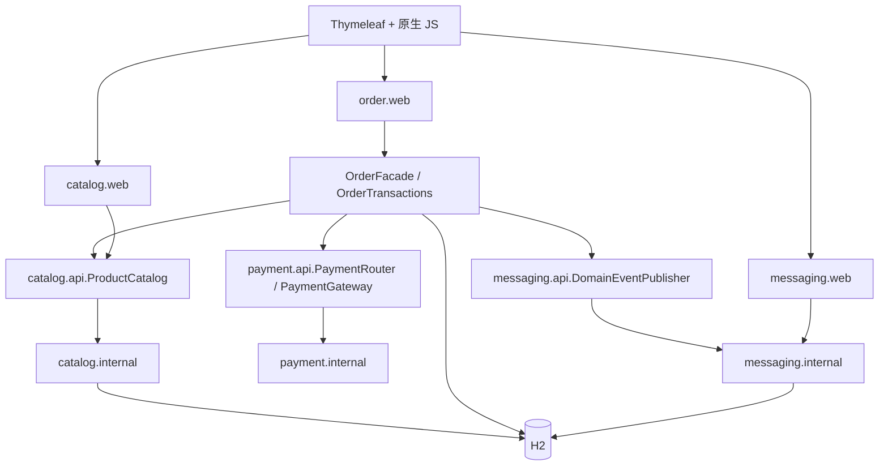
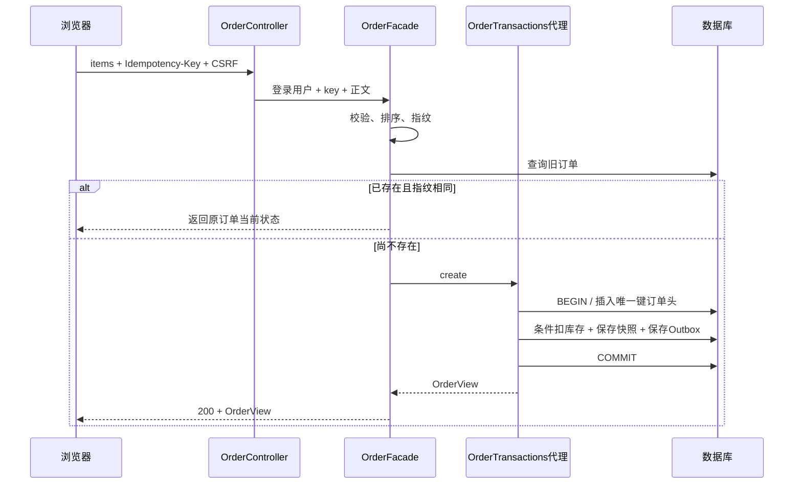

# 架构与阅读路线

## 设计目标

用最少基础设施跑通一条有现实边界条件的商城链路。所有代码在同一个 Spring Boot 应用中运行，按业务模块组织，再在模块内分层。先理解“为什么这样划分”，再考虑拆 Maven 工程或微服务。

## 模块依赖

图中 api 到 internal 的箭头表示运行时实现选择，不表示接口源码应 import 实现。装配由 Spring 完成。

| 模块         | 对外约定                                  | 负责                                 | 不负责                     |
| ------------ | ----------------------------------------- | ------------------------------------ | -------------------------- |
| catalog      | ProductCatalog / ProductView              | 商品读取、库存预占与归还             | 支付、用户身份             |
| order        | HTTP 用例、CreateOrderRequest / OrderView | 幂等、订单状态、交易事务编排         | 具体通知和支付策略实现     |
| payment      | PaymentGateway / PaymentRouter            | 根据方法选择模拟支付策略             | 修改订单状态、真实金融扣款 |
| messaging    | DomainEventPublisher / MessageDashboard   | Outbox、扫描、线程池、重试、站内通知 | 决定库存或订单状态         |
| common       | 异常与 Observed 注解                      | 通用横切能力                         | 保存业务状态               |
| config / web | Spring 装配与页面路由                     | 安全链、模板入口                     | 下单规则                   |

包不是强制的发布边界。不要在新增功能时跨业务包 import 对方 internal。真正需要编译期隔离时可拆 Maven 模块；需要自动规则检查时可引入 ArchUnit/Spring Modulith。当前选择可读性与单次启动优先。

## 推荐阅读顺序

### 第一遍：只看一次商品查询

1. `MallApplication`：启动和扫描范围。
2. `catalog/web/ProductController`：HTTP 路由和返回 DTO。
3. `catalog/api/ProductCatalog`：接口能力。
4. `catalog/internal/ProductService`：业务访问。
5. `catalog/internal/ProductRepository`：SQL 和结果映射。
6. `static/js/app.js` 的 loadProducts/renderProducts：JSON 如何到界面。

到这里先停下，独立复述请求链路，不要立刻跳进并发测试。

### 第二遍：只看成功下单

1. `order/api/CreateOrderRequest`：输入校验。
2. `order/web/OrderController.create`：当前登录身份和请求头。
3. `order/internal/OrderFacade.create`：规范正文、指纹、重放。
4. `order/internal/OrderTransactions.create`：一个事务里的多个动作。
5. `ProductService.reserve`：MANDATORY + 条件库存更新。
6. `OutboxPublisher.publish`：同事务保存待投递事实。
7. `db/migration/V1__create_mall.sql`：唯一约束与 CHECK。

### 第三遍：故障、并发和代理

1. `common/TimingAspect`：统一日志切面。
2. `OrderFacade` 的 DuplicateKeyException 捕获位置。
3. `OrderTransactions.pay/cancel` 的 FOR UPDATE 和状态判断。
4. `MallIntegrationTest` 的回滚/并发案例。

### 第四遍：异步链路

1. `MessagingProperties / ExecutorConfig`：线程池和配置。
2. `OutboxDispatcher`：到期扫描、inFlight、拒绝处理。
3. `MessageWorker`：事务失败后安排重试。
4. `MessageProcessor`：消费事务和失败记录事务。
5. `NotificationSink`：本地幂等写入与故障开关。
6. `MessageService / MessageController`：当前用户的观测页面。
7. `RestartPersistenceTest / DispatcherBackpressureTest`：恢复与反压。

## 下单顺序图

并发唯一键冲突时，代理先回滚，再回到 facade 的 catch 查询已提交订单。这个分支在图中省略，源码与测试中完整保留。

## 数据库事务边界

| 动作     | 一个事务里包含什么                        | 并发保护                           |
| -------- | ----------------------------------------- | ---------------------------------- |
| 创建订单 | 订单头 + 库存 + 订单项 + 创建事件         | 用户/key 唯一约束；库存条件 UPDATE |
| 模拟支付 | 订单行锁 + 状态修改 + 支付事件            | 订单 FOR UPDATE；同方式重放        |
| 取消     | 订单行锁 + 库存归还 + 状态修改 + 取消事件 | 订单 FOR UPDATE；状态检查          |
| 消费事件 | 事件行锁 + 本地通知 + DELIVERED           | 事件锁；通知 event_id 唯一         |
| 记录失败 | 事件行锁 + attempts + 下次时间/DEAD       | 在消费事务回滚之后另开事务         |
| 死信重投 | 单条带用户和状态条件的 UPDATE             | 只从 DEAD 转换                     |

## 有意保持简单的地方

- 商品只有 6 件，搜索/分类在浏览器执行，没有后端分页搜索。
- 订单和通知列表只取最近 50 条；旧数据未删除，但没有历史翻页界面。
- 查询订单列表逐笔读取订单项，最多 50 次子查询；教学代码直观。大量订单时应批量查询或分页，避免 N+1 放大。
- 内存用户、浏览器购物车、数据库订单分别使用不同存储方式，教程解释各自边界。
- 没有库存过期自动释放；未支付订单需要显式取消，适合作为扩展练习。
- 本地模拟支付无外部副作用，可以在短事务内完成。真实支付不能直接替换这一个方法了事。
- 本地持久化队列不保证严格事件顺序，也没有多实例/生产高吞吐验证。
- 没有给所有类再套一层空接口。公开接口只放在值得稳定的跨模块协作位置。

## 扩展时保持这些不变量

库存不能为负；同用户同幂等键不能生成多份订单；同 key 不同业务正文必须冲突；取消只归还一次；支付与取消不能同时获胜；已提交业务不能因为消费者暂时失败而丢失通知任务；同事件不得产生两条本地通知；用户不能访问他人的订单和消息。

每增加一种状态或中间件，先检查上述不变量的保护方式是否仍成立，再增加对应的异常/竞争测试。
