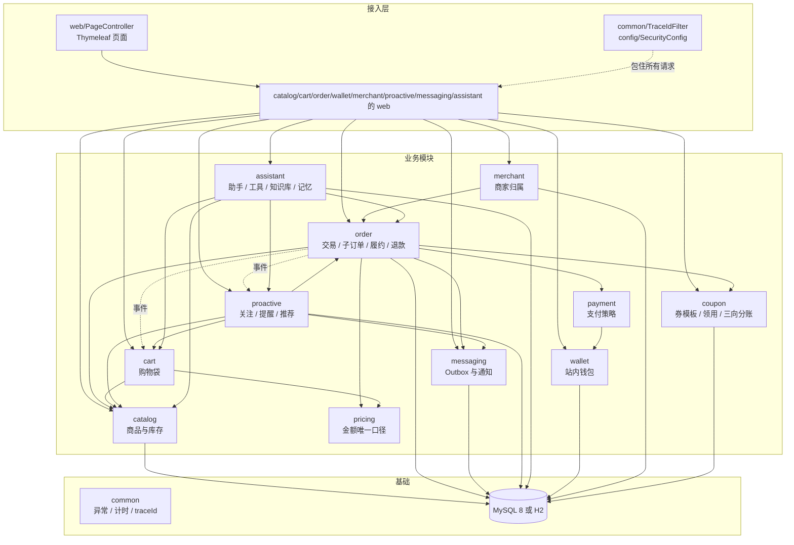
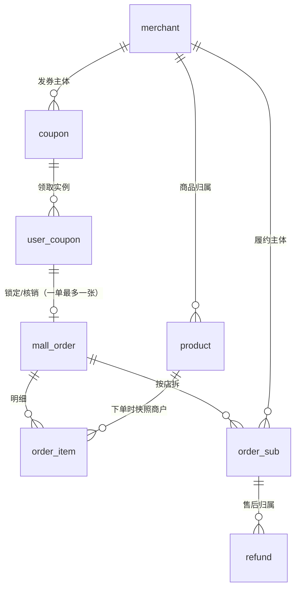
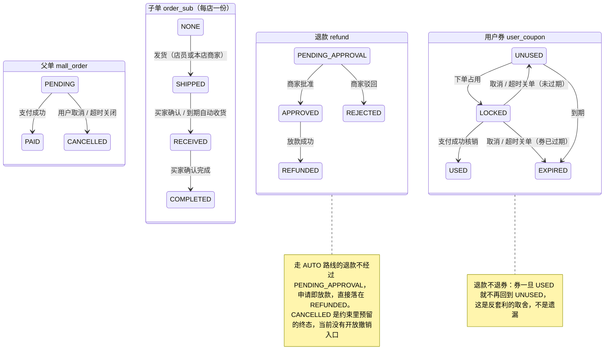
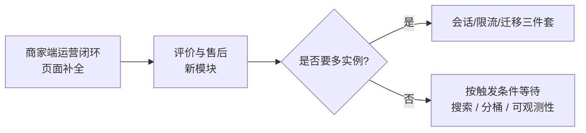

# 商城项目架构总览（当前版本）

> 更新时间：2026-10-27
> 对应代码状态：A（安全）/ B（性能）/ C（可维护性）/ D（可观测性）四段优化已全部落地；在此基础上新增优惠券系统（V27/V28）。全量 **572 条测试全绿**，迁移 **28 个**（24 个结构 + 4 个演示种子）。
> 本文写给「第一次接触这个项目的人」：先讲清楚**它是什么、分成哪几块、每块为什么这么分**，再讲**哪些事刻意没做**以及**下一步可以做什么**。
> 如果你只想尽快跑起来，请看 [README](../README.md)；想按源码顺序读，直接跳到文末的「新人阅读路线」。

---

## 1. 一句话定位

一个**单进程、可实际点击下单**的 Spring Boot 教学商城：它把「浏览 → 购物袋 → 下单 → 支付 → 分店履约 → 退款 → 主动服务」这条真实链路跑通，并在上面挂了一个会调用工具、能查知识库的 AI 导购助手。

它有三个刻意的取向：

1. **运行应用不引入额外基础设施**：不需要 Node.js、Redis、RabbitMQ。消息队列是数据库里的 Outbox 表，向量检索是进程内的 BGE 小模型（可选的浏览器安全评测脚本另算，见第 9 节）。
2. **每个设计尽量有实测依据**：性能数字来自本机计时，迁移脚本先在 H2 与 MySQL 8 上验证方言差异，指标口径经过真实下单验证。
3. **能说清楚「为什么不做」**：缓存、全文索引、微服务前缀、前端框架等都在第 10 节列了否决理由和触发条件——**不做的决定和做了的决定一样，都是设计的一部分**。

---

## 2. 技术底座与运行方式

| 层 | 选型 | 为什么是它 |
|----|------|-----------|
| 语言 / 运行时 | Java 21 | 记录类、模式匹配让 DTO 与分支判断保持短小 |
| 框架 | Spring Boot 3.5.16（MVC + Thymeleaf + Security + AOP + Actuator） | 一个进程装下页面、接口、安全、定时任务 |
| 数据访问 | **JdbcClient**（不用 ORM） | 状态迁移依赖「条件 UPDATE 影响了几行」；SQL 直接可读，才能让 `WHERE status='PENDING'` 这种判权逻辑摆在明面上 |
| 迁移 | Flyway（`db/migration` + `db/dev-seed` 两个目录） | 结构与演示数据分离，见第 7 节 |
| 生产库 | MySQL 8 | 需要真正的行级锁、`SKIP LOCKED`、未来的库存分桶；H2 文件库的锁是整库级 |
| 测试库 | H2 2.x，`MODE=MySQL` | 测试免外部依赖，同时逼着 SQL 保持可移植 |
| 指标 | Micrometer + `/actuator/metrics` | 不额外架 Prometheus，单实例够用 |
| 前端 | Thymeleaf + 原生 JS（无构建链） | 教学项目里「零构建、双击可调」本身是价值，详见 E1 的否决理由 |

**两种启动形态**

```powershell
# 默认（开发）：结构 + 演示种子 → 5000 件商品 / 200 家店 / 200 个商家账号
mvn spring-boot:run

# 生产形态：只有结构，商品目录为空
$env:SPRING_FLYWAY_LOCATIONS="classpath:db/migration"; java -jar target/learning-mall-1.0.0.jar
```

演示账号：`student`、`classmate`（顾客）、`admin`（店员，多 `STAFF` 角色），密码 `learn12345`；商家账号由 `UserAccountProvisioner` 按 `merchant.owner_username` 建，密码 `merchant12345`（可改）。

---

## 3. 模块全景

### 3.1 目录约定：`api` / `internal` / `web`

每个业务包内部固定三层，名字就是规则：

- **`api`**：对外契约。接口（如 `ProductCatalog`）、记录类 DTO、事件（如 `OrderPlacedEvent`）。**跨模块只能 import 这里。**
- **`internal`**：实现。Repository、Service、定时任务。**别的模块原则上不 import**（当前有 3 组例外，见本节附注）。
- **`web`**：HTTP 适配层，只做参数校验、取当前登录人、调 Service、返回视图。

这条约定不是「架构洁癖」：它让「谁能改谁的实现」在编译期就基本可见。强制检查（ArchUnit / Spring Modulith）当前没引——模块数量与例外都还少，人工可审计；等例外变多再上工具。

### 3.2 模块依赖



实线是**编译期依赖**，虚线是**运行时事件或过滤器包裹**。订单不直接依赖钱包：扣款与退款回补都经 `payment` 的策略（`DemoWalletPayment`）转调 `WalletService`——这样「钱怎么动」只有一个入口。券同理：`order` 只调 `coupon` 的 `api`（`CouponRedemptions` 占券/核销/释放），「减多少、谁承担多少」全部留在 `coupon.internal`。

### 附：跨模块 internal 依赖的三组例外

「跨模块只 import `api`」是约定而非编译期强制（没引 ArchUnit）。全量扫了一遍 import，当前有 **3 组**跨模块直接依赖 `internal` 的地方，都源于「必须复用同一套写入逻辑，不能抄第二份」：

1. `assistant.internal` → `cart.internal` / `proactive.internal`：工具层（加购、关注、提醒）要复用购物袋与提醒服务，另起一套只会产生两套真相。
2. `payment.internal` → `wallet.internal.WalletService`：扣款/回补必须与流水成对，这个顺序只有 `WalletService` 知道。
3. `proactive.internal` → `cart.internal.CartService`：推荐要直接读购物袋里的商品。

（同模块的 `web`/`harness` → 本模块 `internal` 不算例外。）若将来要严格化，正确做法是把所需能力上移到对应 `api`，而不是在调用方复制 SQL；需要自动拦截时再引 ArchUnit。

### 3.3 各模块职责

| 模块 | 对外契约（api） | 负责 | **不负责** |
|------|----------------|------|-----------|
| `catalog` | `ProductCatalog`、`ProductView`、`ProductChangedEvent`、`StockReason` | 商品查询/分页/搜索、库存预占与归还、库存流水、售罄 Gauge | 定价规则、订单状态 |
| `cart` | `CartView`、`CartItemView` | 服务端购物袋（登录后跨设备一致）、下单后清袋 | 金额计算、下单 |
| `pricing` | `Pricer`、`MoneyUnits` | **全系统唯一金额口径**：小计、满减、运费 | 落库、展示格式 |
| `coupon` | `CouponCatalog`、`CouponRedemptions`、`CouponApplication`、`CouponPreview` | 券模板与领用、券减免算法、**商家/平台/用户三向分账**、发行量与平台预算的并发控制 | 订单状态、支付、退款决策 |
| `order` | `OrderView`、`OrderPayments`、`OrderCheckout`、`OrderRefunds`、`OrderPlacedEvent`、`QuoteSnapshot` | 下单幂等、按店拆子单、支付状态机、超时关单、履约（发货/收货/完成）、退款审批 | 支付通道实现、通知发送 |
| `payment` | `PaymentGateway`、`PaymentRouter` | 按支付方式选策略（钱包 / 演示卡） | 改订单状态 |
| `wallet` | `WalletAccounts`、`WalletBalance`、`WalletLedgerEntry` | 站内余额、流水、初始额度、固定档充值 | 真实清算、对账 |
| `merchant` | `MerchantDirectory`、`MerchantScoped`、`MerchantContext`、`MerchantInventory` | 商家目录、**当前登录商家上下文**、按店收窄的库存视图 | 商品写操作、退款决策 |
| `messaging` | `DomainEventPublisher`、`MessageDashboard` | Transactional Outbox、投递任务、退避重试、死信、通道降级 | 决定订单/库存状态 |
| `proactive` | `AlertCenter`、`WatchView`、`RelatedProduct` | 关注（降价/补货）、提醒去重、关联推荐、弃单召回 | 商品写入、订单决策 |
| `assistant` | `AssistantStatus`、`SendMessageResponse`、`ConversationDetail`、`PendingActionView` | 对话、工具编排（Agent Loop）、RAG、长期记忆、流式输出、输入/输出守卫、审计与轨迹 | 业务规则本身（全部转调各模块） |
| `common` | `BusinessException`、`Observed`、`TraceIdFilter`、`MdcTaskDecorator` | 统一异常、AOP 计时、请求级 traceId、MDC 传递 | 保存业务状态 |
| `config` / `web` | — | 安全链、账号初始化、页面路由 | 下单规则 |

---

## 4. 领域模型与状态机

### 4.1 三层订单结构（V25 的关键改造）



| 层 | 回答什么问题 | 关键字段 |
|----|-------------|---------|
| `mall_order` | **钱**收没收到 | `status`、`paid_at`、`expires_at`、四个金额列、`coupon_discount` / `coupon_id` / `coupon_code` |
| `order_sub` | **这家店**的货发没发、退没退、**券怎么分账** | `merchant_id`、`pay_amount`、`fulfillment_status`、`auto_receive_at`、`coupon_discount` / `merchant_discount` / `platform_subsidy` / `platform_fee` / `merchant_income` / `platform_income` |
| `order_item` | 买了什么、下单时的价格与归属 | `unit_price`、`quantity`、`merchant_id` |
| `refund` | 哪一笔售后、退给谁 | `order_sub_id`（NOT NULL）、`route`、`status` |
| `coupon` | 这张券**长什么样、能发多少** | `owner_type`/`merchant_id`、`discount_type`、`discount_value`、`max_discount`、`min_spend`、`platform_share_bps`、`total_quantity`/`issued_count`、`platform_budget_cents`/`platform_spent_cents` |
| `user_coupon` | **这张券在谁手上、被哪单占了** | `status`（`UNUSED`/`LOCKED`/`USED`/`EXPIRED`）、`claim_seq`、`locked_order_id`、`used_order_id`、`expires_at` |

V25 之前订单是「一行 = 一个卖家」，于是跨店订单只能整单发货、整单退款，任何一家店都能批走整单金额。这不是漏判，而是**结构假设的必然后果**；拆出 `order_sub` 之后，「A 店批了 B 店的钱」在数据模型上无法被表达。

### 4.2 状态机



**判权方式**：所有状态迁移都用 `UPDATE ... WHERE status = '期望的旧值'`，**影响行数 = 1 才代表这次迁移是我抢到的**。并发支付、支付与关单竞态、重复退款，都靠这一条收敛，不依赖应用层加锁。

### 4.3 金额不变量

- 父单：`pay_amount = subtotal - discount + shipping_fee`，四列均非负（数据库 CHECK）。
- 子单：同一恒等式（`ck_sub_amounts`）。
- **Σ 子单各列 = 父单各列，分毫不差**：优惠与运费按各店小计比例分摊，向下取整到分，**最后一家店吃下全部取整余量**。
  代价是那 1 分钱记在最后一家店头上——这是「钱不能凭空多出或少一分」优先于「每家店金额绝对精确」的取舍。
- 券（V27 起，全部由数据库 CHECK 兜底，不只靠 Java）：
  - `coupon_discount ≤ discount`：券不能减超过券前折后商品金额（`ck_order_coupon_le_discount`、`ck_sub_coupon_le_discount`）。
  - `Σ 子单 coupon_discount = 父单 coupon_discount`：跨店券按商品金额用**最大余额法**分摊（余数按小数部分从大到小逐家补 1 分）。
  - 每店 `coupon_discount = merchant_discount + platform_subsidy`：券的每一分钱都有人认账（`ck_sub_coupon_split`）。
  - 每店 `merchant_income = pay_amount + platform_subsidy - platform_fee`（`ck_sub_merchant_income`）。
  - `platform_income ≥ 0`（`ck_sub_platform_income`）：平台补贴封顶为佣金的 80%，所以用券订单平台也赚钱。
  - `merchant_income ≥ 0`：单店承担不超过商品金额的 35%，超了就下调减免。

---

## 5. 关键链路

每条链路只讲**入口 → 关键判断 → 落点**，以及最容易被误解的那一句「为什么」。

### 5.1 浏览 → 购物袋 → 报价

- 商品列表：筛选/排序/分页**全部下推到 SQL**，服务端最多返回 `MAX_SIZE` 件；响应带 `total` 以便前端写分页器。
- 购物袋：登录后存服务端（`mall_cart_item`），跨设备一致；**金额当场按商品表实时计算**，不缓存价格——商品改价后袋子里显示旧价是最难解释的一类 bug。
- 金额口径：`Pricer` 是唯一入口，页面、下单、助手对话三处共用，所以「对话里说减 10、结算只减 5」在结构上不可能发生。
- 报价快照：`POST /api/quotes` 把当前金额与商品行拍成 `price_quote`，有效期复用支付时限（默认 15 分钟）。下单可带 `quoteId`，但**价格始终以服务端为准**，快照只是展示与过期校验。

### 5.2 下单（幂等 + 防超卖 + 按店拆单）

```
POST /api/orders   Header: Idempotency-Key
  └─ OrderFacade.create
       1. 请求指纹：同一用户 + 同一 Idempotency-Key 必须对应同一份请求内容
       2. 同 key 已存在 → 指纹相同则原样重放，不同则 409（IDEMPOTENCY_CONFLICT）
       3. OrderTransactions.create（单事务）
            ├─ 价格重算（价格已变 → 拒绝，不静默用旧价）
            ├─ ProductService.reserve：条件 UPDATE，库存不足即失败
            ├─ 落 mall_order + order_item（记录下单时 merchant_id）
            ├─ SubOrderSplitter 按店拆 order_sub 并分摊金额
            ├─ Outbox 事件（异步通知）
            └─ OrderPlacedEvent（同事务）→ cart 清袋
```

- 计数 `mall.order.placed` 放在**事务最后一步**：前面的价格变动、库存不足都会抛异常回滚，计早了会把失败单算成成交。
- 清袋用同步应用事件（与落单同生共死），通知用 Outbox（提交后才发）——两种事件刻意不混用。

### 5.3 支付

`POST /api/orders/{id}/pay` → `OrderTransactions.pay`：

1. 取单并校验归属；已支付直接返回（幂等，不重复计 `mall.order.paid`）。
2. `markPaid` 条件 UPDATE 拿状态转换权；返回 0 行说明支付与取消/关单竞态，重新读一次给出明确错误。
3. `PaymentRouter` 按方式选 `DemoWalletPayment` / `DemoCardPayment`（钱包支付会先扣余额并记流水）。
4. 写 Outbox 通知，`mall.order.paid` +1。

### 5.4 履约（单位是子订单）

| 动作 | 入口 | 判定 |
|------|------|------|
| 发货 | `POST /api/orders/subs/{subId}/ship` | URL 层 `hasAnyRole("STAFF","MERCHANT")`；Service 层再用 `@MerchantScoped` 校验「这一单是不是你的店」 |
| 确认收货 | `POST /api/orders/subs/{subId}/receive` | 买家本人；`WHERE username = :me` 写在 UPDATE 条件里 |
| 确认完成 | `POST /api/orders/subs/{subId}/complete` | 同上 |
| 自动收货 | `FulfillmentScheduler` 定时扫描 | 发货时把 `auto_receive_at = shipped_at + N 天` **落库**，之后改配置不影响在途订单 |

「钱到账才配货」这条规则没丢：每条子单 UPDATE 的 `WHERE` 里都带 `EXISTS (父单 status='PAID')`——数据库没有跨表 CHECK，只能把它写进语句。

两层鉴权是刻意的：URL 层管「你是不是经营侧的人」，Service 层管「这一单是不是你的店」（需要读库才知道答案）；两层都判，是因为「绕过 HTTP 直接调 Service」这条路不该因为没走 HTTP 就失守。

### 5.5 退款

```
POST /api/orders/{orderId}/refunds  { orderSubId?, reasonCode, reasonText?, amount? }
  └─ RefundService.apply
       ├─ 归属与状态校验（未发货 + 在 24h 窗口 + 金额 ≤ 200 → AUTO）
       ├─ 否则 → MERCHANT_APPROVAL
       ├─ AUTO：立即 disburse（退回钱包 + 记流水 + 通知），落 REFUNDED
       └─ 审批：落 PENDING_APPROVAL，进商家待办
```

- 三条判据里只有「时间」与「金额」可配；**「订单未发货」是硬规则，刻意不给开关**（给了，它一定会在某次排障时被打开）。
- 一个子订单只能有一笔在途退款：数据库用**生成列 + 唯一索引**（`in_flight` 当 `status` 为在途时等于 `order_sub_id`，否则 NULL）表达，应用层无需加锁。
- 跨店订单退款必须说清退哪一家；助手代发起（HITL）时若没说清且只有一家店，服务端才推导，多于一家直接拒绝——**绝不替用户猜一家**。
- 指标：`mall.refund.requested{route}` 计在 `apply` 末尾（AUTO 转账失败会回滚整笔，计早了会出现「库中无、指标有」）。

### 5.6 超时关单与弃单召回

- `OrderExpiryScheduler` 定时扫描 `expires_at < now` 的 `PENDING` 单，调用 `OrderExpiryService.closeExpired()` 逐单关闭（与用户主动取消是同一份实现，只差 `close_reason`：`USER` / `TIMEOUT`）。
- 扫描支持**分片**：`SHARD_COUNT` / `SHARD_INDEX` 由环境变量注入，多实例时各扫一份。
- 关单后回补库存、发事件；`AbandonedOrderListener` **只对 TIMEOUT 单**做召回——主动取消是用户的明确意图，不该被打扰。

### 5.7 主动服务（降价/补货/推荐）

- 触发双路：商品变更事件（及时）+ 定时扫描（兜底，保证不漏）。`max-alerts-per-scan` 带游标轮转，排队的只是多等一轮，不会被跳过。
- 提醒必须带理由（降了多少、补了多少），且去重后**「重新武装」**：价格再降才会再提醒。
- 关联推荐三级降级：共购 → 同品类 → 热销；B2 已消除 N+1 并把 `LIMIT` 下推到 SQL。

### 5.8 消息外发（数据库版 MQ）

`OutboxPublisher`（业务事务内写 `outbox_event`）→ `OutboxDispatcher`（轮询转成投递任务）→ `MessageWorker`（有界线程池消费）→ 失败退避重试（默认 5 次）→ 死信，可在 `/api/messages/{id}/retry` 手工重投。

通道默认 `IN_APP`；SMS 密钥位已留，**配置缺失时自动降级而不是整体失败**——通知功能不该因为一个通道没配就死掉。

### 5.9 AI 导购助手

| 能力 | 实现要点 |
|------|---------|
| Agent 循环 | `AgentLoop`：最多 6 轮「模型 → 工具」、30s 墙钟、同工具重复上限、并行工具预算；**退出原因显式返回**（`DONE` / `MAX_STEPS` / `TIMEOUT` / `STALLED`）并决定兜底话术 |
| 工具层 | 按域拆类：`CatalogTools` / `CartTools` / `OrderTools` / `PaymentTools` / `CustomerTools` / `StaffTools` / `MerchantTools` / `WatchTools` / `ProactiveTools` / `RefundQueueTools` / `GuideTools` / `KnowledgeTools` / `MemoryTools` |
| 风险分级 | 加购等低风险直写；支付、退款等**效果型动作**进 `pending_action`，必须用户二次确认（HITL） |
| 并发隔离 | 全局在途 16、单用户 3、同会话串行（409）；超限快速失败而不是排队 |
| 流式 | SSE 逐帧进度 + token 级逐字输出；增量也要过输出守卫，`done` 携带权威全文覆盖增量 |
| 安全 | OWASP LLM Top 10 映射：输入长度限制、PII 脱敏、每用户 20 次/分钟限流、输入/输出双层守卫、审计留痕、运行轨迹落库 |
| 知识库 | 进程内 BGE-small-zh 嵌入，按角色隔离检索，相似度阈值按实测分布校准（0.71） |
| 记忆 | 长期偏好 + 滚动摘要；轮后规则/模型双路径抽取，**推断不覆盖用户原话** |
| 多模态 | 视觉模型独立配置；文件头魔数校验（不信声明的 MIME）；识别失败如实降级；图片不落库 |

### 5.10 优惠券（V27，一笔订单最多一张券）

```
POST /api/orders（body 带 userCouponId）
  └─ OrderTransactions.create（同一个事务）
       1. 券前报价 baseQuote ── 比价仍按 baseQuote.payable()（券不参与“防改价”的基准）
       2. CouponRedemptions.reserve
            ├─ SELECT ... FOR UPDATE 锁 user_coupon（同一张券不能被两单同时占）
            ├─ CouponPricing.apply：门槛 → 跨店分摊 → 商家封顶 → 平台补贴封顶
            ├─ reserveBudget：条件 UPDATE，平台预算不够就整体失败
            └─ lockForOrder：UNUSED → LOCKED，0 行即抛（过期/已用/别人锁着）
       3. 券后重算运费 quote（券把金额压到包邮门槛以下，运费要加上）
       4. 落父单 + 按店拆子单（每店写六列分账）
       5. 支付成功 → coupons.commit（LOCKED → USED）
          取消/超时关单 → coupons.release（回 UNUSED，或已过期记 EXPIRED）
```

| 问 | 答 |
|----|----|
| 为什么券要进 `pricing` 而不是只在订单里减一下 | 券会改变「券后金额是否还够包邮」。只减数字不重算运费，就会出现「券后 98 元却仍免运费」的平台自损 |
| 为什么跨店分摊不用「最后一家吃余数」 | 券的分摊基数会因商家封顶而变，余数必须落在真实计算出的减免上；所以用**最大余额法**（按小数部分从大到小逐家补 1 分），且对封顶后的总额再分配一次，保证 `Σ = 券总减免` |
| 发行量和平台预算怎么防并发超发 | 两条都是**条件 UPDATE**（`issued_count < total_quantity`、`spent + n ≤ budget`），影响行数 0 就整体回滚；不靠先查后写 |
| 退款为什么不退券 | 退券会变成「用券下单 → 退款 → 券回来 → 再下单」，等于无限套利。这是取舍，已写进设计与测试 |
| 平台怎么保证不亏 | 补贴封顶 `min(券额 × 平台承担比, 佣金 × 80%)`，所以 `platform_income = 佣金 − 补贴 ≥ 20% 佣金`；数据库 CHECK 再钉一道 |

---

## 6. 横切能力（A/B/C/D 四段优化的结果）

### 6.1 安全（A 段）

| 项 | 落点 |
|----|------|
| 商家归属 | `@MerchantScoped` + `MerchantContext`（ThreadLocal），切面解析并清理；4 处手写校验全部替换 |
| CSRF | `/api/**` 豁免、表单保留；会话 Cookie `SameSite` |
| 用户 | `users` / `authorities` 入库（V26），`JdbcUserDetailsManager`，支持热增删与改密 |
| 密码 | 商家可改密；旧密码校验 + 强度（≥8 位、字母数字）+ 新旧不同 |
| 会话 | 15 分钟超时；单账号单设备，被顶返回 401 `SESSION_EXPIRED` |

### 6.2 性能（B 段，本机 p50）

| 接口 | 优化前 | 优化后 | 做法 |
|------|--------|--------|------|
| `GET /api/orders`（21 单） | 50.4ms / ≈64 条 SQL | **≈16ms / 固定 4 条** | 批量装配：`order_id IN (...)` 一次取回明细与子单，内存分组 |
| 订单列表（50 单） | ≈151 条 SQL | **4 条**（测试守护） | 同上；`OrderListSqlCountTest` 断言 1 单与 50 单 SQL 条数相等 |
| 推荐 | 每行一次查商品 | SQL 条数不随种子数增长 | 共购改 JOIN + 子查询、`LIMIT` 下推；`findByIds` 批量 |
| `GET /api/products?size=24` | 8.9ms | 8.9ms（未加缓存） | B4 评估后不做，见第 10 节 |

另外 4 处 `ORDER BY` 补了唯一列做次排序键（热销 Top3、主动服务列表、同品类推荐、记忆列表），避免翻页时重复/漏条。

### 6.3 可维护性（C 段）

种子数据与结构分离：`db/migration` 只放结构演进；`db/dev-seed` 放 V2/V20/V23 演示目录（**原样搬移，版本号与 checksum 未变**，已建库无需重置）。V24 商家地基留在 `migration`，因为它是归属维度而非演示数据。

### 6.4 可观测性（D 段）

| 能力 | 实现 | 用法 |
|------|------|------|
| 请求级 traceId | `TraceIdFilter`（最高优先级）读/生成 `X-Request-Id` → MDC → 响应头回写；入参白名单 `[A-Za-z0-9._-]{1,64}` | 日志行 `INFO [a1b2c3d4] ...`；调用方报障时报这个号即可捞全链路 |
| 异步传递 | `MdcTaskDecorator` 挂助手线程池，拷入时存原值、出来精确还原 | 一轮回答跨 Web 线程与助手线程仍是同一个 traceId |
| 业务指标 | `mall.order.placed`、`mall.order.paid`、`mall.refund.requested{route}`、`mall.refund.resolved{action}`、`mall.catalog.sold_out`（Gauge） | `GET /actuator/metrics/{name}`（需登录） |
| 既有指标 | `mall.assistant.stop{reason}`、`tool.calls`、`first.token.latency`、`turn.duration`；`TimingAspect`；到期单 Gauge | 同上 |

售罄 Gauge 用**读数时实时 `COUNT`**，而不是「事件刷新」：下单预占、取消归还、退款回补都改库存但刻意不发商品变更事件，靠事件刷新会在每次成交后静默漂移。

---

## 7. 数据与迁移

### 7.1 表的分组

| 组 | 表 |
|----|----|
| 商品与归属 | `product`、`merchant`、`stock_ledger` |
| 购物与报价 | `mall_cart_item`、`price_quote` |
| 交易 | `mall_order`（幂等键与请求指纹是它的两列，靠 `UNIQUE(username, idempotency_key)` 约束）、`order_item`、`order_sub` |
| 优惠券 | `coupon`（模板：面额/门槛/发行量/平台预算）、`user_coupon`（实例：状态、归属、占用订单） |
| 售后 | `refund` |
| 资金 | `wallet`、`wallet_ledger` |
| 消息 | `outbox_event`、`notification`、`notification_delivery` |
| 主动服务 | `mall_product_watch`、`mall_alert` |
| 助手 | `assistant_conversation`、`assistant_message`、`assistant_audit`、`assistant_pending_action`、`assistant_run`、`assistant_run_step`、`assistant_user_memory`、`assistant_conversation_summary` |
| 账号 | `users`、`authorities` |

### 7.2 迁移纪律

- 28 个脚本：**24 个结构**（`V1`、`V3`–`V19`、`V21`、`V22`、`V24`–`V27`）+ **4 个种子**（`V2`、`V20`、`V23`、`V28`）。
- 已应用的脚本**一字不改**（Flyway checksum 会校验）；必须改时走新版本号。
- 每条跨库脚本都在 **H2（MODE=MySQL）与 MySQL 8** 上跑过方言探针（`tools/*Probe`），例如：`DROP INDEX` 裸写法 MySQL 拒绝、生成列只能整列重建、跨表条件只能写进 `UPDATE ... WHERE`。
- 改完 `resources/db` 下任何文件，**必须 `mvn clean test`**：`target/classes` 会残留已删脚本，导致「本地假失败」或「本地假通过」。

---

## 8. 页面与接口

### 8.1 页面（Thymeleaf）

| 路径 | 用途 |
|------|------|
| `/` | 商品列表、购物袋（含券选择与券后金额）、下单与订单列表、优惠券（可领 / 我的）|
| `/product/{id}` | 商品详情 |
| `/login` | 登录（表单，保留 CSRF） |
| `/learn` | 教学入口 |
| `/assistant` | 导购助手（SSE 流式、语音） |
| `/merchant` | 商家中心（当前只有整店库存与售罄概览；改密、退款审批、发货均为纯接口） |

### 8.2 JSON 接口（均以 `/api` 开头）

| 分组 | 代表端点 |
|------|---------|
| 商品 | `GET /api/products`（keyword/category/maxPrice/inStock/page/size）、`GET /api/products/{id}`、`POST /api/products/{id}/price` 与 `/stock`（店员） |
| 购物袋 | `GET /api/cart`、`POST /api/cart/items`、`PUT` / `DELETE /api/cart/items/{productId}` |
| 报价 | `POST /api/quotes`、`POST /api/checkout/preview`（带 `userCouponId` 的券后预览，不写库） |
| 优惠券 | `GET /api/coupons`、`GET /api/coupons/mine`、`POST /api/coupons/{id}/claim`、`POST /api/coupons`（店员建平台券 / 商家建本店券） |
| 订单 | `POST` / `GET /api/orders`、`GET /api/orders/{id}`、`POST /{id}/pay` 与 `/{id}/cancel`、`POST /subs/{subId}/ship`、`/receive`、`/complete` |
| 退款 | `POST /api/orders/{orderId}/refunds`、`GET /api/refunds/mine`、`GET /api/refunds/pending`、`POST /api/refunds/{id}/approve` 与 `/reject`（商家） |
| 商家 | `GET /api/merchant/inventory`、`POST /api/merchant/password` |
| 钱包 | `GET /api/wallet`、`POST /api/wallet/top-up` |
| 主动服务 | `GET` / `POST` / `DELETE /api/watches`、`GET /api/alerts`、`POST /api/alerts/{id}/read`、`GET /api/recommendations/related` |
| 消息 | `POST /api/messages/{id}/retry` |
| 助手 | `/api/assistant/status`、`/conversations`、`/{id}/stream`、`/audit`、`/runs`、`/memory` 等 |
| 运维 | `GET /actuator/health`、`/info`、`/metrics`（需登录） |

约定：`POST /api/orders` 必须带 `Idempotency-Key`；错误统一返回 `{code, message}`（`ApiExceptionHandler`）。

---

## 9. 测试体系

**回归套件 77 个测试类 / 572 条用例**，全部跑在 H2 `MODE=MySQL` 上。另有 1 个基准类 `CatalogScaleBenchmarkTest` 被 surefire 的 `excludes` **刻意挡在回归之外**（它产出数字而非红绿，机器与 JIT 差异会让构建无故飘红），需要时用 `-Dtest` 单跑。

| 类型 | 代表 | 守的是什么 |
|------|------|-----------|
| 业务集成 | `MallIntegrationTest`、`RefundRoutingTest`、`MerchantInventoryTest`、`CheckoutAmountConsistencyTest`、`CouponIntegrationTest` | 链路正确性、角色边界、按店隔离、金额一致、券核销与预算回滚 |
| 券算法 | `CouponPricingTest`（纯函数，不启 Spring） | 跨店分摊守恒、最大余额法、商家封顶、平台补贴 ≤ 佣金 80% |
| HTTP 层约束 | `FulfillmentHttpGuardTest`、`MerchantRefundHttpTest`、`MerchantOwnershipTest` | URL 鉴权与 Service 鉴权两层都在 |
| 迁移重放 | `V14`–`V19`、`V27MigrationTest`、`CatalogMigrationTest` | 脚本在 H2 上能重放、约束真的生效（约束名被断言的「真实约束」而非摆设） |
| 性能守护 | `OrderListSqlCountTest` | 1 单与 50 单 SQL 条数相等（4 条），有人往循环里加查询就会红 |
| 指标守护 | `ObservabilityMetricsTest`、`BusinessMetricsTest` | 指标增量正确、幂等路径不重复计、Gauge 实时 |
| 安全评测 | `tests/security-eval.cjs`（需浏览器）+ `AssistantSecurityIntegrationTest` | 提示词注入与越权套件 |

两条工程习惯：

1. 断言指标一律用**增量**，不用绝对值——测试共享同一个 Spring 上下文与注册表，绝对值会随执行顺序漂移。
2. **两轮 Maven 构建必须串行**：`StopCommand` 停掉 `mvn` 后其 Surefire fork 可能还在跑，紧接着起新构建会让耗时型用例（如 50 万次写）超时假红。

---

## 10. 有意不做的决定

这些不是「还没做」，而是**评估后决定不做**，并写清了重新考虑的触发条件。

| 项 | 结论 | 核心理由 | 触发条件 |
|----|------|---------|---------|
| 商品目录缓存（Caffeine） | ❌ 不做 | 实测 8.9ms 里只能省 3~5ms；库存高频写，失效做细等于没缓存、做粗会卖超；且会破坏「价格当场查表」的刻意设计 | 读多写少且允许旧值的数据出现时 |
| `LIKE` → `FULLTEXT` | ⏸ 暂缓 | H2 不支持 MySQL 的 `ngram` 分词，要维护双查询路径；当前 5000 行 17ms | 目录 > 5 万行或搜索 p95 > 100ms |
| Flyway 与应用启动解耦（C1） | ❌ 不做 | 全是低锁增量 DDL，单实例无滚动升级风险 | 多实例部署、首条高风险迁移 |
| 分页参数配置化（C3） | ❌ 不做 | 24 是 UI 网格常量（4 列 × 6 行），不是运营参数 | 先改 UI 网格，再谈参数化 |
| `/api/v1/` 前缀（C4） | ❌ 不做 | 没有「必须保留旧行为」的外部调用方；版本化是持续成本 | 第一个破坏性变更出现时 |
| Bucket4j 限流（D3） | ❌ 不做 | 能力已存在（每用户滑窗 20/分钟 + 全局/单用户在途闸门） | 多实例部署时换 Redis 计数器 |
| Alpine.js / HTMX（E1） | ❌ 不做 | 核心复杂度在 SSE 解析与卡片状态机，框架帮不上；引入构建链是纯负债 | 页面 > 10 个或多人并行写前端（届时优先 HTMX） |
| JSON 结构化日志 | ❌ 暂不做 | 当前消费方式是人看控制台，MDC 字段已够 | 接入 ELK/Loki 时 |
| Prometheus + Grafana | ❌ 暂不做 | 单实例，`/actuator/metrics` 够看 | 多实例或需要看板时 |

---

## 11. 后续优化方向

按「现在就能做 / 有前置条件 / 不建议回头」三类排列。每条都写**为什么值得做**与**改动面**。

### 11.1 现在就能做（价值明确、无架构阻塞）

| 方向 | 现状 | 要做什么 | 改动面 |
|------|------|---------|--------|
| **商家端运营闭环** | `/merchant` 只有库存概览；改密、退款审批、发货**都只有 API 没有页面**（`merchant.js` 仅 4KB） | 商家中心加「待审退款」「待发货」两个页签，复用 `/api/refunds/pending`、`/api/refunds/{id}/approve` 与 `/reject`、`/api/orders/subs/{id}/ship`；改密表单接 `/api/merchant/password` | `templates/merchant.html` + `static/js/merchant.js` + 少量样式；后端基本不动 |
| **评价与售后模块** | 设计文档已存在（`docs/评价与售后设计方案.md`），代码未落地（无 Review 相关类）；V25 已把售后归属收敛到 `order_sub` | 评价挂 `order_sub_id`（仅 `COMPLETED` 可评）、评分聚合到商品、敏感词/长度守卫、商家回复；具体字段与流程沿用设计文档 | 新增模块 `review` + 迁移 V27 + 页面与助手工具各一处 |

> 这两项的共同点：**结构已经就位，缺的只是「最后一段用户可见的界面/实体」**，属于低风险、高感知的投入。

### 11.2 有明确前置条件（条件到了再做）

| 方向 | 为什么现在不动 | 前置 / 触发条件 | 届时改动面 |
|------|---------------|----------------|-----------|
| **多实例部署** | 单实例是刻意的教学设定 | 需要：① 会话共享（Spring Session JDBC/Redis）；② `AssistantRateLimiter` 换 Redis 计数器；③ Flyway 与应用解耦（C1）；④ 幂等与关单已就绪——`SHARD_COUNT/INDEX` 已支持分片扫描 | 配置 + 3 个组件替换，业务代码基本不动 |
| **搜索升级** | H2 不支持 ngram 分词，双路径维护成本 > 收益 | 目录 > 5 万行或 p95 > 100ms | `ngram` 全文索引 + 生产/测试双查询路径 + 独立搜索集成测试 |
| **热点库存分桶** | 当前并发量下条件 UPDATE 足够；分桶会引入「多桶合并」的读复杂度 | 单品秒杀级并发、行锁等待成为瓶颈时 | `stock_bucket` 表 + 预占路由 + 归还合并；`stock_ledger` 已逐笔记录库存变更，可用来核对分桶前后的账 |
| **可观测性加深** | 单实例下成本 > 收益 | 接 Prometheus/Grafana（多实例）或 ELK（结构化日志）时 | 加 `micrometer-registry-prometheus` + 暴露端点；或加 logstash-encoder（traceId 已在 MDC，切换成本低） |
| **真实支付 / 短信** | 演示项目不接真实资金与短信 | 有真实服务商时 | `PaymentGateway` 加实现即可（策略集合注入）；SMS 已有 `SMS_API_KEY` / `SMS_SECRET` 密钥位与降级逻辑 |
| **助手能力扩展** | 现有工具已覆盖购前/购后主线 | 需要新品类工具时 | 新增 `XxxTools` 类 + 注册；编排与守卫无需改 |

### 11.3 不建议走回头路

- **不要为了「像大厂」加 ORM**：本项目的状态判权完全建立在「条件 UPDATE 影响行数」上，ORM 会把这层语义藏起来。
- **不要现在拆微服务**：模块边界已用 `api/internal` 表达，但单进程下调试、事务、测试都更简单；拆分的成本只有在「独立扩缩容/独立发布」成为真实需求时才划得来。
- **不要给商品行加缓存**（B4 已论证）、**不要现在上 JSON 日志**（MDC 已够）——见第 10 节。

### 11.4 优先级建议



理由：先把**已有的能力暴露给使用者**（商家能自己发货、批退款），再做**新的业务面**（评价），最后才动**运行形态**（多实例）。顺序反过来，很容易在还没人用的功能上先付分布式成本。

---

## 12. 新人阅读路线

建议按「一条链路读到底」，不要按包名横着扫：

1. **商品查询**：`catalog/web/ProductController` → `catalog/api/ProductCatalog` → `catalog/internal/ProductService` → `ProductRepository`（看分页与搜索如何下推）。
2. **金额口径**：`pricing/api/Pricer` → `pricing/internal/CartPricing`（看满减/运费唯一入口）。
3. **下单**：`order/web/OrderController.create` → `OrderFacade.create`（幂等与指纹）→ `OrderTransactions.create`（事务编排）→ `ProductService.reserve`（防超卖）。
4. **拆单**：`SubOrderSplitter` + `V25__order_sub.sql`（看金额分摊与「最后一家吃余量」）。
5. **支付与履约**：`OrderTransactions.pay` → `OrderPaymentsService` → `FulfillmentService`（两层鉴权、自动收货）。
6. **退款**：`RefundService.apply`（路由判据）→ `disburse`（钱包回补）→ 指标落点。
7. **可靠异步**：`OutboxPublisher` → `OutboxDispatcher` → `MessageWorker`（重试与死信）。
8. **助手**：`assistant/web/AssistantController` → `AssistantService` → `AgentLoop` → `ToolRegistry`（先看工具如何注册，再看守卫）。

配套文档：

- [接口与数据结构](接口与数据结构.md)：接口、请求头、状态码、库表。
- [退款与履约设计方案](退款与履约设计方案.md)：V25 前后的完整推理。
- [内置钱包设计方案](内置钱包设计方案.md)：余额、流水与退款回补。
- [助手安全防护](安全防护.md) / [RAG 与检索防护](RAG与检索防护.md) / [Agent Harness 扩展设计](Agent-Harness扩展设计.md)。
- [优化路线图](../plan.md)：A/B/C/D 每一段的「现状 → 问题 → 改法 → 验收 → 否决理由」。

---

## 附：一页速览

| 问题 | 答案 |
|------|------|
| 一次下单落几张表？ | `mall_order` 1 行 + `order_item` N 行 + `order_sub`（按店数）+ `outbox_event` + `stock_ledger` |
| 钱怎么保证不丢不重？ | 四个金额列 CHECK + `Σ子单 = 父单` + 条件 UPDATE 判权 + 生成列唯一索引防重复退款 |
| 并发怎么控制？ | 库存条件 UPDATE；状态迁移看影响行数；退款靠唯一索引；助手靠全局/单用户/会话三道闸 |
| 异步怎么保证可靠？ | Transactional Outbox + 持久化任务 + 退避重试 + 死信 + 手工重投 |
| 出问题怎么查？ | 响应头 `X-Request-Id` → 日志 `[traceId]` → `/actuator/metrics` 看业务计数 |
| 加功能往哪放？ | 新业务建新包，按 `api/internal/web` 分层；跨模块只 import `api` |
