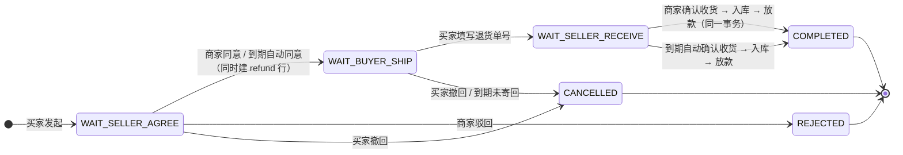
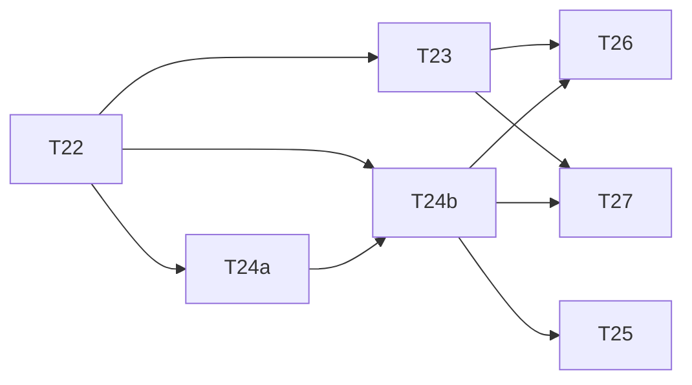

# 评价与售后设计方案（T28）

> 作者角色：架构师。本文**只交付方案，不写代码**。
> 目标：把交易闭环的最后两个缺口补上——**评价**（买过之后能不能说话）与**售后**（已发货的钱怎么退、货怎么回来）。
>
> 必读的既有材料：
> - `docs/退款与履约设计方案.md`（尤其 §3.4 权限边界、§5 退款库存幂等三道闸门、§9 反向验证、§10「不需要做」清单、§13 与钱包的关系）
> - `docs/内置钱包设计方案.md`（§0 第 1 条：余额是 `BIGINT` 分；元→分**唯一**换算点 `MoneyUnits.toCents`）
> - `docs/接口与数据结构.md`（§数据结构与约束：新表按同样格式登记）
> - `docs/对标淘宝差距分析.md` G13 / P2-2 / Q8（业务侧原始诉求与验收口径）
>
> **本文的用法**：正文里每条规则，都要能在 §7（任务拆分）与 §8（反向验证清单）里找到一条「注回什么 bug 会让它变红」。
> 找不到对应物的条目等于没设计——这是本项目「写完就绿的测试不证明任何事」这条方法论对设计文档的要求。

---

## 0. 拍板结论（先看这里）

| # | 决策 | 一句话理由 |
| - | ---- | ---------- |
| 1 | **评价：只有 `fulfillment_status = COMPLETED` 的订单才能评**；`RECEIVED` 不能评，未完成更不能评 | 完成态来源唯一；自动收货已经把 `RECEIVED` 自动推到 `COMPLETED`，要求 `COMPLETED` 的实际等待成本是零 |
| 2 | **一订单 × 一商品 × 一条评价**（`uq_review_order_product`）；**追评不做** | 追评会把「一条评价」变成「多条行」，双计数与展示复杂度同时出现；差距分析 G13 已把追评归为「规模才需要」 |
| 3 | **单一星级 1–5**；多维评分（描述相符/物流/服务）**不做** | 多维要么多列要么多表，而本项目没有任何一处按维度做分析；没有消费者的维度就是第 0 天设计的第 3 年的东西 |
| 4 | **图片评价不做**（项目当前没有文件存储能力） | 引入存储要连带引入上传端点、大小限制、访问控制、清理策略。为一个展示增益引入一整套运维面，不划算 |
| 5 | **评价一旦发布不可修改、不可删除**（含作者本人、STAFF、MERCHANT）；**不建 `hidden` / `anonymous` 列** | 「店员能删评价」是内容治理崩塌的经典起点；隐藏/匿名列今天没有任何内部消费者，违反硬规则「不留死代码」 |
| 6 | **商家可以回复（一次）**：`reply / replied_by / replied_at` 落在同一行 | 它是淘宝售后服务的标配，成本 3 列 + 1 端点；同时给 MERCHANT 一个第二类有意义的能力（不能删，只能答） |
| 7 | **评价不做审核环节** | 没有敏感词库来源、没有申诉入口；`审核中` 是一个既不可见又不可用的中间态，而它的判定者是凭空的 |
| 8 | **平均分实时算（`AVG`），不在 `product` 表落冗余列** | 冗余列 = 两份真相：要事务同步、要回填迁移、要多一套对账测试。本项目评价量在几十条量级，实时聚合成本为零 |
| 9 | **售后：新建 `after_sale` 表；它不自己放款，而是创建一条 `refund` 行并复用既有放款通道** | 本方案最重要的结构决策，论证见 §3.2。一句话：`refund` 是**钱**，`after_sale` 是**一次服务请求**，两者生命周期、唯一性范围、关心的当事人都不同 |
| 10 | **已发货 / 已收货 / 已完成的订单不再允许走「只退钱」的旧退款路径**，必须走售后 | 本次唯一的**破坏既有行为**的改动，也是真正让 `disburse` 里那条「已发货只退钱不还货」注释成为历史的一步。受影响既有测试的改法见 §3.11 |
| 11 | **退货入库发生在「商家确认收到退货」那一刻，与放款同一个事务，货先动、钱后动** | 错成「退款完成才入库」会造出库存虚增或货物消失；错成「钱先动」会在卡通道退款失败时留下「钱没退、货也没了」。论证见 §3.4 |
| 12 | **换货不做** | 换货 = 一次退货 + 一次新建发货义务 + 二次库存腾挪 + 第二棵状态树；收益远低于它带来的分支 |
| 13 | **超时用「单一 `due_at` + `due_action`」而不是三条到期列** | 三条到期列会让「在途售后忘了配定时器」变成**不报错、只是永远不会发生**的静默缺陷；单一列配 `ck_aftersale_due_matches_status`，让这个缺陷在建库那一刻就写不出来 |
| 14 | 迁移编号：**V20 单文件、两节**（评价 / 售后） | 两节的表互不引用；真正需要被单独断言的是每条**命名约束**，它们各自有名字（V18 拆文件的动机是「约束可被单独断言」，按名字断言已满足该动机） |
| 15 | **超时自动推进必须留痕推进依据**：`after_sale.advanced_by`（`MANUAL` / `TIMEOUT`）；自动步的通知文案**不许说「已签收」** | 本项目**没有物流校验**——「货已被签收」是假的，自动放行款唯一的真实依据是**超时**。把「系统判断」写成「有人签收」是文案撒谎，比功能缺失更坏（§3.5） |
| 16 | **卡支付（`DEMO_CARD`）订单在售后申请入口就被拒**，不放它走十天流程后在放款那一刻炸掉 | `DemoCardPayment` 自己在注释里立的原则是「宁可第一次就红」。入口拒比走到迷宫尽头才说此路不通诚实得多（§3.15） |

---

## 1. 现状核查（动笔前逐条读过的东西）

| 事实 | 出处 | 对本方案的影响 |
| ---- | ---- | -------------- |
| 履约状态 `NONE / SHIPPED / RECEIVED / COMPLETED`，`COMPLETED` 是完成态 | `V15__order_fulfillment.sql` | 评价的落点只能是 `COMPLETED` |
| 退款两类路由：`AUTO`（未发货 + 24h + ≤¥200，当场放款）/ `MERCHANT_APPROVAL` | `RefundService#routeOf` | 新规则要把「已发货」从第 2 类里拎出来交给售后 |
| `disburse` 里那条刻意的规则：「只有未发货的订单才归还库存——已发货/已收货的退款只退钱不还货」 | `RefundService#disburse` | 本方案要补的正是这个缺口（§3.1） |
| `refund` 用「生成列 + 唯一索引」表达「一笔订单只能有一笔在途退款」；H2 2.3.232 **不支持** `CREATE UNIQUE INDEX … WHERE` | `V17__refund_and_delivery.sql` | `after_sale` 的在途唯一照抄同一套写法（§3.6） |
| `in_flight` 是 `GENERATED ALWAYS AS`：不可手工赋值、UPDATE 会重算、表达式必须确定性 | V17 注释（实测记录） | 同一套坑要在 V20 上再避开一遍，并配守护测试 |
| H2 给内联 CHECK 起自动名（`CONSTRAINT_51`），跨环境失配 | V15 / V10 教训 | V20 所有 CHECK 一律显式命名 |
| 角色 USER / STAFF / MERCHANT 三者**并列**，`ROLE_MERCHANT` 刻意不带 `ROLE_STAFF` | `SecurityConfig`、退款方案 §3.1 / §3.4 | 权限表照 §3.4 的表格式写，并守住同一条线 |
| `PaymentGateway.refund`：`DEMO_CARD` **直接抛** `REFUND_UNSUPPORTED` | `DemoCardPayment#refund` | 决定 §3.4 的原子性取舍与 §10 的已知残缺 |
| `ProductService#returnStock` 的幂等键是 `(product_id, order_id, reason='REFUND')` | `StockLedgerRepository#appendOnce` | **关键**：退货入库若复用 `REFUND`，两条货的路径会互相吞（§3.6 失败形态 F-10） |
| `stock_ledger.reason` 现为命名约束 `ck_ledger_reason_v2` | V17 | 新增 `RETURN` 要升到 `_v3`；能可靠 DROP 正因为它是命名约束 |
| 通知已有 `outbox_event` + `NotificationSink`（IN_APP / SMS，缺密钥降级留痕） | 退款方案 §6、`notification_delivery` | 新事件命名与 `ORDER_SHIPPED` 等同构；**不许**绕过 sink 直接写 `notification` 表 |
| 金额：余额 `BIGINT` 分；业务侧 `BigDecimal` 元经 `MoneyUnits.toCents` | 钱包方案 §0 / §5.1 | 售后不建金额列、不做加法（§4） |
| 项目无文件存储（全库无 `MultipartFile` / upload / storage） | 全局 grep | 「图片评价不做」不是保守，是无处安放 |
| 测试里 7 个类自行 `DELETE FROM mall_order`；`OrderTrail.purge` 负责订单附属行清理 | `src/test/java` | 新表必须同步进清理链，否则残留（已列入 T22 与风险 R-3） |
| `recommendByBudget` 的推荐理由是硬拼的 `"适合" + scene`，差距分析要求它引用真实评分 | 差距分析 G13 / P2-2 | 它是平均分聚合的**真实消费者**（T27） |
| `RefundRepository.SELECT` 是逐列枚举（不是 `SELECT *`） | `RefundRepository` | 加 `after_sale_id` 时漏列 → 恒为 null 不报错（§3.9 末尾、RV-27） |

---

## 2. 评价（G13）

### 2.1 落点：只有 `COMPLETED` 才能评

**为什么不把 `RECEIVED` 也算「可评价」**：

| 方案 | 后果 |
| ---- | ---- |
| `RECEIVED` 也能评 | 评价与「钱还能不能退」在同一时刻同时成立。买家一边写评价、一边申请退款，就留下一条「对应款项已被退回」的评价——而本项目评价不可删（§2.5），它会永远挂在商品页上 |
| `COMPLETED` 才能评（✅） | `COMPLETED` 只有一个来源：**买家点「完成」，或到期自动收货把 `RECEIVED` 自动推到 `COMPLETED`**（`FulfillmentService#autoAdvance` 两步走）。`RECEIVED` 在日常里是一个瞬时坐落，买家几乎不会停在它上面——要求 `COMPLETED` 的实际等待成本是零，换来一个不需要解释的判断标准 |

未完成能不能评：**不能**。`PENDING` 没有支付成立，`CANCELLED` 没有交易——都不存在「买过」。

两条不那么明显的边界：

- **已全额退款的订单不能评**：不存在 `status IN ('PENDING_APPROVAL','APPROVED','REFUNDED')` 的 `refund` 行（含在途）。理由不是洁癖：退款走完之后评价还挂在商品页，而买家手上既没货也没付钱——那是**没有交易支撑的口碑**。
- **在途售后单存在时不能评**：买家已经声称货有问题要退回，此刻再让它写评价，等于给「正在被说谎的那一单」一个发声位。

两条合并成一个判据：`OrderPurchaseFacts`（§2.12）。

### 2.2 粒度：一订单 × 一商品 一条评价；追评不做

唯一约束 `uq_review_order_product (order_id, product_id)`。

- **为什么不是「一单一评」**：订单可以装 3 件商品，你只对其中 1 件不满意。按订单聚合会让 `product_id` 无处可去，商品页的评价列表也会出现「这条属于哪件货」的二义。
- **为什么不允许同一用户对同一商品评多次**：多次 = 平均分可被一个人拖动。本项目刻意不做反作弊（G13 把它归为「规模才需要」），那就必须让**入口本身**把倍数封掉。

**追评不做。**

> 追评的业务含义是「同一条评价的第二段」。落到本项目只有两种写法：
> 追加一行（「一条评价」的唯一性没了，平均分要写去重逻辑），或在同一行再加一对 `append_content / append_at`（展示层要区分两段、qualifies 偏差）。
> 两种都要为它付出结构代价，而它今天带来不了任何新消费者——差距分析 G13 明确把它归到「规模才需要」。
> **没有消费者的字段不建**是本项目硬规则。等真的有人问「我上次买的那个能不能再补一句」，那时再加列不迟。

### 2.3 维度：单一星级，不做多维

多维（描述相符 / 物流 / 服务）是淘宝的做法，但它是**给运营看**的：后台按维度聚合、算店铺动态评分、做考核。本项目：

- 没有任何读多维数据的消费者（没有报表、没有商家后台页面的要求）；
- 三维要么三个列（三个列 + 三个 CHECK），要么一张子表（「一条评价」变成「一行 + N 行」，评价列表要多一次 join）；
- 平均分口径会分叉：「这个商品 4.8 分」到底指哪一个？答案一旦有一个以上，商品页与助手推荐就会长出两套说法——那正是 §2.9 反对的「两份真相」。

**结论：单一 `rating INT`，`CHECK (rating BETWEEN 1 AND 5)`。** 整数而非小数：半星是展示层的插值，不是事实。

### 2.4 图片：不做（关键取舍）

一条带图的评价会带来：

1. 文件存储（磁盘目录 or 对象存储）与它的生命周期——评价不能删（§2.5），文件什么时候删？
2. 上传端点 + 大小/类型限制 + 访问控制（商品页是公开的，图片要不要登录才能看？）；
3. 文件名、路径、孤儿文件清理这一整套「比业务代码还难删」的面；
4. 一个不新增 Maven 依赖就完不成的部分（项目硬规则：不新增依赖）。

本项目当前**全库无文件存储**（已 grep 确认）。为「评价能配图」引入一整套运维面，性价比远低于它在 demo 里的展示价值。

**替代**：评价只能写文字（≤500 字）；商品本身的 `illustration` 已经承担了视觉角色。

### 2.5 评价不可修改、不可删除

| 角色 | 删 | 改 | 理由 |
| ---- | :-: | :-: | ---- |
| USER（作者本人） | ❌ | ❌ | 评价是**一次表态**，不是草稿。允许改等于允许「别人看见之后回来改口」，评价的可信度归零 |
| STAFF | ❌ | ❌ | 店员删评价是所有内容治理崩塌的起点：它是**最多、也最容易被要求执行**的那双手。这里直接不提供端点，也不留 `hidden` 列 |
| MERCHANT | ❌ | ❌ | 商家有删差评的天然动机。`MerchantRefundController` 已经确立的做法在这里平移一次：MERCHANT 能做的是**回复**（§2.6），不能是消失 |

因此：

- **不提供 `PUT / DELETE /api/reviews/*`**；
- **不提供 `hidden` / `deleted_at` / `anonymous` 列**——它们今天没有内部消费者，只有展示层可能会用；展示层真要用时再补迁移，而不是今天预支。

### 2.6 商家回复：做，且只有一条

字段：`reply VARCHAR(300) / replied_by VARCHAR(100) / replied_at TIMESTAMP`。

- 只能由 `ROLE_MERCHANT` 写：URL 级 `hasRole("MERCHANT")` + `ReviewService` 内二次判（同 `RefundService#requireMerchant` 的双层写法）；
- 只能写一次：`UPDATE … WHERE id = :id AND reply IS NULL`，影响 0 行 → 409 `REVIEW_ALREADY_REPLIED`。它背后的语义是「商家回复公开可见、不可自行撤改」；
- 回复后发事件 `REVIEW_REPLIED`（§6）。

为什么值得做：它是 MERCHANT 角色的**第二个**有意义的能力，并且让 §5 的权限表出现一个好记的不对称：**MERCHANT 不能删评价，但能回复**——「只能说话，不能让它消失」。

### 2.7 审核：不做

正确问法是「谁审核、凭什么、审核时不展示给谁看」：

- **词库没有来源**：本项目没有任何敏感词库，硬写一个 List 就是「第 0 天的第 3 年」；
- **`审核中` 会伤到的不是垃圾评价，而是所有评价**：为了让「审核中」有意义，列表查询与平均分必须过滤它，于是每一处读评价的地方都要带一句 `AND visible = 1`，漏一处就是「待审的评价被提前展示了」；
- **申诉入口不做**（退款方案 §10 已明确删平台介入），没有申诉的审核是单向黑箱。

**替代**：长度上限 + 空串归一化（`ck_review_content_when_present`）+ 把「内容不合规怎么办」明确写成「本期没有」。

### 2.8 实名 / 匿名：默认实名，不建 `anonymous` 列

- 评价表存 `username`（原始账号），展示层遮蔽中间字符（`st**nt`）；
- **不建 `anonymous` 列**：项目没有昵称/头像/资料层（连 `user` 表都没有，账号在 `SecurityConfig` 里写死），「匿名」除了让列表少一个名字外没有内部语义。遮不遮是**前端**的决策，不该让数据库替它保存一个永远不会被查询的标志位。

### 2.9 聚合：实时算，不落冗余列（两份真相的具体形态）

被否方案：`product` 表加 `rating_avg` / `rating_count`，写评价时同事务更新。

它会造成的**具体失败形态**（不是在「要注意一致性」这种层面，是它错成什么样）：

1. **写评价成功、更新 `product` 失败**：一旦有人把聚合更新写成异步或单独 `try`，就会留下「评价在、平均分没动」；
2. **被人绕过**：运营/外贸艦直接 `UPDATE product SET rating_avg = 5.00`（录取分数线越高的地方越有动机），商品页显示的数与评价行数不符，**没有任何一处会报错**；
3. **迁移与回填**：上线那一刻要给所有存量商品算 baseline；将来规则变化（例如允许删除）要重 projection；
4. **对账成本**：要证明两者一致，需要再写一条对账 SQL 与一条「我被绕过了」的哨兵——那是为冗余付的第 3 笔钱。

实时聚合的代价：几十条评价、`SELECT AVG(CAST(rating AS DECIMAL(3,2))), COUNT(*) FROM product_review WHERE product_id = ?` 一次索引范围扫描。成本为零，为什么要先看精油。

> ⚠️ 必须写死的一条约定：**取舍只发生在展示层**。SQL 取到的 `AVG` 保留原始精度；`ReviewSummary.avg` 需要一位小数时在**构造 summary 的地方** `setScale(1, HALF_UP)`，**不许在 SQL 里 `ROUND` 成整型**——整型平均分会让 4.5 变成 5。

聚合的消费者（**必须有，否则聚合接口本身是死代码**）：

1. 商品详情页的评价区块（`GET /api/products/{productId}/reviews` 同时返回 summary 与 items）；
2. 助手 `CatalogTools#recommendByBudget` 的推荐理由（差距分析 P2-2 点名：`reason` **必须**能引用真实评分或评价数，不得再是 `"适合" + scene`）。

### 2.10 「商家不能给自己刷好评」怎么落地

本项目没有店铺/卖家概念（`product` 表没有 `seller_id`），所以「禁止给自家店铺的商品写评价」**无法表达**——除非现在发明一个卖家外键，那是一条牵连商品写入、迁移、DTO 的大改动，为一个能被一行规则覆盖的场景不值得。

**落地规则**：

> **经营侧账号（`ROLE_STAFF` 或 `ROLE_MERCHANT`）不允许写评价。**

- 失败方向：**一律不准**。它们自己的真实购物也评不了——可接受（演示账号里 `merchant` / `admin` 本来就不是购物主力），换来的是「商家号/店员号不可能出现在口碑里」；
- 实施位置：`ReviewService#create` 内部，通过注入的 `UserDetailsService` 取**真实角色**（同 `RefundService#requireMerchant`：**不许让调用方传角色集合**）；查不到账号 → 按无授权处理，不因查不到而放行；
- 错误码：`REVIEW_ROLE_FORBIDDEN`（403）。

它没消除串谋（两个 `student` 互刷）——那需要风控体系，属于「规模才需要」，写在这里以免下次被当成漏洞。

### 2.11 表结构（V20 第一节）

```sql
-- ===================================================================
-- 一、product_review：一次已成交的购买在某个商品上的一次表态
-- ===================================================================
CREATE TABLE product_review (
  id VARCHAR(36) PRIMARY KEY,
  -- 刻意不加外键：mall_order 在测试的 @AfterEach 里被 DELETE（本项目惯例），
  -- 加外键会把「删订单」变成「先删评价」，逼着十来个测试类改清理顺序（V14 教训第 3 条）。
  order_id VARCHAR(36) NOT NULL,
  product_id BIGINT NOT NULL,
  username VARCHAR(100) NOT NULL,
  rating INT NOT NULL,
  content VARCHAR(500),
  -- 商家回复：三个字段成对出现，写就写全，不写就全空（与 refund 的 ck_decision_fields 同款纪律）。
  reply VARCHAR(300),
  replied_by VARCHAR(100),
  replied_at TIMESTAMP,
  created_at TIMESTAMP NOT NULL DEFAULT CURRENT_TIMESTAMP
);
-- 「同一笔订单的同一件商品只能有一条评价」：这条约束同时承担三件事——
--   ① 一单一品一评；② 并发双击只生效一次；③ 追评（同一件事第二段）的入口被封掉。
CREATE UNIQUE INDEX uq_review_order_product ON product_review(order_id, product_id);
-- 商品页按倒序取最近 N 条；买家按用户名取自己的评价。
CREATE INDEX idx_review_product ON product_review(product_id, created_at);
CREATE INDEX idx_review_user ON product_review(username, created_at);

ALTER TABLE product_review ADD CONSTRAINT ck_review_rating
  CHECK (rating BETWEEN 1 AND 5);
-- 「写了内容」不等于「内容是一串空格」：Java 侧把空白串归一化为 NULL，
-- 这里守的是裸 SQL / 修数脚本那条路径（V18 的动机：库里的取值口径必须与 Java 侧一致）。
ALTER TABLE product_review ADD CONSTRAINT ck_review_content_when_present
  CHECK (content IS NULL OR CHAR_LENGTH(TRIM(content)) > 0);
-- 回复要么全空（还没回），要么全满（回了就得说清是谁、什么时候）。半吊子行不存在。
ALTER TABLE product_review ADD CONSTRAINT ck_review_reply_fields
  CHECK (
    (reply IS NULL AND replied_by IS NULL AND replied_at IS NULL)
    OR (reply IS NOT NULL AND replied_by IS NOT NULL AND replied_at IS NOT NULL)
  );
```

**刻意不建的列**（每条都因为今天没有消费者）：

| 不建 | 为什么 |
| ---- | ------ |
| `updated_at` | 评价不可修改（§2.5），它永远等于 `created_at` |
| `append_content` / `append_at` | 追评不做（§2.2） |
| `anonymous` / `hidden` / `deleted_at` | 匿名、隐藏、删除都不提供（§2.5 / §2.8） |
| `image_url` / `image_count` | 没有文件存储（§2.4） |
| `dimension_desc` / `dimension_logistics` / `dimension_service` | 多维评分不做（§2.3） |
| `product.rating_avg` / `product.rating_count` | 实时聚合，不落冗余列（§2.9） |

### 2.12 模块边界与 API

新模块：`dev.learning.mall.review`（`api` / `internal` / `web`）。

**为什么独立，而不是塞进 `order`（它买过才评）或 `catalog`（它评的是商品）**：

- 放 `order`：主要读取方是商品页，届时 `catalog` 要反向依赖 `order`，方向拧着；
- 放 `catalog`：`catalog` 要读订单完成情况与退款/售后状态才能判定评价权，于是 `catalog` 依赖 `order`，与现有依赖方向（`order → catalog`）冲突；
- 独立模块 + `order.api` 的只读事实接口：`review → order.api`，`order → catalog.api`，`assistant → {order.api, review.api}`。方向干净，且每根线都是窄接口。

```java
// order/api/OrderPurchaseFacts.java —— 订单模块对外暴露的「这次购买能不能作为评价的依据」
public interface OrderPurchaseFacts {

    /**
     * 「某用户在一笔<b>已完成</b>的订单里真的买过这件商品」这个事实。
     *
     * <p>三个条件一次性收在这里，不许调用方自己拼：
     * <ol>
     *   <li>订单存在，且 {@code username} 是订单主人；</li>
     *   <li>{@code mall_order.status = 'PAID'} 且 {@code fulfillment_status = 'COMPLETED'}；</li>
     *   <li>{@code order_item} 里有这件商品——<b>漏掉这一条，任何人都能给任意商品写评价</b>。</li>
     * </ol>
     */
    boolean completedPurchase(String orderId, String username, long productId);

    /**
     * 这笔订单当下有没有「钱的事」悬而未决或已经结清：
     * 在途退款（{@code PENDING_APPROVAL/APPROVED}）、已放款退款（{@code REFUNDED}）、或在途售后单。
     * <b>有，就不能评</b>（§2.1 末尾两条边界）。
     */
    boolean moneyOpen(String orderId);
}
```

HTTP：

| 方法 | 路径 | 权限 | 说明 |
| ---- | ---- | ---- | ---- |
| GET | `/api/products/{productId}/reviews` | **公开**（落在现成的 `GET /api/products/** permitAll` 里，**不需要改安全配置**） | 返回 `{count, avg, items[…]}`，items 最近 20 条倒序 |
| GET | `/api/reviews/mine` | 登录即可（落到 `anyRequest().authenticated()`） | 买家看自己的评价；同时让订单页知道「这一单已评」 |
| POST | `/api/reviews` | 登录 + **非经营侧角色**（§2.10） | body `{orderId, productId, rating, content?}` |
| POST | `/api/reviews/{id}/reply` | `hasRole("MERCHANT")` + 服务层二次判 | body `{reply}`；只能回一次 |

> **SecurityConfig 只需加一行**：`POST /api/reviews/*/reply` → `hasRole("MERCHANT")`，且必须排在 `anyRequest().authenticated()` **之前**。
> 反过来提醒：`GET /api/products/**` 的 permitAll 同样覆盖 `/api/products/3/reviews`（评价是公开的），而 `/api/reviews/**` 不在那条 permitAll 内，因此 `POST /api/reviews` 要求登录——正是想要的。

### 2.13 评价的失败形态清单（每条对应 §8 的一条反向验证）

| 编号 | 失败形态（会错成什么样） | 防线 |
| ---- | ------------------------ | ---- |
| F-1 | 任何人都能给任意商品写评价（没校验订单真的买过这件货） | `completedPurchase` 必须校验 `order_item` 中存在 `(order_id, product_id)` |
| F-2 | 别人的订单被用来写评价 | 同一判据里的归属校验；「不存在」与「不是你的」给**同一个**答复（现有惯例） |
| F-3 | 并发双击 → 同一件商品两条评价，平均分被一个人拖两次 | `uq_review_order_product`；Java 侧把唯一键异常翻成 409，**不能让它变成 500** |
| F-4 | 退货退款完成后还能写评价（没有交易支撑的口碑） | `moneyOpen` |
| F-5 | 商家/店员账号给自家商品写五星 | 经营侧角色禁止写评价（§2.10），判据来自 `UserDetailsService` |
| F-6 | 同一评价重复发事件 → 站内信重复、`notification_delivery` 重复 | 事件只在「评价真的落库」之后发；sink 既有留痕幂等 |
| F-7 | 平均分在 SQL 里被 `ROUND` 成整型，4.5 显示成 5 | `AVG` 保留原精度，取舍只在 `ReviewSummary` |
| F-8 | 空格 content 被当成「写了内容」 | Java 归一化 + `ck_review_content_when_present` 双保险 |

---

## 3. 售后（补上「已发货只退钱不还货」）

### 3.1 缺口本体（先把话说准）

`RefundService#disburse` 今天的行为：

```java
if (FULFILLMENT_NONE.equals(order.fulfillmentStatus())) {
    for (OrderView.Item item : orders.items(order.id())) {
        catalog.returnStock(item.productId(), item.quantity(), decidedBy, order.id());
    }
    refunds.markStockReturned(refundId);
}
```

即：**未发货的退款「钱回去了、货也回账」；已发货 / 已收货的退款「只有钱回去」。**

在没有退货物流的系统里，这是唯一诚实的写法（不能假装货回来了）。但只要出现「买家手里握着货」的场景，它就变成三个漏洞：

1. **对买家**：钱退了、货还在手上——白拿，且无代价；
2. **对商家**：货永远回不来，库存既没有 +N 也没有留痕。下一次对账只会看到「库存与流水对不上」——现有对账 SQL 能发现 phantom stock，但**它看不到这笔货去了哪里**；
3. **对系统**：这一步甚至可以商家自导自演——批准一笔已发货订单的退款，钱与货同时离场，且没有任何记录说明这是「自愿不退货」还是「被绕过」。

所以「要不要做售后」等价于「要不要承认货能往回走」。**做**，但只做最必要的一条路径：**退货退款**，加上它的孪生兄弟「仅退款」（§3.7）。

### 3.2 最重要的结构决策：新建 `after_sale`，而不是扩展 `refund`

**结论：`refund` 保持不变（只加一个后向列 `after_sale_id`），新建 `after_sale` 表负责「这次服务请求」的全部生命周期；钱的动作仍然由 `refund` 行承载，并复用既有放款通道。**

三条论证，第 3 条是杀死替代方案的那一枪。

**(1) 两张表回答的问题不同，生命周期不同。**

| | `refund`（钱） | `after_sale`（一次服务请求） |
| - | -------------- | ---------------------------- |
| 粒度 | 一次钱的动作 | 一次「我想把货退回去」的请求 |
| 在途定义 | `PENDING_APPROVAL / APPROVED` | `WAIT_SELLER_AGREE / WAIT_BUYER_SHIP / WAIT_SELLER_RECEIVE` |
| 关心的人 | 买家（钱到没到）、商家（批没批） | 买家（能不能寄）、商家（收到没有）、物流（单号） |
| 终态历史 | 同订单允许多条（多次退款的历史） | 同订单允许多条（第一单没谈拢，再开一单） |
| 与钱包的关系 | 放款后钱包流水 actor = `decided_by` | 无直接关系（它驱动退款，不碰钱包） |

合成一张表，`refund` 就会长出一批只在某一类业务下才有意义的列（`return_shipping_no` / `received_by` / `received_at` / `due_action` …），于是必须像 V13 的 `ck_pending_kind_fields` 那样写一个**穷举式 OR 约束**去解释「哪些列的组合合法」。那条路本项目走过一次：每加一种 kind 就要改一次约束，而在途唯一性（本期最重要的不变量）会因为两类业务共存而难以表达。

**(2) 「已发货」的钱的路径必须只有一个。**

如果钱可以直接从 `refund` 出，也可以从 `after_sale` 出，那么**同一笔订单在任何时刻都可能有两个开口**。`uq_refund_inflight` 今天能保证「同订单只有一笔在途退款」——但它保护的是 `refund` 表；一旦 `after_sale` 自己放款，这条唯一索引就看不见它了。

**(3) 让 `after_sale` 生成 `refund` 行，可以让它继承既有三道防线。**

- `uq_refund_inflight`（**数据库**保证同一订单只有一条在途钱的事实）→ 售后同意那一刻创建 `PENDING_APPROVAL` 的 refund 行后，旧退款路径再也挤不进来；
- `requireWithinRemaining`（**应用层**「累计退款不超过实付」）→ 售后同意时同样过一遍；
- `wallet_ledger` 的 actor 与 `uq_wallet_ledger_order_reason` → 放款口径与后续 RETURN 记账全部落在既有实现上。

> 一句话：**`after_sale` 负责「要不要把钱放出去、放出多少」的决策过程；真正的放款仍然只由 `refund` 那一条线完成。** 于是「钱的出口」在全系统仍然只有一个。

**写给工程师的边界**：`AfterSaleService` **禁止**直接调用 `PaymentRouter` / `PaymentGateway` / 钱包放款。违反它的代价是 `uq_refund_inflight` 与 `requireWithinRemaining` 同时失效，而且**不报错**——只是多了一次放款。RV-18 用「数 gateway 调用次数」+「结构性守卫」两条一起来钉它。

### 3.3 状态机



迁移矩阵（**全部是「条件 UPDATE，影响 1 行才继续」**——本项目统一写法，没有一条是「先查后写」）：

| # | 迁移 | 条件 UPDATE 的前置 | 副作用（只在影响 1 行时发生） | 谁能动 |
| - | ---- | ------------------ | ---------------------------- | ------ |
| M1 | `[*] → WAIT_SELLER_AGREE` | INSERT（+ `uq_aftersale_inflight`） | 写 `due_at/due_action`、事件 `AFTER_SALE_REQUESTED` | 订单主人 |
| M2 | `WAIT_SELLER_AGREE → WAIT_BUYER_SHIP` | `status='WAIT_SELLER_AGREE'` | 建 refund 行（`PENDING_APPROVAL`）、写 `decided_*`、**写 `advanced_by`**、重算 `due_*`、事件 `AFTER_SALE_RETURN_AGREED` | MERCHANT（服务层二次判）/ SYSTEM（超时） |
| M3 | `WAIT_SELLER_AGREE → REJECTED` | `status='WAIT_SELLER_AGREE'` | 写 `decided_*`、清 `due_*`、写 `advanced_by`、事件 `AFTER_SALE_REJECTED` | MERCHANT |
| M4 | `WAIT_SELLER_AGREE → CANCELLED` | `status='WAIT_SELLER_AGREE'` | 清 `due_*`、写 `advanced_by='MANUAL'`；无钱无货 | 订单主人 |
| M5 | `WAIT_BUYER_SHIP → WAIT_SELLER_RECEIVE` | `status='WAIT_BUYER_SHIP'` | 写退货单号/寄回时刻、重算 `due_*`、**写 `advanced_by`**、事件 `AFTER_SALE_RETURN_SHIPPED` | 订单主人 |
| M6 | `WAIT_BUYER_SHIP → CANCELLED` | `status='WAIT_BUYER_SHIP'` | 清 `due_*`、**把那条 `PENDING_APPROVAL` 的 refund 行改成 `CANCELLED`**；系统关闭时 `advanced_by='TIMEOUT'` | 订单主人 / SYSTEM（到期未寄） |
| M7 | `WAIT_SELLER_RECEIVE → COMPLETED` | `status='WAIT_SELLER_RECEIVE'` | ①写 `received_*` ②**退货入库（RETURN 流水 + 现货）** ③调用既有放款通道 ④`stock_returned=1` ⑤**写 `advanced_by`** ⑥事件：人工走径文案与超时走径文案**不同**（§3.5） | MERCHANT / SYSTEM（超时） |

> **每一次向前推进都必须写 `advanced_by`**（见下一条）。它不是装饰：这是本项目唯一一处「由系统判断而自动放钱」的地方，将来对账时要能一眼分出哪几笔是超时推的、哪几笔是有人点过。

> **为什么没有 `WAIT_DISBURSE`（「货已回、待放款」）中间态**：它要么与放款同事务（那样它永远不可能被持久化 → **一个死状态**），要么要求商家第二次点击（多一层 API 与一块 UI）。本项目硬规则是不留死代码，所以不建它。钱的进度由 `refund.status` 回答，**不复制到 `after_sale`**——那是又一次两份真相。

### 3.4 库存入库的时机：商家确认收货时，与放款同事务，「货先动、钱后动」

| 候选 | 错成什么样 |
| ---- | ---------- |
| A. 退款完成时（放款之后）才入库 | 两个事实被拆到两个地方写。中间任何一次重启/异常都会留下「钱退了货没回」或「货回了钱没退」，而两者都**不报错**：状态停在 COMPLETED，账上缺一头 |
| B. 确认收货时入库，放款放到另一个事务 | 看起来更稳，实际引入「另一个事务里放款失败怎么办」：没有地方重试，售后单停在 `WAIT_SELLER_RECEIVE`，**货却已经在账上** |
| C.（✅）确认收货 = 入库 + 放款，同一事务，顺序「先货后钱」 | 唯一能把「钱货两清」做成一条恒等式的写法：两件事实要么一起发生，要么一起没发生 |

**顺序必须是「先写 RETURN 流水与现货，再动钱」**：`DemoCardPayment#refund` 会抛 `REFUND_UNSUPPORTED`（钱压根不在钱包里）。把它放在最后，异常会让整个事务回滚，于是「库存回来了、钱没退」在这段代码里**不可能发生**——与 `disburse` 既有的顺序纪律同构。

> ⚠️ **这条的代价写在明处**：`DEMO_CARD` 支付的订单走退货退款，会永远停在 `WAIT_SELLER_RECEIVE`——每次点确认收货都整体回滚。这不是新缺陷：**今天的已发货订单退款遇到 DEMO_CARD 同样是放款失败**（整个事务回滚）。本期不修，理由见 §10 R-4。

退货入库**必须走一个新的 `StockReason.RETURN`**，不能复用 `REFUND`：

- `ProductCatalog` 现在的样式是「方法 → 固定 reason」（`returnStock` 固定 `REFUND`，`release` 固定 `RELEASE`），这个样式的意义正是**不让调用方挑 reason**（拐个弯把售后退货伪装成退款归还，会毁掉幂等判据）；
- 更致命的是：`StockLedgerRepository#appendOnce` 的去重键是 **(product_id, order_id, reason)**。若退货入库复用 `REFUND`，同一笔订单的一次退货会把「退款归还」用掉的名额吃掉，反之亦然——**两条货的路径互相吞**，症状是「第二次该入库的那批货凭空消失，且不报错」（`appendOnce` 返回 0 时是静默 skip）。

新增：`ProductCatalog#receiveReturnedStock(productId, quantity, actor, orderId)`，内部固定 `StockReason.RETURN`；`ck_ledger_reason_v2 → ck_ledger_reason_v3`（加 `RETURN`）。

### 3.5 超时：单一 `due_at` + `due_action`，而不是三条到期列

三条到期列带来的失败形态是**静默的**：如果未来有人新增一个在途状态却忘了给它配定时器，数据库不会拒绝、编译不会失败、测试不会红——那笔售后单只是在那里**永远停着**。用一条 CHECK 把它变成写不进去的错误：

```sql
ALTER TABLE after_sale ADD CONSTRAINT ck_aftersale_due_matches_status
  CHECK (
    (status = 'WAIT_SELLER_AGREE'   AND due_action = 'AUTO_AGREE'      AND due_at IS NOT NULL)
 OR (status = 'WAIT_BUYER_SHIP'     AND due_action = 'CLOSE_UNSHIPPED' AND due_at IS NOT NULL)
 OR (status = 'WAIT_SELLER_RECEIVE' AND due_action = 'AUTO_RECEIVE'    AND due_at IS NOT NULL)
 OR (status IN ('COMPLETED','REJECTED','CANCELLED') AND due_action IS NULL AND due_at IS NULL)
  );
```

即：**在途 ⟺ 有且只有一个到期动作；终态 ⟹ 到期信息清空。**

到期动作与配置（照 V15「在那一刻算好落库」的写法：运营改配置不影响在途那批）：

| 阶段 | `due_action` | 到期时刻怎么来 | 到期发生什么 | 默认 |
| ---- | ------------ | -------------- | ------------ | ---- |
| 等商家处理 | `AUTO_AGREE` | 发起时 = `now + agreeTimeoutHours` | 系统代商家同意 → `WAIT_BUYER_SHIP`，`decided_by='SYSTEM'` | 48 小时 |
| 等买家寄回 | `CLOSE_UNSHIPPED` | 同意时 = `now + shipTimeoutHours` | 售后关闭 → `CANCELLED`，并取消那条 refund 行 | 7 天（168h） |
| 等商家收货 | `AUTO_RECEIVE` | 买家填单号时 = `now + receiveTimeoutHours` | 系统代确认收货 → 入库 + 放款 → `COMPLETED`，`received_by='SYSTEM'` | 10 天（240h） |

- **为什么必须做 `AUTO_AGREE`**（回答「商家一直不处理怎么办」）：没有它，售后路径在商家缺席时完全死亡，买家既拿不到钱也拿不到货——这是本次补缺口最不能接受的形态。
- **为什么也必须做 `CLOSE_UNSHIPPED`**：在途 refund 行会锁住订单的退款额度；一个「说要退货但永远不寄」的申请会让这笔订单对所有人不可退款。
- **`AUTO_RECEIVE` 是三条里最危险的一条**：它包含**自动放款**（钱在系统判断下自己出去了）。它不越界——更强的先例已经存在：`AUTO` 路由的无理由退款本就是「不等任何人、当场放款」。**但它需要被诚实地实施**，见下面的硬前提与三条诚实条款。

#### 硬前提（不是「注意事项」，是这条设计成立的条件）

> **本项目没有任何物流校验能力**（`return_shipping_no` 是手填/生成的演示单号，与 V17 里的 `mall_order.shipping_no` 一样不查任何外部 API）。
> 因此 **`AUTO_RECEIVE` 自动放款的信任基础是「超时」，不是「签收」**——系统并不知道货有没有真的回到仓库，它只知道「商家有 N 天的时间说没收到，而他没说」。
> **这句话将来必须随着能力变化而改**：一旦接入物流（能查轨迹/签收状态），怀疑的依据就从 TIMEOUT 变成真实的签收事实，届时要在 `advanced_by` 里**新增一个取值**（例如 `LOGISTICS_CONFIRMED`），**而不是沿用 `TIMEOUT`**——沿用会让「超时推的」与「签收推的」在数据里重新混成一类，而区分它们正是加这一列的全部目的。

#### 三条诚实条款

1. **留痕必须记录推进依据**：新增 `advanced_by VARCHAR(20)`，取值 `MANUAL` / `TIMEOUT`，**每一次向前推进都必须写它**（人工路径写 `MANUAL`、扫描器路径写 `TIMEOUT`）。配两条 CHECK（见 §3.9）：一条限定取值域，一条钉住「凡是最后由系统完成的单必然记为超时」。
   > 为什么不能靠读 `received_by='SYSTEM'` 反推：那能反推「是系统做的」，但反推不出「为什么是系统做的」；而且它没有留出「将来出现第三种依据」的位置。显式列是最便宜的那一版。
2. **通知文案不许说「已签收」**。两条走径的文案必须不同：
   - 人工确认收货：`「商家已确认收到退货，货已入库，¥X 已退回你的钱包。」`
   - 超时自动确认收货：`「退货寄回后已超过 N 天未确认，系统现已自动完成这次退货退款：货已入库，¥X 已退回你的钱包。」`
   
   「把这个判断说成『已签收』」是文案撒谎：用户会以为真有人验过货，而事实是没人验过。**文案撒谎比功能缺失更坏。**
3. **系统做的那一次必须记为 `TIMEOUT`**（反向不要求，也不能要求）。数据库只钉**危险方向**：
   `received_by = 'SYSTEM'` ⟹ `advanced_by = 'TIMEOUT'`。
   反方向（`TIMEOUT` ⟹ 两个 actor 都是 `SYSTEM`）**刻意不成立**：一笔单完全可以「商家人工同意 → 到期自动确认收货」，此时 `decided_by` 是那位商家的账号，而最后一次推进的依据是 `TIMEOUT`。若把反向也写进约束，这种正常组合会被数据库拒绝。
   所以「谁是人工、哪一步是超时」的完整答案由 `decided_by` / `received_by` / `advanced_by` 三列**合起来**回答，任何单独一列都不够——这也正是 `advanced_by` 值得存在的理由（光看 `received_by='SYSTEM'` 只能知道「是系统做的」，不知道「为什么是系统做的」）。

扫描器照 `FulfillmentService#autoReceiveScan` 的形状：候选集由 `(status, due_at)` 选出，**每笔一个 `TransactionTemplate`**，单笔失败只记不抛，下一轮会重试；每一笔内部按 `due_action` 派发到 M2 / M6 / M7 的**内部方法**（与人类操作的公开方法共用同一份实现，不存在第二条自动路径）。

### 3.6 幂等：在途唯一怎么保证

**数据库那一半**（照抄 V17 的生成列写法，它已在 H2 2.3.232 上被证明能用）：

```sql
in_flight VARCHAR(36) GENERATED ALWAYS AS
  (CASE WHEN status IN ('WAIT_SELLER_AGREE','WAIT_BUYER_SHIP','WAIT_SELLER_RECEIVE') THEN order_id END)
-- + CREATE UNIQUE INDEX uq_aftersale_inflight ON after_sale(in_flight);
```

四条必须遵守的注意点（**每条都是 V17 实测过的坑，不是推演**）：

1. `GENERATED ALWAYS AS` 的列**不可手工赋值**——INSERT/UPDATE 的列清单里不要出现 `in_flight`，测试夹具同理（报错原文 `Generated column … cannot be assigned`）；
2. 生成列在 UPDATE 时**会重算**（在途→终态后变 `NULL`），这是「约束没退化成永久封禁」的前提；
3. 表达式**必须是确定性的**（H2 不拦你写 `CURRENT_TIMESTAMP` / `RAND()`，这是自律而非数据库保证）；
4. ⚠️ **耦合点**：`in_flight` 的 CASE 取值集合与 `ck_aftersale_status` 是两处独立的枚举。将来给 `after_sale.status` 加第三个在途值而忘了改 CASE，约束会**静默失效**——不报错，只是同一订单能开两单。RV-20 专门钉它。

「同一订单能否有多个售后单」：**在途只能一个**（生成列唯一索引），**历史可以多个**（终态 `in_flight` 为 NULL，H2 的唯一索引允许多个 NULL）。终态后再开一单是合理的：第一次被拒、或只是没谈拢，隔周再申请一次是真实场景。

**应用层那一半**：所有迁移都是条件 UPDATE——「影响 1 行 = 这次转换是我做的，副作用是我的责任」；0 行 = 别人已经做过，安静跳过。注意 0 行的地方**不能静默 return 掉整件事**（`disburse` 里那段注释已经把这条写过一遍：理论不可达的路径更应该抛，否则我们永远收不到「并发进来了」这个信号）。

并发的具体防线：

| 场景 | 防线 |
| ---- | ---- |
| 商家同意与超时自动同意同时发生 | M2 的条件 UPDATE 只认影响 1 行；落败方影响 0 行 → 停止；且两侧最终只会建出一条 refund 行（另一个 INSERT 会被 `uq_refund_inflight` 拒绝） |
| 买家（商家端）同时点两次确认收货 | M7 的条件 UPDATE；即使两条请求都进来，第二条会被「同一 refund 行的 `markApproved` 影响 0 行」拦住，**不会放两次款** |
| 两个不同入口给同一订单放款 | `uq_refund_inflight` 保证只有一条在途 refund |

### 3.7 「仅退款」（`REFUND_ONLY`）：允许，但必须由商家同意

允许的条件只有一个：**商家同意**。

为什么还要留它：它要解决的不是「这样做对不对」，而是「将来对账看到这笔单时，能不能知道这是**有意**的，而不是被绕过的」。有了 `type` 这一列，「已发货订单出现钱退了、货没回来」就分成了两种可以分辨的情形：**有据可查的商家决策** vs **bug**。没有它，这两种永远混在一起。

流程：`WAIT_SELLER_AGREE → COMPLETED`（跳过全部物流阶段），同事务内建 refund 行 → 放款 → `COMPLETED`。`stock_returned` 恒为 0、`due_*` 恒为空（`ck_aftersale_return_fields` 会替我们守住这件事）。

### 3.8 换货：不做

| 不做 | 理由 |
| ---- | ---- |
| **换货** | 换货 = 一次退货入库 + 一次新发货义务 + 一个新运单号 + 一套「什么时候算完成」的新定义（换出去的又要换回来怎么办）。它不是本状态机的子集，是**第二棵状态树**；而它解决的需求（发错型号）在「退货退款 → 重新下单」这个组合下完全可达，且不引入任何新概念 |

### 3.9 表结构（V20 第二节）

```sql
-- ===================================================================
-- 二、after_sale：一次「把钱和货都送回去」的服务请求
-- ===================================================================
-- ⚠ 这张表<b>不放款</b>：钱的动作一律经由 refund 那条唯一的线（§3.2）。
--   它记录的是这次请求的全部事实：谁要退、为什么、寄了没有、收到没有、货回没回库。

CREATE TABLE after_sale (
  id VARCHAR(36) PRIMARY KEY,
  order_id VARCHAR(36) NOT NULL,
  username VARCHAR(100) NOT NULL,
  type VARCHAR(20) NOT NULL,            -- RETURN_REFUND（退货退款）/ REFUND_ONLY（仅退款）
  reason_code VARCHAR(30) NOT NULL,     -- NO_REASON / QUALITY / DAMAGED / WRONG_ITEM / MISSING_ITEM / OTHER
  reason_text VARCHAR(200),
  status VARCHAR(20) NOT NULL DEFAULT 'WAIT_SELLER_AGREE',
  requested_by VARCHAR(100) NOT NULL,   -- 买家自己，或助手代发起（与 refund.requested_by 同款）
  -- 第一次决定（同意 or 驳回）：谁定的、什么时候、理由。同意也可能是 SYSTEM（超时自动同意）。
  decided_by VARCHAR(100),
  decided_at TIMESTAMP,
  decision_note VARCHAR(200),
  -- 退货物流：「买家寄回」这件事（REFUND_ONLY 全程为空）
  return_shipping_no VARCHAR(40),
  returned_at TIMESTAMP,
  -- 第二次决定（确认收货）：收货人 + 时刻。它同时是放款的触发点与放款责任人。
  received_by VARCHAR(100),
  received_at TIMESTAMP,
  -- 货有没有真的回到库存。StockReason.RETURN 的幂等键是 (商品, 订单, RETURN)，
  -- 所以这一列是「这批货入库过没有」的应用层判据，也是被命名 CHECK 依赖的那一列。
  stock_returned INT NOT NULL DEFAULT 0,
  -- 钱的那一行（refund.id），在商家同意那一刻写入（§3.2：钱的出口仍然只有 refund 一条）
  refund_id VARCHAR(36),
  -- 到期：单一列 + 单一动作，见 §3.5（在途 ⟺ 有且只有一个到期动作）
  due_at TIMESTAMP,
  due_action VARCHAR(20),
  -- 最后一次「向前推进」是谁依据什么做的：MANUAL（有人点过）/ TIMEOUT（到期自动推）。
  -- 它存在的唯一理由是本项目<b>没有物流校验</b>：超时自动确认收货会触发放款，
  -- 而对账时要能一眼分出「有人真的确认了」与「系统在时间到了之后替他确认了」。
  -- 每一次向前推进都必须写它（INSERT 用默认的 MANUAL，扫描器路径写 TIMEOUT）。
  advanced_by VARCHAR(20) NOT NULL DEFAULT 'MANUAL',
  created_at TIMESTAMP NOT NULL DEFAULT CURRENT_TIMESTAMP,
  completed_at TIMESTAMP,
  updated_at TIMESTAMP,

  -- ── 「一笔订单只能有一笔在途售后」── 与 V17 的 refund.in_flight 同一套写法：
  -- H2 2.3.232 不支持 CREATE UNIQUE INDEX … WHERE（实测 Syntax error），
  -- 于是把在途态映射到 order_id、终态映射到 NULL，再用唯一索引（它的唯一索引允许多个 NULL）。
  -- 四条注意点写在方案 §3.6，其中第 4 条（CASE 取值集合与 ck_aftersale_status 的耦合）
  -- 由 V20MigrationTest#afterSaleInFlightSetMatchesStatusSet 钉住——
  -- 漏改 CASE 的症状不是报错，是「同一订单能同时在途两单」。
  in_flight VARCHAR(36) GENERATED ALWAYS AS
    (CASE WHEN status IN ('WAIT_SELLER_AGREE','WAIT_BUYER_SHIP','WAIT_SELLER_RECEIVE') THEN order_id END)
);
CREATE UNIQUE INDEX uq_aftersale_inflight ON after_sale(in_flight);
-- 经营侧队列（先申请的在前）、买家看自己的、以及超时扫描（status + due_at 是扫描的唯一谓词）。
CREATE INDEX idx_aftersale_queue ON after_sale(status, created_at);
CREATE INDEX idx_aftersale_user  ON after_sale(username, created_at);
CREATE INDEX idx_aftersale_due   ON after_sale(status, due_at);
-- 刻意不建 (refund.after_sale_id) 的索引：反向查找不存在这个方向——
-- 是由 after_sale.refund_id 单向提供「这笔钱属于哪张售后单」；没有消费者去查它，建了就是死索引。

ALTER TABLE after_sale ADD CONSTRAINT ck_aftersale_type
  CHECK (type IN ('RETURN_REFUND', 'REFUND_ONLY'));
ALTER TABLE after_sale ADD CONSTRAINT ck_aftersale_status
  CHECK (status IN ('WAIT_SELLER_AGREE','WAIT_BUYER_SHIP','WAIT_SELLER_RECEIVE',
                    'COMPLETED','REJECTED','CANCELLED'));
-- 售后的原因码是<b>独立于 refund 的第二个枚举</b>，不是懒，是它们回答不同的问题：
-- refund.reason_code 回答「为什么把钱退回去」（含 NO_REASON：7 天无理由退款），
-- after_sale.reason_code 回答「为什么要把货退回来」（NO_REASON 同样是淘宝的 7 天无理由退货）。
-- 合并成一个集合会让退款表里出现 MISSING_ITEM 这种「我没退钱、只是少发了件」的怪值。
-- ⚠ 耦合点：Java 侧 AfterSaleService.AFTER_SALE_REASONS 必须与本约束逐字一致；
--    新增原因码不在这里同步 → 新码在 Java 里合法、在库里被拒，报错形态是 500 而不是业务异常（V18 同一条教训）。
ALTER TABLE after_sale ADD CONSTRAINT ck_aftersale_reason_code
  CHECK (reason_code IN ('NO_REASON','QUALITY','DAMAGED','WRONG_ITEM','MISSING_ITEM','OTHER'));
ALTER TABLE after_sale ADD CONSTRAINT ck_aftersale_stock_flag
  CHECK (stock_returned IN (0, 1));
-- 决定字段成对出现（「半吊子行不存在」，与 refund 的 ck_decision_fields 同款）。
ALTER TABLE after_sale ADD CONSTRAINT ck_aftersale_decision_fields
  CHECK (
    (decided_by IS NULL AND decided_at IS NULL)
    OR (decided_by IS NOT NULL AND decided_at IS NOT NULL)
  );
-- 「商家还没说话」的那一段不许带上决定字段。
ALTER TABLE after_sale ADD CONSTRAINT ck_aftersale_first_decision_gate
  CHECK (status <> 'WAIT_SELLER_AGREE' OR (decided_by IS NULL AND decided_at IS NULL));
-- 收货字段：只有「已完成」（钱货两清）的那一行才有收货人与收货时刻。
-- 它同时挡住了「还没收到货就写 received_*」——那种行会让后续判据以为货已经入库。
ALTER TABLE after_sale ADD CONSTRAINT ck_aftersale_receipt_fields
  CHECK (
    (received_by IS NULL AND received_at IS NULL)
    OR (status = 'COMPLETED' AND received_by IS NOT NULL AND received_at IS NOT NULL)
  );
-- 退货物流：REFUND_ONLY 全程没有包裹；RETURN_REFUND 只有在「买家已寄回」之后才允许有单号与寄回时刻。
ALTER TABLE after_sale ADD CONSTRAINT ck_aftersale_return_fields
  CHECK (
    (type = 'REFUND_ONLY'
       AND return_shipping_no IS NULL AND returned_at IS NULL AND stock_returned = 0)
    OR (type = 'RETURN_REFUND' AND (
         (return_shipping_no IS NULL AND returned_at IS NULL)
      OR (return_shipping_no IS NOT NULL AND returned_at IS NOT NULL
            AND status IN ('WAIT_SELLER_RECEIVE','COMPLETED'))))
  );
-- 入库只能跟着「货真的被收到」走。这条 CHECK 是 §3.4 那条取舍在数据库里的那一半：
-- 它能被写成的行必须同时满足上面的 ck_aftersale_receipt_fields，
-- 于是「还没收到货就把货加回库存」写不进去。
ALTER TABLE after_sale ADD CONSTRAINT ck_aftersale_stock_only_when_received
  CHECK (stock_returned = 0 OR status = 'COMPLETED');
-- 一旦越过「还在等商家开口」这一步，就必须挂上钱的那一行：
-- 「同意了退货却没有退款事实」是这类系统最常见的半成品——对买家显示为「正在进行」，
-- 实际却没有任何人有钱可放。
ALTER TABLE after_sale ADD CONSTRAINT ck_aftersale_refund_link_required
  CHECK (status IN ('WAIT_SELLER_AGREE','REJECTED','CANCELLED') OR refund_id IS NOT NULL);
-- COMPLETED 与 completed_at 一对一。
ALTER TABLE after_sale ADD CONSTRAINT ck_aftersale_completed_fields
  CHECK (
    (status = 'COMPLETED' AND completed_at IS NOT NULL)
    OR (status <> 'COMPLETED' AND completed_at IS NULL)
  );
-- 见 §3.5：在途 ⟺ 有且只有一个到期动作。这条约束把「忘了配定时器」变成一个写不进去的错误。
ALTER TABLE after_sale ADD CONSTRAINT ck_aftersale_due_matches_status
  CHECK (
    (status = 'WAIT_SELLER_AGREE'   AND due_action = 'AUTO_AGREE'      AND due_at IS NOT NULL)
 OR (status = 'WAIT_BUYER_SHIP'     AND due_action = 'CLOSE_UNSHIPPED' AND due_at IS NOT NULL)
 OR (status = 'WAIT_SELLER_RECEIVE' AND due_action = 'AUTO_RECEIVE'    AND due_at IS NOT NULL)
 OR (status IN ('COMPLETED','REJECTED','CANCELLED') AND due_action IS NULL AND due_at IS NULL)
  );
ALTER TABLE after_sale ADD CONSTRAINT ck_aftersale_due_action
  CHECK (due_action IS NULL OR due_action IN ('AUTO_AGREE','CLOSE_UNSHIPPED','AUTO_RECEIVE'));
-- 推进依据的取值域：今天只有两种。将来接入物流要<b>新增取值</b>而不是复用 TIMEOUT
-- （§3.5 硬前提），届时这个文件要像 V17→V18 那样另开一个 V2x 改约束，不要回头改 V20。
ALTER TABLE after_sale ADD CONSTRAINT ck_aftersale_advanced_by
  CHECK (advanced_by IN ('MANUAL', 'TIMEOUT'));
-- ⚠ 这条是「不要把系统行为伪装成人工」在数据库里的那一半：
-- 凡是<b>最后由系统完成</b>的售后单（收货人写的是 SYSTEM），推进依据必须是 TIMEOUT。
-- 少了它，将来有人用脚本写一行 received_by='SYSTEM' 而 advanced_by 留 MANUAL，
-- 一批「从未被人工确认过的放款」就获得了「看起来人工确认过」的外观。
ALTER TABLE after_sale ADD CONSTRAINT ck_aftersale_autoreceive_is_attributed
  CHECK (received_by IS NULL OR received_by <> 'SYSTEM' OR advanced_by = 'TIMEOUT');

-- ===================================================================
-- 三、stock_ledger 认得「退货入库」（第五种 reason）
-- ===================================================================
-- 为什么不能复用 REFUND：见 §3.4 末尾。一句话——
-- appendOnce 的去重键是 (商品, 订单, reason)，同一个 key 会把退货与退款归还互相吞掉，
-- 症状是「第二次该入库的那批货凭空消失，且不报错」。
-- 能可靠 DROP 掉 V17 那条，正因为它是命名约束（自动名会跨环境失配）。
ALTER TABLE stock_ledger DROP CONSTRAINT ck_ledger_reason_v2;
ALTER TABLE stock_ledger ADD CONSTRAINT ck_ledger_reason_v3
  CHECK (reason IN ('RESERVE', 'RELEASE', 'RESTOCK', 'REFUND', 'RETURN'));

-- ===================================================================
-- 四、refund：只加一个「这是哪张售后单带来的钱」的后向列
-- ===================================================================
-- 为什么不用它来判定路由 / 金额：那些事实已经由 refund 自己的列表达。
-- 它存在的理由是<b>把两条钱的路径在数据库里区分开</b>，从而能写下面两条 CHECK。
ALTER TABLE refund ADD COLUMN after_sale_id VARCHAR(36);
-- 由售后驱动的钱<b>永远不碰库存</b>：货只能通过 after_sale 的 RETURN 那一腿回来。
-- 它配合 disburse 里既有的「只有未发货才归还库存」形成双重保险——
-- 少了它，将来有人放宽 disburse 的条件时，「退货入库一次 + 退款归还一次」会把同一批货加两次。
ALTER TABLE refund ADD CONSTRAINT ck_refund_aftersale_never_returns_stock
  CHECK (after_sale_id IS NULL OR stock_returned = 0);
-- 售后驱动的钱必须走商家审批那条路（AUTO = 未发货自助退；售后在定义上是另一回事）。
ALTER TABLE refund ADD CONSTRAINT ck_refund_aftersale_needs_approval
  CHECK (after_sale_id IS NULL OR route = 'MERCHANT_APPROVAL');
```

> **这组 CHECK 顺带把两条流程的边界也钉住了**（不需要再写「]}$e主动脉ying Java 侧判断）：
> - `REFUND_ONLY` **不可能**出现任何物流字段（单号/寄回时刻/收货人/收货时刻/入库标记恒为空）；
> - `RETURN_REFUND` **不可能**从 `WAIT_SELLER_AGREE` 直接跳到 `COMPLETED`——那样那一行的 `return_shipping_no` 必然是 NULL，会被 `ck_aftersale_return_fields` 当场拒绝。
> 也就是说「该走的路必须走完、不该走的字段不许出现」这两件事，数据库替我们记着，任何绕过 Service 的路径也绕不过它。

> ⚠️ **`RefundRepository.SELECT` 是逐列枚举的**（不是 `SELECT *`）。加列之后必须同步把 `after_sale_id` 写进那份 SELECT，否则 `RefundRow.afterSaleId` 恒为 `null` **且不报错**——这正是本项目最难受的一类 bug。RV-27 用一条「走完同意之后 `RefundView.afterSaleId()` 非空」的断言钉住。

### 3.10 售后 API

| 方法 | 路径 | 权限（URL 级 + 服务层二次判，照 `MerchantRefundController` 的双层写法） |
| ---- | ---- | ------------------------------------------------------------ |
| POST | `/api/after-sales` | 登录用户；归属在服务层判（`order.username == principal`） |
| GET | `/api/after-sales/mine` | 登录用户；服务层按 `username` 收窄 |
| GET | `/api/after-sales/pending` | `hasAnyRole("STAFF","MERCHANT")`（只读队列，与 `GET /api/refunds/pending` 同口径） |
| POST | `/api/after-sales/{id}/ship` | 订单主人；body `{shippingNo}` |
| POST | `/api/after-sales/{id}/cancel` | 订单主人；仅在 `WAIT_SELLER_AGREE` / `WAIT_BUYER_SHIP` |
| POST | `/api/after-sales/{id}/agree` | `hasRole("MERCHANT")` + `AfterSaleService#requireMerchant` |
| POST | `/api/after-sales/{id}/reject` | 同上；body `{note}` |
| POST | `/api/after-sales/{id}/receive` | 同上（**确认收货 = 入库 + 放款**，见 §3.4） |

`SecurityConfig` 需要新增的只有两行：三个写端点 `hasRole("MERCHANT")`、队列 `hasAnyRole("STAFF","MERCHANT")`。

### 3.11 ⚠️ 对既有代码唯一会改行为的一处：已发货订单不再允许「只退钱」

**改动**：`RefundService#apply`（买家自助与助手 HITL 两条入口的公共实现）在 `routeOf` 判定**之前**加一条硬规则：

```java
// 货一旦出门，「退钱」就不再是一个可以自说自话的动作：它必须先有退货入库这条腿。
// 这里给的是 409 + 一个指向售后的答复，而不是「静默转成 MERCHANT_APPROVAL 让商家去背锅」——
// 后者正是今天「钱走了、货没回来」这个缺口的成因。
if (!FULFILLMENT_NONE.equals(order.fulfillmentStatus())) {
    throw BusinessException.conflict("AFTER_SALE_REQUIRED",
            "订单已发货，请申请售后（退货退款）；暂不支持直接退款");
}
```

（建议放在 `requireWithinRemaining` 之后、`routeOf` 之前——与既有「先判不可配的硬规则，再判可配阈值」的顺序纪律一致。）

**连锁影响必须提前说清**（这也是本次最需要团队拍板的一点，见 §10 R-1）：

| 受影响 | 现在的行为 | 改后 | 处理 |
| ------ | ---------- | ---- | ---- |
| `RefundRoutingTest#shippedOrderRequiresMerchant`（L115-137） | 已发货订单 `refunds.apply` 返回 `route='MERCHANT_APPROVAL'`、`status='PENDING_APPROVAL'` | **409 `AFTER_SALE_REQUIRED`，且不落任何 refund 行** | **改写**（不是删除）：断言 409、`refund` 零新增、`gateway.refund` 与 `catalog.returnStock` 调用各 0 次 |
| 助手 HITL `requestOrderRefund` | 已发货订单也能生成退款待确认卡 | 同样 409 | 新增一条用例证明助手这条路被同一条规则拦住 |
| `MerchantRefundHttpTest` / `RefundDisburseGuardTest` / `RefundWalletTest` / `RefundStockIdempotenceTest` | 部分用例可能在发货态构造退款 | 视情况 | **T24b 的第一件事是全量回归**，把这些场景改成未发货（或改走售后）。**谁还需要「已发货退款」的行为守卫，就新建一条测试，而不是把旧的改回旧语义** |
| `RefundStockIdempotenceTest#receivedOrderRefundDoesNotReturnStock` | 已收货订单退款 → `stock_returned=0`、`product.stock` 不变（今天的正解） | 这条路被禁了 | **改写成售后语境**：「已收货订单走售后 `REFUND_ONLY` 时 `stock_returned=0`」。它守护的意图（已收货不退库存）没消失，只是改由 `REFUND_ONLY` 表达 |

一句话给团队：**这不是「新功能顺手改了旧行为」，这是本任务存在的理由。** 如果不同意改这一处，本次做的售后只是在旧缺口旁边开了一扇门，缺口本身还在。

### 3.12 售后的失败形态清单（每条对应 §8 的一条）

| 编号 | 失败形态（会错成什么样） | 防线 |
| ---- | ------------------------ | ---- |
| F-9 | 买家寄回、商家确认都做了，但库存没回来（货凭空消失） | M7 同事务写 RETURN 流水 + `ck_aftersale_stock_only_when_received`；哨兵用「手工加库存」证明对账 SQL 看得见 |
| F-10 | 退货入库用 `REFUND` reason，与「退款归还」互相吞（`appendOnce` 返回 0 静默 skip） | `receiveReturnedStock` 固定 `RETURN`（reason 不许由调用方传）+ `ck_ledger_reason_v3` |
| F-11 | 同一订单同时在途两笔售后（两批货都往回寄） | `uq_aftersale_inflight`；Java 预检只是「说人话」的一层 |
| F-12 | `in_flight` 的 CASE 漏一个在途值 → 唯一索引静默失效 | RV-20（两套集合交叉比对，不许手写字符串） |
| F-13 | 两条钱的路径并存 → 同一订单放款两次 | ① §3.11 禁止旧路径；② 售后同意那一刻建 refund 行交给 `uq_refund_inflight`；③ 并发断言 gateway 调用恰 1 次 |
| F-14 | 「同意了退货却没有退款事实」（对买家显示进行中，实际没钱可放） | `ck_aftersale_refund_link_required` |
| F-15 | 超时自动步提前发生（还没到期就入库/放款） | 扫描条件是 `due_at <= :now`，时间由注入的 `Clock` 决定；「未到期不动」+「到期必动」双重断言 |
| F-16 | 放了款却没入库（或反过来） | 同事务 + 先货后钱；断言「两者都有」或「两者都没有」，不允许半截存在 |
| F-17 | 放款失败后货已经入库 | 整个 M7 一个事务；DEMO_CARD 场景断言 RETURN 流水为 0 |
| F-18 | 约束异常冒泡成 500 | 照 `FulfillmentService#translate` 加售后约束名的翻译（T25） |
| F-19 | 买家撤回后订单永久锁住退款额度 | M6 必须把那条 `PENDING_APPROVAL` refund 行改成 `CANCELLED` |
| F-20 | 「我说要退货但永远不寄」堵死这笔订单 | `CLOSE_UNSHIPPED` 到期关闭（同一个撤销动作） |
| F-21 | 卡支付订单走完十天物流后在放款那一刻炸掉 | 售后申请**入口**就拒（§3.15），`after_sale` 表里根本不会出现这种订单 |

---

## 3.13 扩展点清单：如果将来要做「部分退货 / 部分退款」

本轮做**整单退货**（售后金额恒等于订单实付、退货是全部订单行一起退）。这不是偷懒，但它确实把「订单里 3 件只退 1 件」挡在了门外。为了避免将来做这件事的人从零开始猜，这里把需要改的地方**逐条写到表名与约束名**。

> 明确**不做的准备动作**：**不加恒为 NULL 的 `after_sale.order_item_id` 预留列。** 一个本轮无人写入、且语义上恒为 NULL 的列就是死列——它与本文 §2.2「追评不做，因为它是一个没有消费者的列对」是同一条原则。宁可在文档里写清楚将来怎么改，也不在今天留一根没接的线。

| # | 现在 | 要做部分退货时必须改成 | 具体到 ↓ |
| - | ---- | ---------------------- | --------- |
| 1 | `after_sale` 的在途唯一性粒度是**订单**：<br>`in_flight = CASE WHEN status IN (…) THEN order_id END` + `uq_aftersale_inflight` | 粒度下沉到 **(订单, 商品)**：生成列表达式要改成<br>`CASE WHEN … THEN order_id \|\| ':' \|\| product_id END` | `after_sale.in_flight`（V20）与 `uq_aftersale_inflight`。**H2 不允许原地改生成列表达式**，所以要新开一个迁移：新增 `in_flight_v2` 生成列 + 新唯一索引，再 DROP 旧索引与旧列（照 V17 把 `ck_ledger_reason` 升 `_v2`/`_v3` 那套做法） |
| 2 | 退款额度以**订单实付**为准：`RefundService#requireWithinRemaining` 比较 `toCents(order.payAmount())` vs `toCents(sum(refund.amount))` + 本次 | 必须改成**行实付**：`toCents(该行金额)` vs 该商品**累计已退** + 本次 | `RefundService#requireWithinRemaining`、`RefundRepository#settledAmount`。⚠️ **这里有一个今天不存在的前置事实**：`order_item` 只有 `unit_price` / `quantity`，而**满减与运费是订单级的**（`mall_order.discount` / `shipping_fee`），「这一行实付多少」在本库的任何一张表里都查不出来。所以这一步的真正工作是**先建立金额分摊口径**（按行小计比例摊销优惠与运费），而不是改一个 SUM 的 WHERE——它是本清单里唯一一项需要先建立新事实（而不是改 SQL）的工作 |
| 3 | 放款唯一性粒度是**订单**：`refund.in_flight` + `uq_refund_inflight`（一笔订单只能有一笔在途钱） | 部分退货意味着**同一订单可以同时跑多张售后单**，于是同一订单会有多条在途 `refund` 行——现在的唯一索引会（正确地）把第二笔挡掉 | `refund.in_flight`（V17）与 `uq_refund_inflight`。改法与第 1 条同构（同样要新增生成列 + 索引，不能原地改） |
| 4 | 资金流水层面也是**每订单一笔**：`uq_wallet_ledger_order_reason` 让同一 `(order_id, reason)` 只允许一行 | 这条约束会在第二笔放款时把事情挡掉（ SQLException，而非业务答复）。**钱包方案已经预言了这一改动**：原文写的是「将来放开部分退款（同一订单多笔 `refund`），这个索引必须换成以 `refund.id` 为粒度」（`docs/内置钱包设计方案.md` §2.2 与 §5.2 各有一句） | `wallet_ledger` 的 `uq_wallet_ledger_order_reason`（V16）。改成 `(reason, order_id, 一个新的 refund_id 列)` 或直接改为按 `refund.id` 粒度 |
| 5 | 「只有未发货才归还库存」是**订单级**判断（`disburse` 读 `order.fulfillmentStatus()`），退货入库循环 `orders.items(order.id())` 全部行 | 必须按**被退的那一行**判断与循环 | `RefundService#disburse`、`AfterSaleService` 的 M7、`ProductCatalog#receiveReturnedStock` 的入参（数量要从「该 `order_item` 的 quantity」取，而不是循环出来的全部） |
| 6 | `ck_aftersale_return_fields` / `ck_aftersale_stock_only_when_received` 等按 **`type` + `status`** 表达 | 这些约束**不需要改**：它们不感知商品粒度 | —（列出是为了说明「改的边界到哪为止」，免得将来连带大改） |
| 7 | 超时、到处跑、`due_action` 三分支 | **不需要改**：超时的粒度跟着 `after_sale` 走，改成按行之后每一单自带一个 `due_at` | — |
| 8 | `OrderPurchaseFacts#moneyOpen(orderId)` 是**订单级**布尔 | 不需要改（仍可用于评价资格判定） | — |

> 一句话给将来那个人：**真正贵的是第 2 条（金额分摊口径今天不存在）和第 4 条（钱包唯一索引是按 OEM 粒度写的），而不是把 DB 的唯一键下沉粒度那点 SQL。**

---

## 3.14 助手侧怎么处理 `AFTER_SALE_REQUIRED`（R-1 的另一半）

§3.11 让助手这条路也会拿到 409。**如果助手只是把错误抛回给用户，这条路径就是坏的**——用户听到的是一句「冲突」，而不是「你该往哪走」。

既有惯法（`OrderTools#requestRefund`，L103-119）：工具用 `catch (BusinessException e) { return error(e.code(), e.getMessage()); }` 把服务端错误转成 `{error, message, hint}` 的 JSON。**不改这个形状，只把这一种 code 的关系补全**：

| 要改的地方 | 现在 | 改成 |
| ---------- | ---- | ---- |
| `OrderRefunds#apply` 抛的那个异常本身的 **message** | 「订单已发货，请申请售后（退货退款）」 | 消息必须**自带下一步**：「这笔订单已发货，不能直接退款了：请改为申请退货退款——在订单页点击『申请售后』，寄回商品并填写退货单号，商家确认收货后 ¥X 会退回你的钱包。」<br>（工具是直接透传 `e.getMessage()` 的，所以引导如果只写在工具层，HTTP 那边就没有；写在异常里，两边都有） |
| `OrderTools#requestRefund` 的 catch | 所有 BusinessException 一律走通用的 `error(code, message)`，`hint` 是通用的一句 | 对 `AFTER_SALE_REQUIRED` 单独走一支，返回的 JSON 多两个字段：<br>`"nextStep": "引导用户改为申请售后（退货退款），不要重复调用本工具"`<br>`"hint": "这不是临时故障，重试同一个工具一定会再次失败。请如实告诉用户这笔已发货、需要走退货退款流程。"` |
| `OrderTools#requestRefund` 的**工具说明**（`@Tool` 文案，L94-101） | 里面写着「**已发货或金额较大的需要商家审批**」 | 这句话在 R-1 落地之后是**假的**（已发货根本不能申请退款了）。改成「已发货的订单不能直接退款，需要走退货退款（售后）」。<br>⚠️ 工具说明撒谎比工具缺失更坏：模型会据此给用户一个兑现不了的承诺 |
| 要不要把这个 409 **转成一张 HITL 待确认卡片** | — | **不要。** 三条理由：① HITL 卡的语义是「一次待用户本人确认的写操作」，而这里的结果是「请换一条流程」，它没有可以确认的动作；② 就算生成了「申请售后」的卡片，确认后又会遇到同一个 409（或与售后入口形成两条平行入口）；③ 它会把 `409 冲突` 伪装成「待办」，用户会以为点一下就好。<br>**正确形态是「工具返回失败 + 模型据此如实解释」**，这也正是 `hint` 这个项目既有字段存在的理由 |

> 反向验证：RV-44 / RV-45 / RV-46（§8）。其中 RV-45（「工具说明不许再写『已发货需要商家审批』」）是一条**文案层的断言**——本项目第一次遇到「 Falsehood 在工具说明里」这类缺陷，它就是典型的写完就绿：不改也能全绿，所以要显式钉住。

---

## 3.15 入口拦截：卡支付订单根本不该进入售后流程

> 依据（`DemoCardPayment` 自己的类注释与 `#refund` 实现，原文）：它的 `refund` **刻意抛异常**，理由是「这笔钱压根没进过钱包，退款到这里没有可以是真的地方……**宁可让这条路在第一次被调用时就红，也不要让它安静地通过**」。
> **这个设计是对的，不要动它。** 该改的不是通道，而是**我们让一笔注定退不出去的钱走了十天流程**。

**规则：售后申请（M1）入口直接拦掉卡支付订单**，409 + 一个新的业务码 `AFTER_SALE_METHOD_UNSUPPORTED`：

```
这笔订单是银行卡支付（DEMO_CARD），暂不支持线上退货退款：这笔钱从未进入站内钱包，
退款没有可以退的落点。真实场景需要退款单与渠道回调，本项目没有。（订单号 xxx）
```

**判据怎么取（关键：不许写魔法字符串）**

| 环节 | 做法 | 理由 |
| ---- | ---- | ---- |
| `PaymentGateway` | 新增 `boolean refundable()`；`DemoWalletPayment` 返回 `true`，`DemoCardPayment` 返回 `false` | 「这个通道能不能退」是**通道自己的知识**。写在任何别处，迟早会变成某人 `"DEMO_CARD".equals(order.paymentMethod())` 的一行魔法字符串——那种写法在将来加第三个通道时一定会被漏掉，而漏掉的症状是「新通道能不能退这个问题没人知道答案」 |
| `RefundService` | 新增**包内可见**的 `boolean refundable(OrderRow order)`，内部 `payments.get(order.paymentMethod()).refundable()` | 它已经持有 `PaymentRouter`（既有放款出口就在它这里），把这个问题也放在它这里，售后侧不需要新依赖 |
| `AfterSaleService#request` | 调 `refunds.refundable(order)`，false 就抛 409 | ⚠️ **不能**让 `AfterSaleService` 自己去持有 `PaymentRouter` —— 那会撞上本文 R-2 那条「钱的出口/能力判定只有一个地方」的结构约束。它是通过同一个包内的 `RefundService` 问这个问题的，不是自己去问通道 |

**要不要让 `after_sale` 表里根本不出现这种订单**：要，而做法是**入口拒**而不是加约束——SQL 的 CHECK 跨不了表（`after_sale` 看不到 `mall_order.payment_method`），所以这件事由 Java 判据 + RV-47 反向验证来守。

> ⚠️ **必须承认的一处不对称（本轮不修，留给下一次决策）**：**未发货**卡支付订单走**旧退款**路径时，今天仍然是「申请成功 → 走到放款 → `REFUND_UNSUPPORTED` → 整笔事务回滚」，最终留下一张永远推不动的 `PENDING_APPROVAL` 退款单。这条行为被两条**已落地**的测试守卫着（`RefundWalletTest` L186-198「银行卡支付的订单退款：REFUND_UNSUPPORTED，整笔事务回滚」、`WalletPaymentTest#cardRefundIsRejectedNotSilentlyReceipted`），它们断言的是「**放款那一刻必须红**」这个契约本身，所以本轮不去动它。
> 我的建议是**把同一个 `refundable` 判据也搬到 `RefundService#apply` 入口**（理由与本次相同：入口拒比走到尽头才报错诚实得多），这件事已作为 **T24b 的子项 S1** 排进任务：
> **第一步只做调研**（确认没有既有用例依赖「卡支付订单申请退款成功」）→ 无依赖则搬，有依赖则**停下来报 team-lead 决策**，不由工程师自行判断。详见 §7 T24b 子项 S1。

---

## 4. 金额口径

| 规则 | 具体写法 |
| ---- | -------- |
| **只用一趟单位**：业务侧 `BigDecimal` 元两位小数；存储与比较一律 `MoneyUnits.toCents` 后的整数分 | 售后**不建 `amount` 列**——金额是全额，直接取 `OrderRow.payAmount()`。理由是任何一个「必须等于某个别处的值」的新列，都是在给「两份真相」发门票（退款方案 §10 已确立「本次退款金额恒等于实付」） |
| **禁止裸 `BigDecimal::add` 拼金额** | 累计校验一律 `toCents(paid)` vs `toCents(settled) + toCents(asks)`，照 `RefundService#requireWithinRemaining` 的形状 |
| **售后同意前必须过同一道额度校验** | `requireWithinRemaining(order, requested)` 由 `AfterSaleService` 在 M2 里调用（它现在是 refund-vs-实付 的唯一判据，不能只在旧路径上调用） |
| **放款 actor 语义不变** | `decidedBy`（售后场景 = `receivedBy`：商家账号或 `SYSTEM`），与钱包方案一致——**不能写买家本人**（那就记成「买家自己给自己退了一笔钱」） |
| **展示** | 一律 `MoneyUnits.toYuan(cents)`；禁止在 API 里新增第二个「元 ↔ 分」换算点 |
| **不做部分退款** | 因此不存在「累加多笔部分额」的新 MAX 判据；既有的 `settled + asks <= paid` 一行就够 |

---

## 5. 权限边界（照退款方案 §3.4 的表格式）

| 动作 | USER | STAFF | MERCHANT | 实施位置 |
| ---- | :--: | :---: | :------: | -------- |
| **写评价**（自己的已完成订单） | ✅ | ❌ | ❌ | `ReviewService#create` 内部判经营侧角色；判据来自 `UserDetailsService`，**不由调用方传** |
| **删除 / 修改评价** | ❌ | ❌ | ❌ | **不提供端点**（§2.5） |
| 查看商品评价（`GET /api/products/{id}/reviews`） | ✅（未登录也可） | ✅ | ✅ | 落在既有的 `GET /api/products/** permitAll` 里，**本次不改** |
| 查看自己的评价 | ✅ | ✅（自己的） | ✅（自己的） | `/api/reviews/mine` + `username` 收窄 |
| **商家回复评价** | ❌ | ❌ | ✅（一次） | `hasRole("MERCHANT")` + 服务层二次判 + `WHERE reply IS NULL` |
| **发起售后**（自己的订单，且已发货/已收货/已完成） | ✅ | ✅（自己的订单） | ✅（自己的订单） | `AfterSaleService#request` 归属校验 |
| **填写退货单号 / 撤回申请** | ✅（自己的售后单） | — | — | 同上 + 仅 `RETURN_REFUND` 允许填单号 |
| **查看售后队列（只读）** | ❌ | ✅ | ✅ | `GET /api/after-sales/pending`：`hasAnyRole("STAFF","MERCHANT")`；与 `GET /api/refunds/pending` 同口径 |
| **同意 / 驳回售后**（决定钱的一切） | ❌ | ❌ | ✅ | `hasRole("MERCHANT")` + `AfterSaleService#requireMerchant` 二次判 |
| **确认收到退货**（= 触发入库 + 放款） | ❌ | ❌ | ✅ | 同上。**STAFF 刻意不能做**：确认收货会触发放款，给 STAFF 这条能力等于绕过「钱的决定权不给店员」那条线 |
| 查看自己的售后单 | ✅ | ✅ | ✅ | `/api/after-sales/mine` + `username` 收窄 |
| 超时自动同意 / 自动关闭 / 自动收货 | — | — | — | SYSTEM（`decided_by='SYSTEM'` / `received_by='SYSTEM'`），不由任何人类账号发起 |

> 两条边界，这是本节唯一需要被记住的：
> - **不再新增第四条边界**：发货给 STAFF、钱给 MERCHANT、货给 MERCHANT。买家之外的动作要么是店员（日常运作），要么是商家（钱与货）。
> - **失败方向一律是「少给权限」**：角色判定拿不到 / 账号查不到 → 无授权（照 `MerchantRoleTest#unknownActorDegradesToLeastPrivilege`）。

---

## 6. 通知事件（沿用 `outbox_event` 命名风格，且一律经既有 sink）

现有命名：`ORDER_SHIPPED` / `ORDER_RECEIVED` / `ORDER_COMPLETED` / `REFUND_REQUESTED` / `REFUND_REJECTED` / `ORDER_REFUNDED`。
新事件（都在 `VARCHAR(30)` 之内，最长的 `AFTER_SALE_RETURN_RECEIVED` 是 26 字符）：

| eventType | 触发点 | 发给谁 | 文案要点 |
| --------- | ------ | ------ | -------- |
| `REVIEW_CREATED` | 评价落库成功 | 评价作者（回执） | 「评价已发布」——**不给别人**，别拿它骚扰商家 |
| `REVIEW_REPLIED` | 商家回复成功 | 评价作者 | 「商家回复了你的评价」；**正文不贴回复内容**（回复是用户长文本，是否入 `notification.content` 会牵动 PII 边界，本期只发「商家回复了你的评价」这一句提要，正文让读者回商品页看） |
| `AFTER_SALE_REQUESTED` | 买家发起 | 买家 | 「售后申请已提交，等待商家处理」 |
| `AFTER_SALE_REJECTED` | 商家驳回 | 买家 | 带 `decision_note`（如有），理由回给买家 |
| `AFTER_SALE_RETURN_AGREED` | 商家/系统同意退货 | 买家 | 「商家已同意退货，请寄回并填写单号」+ 到期时间 |
| `AFTER_SALE_RETURN_SHIPPED` | 买家填单号 | 买家 | 「已寄回，等待商家确认收货」 |
| `AFTER_SALE_RETURN_RECEIVED` | 确认收货成功 | 买家 | **两条走径文案不同，不许合并成一句**（§3.5 诚实条款 2）：<br>· 人工：`「商家已确认收到退货，货已入库，¥X 已退回你的钱包。」`<br>· 超时：`「退货寄回后已超过 N 天未确认，系统现已自动完成这次退货退款：货已入库，¥X 已退回你的钱包。」`<br>**两种文案都不许出现「已签收」** |

> **两条纪律**：
> 1. **不许绕过 `NotificationSink` 直接写 `notification` 表**（退款方案 §9 T15 #5 已经为这件事留过断言）。统一经 `DomainEventPublisher#publish` 出去，由既有 outbox → sink 链路投递；新事件自动获得 IN_APP/SMS 与降级留痕，不需要任何通道代码。
> 2. **事件只在「影响行数 = 1」的那一侧发布**（照 `FulfillmentService` 的写法），因此重放 / 双击不会产生第二条站内信——由 RV-10 与 RV-17 钉住。

---

## 7. 任务拆分（T22 起，按依赖排序）

> 前置：现有最新任务是 T20，**本方案的任务编号从 T22 起编**，以避开历史上已存在的 T21（退款闭环五条债）；实现时如主干任务编号又有推进，**以任务板为准**。
> **分批原则**：每一批必须**能独立验收**——「前五步都在做准备、最后一步才出结果」这种拆法不接受。
> 因此每批都给了「**红绿口径**」：这一批跑完之后什么一定是绿的，以及至少一条「注回什么 bug 会立刻变红」的必经断言。
> 编号约定：`T24a` / `T24b` 沿用本项目既有写法（历史上已出现过 `T13a` / `T13b` 这种把一批拆成两批交付的形式）。

### T22　数据层：V20 迁移 + Row/View + 测试清理配套

- **目标**：两张表落地、所有 CHECK/索引命名、并接入测试的清理链。不含业务逻辑。
- **改哪些文件**
  - 新增 `src/main/resources/db/migration/V20__review_and_after_sale.sql`（§2.11 + §3.9 全文）
  - 新增 `order/internal/AfterSaleRow.java`、`review/internal/ReviewRow.java`
  - 修改 `order/internal/RefundRow.java` / `RefundRepository.SELECT` / `order/api/RefundView.java`（加 `afterSaleId`）
  - 修改 `src/test/java/dev/learning/mall/OrderTrail.java`：`purge` 增加 `product_review` / `after_sale`，`residueFor` 同步计数
  - 新增 `src/test/java/dev/learning/mall/V20MigrationTest.java`
- **依赖**：无（建议排在 T20 合并之后，避开同一批文件的冲突窗口）
- **反向验证要点**：RV-1…RV-8、RV-20
  - 删掉 `ck_aftersale_due_matches_status` → 能写出「在途却没有定时器」的行 → RV-4 红
  - 把 `in_flight` 的 CASE 漏一个在途值 → RV-20（两套集合交叉比对）红
  - 不在 `OrderTrail.purge` 里清 `product_review` → 残留断言 RV-6 红
  - `RefundRepository.SELECT` 漏了 `after_sale_id` → RV-27 红（**这一条属于 T24b，但在此登记以免交付时被遗忘**）
- **红绿口径（本批独立验收）**：`V20MigrationTest` 全绿 + 全量回归不变（本批不引入任何业务行为变化，所以「全量回归必须一条都不红」本身就是它的验收标准）；
  **必红信号**：删掉 `OrderTrail.purge` 里那两行 → RV-6 立刻红。

### T23　评价：模块、接口、权限、事件

- **目标**：`dev.learning.mall.review` 包 + 四个端点 + 聚合读 + 「经营侧不可评」+ `REVIEW_CREATED` / `REVIEW_REPLIED`。
- **改哪些文件**
  - 新增 `review/api/{ReviewSummary,ReviewView,ReviewCreateRequest}.java`
  - 新增 `review/internal/{ReviewRepository,ReviewService}.java`、`review/web/ReviewController.java`
  - 新增 `order/api/OrderPurchaseFacts.java`，并在 `order/internal` 里用一个窄实现类实现它（或直接由 `OrderFacade` 兼任）
  - 修改 `config/SecurityConfig.java`：只加一行 `POST /api/reviews/*/reply` → `hasRole("MERCHANT")`（必须排在 `anyRequest().authenticated()` **之前**）
- **依赖**：T22
- **反向验证要点**：RV-9…RV-17
  - 去掉「订单真的买过这件商品」的判据 → RV-9 红
  - 把经营侧角色禁令去掉 → RV-12 红（**必须用 `UserDetailsService` 取真实角色**，不许手造 actor）
  - 并发双击 → RV-11 红（行数 1、事件 1、第二个不是 500）
- **红绿口径（本批独立验收）**：评价的四个端点在真机冒烟里可用（写完 → 商品页出现评分 → 商家回复一次 → 第二次 409）；`ReviewOwnershipTest` / `ReviewOnceTest` / `ReviewRoleTest` / `ReviewSummaryTest` 全绿。
  **必红信号**：把平均分改成从 `product` 的某个字段读（假装加了冗余列）→ RV-16 与 `ReviewSummaryTest#aggregateCountsWhatIsStored` 立刻双红。

### T24a　RETURN 入库基线（**单独一批，不与售后状态机混改**）

- **为什么单独一批**：它是「货」那一腿的全部入库能力，独立可测、也可以先于售后状态机交付；把它和状态机混在同一个 diff 里，会让「RETURN vs REFUND 归因」这个最容易错的点在一大片改动里失去焦点。
- **目标**：让「退货入库」成为库存模块认得的一种独立事实。
- **改哪些文件**
  - 修改 `catalog/api/StockReason.java`：加 `RETURN`
  - 修改 `catalog/api/ProductCatalog.java` + `catalog/internal/ProductService.java`：新增 `receiveReturnedStock(productId, quantity, actor, orderId)`——内部**固定** `StockReason.RETURN`，形状与 `returnStock` 一致（行锁取前值 → `appendOnce` → 改现货）；reason **不由调用方传**
  - （V20 里的 `ck_ledger_reason_v3` 已在 T22 落地，本批不再改迁移）
- **依赖**：T22
- **红绿口径（本批独立验收）**：`AfterSaleReturnReasonTest` 的**归因那一半**跑绿（写一次 RETURN → RETURN 行 = 1、REFUND 行 = 0；同一订单已有 REFUND 流水时 RETURN 仍能写进去）；`AfterSaleStockOnceTest#secondReceiptDoesNotRestockTwice` 跑绿。
  **必红信号**：把 reason 改成 `REFUND`（复用既有方法）→ RV-22 立刻红；或者直接拿 `returnStock` 顶替 `receiveReturnedStock`（不改 reason）→ RV-22 一样要红（断言的是归因，不是「有没有加库存」）。

### T24b　售后核心：状态机 + 放款唯一出口 + 入口拦截 + 旧退款路径收口 + 助手侧接线

- **目标**：新增 `after_sale` 的完整写路径；改变 §3.11 的既有行为；落地 §3.15 的入口拦截；让助手那条路也能说得清 409。
- **改哪些文件**
  - 新增 `order/internal/{AfterSaleRepository,AfterSaleService}.java`、`order/web/AfterSaleController.java`
  - 新增 `order/api/AfterSaleView.java`（对外视图，不要把 internal 的行类型暴露出去）
  - 修改 `payment/api/PaymentGateway.java`：新增 `boolean refundable()`；`DemoWalletPayment` 返回 `true`、`DemoCardPayment` 返回 `false`（§3.15）
  - 修改 `order/internal/RefundService.java`：① `apply` 加已发货硬规则（§3.11）；② 新增包内可见 `refundable(OrderRow)`；③ 把 `disburse` 从 `private` 提升为**包内可见**，作为**全系统唯一放款出口**（`AfterSaleService` 与它同包，可在同一事务里直接调用）
  - 修改 `order/internal/OrderProperties.java`：内部类 `AfterSale`（三个超时 + 总开关 + 扫描间隔/首延/单轮上限，照既有 `Refund` 的写法）
  - **每一次向前推进都要写 `advanced_by`**（人工写 `MANUAL`、扫描器写 `TIMEOUT`）——这是本批最容易漏的一件事（§3.5）
  - 修改 `assistant/internal/OrderTools.java`：`requestRefund` 针对 `AFTER_SALE_REQUIRED` 加专属 `hint` / `nextStep`；并**改掉工具说明里那句已经变成假话的「已发货或金额较大的需要商家审批」**（§3.14）
  - 修改 §3.11 表格里列出的受影响测试，**并新增一条 "未发货订单的旧退款行为逐字段不变" 的哨兵**——改既有行为必须留下「别的地方没被误伤」的证据
- **子项 S1（调研先行，条件执行）：把 `refundable` 也搬到 `RefundService#apply` 入口**
  - **为什么排它**：既然判定「入口拒」优于「走到放款那一刻才炸」，这条规则就不该只在售后路径生效。现状是**两条退款路径对同一件事给出两种行为**（售后入口拒卡支付、旧退款路径仍走到放款才 `REFUND_UNSUPPORTED`），而规则不一致比功能不完整更糟——它会让「哪种情况会被拒」变成需要记忆的东西。
  - **第一步只做调研，不改代码**：确认有没有既有用例依赖「卡支付订单申请退款成功」。做法：跑一次全量回归前先 grep `DEMO_CARD` + `refunds.apply` / `requestOrderRefund` 的交集（`RefundDisburseGuardTest`、`RefundWalletTest`、`MerchantRefundHttpTest`、`RefundOwnershipTest`、`NotificationLifecycleTrailTest` 是重点），并单跑这几个类确认没有断言「卡支付订单的 refund 行被成功创建」。
  - **没有依赖** → 把 `refunds.refundable(order)` 也放进 `apply` 的守卫链（与 §3.11 的已发货规则同一处，顺序：**先判这个通道能不能退，再判有没有发货**——「这笔钱根本退不出去」比「这笔要走售后」更基础），两条路径从此一致。
  - **有依赖** → **停下来报 team-lead**，由他决定是改那些用例还是维持现状。**不要自行决定**。
  - ⚠️ 无论结论如何，**卡通道「放款那一刻必须红」这条契约本身不动**：`WalletPaymentTest#cardRefundIsRejectedNotSilentlyReceipted` 与 `RefundWalletTest` L186-198 必须继续绿（它们守的是 `DemoCardPayment` 那条「宁可第一次就红」的原则，不是这条路径的便利性）。
- **依赖**：T22、T24a
- **反向验证要点**：RV-18…RV-31、RV-44…RV-47
  - `AfterSaleService` 直接调 PaymentRouter 放款 → RV-18 红（数 gateway 调用 + 反射禁依赖）
  - M7 拆成两个事务 → RV-21 红（DEMO_CARD 之外还要有一条 wallet 场景的正向证据）
  - 退货入库复用 `REFUND` reason → RV-22 红
  - 确认收货的 UPDATE 去掉前置条件 → RV-26 红（并发双击只放一次款）

### T25　售后超时扫描 + 异常翻译 + URL 安全规则

- **目标**：三个到期分支按期推进；约束逃逸翻译成 409 而不是 500；补齐 URL 规则。
- **改哪些文件**
  - 新增 `order/internal/AfterSaleScheduler.java`（照 `FulfillmentScheduler`：`@Scheduled` 只做触发，开关判断集中在服务里）
  - 修改 `AfterSaleService`：加 `timeoutScan()`（照 `FulfillmentService#autoReceiveScan`：候选集 → 每笔一个 `TransactionTemplate` → 单笔失败只记不抛）
  - 修改 `AfterSaleService`：加 `translate(DataIntegrityViolationException)`，照 `FulfillmentService` 的形状，**只认本项目自己起的售后约束名**
  - 修改 `config/SecurityConfig.java`：`POST /api/after-sales/*/{agree,reject,receive}` → `hasRole("MERCHANT")`；`GET /api/after-sales/pending` → `hasAnyRole("STAFF","MERCHANT")`
- **依赖**：T24b
- **反向验证要点**：RV-32…RV-37、RV-41…RV-43
  - 到期判据写成「当前时间 − 发起时间」而不是读落库的 `due_at` → RV-32 红（改配置让在途订单跳变）
  - 去掉翻译层 → RV-36 红（**要用真实 H2 抛出的异常喂进来**，不许手写字符串，照 `FulfillmentHttpGuardTest#realH2ConstraintNamesAreToldApart`）
  - `hasAnyRole` 写成 `hasRole("MERCHANT")` → RV-37 红
- **红绿口径（本批独立验收）**：三个到期分支各有一条端到端用例跑绿（时间由注入的 `Clock` 控制，不靠 `sleep`）；`AfterSaleHttpGuardTest` 绿。
  **必红信号**：把 `advanced_by` 的赋值删掉（扫描器那一侧不写）→ RV-41 立刻红；把超时文案改成「已签收」→ RV-42 立刻红。

### T26　前端与文档接线

- **目标**：让 §2.9 点名的两个真实消费者真的存在。
- **改哪些文件**
  - `src/main/resources/static/js/app.js`：订单页在 `COMPLETED` 时出「评价」按钮（已评价则标注）；已发货时把「申请退款」换成「申请售后」
  - `src/main/resources/static/js/product.js` + `templates/product.html`：评价区块（summary 星星 + 20 条列表 + 商家回复）
  - `docs/接口与数据结构.md`：登记 `product_review` / `after_sale` 两张表（照该节行文：主键、每个 CHECK 名与意图、`in_flight` 是生成列不可手工写、索引服务哪次查询），并登记 8 个新端点与 7 个新 eventType
- **依赖**：T23、T24b
- **反向验证要点**：前端没有单测，按本项目方法**必须真机冒烟**（照 T03 的做法：起服务走一遍「发货 → 收货 → 完成 → 评价 → 申请售后 → 同意 → 寄回 → 确认收货」），并把命令与结果记进 `docs/验证记录.md`；文档登记由 RV-38 守护
- **红绿口径（本批独立验收）**：冒烟路径跑通（含「已发货订单页面上不再有『申请退款』、而是『申请售后』」这一条视觉事实）；`DocsConsistencyTest` 绿。
  **必红信号**：把文档里 `in_flight` 是生成列那句话删掉 → RV-38 立刻红。

### T27　助手侧接线（**可裁剪**，优先级 P2）

- **目标**：兑现差距分析 P2-2 的验收口径，让推荐理由引用真实口碑；给 MERCHANT 一个对话侧的售后入口。
- **改哪些文件**
  - 修改 `assistant/internal/CatalogTools.java`：注入 review 的摘要接口，`recommendByBudget` / `getProduct` 的 `reason` 引用真实 `avg` / `count`（**没有评价时明说没有**，不许退回 `"适合" + scene`）
  - 新增 `assistant/internal/AfterSaleTools.java`（买家侧只读：我的售后列表）+ `MerchantAfterSaleTools.java`（同意/驳回/确认收货，标 `@Effectful`）
  - 修改 `ToolRegistry.java`（对照 T13b 的分档：只读判 `isOperatingSide()`，写判 `isMerchant()`）、`AssistantService.capabilitiesOf`、`AssistantActor#capabilityHint`
- **依赖**：T23、T24b（**可裁剪**：不发这一批不影响前面任何一批的验收口径）
- **反向验证要点**：RV-39、RV-40
- **红绿口径（本批独立验收）**：`RecommendReasonTest#reasonCitesRealRatings` 绿 + `MerchantRoleTest` 扩展后的工具注册断言绿。
  **必红信号**：把 `reason` 改回硬拼的 `"适合" + scene` → RV-39 立刻红。



---

## 8. 反向验证清单（注回什么 bug → 哪条测试必须变红）

> **分层纪律**：本项目已经四次栽在「写完就绿的测试其实什么也没守住」上。下表每条给出它真正覆盖的层；
> 尤其要把「数据库约束层」与「Java writer → 约束联动层」分开——**裸 JDBC 只能证明约束在线，不能证明 writer 把字段写对**。

### T22　数据层

| # | 注回的 bug | 必须变红的测试 / 证据 | 覆盖的层 |
| - | ---------- | --------------------- | -------- |
| RV-1a | 删掉 `ck_review_rating` | `V20MigrationTest#ratingMustBeOneToFive`（裸 SQL 插 `rating=6` / `0` → 被拒，异常含 `CK_REVIEW_RATING`） | 数据库约束层 |
| RV-1b | `ReviewService#create` 漏写某一列 / 写入非法 rating | `ReviewWriteIntegrityTest`（从真实入口进，断言数据库把它打回，且根因是 `CK_REVIEW_RATING` 而不是业务 400） | Java writer → 约束联动层 |
| RV-2 | 删掉 `uq_review_order_product` | `V20MigrationTest#sameOrderProductCannotBeReviewedTwice`（裸 SQL 同 `(order_id, product_id)` 插两条 → 第二条被拒，异常含 `UQ_REVIEW_ORDER_PRODUCT`） | 数据库唯一索引层 |
| RV-3 | 生产代码没把空格 content 归一化成 NULL | `ReviewContentBlankTest`（真实入口提交 `"   "` → 落库为 NULL；另有一条裸 SQL 探针证明 `ck_review_content_when_present` 在线） | Java writer 层 + 数据库约束层（两条分列） |
| RV-4 | 删掉 / 弱化 `ck_aftersale_due_matches_status` | `V20MigrationTest#inFlightSaleAlwaysHasATimer`（裸 SQL 构造「`WAIT_SELLER_AGREE` 但 `due_at IS NULL`」的行 → 被拒） | 数据库约束层 |
| RV-5 | `in_flight` 被写进 INSERT 的列清单 | `V20MigrationTest#afterSaleInFlightIsNotAssignable`（报错须含 `cannot be assigned`） | 迁移 / DDL 层 |
| RV-6 | 忘了在 `OrderTrail.purge` 里清 `product_review` / `after_sale` | `V20CleanupTest`（造一笔订单 + 一条评价 + 一张售后单，`@AfterAll` 断言 **`residueFor > 0`**；照既有 `OrderTrail` 的自证写法：删掉清理立刻变红） | 测试卫生层 |
| RV-7 | `ck_ledger_reason_v3` 漏掉 `RETURN` | `V20MigrationTest#returnedGoodsAreLegibleInTheLedger`（`reason='RETURN'` 必须成功、`'UNKNOWN'` 必须被拒） | 数据库约束层 |
| RV-8 | 迁移里把「约束」排在「加列」之前（或落到 `product` 的冗余列上） | `V20MigrationTest#scriptReplaysOnAFreshDatabase`（空库完整重放 V20 必须成功；另有一条断言 `product` 表不含 `rating_avg` 列——防止有人手滑把冗余列加回来） | 迁移层 + 模型口径层 |

### T23　评价

| # | 注回的 bug | 必须变红的测试 / 证据 | 覆盖的层 |
| - | ---------- | --------------------- | -------- |
| RV-9 | `completedPurchase` 不再校验 `order_item` 里有这件商品（只校验订单归属） | `ReviewOwnershipTest#cannotReviewAProductNeverBought`（真实入口拿同一笔订单去评一件没买过的商品 → 拒绝；且**该商品评价数不变**） | 购买事实层 |
| RV-10 | 允许用别人的订单号写评价 | `ReviewOwnershipTest#cannotReviewOthersOrder`（甲替乙的订单写评价 → 与「不存在」同一个答复） | 归属校验层 |
| RV-11 | 允许多次评价同一 `(订单, 商品)`（唯一索引被去掉或改成非唯一） | `ReviewOnceTest#concurrentDuplicateCreatesOneRowAndOneEvent`（双线程走真实入口：评价行数 = 1、**事件数 = 1**、第二个拿到 409 而不是 500） | 事务/唯一索引层 + 事件幂等 |
| RV-12 | 「经营侧不能写评价」被去掉，或改成由调用方传角色 | `ReviewRoleTest#operatingSideCannotReview`（经 `UserDetailsService` / `AssistantActors.resolve` 取**真实角色**再走 `ReviewService`；未知账号 → 403） | 身份解析 → 授权层 |
| RV-13 | 新加了 PUT/DELETE 评价端点 | `ReviewImmutabilityTest#noMutationEndpointExists`（反射扫 `ReviewController` 的映射：只允许 GET 与 POST，且 POST 只有 `/api/reviews` 与 `/reply` 两条） | API 表面层 |
| RV-14 | 商家回复可以写多次（去掉 `WHERE reply IS NULL`） | `ReviewReplyOnceTest#replyIsWrittenOnce`（第二次 → 409 `REVIEW_ALREADY_REPLIED`，且回复内容不变） | 条件 UPDATE 层 |
| RV-15 | 商家以外的角色能回复（URL 级被去掉） | `ReviewRoleTest#onlyMerchantCanReply`（店员身份打 reply → 403；直接注入 Service → `FORBIDDEN`，两条分列） | URL 层 + 服务层纵深防御 |
| RV-16 | 平均分在 SQL 里被取整 | `ReviewSummaryTest#averageKeepsOneDecimal`（4 与 5 两条评价 → summary 均值是 4.5 而不是 5） | 聚合口径层 |
| RV-17 | 事件在评价落库**之前**发布（落库失败仍有站内信） | `ReviewEventTest#eventFollowsTheRow`（让插入失败，断言 `DomainEventPublisher#publish` 调用 **0** 次） | Java 控制流 / 外部副作用边界 |
| RV-17b | 「已放款退款的订单还能评」被忽略 | `ReviewRefundGuardTest#refundedOrderCannotBeReviewed`（走真实退款放款路径后再调评价入口 → 409） | 业务不变量层 |

### T24a　RETURN 入库基线

| # | 注回的 bug | 必须变红的测试 / 证据 | 覆盖的层 |
| - | ---------- | --------------------- | -------- |
| RV-22 | 退货入库复用 `REFUND` reason（或直接拿 `returnStock` 顶替 `receiveReturnedStock`） | `AfterSaleReturnReasonTest#goodsReturnIsLegibleAsReturn`（真实确认收货后断言 RETURN = 1、REFUND = 0；再手工构造「同一订单已有 REFUND 流水」的情形，断言 RETURN **仍能写进去**——这一条专门盯住 `appendOnce` 的去重键是 `(商品, 订单, reason)` 这个事实） | Java 调用路径 → 归因正确性层 |
| RV-23 | 同一批货入库两次（`appendOnce` 被「先查后插」替掉） | `AfterSaleStockOnceTest#secondReceiptDoesNotRestockTwice`（必须走 `ProductService#receiveReturnedStock` 真实入口触发两次；**禁止在测试里复制那份 SQL**） | 生产 Repository SQL 路径 |

### T24b　售后核心

| # | 注回的 bug | 必须变红的测试 / 证据 | 覆盖的层 |
| - | ---------- | --------------------- | -------- |
| RV-18 | `AfterSaleService` 绕过 `refund` 直接放款（自己调 wallet / payment） | `AfterSaleMoneyExitTest#disbursementGoesThroughRefundOnce`：真实走完「同意 → 寄回 → 确认收货」，断言 `refund` 行恰 1 条、`refund.after_sale_id` 非空、`PaymentGateway#refund` 调用**恰 1 次**、`wallet_ledger` 的 REFUND 恰 1 行。**再加一条结构性守卫**：反射断言 `AfterSaleService` 不持有 `PaymentRouter` / `PaymentGateway` / wallet 用具 | 应用层结构性不变量（最重要的一条） |
| RV-19 | 同一订单两笔在途售后变成可能（漏了唯一索引或 CASE） | `AfterSaleUniquenessTest#secondInFlightIsRejected`（真实入口第二单 → 409；裸 SQL 插第二单 → 异常含 `UQ_AFTERSALE_INFLIGHT`） | 应用层 + 数据库唯一索引层（两条分列） |
| RV-20 | `in_flight` 的 CASE 取值集合与 `ck_aftersale_status` 漂移 | `V20MigrationTest#afterSaleInFlightSetMatchesStatusSet`（把两套集合都取出来交叉比对，**不许手写死字符串**：写死会在单边改动时假红） | 迁移内部一致性层 |
| RV-21 | M7 被拆成两个事务（先入库、再放款；或反过来） | `AfterSaleStockTimingTest#democardDoesNotCreatePhantomGoods`（DEMO_CARD 订单走真实确认收货 → 整体失败；断言 `stock_ledger` 的 RETURN 行 = **0**、`product.stock` 不变、`status` 仍是 `WAIT_SELLER_RECEIVE`） | 事务边界 / 钱货原子性 |
| RV-24 | 已发货订单还能走旧退款路径（§3.11 的守卫被删） | `RefundRoutingTest#shippedOrderMustGoThroughAfterSale`（由既有 `#shippedOrderRequiresMerchant` 改写；除 409 外还要断言 `refund` 零新增、`gateway.refund` 与 `catalog.returnStock` 调用各 0 次） | 应用层拦截 + 外部副作用边界 |
| RV-25 | HITL（助手代发起）绕过了同一条守卫 | `RefundRoutingTest#shippedOrderCannotEvenRequestMoneyThroughAssistant`（走真实 `PendingActionService#requestOrderRefund`） | HITL 发起侧一致性 |
| RV-26 | 确认收货的条件 UPDATE 去掉前置条件（可重复放款） | `AfterSaleConcurrencyTest#concurrentReceiveDisbursesOnce`（双线程打真实确认收货：refund 状态只前进一次、gateway 调用 1 次、库存只加一次） | 事务层 / 条件 UPDATE |
| RV-27 | `RefundRepository.SELECT` 漏了 `after_sale_id` | `AfterSaleLinkageTest#refundKnowsItsAfterSale`（真实走完同意 → 断言 `RefundView.afterSaleId()` **非空**） | Java writer → 视图层 |
| RV-28 | 「同意了却没建 refund 行」 | `V20MigrationTest#agreedSaleMustHaveAMoneyRow`（裸 SQL 把状态改成 `WAIT_BUYER_SHIP` 但 `refund_id` 留空 → 被 `CK_AFTERSALE_REFUND_LINK_REQUIRED` 拒） | 数据库约束层 |
| RV-29 | 买家撤回时没有取消那条 PENDING_APPROVAL refund 行（订单永久锁住退款额度） | `AfterSaleCancelTest#cancelReleasesTheMoneyClaim`（撤回后该订单无在途 refund；再走真实未发货退款路径证明额度确实空出来了） | 应用层事务一致性层 |
| RV-30 | `REFUND_ONLY` 走了退货分支（给没有物流的单子记了 `stock_returned`） | `V20MigrationTest#refundOnlyNeverReturnsStock`（裸 SQL 给 `type='REFUND_ONLY'` 的行写 `stock_returned=1` → 被 `CK_AFTERSALE_RETURN_FIELDS` 拒） | 数据库约束层 |
| RV-31 | 把确认收货端点也给 STAFF 开了口 | `AfterSaleRoleTest#staffCannotTriggerDisbursement`（STAFF 身份打 `receive` → 403；注入 Service 直接调 → `FORBIDDEN`） | URL 层 + 服务层纵深防御 |
| RV-44 | **卡支付订单被放行进了售后流程**（入口拦截被删） | `AfterSaleCardGuardTest#cardPaidOrderCannotEnterAfterSale`（用卡支付走真实售价入口 → 409 `AFTER_SALE_METHOD_UNSUPPORTED`；断言**没有落任何 `after_sale` 行**、没有发任何事件；另有一条反向哨兵证明钱包支付的订单照常能进） | 入口拦截层（§3.15） |
| RV-45 | 「这张通道能不能退」被写成魔法字符串（`"DEMO_CARD".equals(order.paymentMethod())`） | `AfterSaleCardGuardTest#refundabilityLivesInTheGateway`（在测试里伪造一个新通道作为探针：它应当**不需要改 `AfterSaleService` 任何一行**就被正确判断；反之若实现里写的是判字符串，这条必须红） | 知识归属层（能力住在通道自己那里） |
| RV-46 | `AfterSaleService` 为了判卡而去持有 `PaymentRouter` | 反射断言：`AfterSaleService` 的构造依赖里不出现 `PaymentRouter` / `PaymentGateway` / wallet 用具（与 RV-18 那条结构性守卫合并实现，但**要单独一条用例**，因为它防的是另一种倒塌） | 依赖边界层 |
| RV-47 | 助手工具说明里仍写着「已发货或金额较大的需要商家审批」（已变成假话） | `AssistantToolDocTest#refundToolDescriptionDoesNotPromiseMerchantApprovalForShipped`（扫 `OrderTools#requestRefund` 的 `@Tool` 文案，断言其中不再出现「已发货……商家审批」这一类的承诺；并保证它提到「已发货需走退货退款（售后）」） | 文案层（工具说明不许对用户做出兑现不了的承诺） |
| **RV-48**（S1） | 两条退款路径对「卡支付能不能退」给出两种行为（售后入口拒、旧路径走到放款才炸） | `RefundCardGuardTest#bothRefundPathsRejectCardPaidOrdersTheSameWay`（**同一条用例里走两个入口**：卡支付订单打售后入口 → `AFTER_SALE_METHOD_UNSUPPORTED`；打退款入口 → 同一个拒绝码，且**不能落 `refund` 行**）。<br>⚠️ 若子项 S1 的调研结论是「有依赖、维持现状」，本条**降级为一条显式的不对称记录**：断言两条路径的码不同且文档写明，避免后人以为它们是同一种行为 | 跨路径一致性层 |
| **RV-49**（S1） | 判决顺序写反（先判发货再判通道） | `RefundCardGuardTest#refundabilityIsCheckedBeforeFulfillment`（卡支付 + **已发货**的订单走退款入口 → 必须拿到「通道不支持」而不是「请走售后」：前者是更基础的拒绝，顺序反了会让用户先被引导去走售后、走了十天又在放款时炸掉） | 守卫顺序层 |

### T25　超时、翻译与安全配置

| # | 注回的 bug | 必须变红的测试 / 证据 | 覆盖的层 |
| - | ---------- | --------------------- | -------- |
| RV-32 | 到期判据写成「现在 − 发起时刻」而不是读落库的 `due_at` | `AfterSaleTimeoutTest#dueMomentIsFrozenAtTransition`（改配置：先把超时从 48h 改成 1h，断言在途那批的 `due_at` **没变**；再改回去） | 配置 / 时间层（`Clock` 注入） |
| RV-33 | 未到期就自动推进 | `AfterSaleTimeoutTest#notDueYetStaysPut`（真实扫描器跑一轮，未到期行一条都没动，且 gateway 调用 0 次） | 调度 / 时间层 |
| RV-34 | 到期了却不动（扫描漏了一个分支） | `AfterSaleTimeoutTest#eachInFlightStatusEventuallyAdvances`（三种在途状态各跑一轮到期扫描，断言各自到达预期状态） | 调度分支覆盖层 |
| RV-35 | 自动步忘了写 `decided_by='SYSTEM'`（把系统行为伪造成某个人） | `AfterSaleTimeoutTest#autoStepsAreAttributedToSystem`（三个自动步分别断言 actor 是 SYSTEM；这同时保护钱包流水的 actor 语义） | 审计归因层 |
| **RV-41** | **自动步忘了写 `advanced_by='TIMEOUT'`**（或所有推进都留默认的 `MANUAL`） | `AfterSaleTimeoutTest#autoStepsAreAttributedToTimeout`（三个到期分支各自端到端跑完，断言 `advanced_by='TIMEOUT'`；同一条用例还断言人工路径是 `MANUAL`，两条成对，缺一半就红） | 推进依据留痕层（§3.5 诚实条款 1） |
| **RV-42** | 超时完成的通知文案里出现「已签收 / 已收到退货」 | `AfterSaleTimeoutTest#autoCompletionWordingDoesNotClaimReceipt`（断言自动那条站内信文案含「超过 N 天未确认」且**不含**「签收/已收到」；人工那条反过来必须含「商家已确认收到」） | 文案诚实层（§3.5 诚实条款 2） |
| **RV-43** | 能把「系统完成的单」伪装成人工确认（脚本写 `received_by='SYSTEM'` 而 `advanced_by` 留 `MANUAL`） | `V20MigrationTest#systemCompletionCannotPoseAsManual`（裸 SQL 构造该行 → 被 `CK_AFTERSALE_AUTORECEIVE_IS_ATTRIBUTED` 拒） | 数据库约束层 |
| RV-36 | 三条售后约束的异常原样冒泡成 500 | `AfterSaleHttpGuardTest`（用**真实 H2 抛出的**约束异常喂进 `translate`，断言三个名字能被分别识别；另有一条反射用例守住写方法不 public） | 异常翻译层 |
| RV-37 | 队列写成 `hasRole("MERCHANT")` | `AfterSaleRoleTest#staffSeesTheQueueReadonly`（店员身份 GET → 200；并用 POST 证明店员不能写） | 安全配置层 |

### T26 / T27

| # | 注回的 bug | 必须变红的测试 / 证据 | 覆盖的层 |
| - | ---------- | --------------------- | -------- |
| RV-38 | 接口文档漏登 `in_flight` 是生成列（下次有人手写 INSERT 会撞墙） | `DocsConsistencyTest#afterSaleGeneratedColumnIsDocumented`（扫 `docs/接口与数据结构.md` 的确切片段；照既有「文档一致性守护」的形状） | 文档一致性层 |
| RV-39 | 推荐理由退回硬拼套话 | `RecommendReasonTest#reasonCitesRealRatings`（造一条 5 星评价后调真实工具，断言 reason 含平均分/评价数；无评价时文案必须明说「暂无评价」而不是编一个理由） | 助手工具 → 数据层 |
| RV-40 | 商家工具集混进 `StaffTools` | `MerchantRoleTest#merchantStillCannotSeeStaffWriteTools`（照既有同名用例的形状扩张到新工具注册表） | 工具注册层 |

**哨兵自证**（证明断言本身不是空的——删掉它守护的那个东西，它必须立刻变红）：

| 模块 | 哨兵 | 它证明什么 |
| ---- | ---- | ---------- |
| 售后 | `AfterSaleTimeoutTest#dueActionSetIsExhaustive`（把 `due_action` 的取值集合与在途状态集合交叉断言） | 到期分支没有漏掉任何一个新加的在途状态 |
| 售后 | `AfterSaleStockOnceTest#reconciliationSeesPhantomGoods`（手工 `UPDATE product SET stock = stock + 2` 不写流水 → 对账 SQL 返回差 2） | 对账 SQL 真的能看见凭空造出来的货——它是 RV-21/23 的**前提**，不是结语 |
| 售后 | `V20MigrationTest#afterSaleInFlightIsNotVacuous`（同订单插第二笔在途 → 必须被拒且异常含 `UQ_AFTERSALE_INFLIGHT`） | 唯一索引不是空约束；它是 RV-19 的前提 |
| 售后 | `V20MigrationTest#inFlightRecomputesOnTerminal`（在途 → 终态后 `in_flight` 变 `NULL`，同订单能再开一单） | 生成列会重算，约束没退化成永久封禁 |
| 评价 | `ReviewSummaryTest#aggregateCountsWhatIsStored`（手工插一条评价，`AVG` 必须跟着变） | 实时聚合真的读了表，而不是某个被回填的冗余列；它同时是把「不许改回冗余列」钉死的回归锁 |
| 全局 | `RefundRoutingTest#unshippedOrderStillRefundsAsBefore`（未发货 AUTO 路由行为与 T14 落地时**逐字段一致**） | §3.11 的收口只打掉了「已发货」那一侧，别的地方没被误伤——改既有行为的必留证据 |
| 售后 | `AfterSaleCardGuardTest#walletPaidOrderStillEntersAfterSale`（钱包支付的订单必须能正常进售后） | RV-44 不是「把所有订单都拒掉」；少了它，把判据写反也能让 RV-44 绿 |
| 售后 | `AfterSaleTimeoutTest#manualStepsAreAttributedToManual`（人工路径必须落 `advanced_by='MANUAL'`） | RV-41 是双向的；只断言 TIMEOUT 那一侧的话，「把所有行都写成 TIMEOUT」也能绿 |

---

## 9. 明确不做（每条给了理由，不含糊）

| 不做 | 理由 |
| ---- | ---- |
| **图片 / 视频评价** | 项目无任何文件存储能力（已 grep 确认）；引入要连带引入上传端点、大小/类型限制、访问控制、孤儿清理（§2.4） |
| **追评** | 「同一条评价的第二段」要么破唯一性，要么加一对只在展示层用的列；G13 已归为「规模才需要」（§2.2） |
| **多维评分** | 没有按维度分析的数据消费者；会与单一平均分吵架，制造两份真相（§2.3） |
| **评价内容 / 商家回复的审核环节** | 无词库来源、无申诉入口；`审核中` 会把不可见状态扩散到所有读路径（§2.7） |
| **匿名 / 隐藏 / 删除评价** | 前两者没有内部语义（项目连昵称/资料层都没有）；删除会开放内容治理崩塌的入口（§2.5、§2.8） |
| **`product.rating_avg` 冗余列** | 两份真相，且要为「一致性」再写一套检测设施；实时 AVG 的成本是零（§2.9） |
| **换货** | 它是第二棵状态树（含二次发货义务与二次完成定义），收益低于它带来的分支（§3.8） |
| **部分退货 / 部分退款**（一行商品单独退） | 本轮做整单。**不做↔将来怎么做的边界写在 §3.13「扩展点清单」里**（具体到表名与约束名），不预留列 |
| **恒为 NULL 的 `after_sale.order_item_id` 预留列** | 一个本轮无人写入、语义上恒为 NULL 的列就是死列——与 §2.2「追评不做」是同一条原则。宁可写在文档里，也不留一根没接的线（§3.13） |
| **HITL 卡片化 `AFTER_SALE_REQUIRED`** | HITL 卡的语义是「一次待用户本人确认的写操作」，而这个结果是「请换一条流程」，没有可确认的动作。正确形态是工具返回失败 + 模型如实解释（§3.14） |
| **退货物流轨迹、电子面单、真实承运商** | 与 `mall_order.shipping_no` 一样是手填的演示单号，不接外部 API（退款方案 §10 已有同一条排除） |
| **平台介入仲裁 / 申诉 / 超时自动判责** | 退款方案 §10 已明确删。本方案的自动步只有「自动同意、自动关闭、自动确认收货」三种，都**不含举证** |
| **退货质检**（到货即入库） | 入库只看「商家说收到了」。要质检就要引入次品仓与折价退款，那是第三条钱的路径 |
| **`after_sale.amount` 列 / 可协商金额** | 全额退款是既定口径；加一个必须等于 `pay_amount` 的列，就是给「两份真相」发一张门票（§4） |
| **`refund.after_sale_id` 上的索引** | 反向查找由 `after_sale.refund_id` 单向提供；没有消费者的索引是死索引（同 V14 §9 的巡检口径） |
| **评价里的收货地址 / 物流信息回显** | 涉及 PII 与展示边界，本期不碰 |
| **真实资金结算 / 真实 SDK 接入** | 沿用退款方案 §10 的边界：`PaymentGateway.refund` 只在模拟实现里返回凭证 |

---

## 10. 风险排序（我认为风险最高的三点）与我没想清楚的地方

### R-1 🔴 最高：§3.11 的「已发货订单不再允许只退钱」是一处**破坏既有行为**的改动

- 它会让**已落地的** `RefundRoutingTest#shippedOrderRequiresMerchant` 变红（必须改写而非删除），并波及 HITL 助手路径与若干用发货态构造退款的既有用例。
- 应对：把它单独做一个 commit，改动面只有 `RefundService#apply` 的约 6 行 + 受影响测试的改写；并**必须同时留下 `RefundRoutingTest#unshippedOrderStillRefundsAsBefore` 这条哨兵**，证明被打掉的只有「已发货」那一侧。
- **这是合并前需要团队明确同意的一点**：不做它，本次售后只是在旧缺口旁边开了一扇门，缺口本身还在。

### R-2 🔴 「钱的出口只有一个」这条结构不变量，被违反时不会报错

- 只要有人在 `AfterSaleService` 里「顺手」多调一次 `payments.get(...).refund(...)`，`uq_refund_inflight` 与 `requireWithinRemaining` 会同时看不见它。症状是**重复放款**，而我们只在钱包对账时才发现——那时已经是钱的事。
- 应对：RV-18 双层守卫（数调用次数 + 断言 refund / wallet 行数）；再加一条**结构性**守卫：反射断言 `AfterSaleService` 不持有 `PaymentRouter` / `PaymentGateway` / wallet 用具。这个守卫略显笨拙，但它把这个 bug 从「将来看出来」提前到「下次 CI 就拒绝」。

### R-3 🟠 测试残留与生成列耦合（本项目已经踩过两次）

- 新表要进 `@AfterEach` 清理链（7 个类自行 `DELETE FROM mall_order` + `OrderTrail`）。漏一处的后果是评价 / 售后行跨测试残留，症状可能是「某个商品的评价数莫名 +1」，排查成本远高于现在补。
- 生成列的 CASE 与 `ck_aftersale_status` 是两处独立枚举——V17 已经**在同一个坑里留过注释**：漏改不报错，只是约束静默失效。
- 应对：T22 就动手，不等到时候补；RV-6 与 RV-20 各一枚哨兵。

### R-4 ✅ 已裁决（原「接受 `DEMO_CARD` 停在 `WAIT_SELLER_RECEIVE`」这条要求被推翻，改法写在 §3.15）

> **裁决：不做「接受它」，改成入口拦截。** 我原来那条「让 UI 诚实告知」是把症状当成了既定事实。
> `DemoCardPayment` 自己在类注释里立的规矩是「宁可让这条路在第一次被调用时就红，也不要让它安静地通过」——那条设计是对的，**不要动它**。
> 真正的错误是：**我们让一笔注定退不出去的钱走了十天流程**。卡支付订单根本不该被允许进入售后流程。

- 做法：M1（售后申请）入口用「这个通道能不能退」的判据直接拦掉，409 `AFTER_SALE_METHOD_UNSUPPORTED`，`after_sale` 表里根本不会出现这种订单。
- 判据的归属：`PaymentGateway` 新增 `refundable()`，**能力住在通道自己那里**；`AfterSaleService` 通过同包的 `RefundService#refundable(OrderRow)` 问它，**自己去持有 `PaymentRouter`（会被 RV-46 拒绝）。
- 因此原 R-4 描述的失败形态（`DEMO_CARD` 订单卡在 `WAIT_SELLER_RECEIVE`）**不再存在**；保留 M7 的原子性不变。
- 一处~~待决~~**已裁决为「排」**的不对称（见 §3.15 末尾与 §7 T24b 子项 S1）：未发货卡支付订单走**旧退款**路径时，仍是「申请成功 → 放款时才 `REFUND_UNSUPPORTED`」，最终留一张推不动的 `PENDING_APPROVAL`。
  **team-lead 的裁决**：既然判定「入口拒」优于「走到放款那一刻才炸」，这条规则**不该只在售后路径生效**——两条退款路径对同一件事给出两种行为，会让「哪种情况会被拒」变成需要记忆的东西。故排进 T24b 子项 S1，**第一步只调研**：确认有无既有用例依赖「卡支付订单申请退款成功」；无依赖则把判据搬进 `apply`，有依赖则停下来报决策。
  无论结论如何，`WalletPaymentTest#cardRefundIsRejectedNotSilentlyReceipted` 与 `RefundWalletTest` L186-198 必须继续绿——它们守的是卡通道「放款那一刻必须红」这条契约本身，不是这条路径的便利性。

---

### 裁决记录（team-lead 四条，已并入正文）

| 裁决 | 落点 |
| ---- | ---- |
| 1. `AUTO_RECEIVE` 自动放款：**做**，不加 `WAIT_DISBURSE`，但必须诚实 | §3.5（硬前提 + 三条诚实条款：`advanced_by`、两条不同文案、actor 与依据一致）+ RV-41/42/43 |
| 2. 整单退货：**做整单**；不给预留列，改写「扩展点清单」 | §3.13（8 条，具体到表名/约束名） |
| 3. R-1 破坏既有行为：**同意改**；补助手侧怎么处理这个 409 | §3.14（异常 message 自带引导、工具专属 hint/nextStep、**不转 HITL 卡片**、工具说明那句假话要改）+ RV-44/45/47 |
| 4. R-4：**不同意「接受它」**，改成入口拦截 | §3.15 + RV-44 |

---

### 我没想清楚的地方（保留原样，其中第 1 条已被裁决）

1. ~~`AUTO_RECEIVE` 自动放款~~ → **已裁决（做，配三条诚实条款）**，见上文裁决表与 §3.5。保留它的原因是：那条 hard premise（本项目无物流校验，自动放款的依据是**超时**而非**签收**）必须在能力变化时回来重读一次。
2. **整单退货 vs 单行退货**：仍然是我的取舍，但现在有了 §3.13 这张清单——将来那条路上真正贵的是「金额分摊口径今天不存在」与「钱包 `uq_wallet_ledger_order_reason` 是订单粒度」这两件，而不是下沉唯一键粒度那点 SQL。

3. **`after_sale.reason_code` → `refund.reason_code` 的映射，我担心它会漂移。**
   售后创建 refund 行时必须给 `refund.reason_code` 一个值（它的 CHECK 只允许 4 个值，而售后有 6 个）。方案是「能映射的映射、其余落到 `OTHER`」+ 一条「所有售后原因码都能映射到合法的 refund 原因码」的守护测试。
   它能防住漏 new value，但防不住「映射的意义变了」。更干净的做法是让 `refund.reason_code` 对售后场景恒等于 `OTHER`（真正的理由看 `after_sale` 那一行）——代价是 `refund` 这一行少了自描述性。**我现在选了映射，但不是很有把握。**

4. **评价量上去之后的排序与分页。**
   现在的设计是「最近 20 条倒序」，没有排序维度（不支持按评分筛选、按有用数排序）。我不知道这个应用会不会真的攒到让人想筛的评价量——如果会，加索引的时机应该在 V20 而不是事后。
   **保守的选择是先不加**（没消费者），但我把它记在这里，因为这可能是我判断错的地方。

5. **`REVIEW_REPLIED` 要不要把回复正文写进 `notification.content`。**
   理由应当写成**「不把用户的长文本复制进通知正文」**，而不是「避免 PII」——后者会让后人以为我们做了一套隐私分级，其实我们只是没有复制那段文本。别把没有的东西说成有。
   我选了「只发一句提要、正文在站内信里不出现」。代价是「商家到底回答了什么」在站内信里看不到，买家必须回商品页看。

6. **同一批发货→售后的乐观边界（本次新增的不确定）**：`AUTO_AGREE` 让系统在商家 48 小时不回应时替他同意退货。这意味着**一笔商家从未看过的申请会自动进入物流阶段**。我保留了这条，因为它造成的问题比「售后永远卡死在等���商家」轻（货始终在买家手里，且入库之前的每一步都可查），但如果演示里出现「商家没同意怎么会让我寄回去」的困惑，正确的做法是把它做成 §3.5 那种带 `advanced_by` 的显式自动步并让文案说清来源——而不是偷偷退回「永远等待」。


