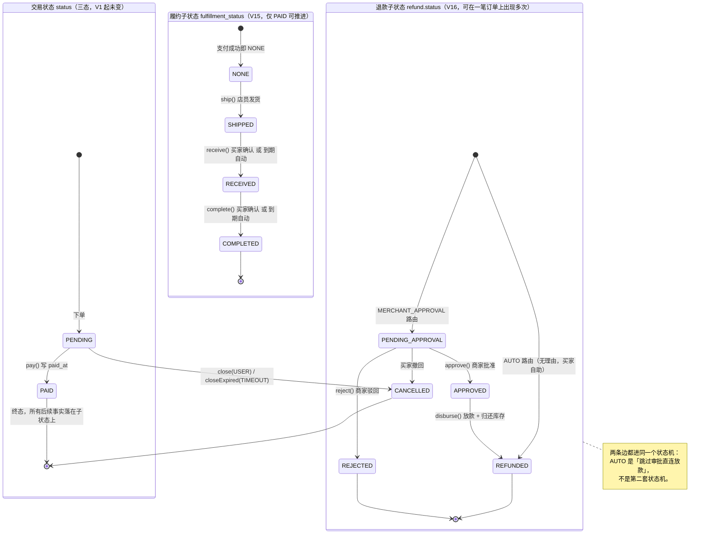
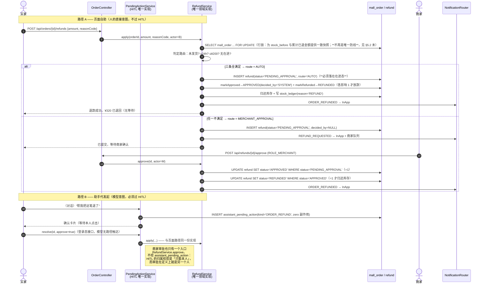

# 退款与履约设计方案

> **本文只回答已被拍板的三件事**：Q3 退款（区分无理由 / 需商家确认）、Q5 本地外发（预留密钥位）、
> N1 成交后履约 + N2 退款。所有判断建立在已核实的现状之上，**不改动 `docs/优化计划-P1.md`**（那份已定稿）。
>
> 编号：迁移走 **V15 / V16**（**不进 V14**），任务沿用全局编号 **T11–T15**（T01–T06 已完结）。
>
> 约束：不新增 Maven 依赖；不接真实资金；不引入真实物流承运商；安全关键逻辑只有一份实现（项目决策第 2 条）。

---

## 0. 拍板结论 → 本方案落点

| 拍板项 | 结论 | 本方案的落点 |
| ------ | ---- | ------------ |
| **Q3 退款** | 做，且区分「无理由（买家自助）」与「需商家确认（商家审批）」 | §4 分流规则 + §4.4 `refund` 表 + §5 库存幂等 |
| **新增商家账户类型** | `ROLE_MERCHANT`，与 `ROLE_USER` / `ROLE_STAFF` **并列** | §3（含 `AssistantActor` 三处改动与既有测试影响面） |
| **Q5 本地版本 + 密钥预留** | 本地实现无需密钥即可跑；配置结构从一开始容纳 `api-key` / `secret` | §6 YAML + 缺密钥行为契约 + 三条测试 |
| **N1 + N2 一起做** | 先有完成态，退款与评价才有落点 | §2 履约状态机（V15）→ §4 退款（V16） |

---

## 1. 既有机制核查（开工前先读这一行）

> 本项目已三次因跳过这步而立项错误（P0 的 `request_hash` 死列、B10 的 Micrometer 依赖假设、P2-1 的「慢查询」）。开户前逐条对照。

| 项 | 现在有没有代码在管？ | 缺口到底是哪一段？ |
| -- | -------------------- | ------------------ |
| **N1 履约** | **有**：`OrderRepository.markPaid`（L84-87）、`closeExpired`（扫描器 `OrderExpiryService`）、`OrderView` 已有 `expiresAt/closeReason/closedAt` 三列的成功经验 | **缺的是「PAID 之后」**：`status` 只有 `PENDING/PAID/CANCELLED`，**PAID 是零出边的死状态**；没有 `paid_at`（连「付了多久」都不知道）；没有任何发货 / 收货 / 完成的字段 |
| **N2 退款** | **没有**：无 `refund` 表，无状态迁移.sql。但**有可复用的两条现成范式**：`OrderTransactions.close`（带条件 UPDATE + 影响行数＝1 才做副作用）与 `PendingActionService`（HITL 闸门） | **缺的是「整套」**：实体、状态机、审批人、与库存的关系 |
| **商家** | **没有**：`AssistantActor` 只有 `ROLE_USER` / `ROLE_STAFF`（L11-12），`AssistantActors.resolve` 从 `UserDetailsService` 解析角色，`SecurityConfig.users` 是 `InMemoryUserDetailsManager`（L22-27，三个账号） | **缺的是第三个角色**：且角色不是"写在文档里"就够——`AssistantActor` L15/L20/L26 三处都要跟着动 |
| **Q5 外发** | **有半截**：`outbox_event` → `notification` 表就是**本地站内信**，已经在 FOR ORDER_CREATED / ORDER_PAID / ORDER_CANCELLED 三类事件 | **缺的是「通道」概念**：没有 `NotificationChannel` 抽象，也没有任何密钥位。好消息是——本地实现有真实调用方，**不会是死代码** |
| **库存归还** | **有**：`ProductCatalog.release` → `ProductService.release` → `repository.restore`；关单路径在 `OrderTransactions.close` L137-139 | **缺的是「归因」**：退款归还与超时关闭归还**共用同一个动作**，重复归还就是凭空造货（PM 已点名 N6） |

---

## 2. 状态机：N1 履约

### 2.1 结论（一句话）

> **`status` 三态不动，PAID 之后的正交生命周期放进新的 `fulfillment_status` 列；退款再单独一张 `refund` 表。**
> 沿用 `closeReason` 那种「状态 + 正交子状态 / 原因」的写法，**不给 `status` 加第四、第五个值**。

即：

| 列 | 语义 | 取值 |
| -- | ---- | ---- |
| `mall_order.status` | **交易/资金状态**（钱有没有收到） | `PENDING` / `PAID` / `CANCELLED`（**不变**） |
| `mall_order.fulfillment_status` | **履约子状态**（货走到哪一步，仅 PAID 之后可推进） | `NONE` / `SHIPPED` / `RECEIVED` / `COMPLETED`（**V15 新增**） |
| `refund.status` | **退款子状态**（钱要不要退回去） | `PENDING_APPROVAL` / `APPROVED` / `REJECTED` / `REFUNDED` / `CANCELLED`（**V16 新增**） |

### 2.2 为什么**不改** `status` 的 CHECK：正面回答 H2 自动命名那条教训

`V1__create_mall.sql` L16 写的是**内联** CHECK：

```sql
status VARCHAR(20) NOT NULL CHECK (status IN ('PENDING','PAID','CANCELLED')),
```

H2 会把它起成 `CONSTRAINT_51` 这类**自动名**。教训（V10 注释 L12-13、V12 L26-27、P1 §4.2 第 1 条）是：
**自动名写进后续迁移脚本，换个环境就会失配。**

于是「给 status 加两个值」这件事，落到 SQL 上有且只有三条路，逐条对照：

| 可选路径 | 做法 | 为什么不选 |
| -------- | ---- | ---------- |
| **A. `DROP CONSTRAINT` + `ADD CONSTRAINT`** | `ALTER TABLE mall_order DROP CONSTRAINT CONSTRAINT_51;` | **正是教训本人**：名字是 H2 给的、跨环境不可靠。H2 2.x 也没有能在静态 SQL 里「按列查出并删除 CHECK」的语法（Flyway 只支持静态 SQL，不能在迁移里做 `INFORMATION_SCHEMA` 查询再拼 SQL）。 |
| **B. 换不要在 weekend 用会自动命名的地方 —— 即绕开它** | 新建表 → `INSERT SELECT` → 重命名 | `order_item`、`outbox_event`、`notification` 三张表都对 `mall_order(id)` 有外键，其中两个是**自动名外键**（实测：删 `outbox_event` 时报 `Cannot drop … because "CONSTRAINT_AD" depends on it`）。重建表＝让三条既有外键失联或被迫重写，改动面远超需要。 |
| **C. 不动它，加正交子状态列** ✅ | 新增 `fulfillment_status`，所有新 CHECK **显式命名** | 零 DROP、零重建、零外键风险；且与 `close_reason`（V10）已经是同一套写法——「交易态」与「履约态」本来就是两个正交的维度。 |

**业务语义上也支持 C**：`status` 回答「钱收到了没有」，`fulfillment_status` 回答「货走到哪了」。
淘宝的「已付款待发货 / 待收货 / 已完成 / 售后中」同样是**两个维度**的组合，而不是一条 8 值的平铺状态链——
一个退款成功的订单仍然**曾经**付过款（`PAID`）也**曾经**有发货记录，把这两件事压进同一列，就只能用「回退状态」来抹掉历史事实。

> **附录（如果将来真要扩 `status` 的值）**：唯一可靠的做法是 B 的受控版本——
> `CREATE TABLE mall_order_new (… CONSTRAINT ck_order_status CHECK (…) …)` → `INSERT INTO mall_order_new SELECT … FROM mall_order` → 逐张处理三个外键（先 DROP 旧外键、再 ADD 命名外键）→ `DROP TABLE mall_order` → `ALTER TABLE mall_order_new RENAME TO mall_order`。
> **本方案不走这条路**，因为 N1/N2 不需要动交易态。

### 2.3 状态流转图



> **图上的一个关键点**：履约推进时 `status` **始终是 `PAID`**。退款也不改 `status`——
> 「这笔订单收过 ¥320，后来退回去了 ¥50」是 `PAID` + 一条 `refund` 记录，而不是一个新状态。

### 2.4 V15 迁移 SQL（H2 2.3.232 已实测）

```sql
-- V15：成交之后的履约状态机（N1）。
--
-- 为什么不扩 status 的值：V1 的 status CHECK 是内联的，H2 起了自动名 CONSTRAINT_51，
-- 写进后续脚本跨环境会失配（V10 的教训）。这里改用「交易态 + 正交履约子状态」，
-- 与 V10 的 close_reason 同一套写法，且所有新约束一律显式命名。

-- ===================================================================
-- 一、新列
-- ===================================================================
-- paid_at：退款窗口要按「支付完成多久」判定，没有它就只能用 created_at 凑，
-- 而 created_at 是下单时刻——用户拖到最后一秒付款，凭空多出 15 分钟。
ALTER TABLE mall_order ADD COLUMN paid_at TIMESTAMP;
ALTER TABLE mall_order ADD COLUMN fulfillment_status VARCHAR(20) NOT NULL DEFAULT 'NONE';
ALTER TABLE mall_order ADD COLUMN shipped_at TIMESTAMP;
ALTER TABLE mall_order ADD COLUMN shipped_by VARCHAR(100);
ALTER TABLE mall_order ADD COLUMN shipping_no VARCHAR(40);
ALTER TABLE mall_order ADD COLUMN received_at TIMESTAMP;
ALTER TABLE mall_order ADD COLUMN completed_at TIMESTAMP;
-- 自动收货时刻：在发货这一刻算好并落库（与 expires_at 同一个道理——
-- 之后运营把 10 天改成 7 天，不该让在路上这批订单的对账一起跳变）。
ALTER TABLE mall_order ADD COLUMN auto_receive_at TIMESTAMP;

-- ===================================================================
-- 二、存量回填（必须排在约束之前，理由见 §2.5）
-- ===================================================================
-- 历史 PAID 订单没有支付时刻这个事实，唯一可得的下界是 created_at，用它兜底。
-- 代价要写清楚：这批订单的「无理由退款窗口」会比真实支付时刻早几分钟启动。
-- 条件 IS NULL 而不是无条件：这条语句会被重复执行（建库脚本回放 / 多环境重跑），
-- 无条件 UPDATE 会把已经正确的行改坏。
UPDATE mall_order SET paid_at = COALESCE(paid_at, created_at)
 WHERE status = 'PAID' AND paid_at IS NULL;

-- ===================================================================
-- 三、命名约束
-- ===================================================================
ALTER TABLE mall_order ADD CONSTRAINT ck_order_fulfillment_status
  CHECK (fulfillment_status IN ('NONE','SHIPPED','RECEIVED','COMPLETED'));

-- 时间戳与状态必须同步：这条是整套履约状态机的地基——
-- 「SHIPPED 却没有发货时间」这种半吊子行由数据库拒绝，不靠调用方记得写全。
ALTER TABLE mall_order ADD CONSTRAINT ck_order_fulfillment_fields
  CHECK (
    (fulfillment_status = 'NONE'      AND shipped_at IS NULL     AND received_at IS NULL     AND completed_at IS NULL)
 OR (fulfillment_status = 'SHIPPED'   AND shipped_at IS NOT NULL AND received_at IS NULL     AND completed_at IS NULL)
 OR (fulfillment_status = 'RECEIVED'  AND shipped_at IS NOT NULL AND received_at IS NOT NULL AND completed_at IS NULL)
 OR (fulfillment_status = 'COMPLETED' AND shipped_at IS NOT NULL AND received_at IS NOT NULL AND completed_at IS NOT NULL)
  );

-- 付过钱必须有支付时刻：这条约束会强制 OrderRepository.markPaid 同步改写（见 §8 T11）。
ALTER TABLE mall_order ADD CONSTRAINT ck_order_paid_needs_moment
  CHECK ((status <> 'PAID' AND paid_at IS NULL) OR (status = 'PAID' AND paid_at IS NOT NULL));

-- 没付钱的订单不允许进入履约：「钱到账才配货」这条底线写在这里，而不是写在某个 Controller 里。
ALTER TABLE mall_order ADD CONSTRAINT ck_order_fulfillment_needs_paid
  CHECK (fulfillment_status = 'NONE' OR status = 'PAID');

CREATE INDEX idx_order_fulfill     ON mall_order(fulfillment_status, shipped_at);
CREATE INDEX idx_order_autoreceive ON mall_order(fulfillment_status, auto_receive_at);
```

### 2.5 迁移内的**语句顺序**是被约束逼出来的（实测）

先加约束、后回填，会被**存量数据自己**拒绝。实测报错：

```
org.h2.jdbc.JdbcSQLIntegrityConstraintViolationException:
  Check constraint violation: "CK_ORDER_PAID_NEEDS_MOMENT"
```

因为此刻表里已经有一笔 `status='PAID'` 且 `paid_at IS NULL` 的行。
**顺序必须是：加列 → 回填 → 加约束 → 加索引。**
这条写进 `V15MigrationTest`，因为它是「下一个改这个文件的人最容易踩的一脚」。

顺便验证了一件事：**约束名出现在异常消息里**（`"CK_ORDER_PAID_NEEDS_MOMENT: "`），
所以测试可以直接断言

```java
assertThatThrownBy(…).hasMessageContaining("CK_ORDER_FULFILLMENT_FIELDS");
```

这正是「一律显式命名」在可测试性上的回报。

### 2.6 履约状态迁移的语句模板（沿用关单那套写法）

```sql
-- 发货：谁成功把状态从 NONE 迁移走，谁就负责写 shipped_at（"转换权"＝责任）
UPDATE mall_order
   SET fulfillment_status = 'SHIPPED', shipped_at = :now, shipped_by = :staff,
       shipping_no = :no, auto_receive_at = :auto
 WHERE id = :id AND status = 'PAID' AND fulfillment_status = 'NONE';

-- 收货（买家手动）：PAID + SHIPPED 两个前置条件一起写死，越掉任何一半都是漏洞
UPDATE mall_order SET fulfillment_status = 'RECEIVED', received_at = :now
 WHERE id = :id AND username = :user AND fulfillment_status = 'SHIPPED';

-- 完成
UPDATE mall_order SET fulfillment_status = 'COMPLETED', completed_at = :now
 WHERE id = :id AND username = :user AND fulfillment_status = 'RECEIVED';

-- 到期未收货 → 自动完成（系统路径，不限定 username，同 OrderRepository.lock 的道理）
UPDATE mall_order SET fulfillment_status = 'COMPLETED', completed_at = :now
 WHERE id = :id AND fulfillment_status = 'RECEIVED' AND auto_receive_at <= :now;
```

**影响行数＝1 才允许发后续事件**（`ORDER_SHIPPED` / `ORDER_RECEIVED` / `ORDER_COMPLETED`）——
与 `OrderTransactions.close` L133-137 完全同构，不另发明一套。

---

## 3. 商家账户：新增 `ROLE_MERCHANT`

### 3.1 结论

> **`ROLE_MERCHANT` 与 `ROLE_USER` / `ROLE_STAFF` 并列**，不是 STAFF 的子类型。

为什么不做成 STAFF 的子类：

| 方案 | 后果 |
| ---- | ---- |
| MERCHANT 是 STAFF 的**子类型**（账号同时带 `ROLE_STAFF` + `ROLE_MERCHANT`） | 判定写的是 `roles.contains(ROLE_STAFF)`，商家会**自动拥有全部店员权限**（改价、改库存、查所有用户订单）。要让商家只多退款审批权、不碰日常运营，就必须在**每一个判店员的地方**加一个「且不是 MERCHANT」的排除项——那是 5 个调用点、每个都可能在将来漏改。权限应当**默认最小、显式授予**。 |
| **并列**（✅ 本方案） | 商家账号只带 `ROLE_USER, ROLE_MERCHANT`。它要看内部文档，就在判定的那一处显式写上 `|| isMerchant()`。漏改的后果是「少给权限」（安全的方向），不是「多给权限」。 |

### 3.2 账户数据落在哪

现状核对：**没有用户表**。账号体系只有一处——

```java
// src/main/java/dev/learning/mall/config/SecurityConfig.java L22-27
UserDetailsService users(PasswordEncoder encoder, @Value("${mall.demo-password}") String password) {
    return new InMemoryUserDetailsManager(
            User.withUsername("student").password(encoder.encode(password)).roles("USER").build(),
            User.withUsername("classmate").password(encoder.encode(password)).roles("USER").build(),
            User.withUsername("admin").password(encoder.encode(password)).roles("USER", "STAFF").build());
}
```

**最小改法**（一行，不引入表、不引入新依赖）：

```java
User.withUsername("admin").password(encoder.encode(password)).roles("USER", "STAFF").build(),
// 商家账号：经营决策方。刻意不带 STAFF——它能做的事由「MERCHANT」这一个角色说了算。
User.withUsername("merchant").password(encoder.encode(merchantPassword)).roles("USER", "MERCHANT").build()
```

- 密码：`${MALL_MERCHANT_PASSWORD:${mall.demo-password}}`，与店员账号的既有写法保持一致。
- **不建 `user` 表**：引入表就要引入注册/找回/密码字段/外键，而本项目账号是演示用的固定集合；
  更重要的是 `AssistantActors.resolve`（L22-27）已经把 `UserDetailsService` 当作**唯一权威来源**，
  加账号以后助手侧自动生效——**权限真相仍然只有一处**。
  > 将来真要持久化账号，只需替换 `UserDetailsService` 这个 Bean，`AssistantActor` 与本文 §3.3 的改动都不受影响。

### 3.3 `AssistantActor` 怎么扩（三处都要跟着动）

```java
public record AssistantActor(String username, Set<String> roles) {

    public static final String ROLE_USER = "ROLE_USER";
    public static final String ROLE_STAFF = "ROLE_STAFF";
    public static final String ROLE_MERCHANT = "ROLE_MERCHANT";   // ① 常量

    /** L15 isStaff() 保持严格语义：只看 ROLE_STAFF。商家不是店员的子集。 */
    public boolean isStaff() {
        return roles.contains(ROLE_STAFF);
    }

    public boolean isMerchant() {                                  // ② 新增判据
        return roles.contains(ROLE_MERCHANT);
    }

    /** 经营侧身份的统称：判这些数据(counted「内部数据能不能看」)用它，判「能不能执行日常运营动作」用 isStaff()。 */
    public boolean isOperatingSide() {
        return isStaff() || isMerchant();
    }

    /** L20 roleName()：判定顺序不能反——将来真有账号同时带 STAFF+MERCHANT 时，
     *  先判 MERCHANT 会让「店员」从前端徽标与既有测试里消失。 */
    public String roleName() {
        if (isStaff()) return "STAFF";
        if (isMerchant()) return "MERCHANT";
        return "USER";
    }

    /** L26 capabilityHint()：三分支，且**只描述字面意思——真正的闸门在工具内部**（原注释已强调）。 */
    public String capabilityHint() {
        if (isStaff())
            return "当前账号是店员（STAFF）…（原文不动）";
        if (isMerchant())
            return "当前账号是商家（MERCHANT）：可以查看经营数据、按用户名查询订单、"
                 + "查询并处理退款申请（批准 / 驳回）；发货、改价、改库存属于店员职责，"
                 + "你只能看不能动，更无权替某个买家发起退款。";
        return "当前账号是普通顾客（USER）…（原文不动）";
    }
}
```

**其余需要跟着改动的调用点（全部已定位，共 4 处）**：

| 位置 | 现在 | 改成 | 理由 |
| ---- | ---- | ---- | ---- |
| `StaffTools.java:119` | `if (!actors.resolve(username).isStaff())` | `!…isOperatingSide()` | 商家也该能查经营数据；但**改价/改库存的方法本身仍在 StaffTools 里，因此商家拿不到**——这条边界由「工具注册给谁」决定，见下行 |
| `KnowledgeService.java:73,81` | `actor.isStaff()` | `actor.isOperatingSide()` | 商家应该看得见内部运营文档（RAG 多租户按角色过滤） |
| `ToolRegistry.java:103` | `if (actor.isStaff()) targets.add(staffTools);` | 保持原样，**另加一行** `if (actor.isMerchant()) targets.add(merchantTools);` | **这是权限边界真正的实施点**：商家只拿到 `merchantTools`，不含改价/改库存/发货 |
| `AssistantService.java:254` | `if (actor.isStaff()) { … }` | 加一段 `if (actor.isMerchant()) { … }` | 前端能力清单要说清「能批退款」 |

### 3.4 权限边界（谁能审批退款、谁能发货）

| 动作 | USER | STAFF | MERCHANT | 实施位置 |
| ---- | :--: | :---: | :------: | -------- |
| 对**本人**订单申请退款 | ✅ | ✅（自己的订单） | ✅（自己的订单） | `RefundService.apply` 校验 `order.username == actor` |
| **发货**（NONE → SHIPPED） | ❌ | ✅ | ❌ | `SecurityConfig` URL 级 `hasRole("STAFF")` + `StaffTools` 归属 |
| **收货 / 确认完成** | ✅（本人订单） | ❌（不能替买家确认收货） | ❌ | Controller 限定 `principal == order.username` |
| **批准 / 驳回退款**（MERCHANT_APPROVAL 路由） | ❌ | ❌ | ✅ | `SecurityConfig` `hasRole("MERCHANT")` + `RefundService.approve` 内二次校验 |
| 无理由退款**（AUTO 路由） | ✅（本人 + 阈值内） | ❌ | ❌ | `RefundService.apply` 判定路由后**直接放款，不等任何人** |
| 查看待审批退款队列 | ❌ | ✅（只读） | ✅ | `hasAnyRole("STAFF","MERCHANT")` |
| 改价 / 改库存 | ❌ | ✅ | ❌ | 既有 `hasRole("STAFF")`（L37-38），**不动** |

> **为什么发货给店员、退款审批给商家**：钱的决定权与日常运营执行权分离，是最容易向人解释清楚的一条线，
> 也让「店员自己申请退款自己批准」在角色上就不可能。

### 3.5 对既有测试的影响面（逐条）

| 测试 | 断言 | 会不会红 | 处理 |
| ---- | ---- | -------- | ---- |
| `AssistantSecurityIntegrationTest` L146-149 | `status("student").role()=="USER"`、`status("admin").role()=="STAFF"`、admin 的能力含「库存预警/按用户名查订单」 | **不会红** | `roleName()` 先判 STAFF；admin 角色不变；能力清单对 STAFF 的分支没改 |
| `AssistantSecurityIntegrationTest` L100-104 | USER 与 STAFF 的工具集差异 | **不会红** | MERCHANT 走新增的一行，不动 staffTools 的注册条件 |
| `ToolProgressLabelTest` L41-42 / L58-62 | 只用写死的 USER / STAFF 两个 actor 遍历工具标签 | **不会红，但也覆盖不到新工具** | T13 里**追加** MERCHANT actor 到它的遍历列表（这是补充覆盖，不是修红） |
| `AgentLoopTest` L188 / L315-319 | `new AssistantActor("student", Set.of("ROLE_USER"))`、`user("admin").roles("USER","STAFF")` 的端点 403/200 | **不会红** | 未触碰 |
| `KnowledgeServiceTest` L34-37 | CUSTOMER / STAFF 两个 actor 的知识可见性 | **不会红** | MERCHANT 是新 actor，不在这两个用例里 |
| `ProactiveServiceTest` L401/409 | `POST /api/products/*/price|stock` 的 STAFF 403 判定 | **不会红**（商家账号不在这些用例里）；但若不放心，可加一条 | 建议 **新增** 一条：用 merchant 角色打同样的请求 → 403（证明商家拿不到改价/改库存） |

**新增断言（不让它们悄悄漏掉）**：`MerchantRoleTest`
① merchant 工具的 labels 齐全（补 `ToolProgressLabelTest` 没覆盖到的那一类 actor）；② merchant 看不到 staff 的改价 / 改库存 / 发货工具；③ merchant 也看不到顾客工具里「发起退款」之外的效果型工具。
④ **负向**：用 merchant 身份调 `GET /api/assistant/audit` → 应为 **403**（该端点只对 STAFF 开放，商家不继承）。

---

## 4. 两类退款：分流规则与实现

### 4.1 判定条件（**可配的是金额与时限，「未发货」是硬规则**）

一笔退款申请走 `AUTO`（无理由，买家自助，不等任何人）必须**同时满足三条**：

| # | 条件 | 来源 | 说明 |
| - | ---- | ---- | ---- |
| 1 | `order.fulfillment_status = 'NONE'`（**未发货**） | **硬规则，不可配** | 货一旦出库，退款就要先走退货入库，那不是「点击即退」能自说自话的事。把它做成可配＝给「货已签收还能一键退款」留一个开关，这与本项目「安全边界不进配置」的一贯写法相悖（对比：`<`  permission 判定从不读配置） |
| 2 | `now − order.paid_at ≤ auto-refund-window-hours`（**默认 24 小时**） | 可配 | 支付完成后一天之内可反悔 |
| 3 | `refund.amount ≤ auto-refund-max-amount`（**默认 ¥200**） | 可配 | 阈值依据既有配置：包邮门槛 `99`、最高促销档 `199`，取 ¥200 作为「不超过最高促销档」的自然边界 |

**任一不满足 → `MERCHANT_APPROVAL`**（路由结果落库在 `refund.route`，可审计、可事后运营复盘）。
另外两条永远成立的前置：`order.status = 'PAID'`（没付过钱不叫退款，叫关单）与**该订单当前无在途退款**（见 §5）。

### 4.2 配置块 YAML

放进**既有**的 `mall.order` 块下，不另起一级——`OrderProperties` 已经是 `@ConfigurationProperties(prefix = "mall.order")`（L19），
加一个内部类 `Refund` 即可，不需要改任何前缀或装配方式：

```yaml
mall:
  order:
    payment-timeout-minutes: 15        # 既有，不动
    # ── 退款（N2）────────────────────────────────────────────
    refund:
      enabled: true                    # 总开关；关掉 = 回到「付完就是终态」的旧行为
      # 无理由退款窗口：支付完成后多少小时内可自助退。按 paid_at 计，不是 created_at。
      auto-refund-window-hours: 24
      # 无理由退款单笔金额上限（含）。超过就要商家点头。
      auto-refund-max-amount: 200
      # 自动收货：发货后多少天没人确认就算收到了。落库为 auto_receive_at。
      auto-receive-days: 10
      auto-receive-enabled: true
      auto-receive-scan-delay-ms: 300000
      auto-receive-max-per-scan: 200
      # 单笔订单同时在途的退款申请上限。>1 是为了将来做「一件商品单独退」留出位置，
      # 当前实现只支持全额退款，因此这个值 > 1 时会在服务端被拒绝（见 §4.4 注）。
      max-active-per-order: 1
```

> **两个"带货(?)"**：`auto-receive-days` 与履约扫描器同属 `mall.order`（它本身也是订单生命周期的一部分），
> 不单开 `mall.fulfillment`，避免前缀碎片化。

### 4.3 时序图：两类退款的分流路径



> **[2026-10-17 修订]** 上面 AUTO 分支的第一句原本写成 `INSERT refund(status='REFUNDED', …)`（一步到位），
> 与 §5.2 `disburse` 的 `markApproved → markRefunded` 两段写法自相矛盾，现在改掉了。
> **改它不是为了文案一致**：§4.4 新增的 `uq_refund_inflight` 只对**在途态**的行生效，
> 若 AUTO 直接插成 `REFUNDED`（终态），这行从头到尾不进索引，
> 「同一订单两笔 AUTO 退款」就绕开了数据库约束——刚补上的防线被自己挖了个洞。
> 因此**两条路由都必须先落在 `PENDING_APPROVAL`**，再在同一事务内推进到终态。

### 4.4 V16 迁移 SQL（H2 2.3.232 已实测）

```sql
-- V16：退款（N2）+ HITL 退款闸门字段 + 外发投递留痕（Q5）。
-- 依赖：V14（stock_ledger 已存在）、V15（fulfillment_status 已存在）。Flyway 顺序即依赖保证。

-- ===================================================================
-- 一、stock_ledger 认得退款归还
-- ===================================================================
-- 退款归还库存要能在流水里被认出来：关单归还叫 RELEASE（订单没成交，货压根没出去），
-- 退款归还叫 REFUND（钱收过了，货要回来）。共用同一个 reason 会把这两件事混在一起，
-- 于是「这笔订单到底还过货没有」这条幂等判据没法写（见 §5）。
-- 能可靠地 DROP 掉 V14 那条，正因为它是命名约束（自动名会跨环境失配）。
ALTER TABLE stock_ledger DROP CONSTRAINT ck_ledger_reason;
ALTER TABLE stock_ledger ADD CONSTRAINT ck_ledger_reason_v2
  CHECK (reason IN ('RESERVE', 'RELEASE', 'RESTOCK', 'REFUND'));

-- ===================================================================
-- 二、refund：退款业务实体与它自己的状态机
-- ===================================================================
CREATE TABLE refund (
  id VARCHAR(36) PRIMARY KEY,
  -- 刻意不加 REFERENCES mall_order(id)：订单表在每个测试类的 @AfterEach 里被 DELETE，
  -- 加外键会把「删订单」变成「先删退款」，逼着 10+ 个测试类改清理顺序（V14 教训第 3 条）。
  order_id VARCHAR(36) NOT NULL,
  username VARCHAR(100) NOT NULL,
  amount DECIMAL(12,2) NOT NULL,
  reason_code VARCHAR(30) NOT NULL,        -- NO_REASON / DAMAGED / WRONG_ITEM / OTHER
  reason_text VARCHAR(200),
  route VARCHAR(20) NOT NULL,              -- AUTO / MERCHANT_APPROVAL：分流结果落库，可事后复盘
  status VARCHAR(20) NOT NULL DEFAULT 'PENDING_APPROVAL',
  requested_by VARCHAR(100) NOT NULL,      -- 买家自己，或助手代发起（写请求者标识）
  decided_by VARCHAR(100),                 -- MERCHANT 审批人；AUTO 路由固定为 'SYSTEM'
  decided_at TIMESTAMP,
  decision_note VARCHAR(200),
  -- 库存是否已归还。这是幂等的第一道实物标记（见 §5）。
  stock_returned INT NOT NULL DEFAULT 0,
  created_at TIMESTAMP NOT NULL DEFAULT CURRENT_TIMESTAMP,
  updated_at TIMESTAMP,

  -- ── [2026-10-17 新增]「一笔订单只能有一笔在途退款」的数据库保证 ──
  -- H2 2.3.232 不支持条件唯一索引（CREATE UNIQUE INDEX … WHERE …，实测 Syntax error），
  -- 于是用「生成列 + 唯一索引」表达：在途态映射到 order_id，终态映射到 NULL；
  -- H2 的唯一索引允许多个 NULL，所以终态可以留任意多条历史，在途只允许一条。
  --
  -- 迁移与代码的三条必须遵守的注意点（都是实测结论，不是纸上推演）：
  --   1. GENERATED ALWAYS AS 的列不可手工赋值。INSERT/UPDATE 写它会报
  --      `Generated column "PUBLIC.REFUND.IN_FLIGHT" cannot be assigned`，
  --      因此所有 INSERT 的列清单里都不要出现 in_flight，种子数据与测试夹具同理。
  --   2. 生成列在 UPDATE 时会重算（实测 PENDING_APPROVAL→APPROVED 仍为 order_id、
  --      APPROVED→REFUNDED 后变 NULL）。这条是本方案成立的前提：
  --      若不重算，约束就从「防重复」退化成「这笔订单永远不能再退款」。
  --   3. 表达式必须是确定性的。H2 2.3.232 **不会**拦你（实测 CURRENT_TIMESTAMP / RAND()
  --      / RANDOM_UUID() 都能建表），所以这是自律而非数据库保证：非确定性表达式在每次
  --      UPDATE 时重算出新值，会让唯一索引的键漂移，约束形同虚设。
  --
  -- ⚠ 耦合点：这里的在途态集合 ('PENDING_APPROVAL','APPROVED') 与上面的 ck_refund_status
  --   是两处独立的枚举。将来若给 refund.status 增加第三个「在途」值，必须同步改这里，
  --   否则新状态的退款不受约束（静默失效，不报错）。反向验证见 §9 T14 #7。
  in_flight VARCHAR(36) GENERATED ALWAYS AS
    (CASE WHEN status IN ('PENDING_APPROVAL','APPROVED') THEN order_id END)
);
CREATE INDEX idx_refund_order ON refund(order_id, created_at);
CREATE INDEX idx_refund_queue ON refund(status, created_at);
-- 命名沿用项目既有惯例（V1 uq_order_request / V7 uq_memory_user_key / V11 uq_alert_source 都是 uq_ 前缀）。
-- 命名而不是让 H2 自动起名，因为约束名会出现在异常消息里，测试要断言它（§2.5 那条回报）。
CREATE UNIQUE INDEX uq_refund_inflight ON refund(in_flight);

ALTER TABLE refund ADD CONSTRAINT ck_refund_amount CHECK (amount > 0);
ALTER TABLE refund ADD CONSTRAINT ck_refund_route
  CHECK (route IN ('AUTO', 'MERCHANT_APPROVAL'));
ALTER TABLE refund ADD CONSTRAINT ck_refund_status
  CHECK (status IN ('PENDING_APPROVAL', 'APPROVED', 'REJECTED', 'REFUNDED', 'CANCELLED'));
ALTER TABLE refund ADD CONSTRAINT ck_refund_stock_flag CHECK (stock_returned IN (0, 1));
-- 审批字段要么全空（还在等 / 买家撤回），要么全满（已有决定）。半吊子行不存在。
ALTER TABLE refund ADD CONSTRAINT ck_refund_decision_fields
  CHECK (
    (status IN ('PENDING_APPROVAL','CANCELLED') AND decided_by IS NULL AND decided_at IS NULL)
    OR (status IN ('APPROVED','REJECTED','REFUNDED') AND decided_by IS NOT NULL AND decided_at IS NOT NULL)
  );
-- AUTO 全程没有人类审批人，decided_by 只能是 SYSTEM——防止把自助退款伪造成「某某批过」。
-- [2026-10-17 修订] 原写法 `route <> 'AUTO' OR decided_by = 'SYSTEM'` 会**拒绝 AUTO 的首次插入**：
--   §4.3 改过之后 AUTO 也先落在 PENDING_APPROVAL（decided_by IS NULL），NULL = 'SYSTEM' 是 NULL 不是 TRUE，
--   CHECK 因此判假 → 无理由退款连建单都建不了。加了 `decided_by IS NULL` 分支：
--   「还没定」与「系统定的」都合法，「某个人定的」对 AUTO 永远不合法（伪造审批仍然被挡）。
ALTER TABLE refund ADD CONSTRAINT ck_refund_auto_decided_by_system
  CHECK (route <> 'AUTO' OR decided_by IS NULL OR decided_by = 'SYSTEM');
-- 库存只能跟着「已放款」走，不能「还没批就先退货」。
ALTER TABLE refund ADD CONSTRAINT ck_refund_stock_only_when_refunded
  CHECK (stock_returned = 0 OR status = 'REFUNDED');

-- ===================================================================
-- 三、HITL：助手发起退款走已泛化的那道闸门，不新建第二张「待确认」表
-- ===================================================================
ALTER TABLE assistant_pending_action ADD COLUMN refund_reason_code VARCHAR(30);
ALTER TABLE assistant_pending_action ADD COLUMN refund_reason_text VARCHAR(200);

-- V13 的 ck_pending_kind_fields 是穷举式 OR：新增 ORDER_REFUND 不改它，
-- 插入会直接被数据库拒绝（实测见 §11）。这里能可靠 DROP，正因为 V13 当初用了命名约束。
ALTER TABLE assistant_pending_action DROP CONSTRAINT ck_pending_kind_fields;
ALTER TABLE assistant_pending_action ADD CONSTRAINT ck_pending_kind_fields_v2
  CHECK (
    (kind = 'ORDER_PAYMENT' AND order_id IS NOT NULL AND payment_method IS NOT NULL)
    OR (kind = 'ORDER_CREATE'  AND idempotency_key IS NOT NULL AND lines_json IS NOT NULL)
    OR (kind = 'ORDER_CANCEL'  AND order_id IS NOT NULL)
    OR (kind = 'ORDER_REFUND'  AND order_id IS NOT NULL AND amount IS NOT NULL
        AND refund_reason_code IS NOT NULL)
  );

-- ===================================================================
-- 四、notification_delivery：外发投递留痕（本地实现也写，降级也写）
-- ===================================================================
CREATE TABLE notification_delivery (
  id VARCHAR(36) PRIMARY KEY,
  username VARCHAR(100) NOT NULL,
  channel VARCHAR(20) NOT NULL,          -- 实际投递走的通道
  preferred_channel VARCHAR(20) NOT NULL,-- 原本想走的通道（降级后两者不同）
  degraded BOOLEAN NOT NULL DEFAULT FALSE,
  event_type VARCHAR(30) NOT NULL,       -- ORDER_SHIPPED / ORDER_RECEIVED / ORDER_REFUNDED …
  order_id VARCHAR(36),                  -- 同样不加外键，理由同 refund
  content VARCHAR(400) NOT NULL,
  created_at TIMESTAMP NOT NULL DEFAULT CURRENT_TIMESTAMP
);
CREATE INDEX idx_delivery_user ON notification_delivery(username, created_at);
ALTER TABLE notification_delivery ADD CONSTRAINT ck_delivery_channel
  CHECK (channel IN ('IN_APP', 'SMS', 'EMAIL'));
ALTER TABLE notification_delivery ADD CONSTRAINT ck_delivery_preferred
  CHECK (preferred_channel IN ('IN_APP', 'SMS', 'EMAIL'));
```

> **[2026-10-17 修订]** 上一版这里写的是「H2 不支持条件唯一索引 → 该约束在 DB 层无法表达，只能靠应用层行锁」。
> **前半句实测成立，后半句结论错了**——条件唯一索引只是「表达方式之一」，不是唯一表达方式。
> 用**生成列 + 唯一索引**可以在 DB 层完整表达同一条规则，实测（H2 2.3.232，文件库 MVStore，
> 临时库 `target/refund-verify/db4`，**未触碰 `data/mall.mv.db`**）：
>
> ```
> [1] CREATE UNIQUE INDEX uk_p ON t_partial(order_id) WHERE status='PENDING_APPROVAL'
>     → Syntax error in SQL statement ... [42000-232]        ← 原结论，仍然成立
> [2] 生成列 + 唯一索引 DDL（文件库 MVStore）                → 通过
> [3] 首笔在途插入 PENDING_APPROVAL                          → 通过，in_flight='paid-0001'
> [4] 同订单第二笔在途（APPROVED）                           → 被拒：
>     Unique index or primary key violation:
>       "PUBLIC.UQ_REFUND_INFLIGHT ON PUBLIC.REFUND(IN_FLIGHT NULLS FIRST)
>        VALUES ( /* 1 */ 'paid-0001' )"
> [5] 终态(REJECTED×2/REFUNDED/CANCELLED)同订单多行          → 通过（历史可留多条）
> [6] 不同订单各自在途                                       → 通过
> [7] PENDING_APPROVAL→APPROVED 仍为 'o1'；→REFUNDED 变 NULL → 重算正确
> [8] 退款完成后同一订单再申请一笔                           → 通过（没退化成「永远不能再退」）
> [9] 并发：两个连接各插一笔同订单在途，T1 未提交时 T2 插入   → T2 被拒（真的并发窗口也兜住）
> ```
>
> 于是这条规则**从「应用层纪律」升级为「数据库保证」**：漏掉 `SELECT … FOR UPDATE` 不再等于双退款。
> 行锁仍然建议保留（§5.2 注），但它现在只是纵深防御的第二层，不再是唯一防线。
> 相应的风险话术与反向验证已同步改掉（§11.2 第 2/4 条、§9 T14 #7）。

### 4.5 退款与 HITL 的关系：确定答案

> **新增 `kind = ORDER_REFUND`，复用 `PendingActionService` 那一份实现，不另起一套闸门。**
> 而**商家审批**走 `RefundService.approve`，**不**塞进 `assistant_pending_action`。

理由（这是本节最需要说清的一条边界）：

1. **HITL 防的是 LLM06 过度代理**——它的语义是「模型发起的动作，必须由**本人**确认」。
   判定写死在 `PendingActionService.resolve` L266-270：`if (!row.username().equals(username)) → 404`。
2. **商家审批在定义上就是另一个人**。把它塞进 `assistant_pending_action`，只有两种可能：
   绕过归属校验（把安全关键逻辑挖个洞），或改成"归属可扩展"（那才是真正的第二份实现）。
   两种都不接受。
3. 因此分工是——
   - **闸门**（`assistant_pending_action`）：只管「模型替人发起 → 人本人确认」。新增 kind 只动 `label()`、`auditPrefix()`、`execute()` 三个 switch，
     **归属校验 / 一次性原子迁移 / TTL / 审计这四段一行都不改**。
   - **领域**（`refund` 表）：所有路径——页面自助、助手代发起、商家审批——最终都调用 `RefundService`，**业务规则只有一份**。

```java
public static final String KIND_ORDER_REFUND = "ORDER_REFUND";

// label(): case KIND_ORDER_REFUND -> "退款确认";
// auditPrefix(): case KIND_ORDER_REFUND -> "HITL_REFUND";   // 支付路径的 HITL_PAY_* 保持不变

case KIND_ORDER_REFUND -> {
    RefundView r = refunds.apply(row.orderId(), username, row.amount(),
            row.refundReasonCode(), row.refundReasonText());
    audit.record(username, row.conversationId(), AssistantAudit.STAGE_TOOL, "CONFIRM",
            "HITL_REFUND_CONFIRM", "LLM06",
            "本人确认退款：订单 " + row.orderId().substring(0, 8) + "，金额 ¥" + row.amount());
    yield insights.ordersOf(username).stream().filter(o -> o.id().equals(row.orderId())).findFirst()
            .orElseThrow();
}
```

> **注意：`execute` 里 yield 的是 `OrderView`**（现有签名）。退款不改变 `OrderView.status`（退款是自子状态，见 §2.1），
> 因此这里返回订单原视图；退款结果通过 `PendingActionView` + `RefundService` 的返回值回给前端。

---

## 5. 退款后的库存：幂等方案（PM 点名的 N6）

### 5.1 风险本体

`OrderTransactions.close` L133-137 的注释已经把规则写死了：

> 更新成功 = 这笔订单的待支付状态是我终结的，那么归还库存也是我的责任；
> 更新影响 0 行 = 别人已经处理过，此刻绝不能再还一次库存（重复归还会凭空造出货）。

退款要复用同一条规则。三条可能会"重复归还"的路径：

| 路径 | 会不会重复 | 怎么挡 |
| ---- | ---------- | ------ |
| 超时关闭 与 退款 同时发生 | **不会**——前者只能从 `status='PENDING'` 转换，后者只能从 `status='PAID'` 转换，两个前置条件在同一行上互斥（实测 `IS_PAID=1, IS_PENDING=0`） | DB 层前置条件互斥 |
| 同一笔退款被执行两次（并发双击 / 异步重放） | 会 | 闸门 ① |
| **已发货 / 已收货之后退款却照样归还库存** | 会 —— 这是比 PM 点名那条更隐蔽的一条：**货在买家手上，库存却回到了货架** | 闸门 ② |

### 5.2 三道闸门

**① 一次性状态迁移（应用层，主闸门）——沿用 `close()` 那套写法**

```java
// RefundService.disburse
// 第一段的「转换权」= 放款 + 归还库存的责任；第二段防止一笔 refund 被放款两次
if (refunds.markApproved(id, merchant, now) != 1) throw conflict("ALREADY_RESOLVED", …);
if (refunds.markRefunded(id, now) != 1) return;     // 落败方安静跳过，不报错、不归还
if (order.fulfillmentStatus().equals("NONE")) {     // 只有未发货才还货
    for (OrderView.Item item : lines) catalog.returnStock(item.productId(), item.quantity(), actor, orderId);
    refunds.markStockReturned(id);                   // stock_returned = 1
}
payments.get(order.paymentMethod()).refund(orderId, receipt, amount);  // 模拟 gateway，不接真实资金
```

**② 业务判定「该不该还」（应用层）**：见上面 `fulfillmentStatus().equals("NONE")`。
已发货 / 已收货的退款**只退钱不还货**——它们需要的是退货入库流程，那部分**不做**（§10）。
**这笔钱走了，库存没回来，是正确行为**，不是丢数据。

**③ 数据层守卫（最后一道）**：写 `stock_ledger` 之前用 `NOT EXISTS` 去重——

```sql
INSERT INTO stock_ledger(product_id, delta, stock_before, stock_after, reason, actor, order_id)
SELECT p.id, :qty, p.stock, p.stock + :qty, 'REFUND', :actor, :order
  FROM product p
 WHERE p.id = :pid
   AND NOT EXISTS (SELECT 1 FROM stock_ledger l
                    WHERE l.order_id = :order AND l.reason = 'REFUND' AND l.product_id = :pid);
```

实测：第 1 次 `(Update count: 1)`，第 2 次 `(Update count: 0)`，**幂等且不报错**。
这条守卫的意义是：即便 ①② 都被绕过（有人手工刷 `#!java 应急脚本`），
也不会出现同一笔订单的两条 REFUND 流水，事后对账时立刻可见。

> **`ProductCatalog` 的入口怎么开**：不要给 `release` 再加一个 `reason` 参数让调用方传——
> 那样调用方可以传 `'RELEASE'` 冒充关单归还。新增具名方法
> `void returnStock(long productId, int quantity, String actor, String orderId)`，
> 内部固定 `reason = 'REFUND'`；底层仍收敛在 `ProductService` 的同一个写节点上
> （满足 P1 的「入口收在一处」，不破坏 T02 的成果）。

> **跨越 reviews**：退回金额累计不得超过 `pay_amount`。CHECK 不能跨表，
> 因此在**订单行锁内**判 `SUM(amount WHERE status IN ('APPROVED','REFUNDED')) + 本次 ≤ pay_amount`，超了抛 `REFUND_EXCEEDS_PAID`。

> **[2026-10-17 修订] `SELECT … FOR UPDATE` 的定位变了**：它**仍然保留**，但不再是「唯一防线」。
> §4.4 的 `uq_refund_inflight` 已经把「同订单两笔在途」挡在 INSERT 上，**漏掉行锁不再等于双退款**。
> 它现在的职责收敛为两条、且都与唯一性无关：
> ① 让 `stock_ledger` 的 `stock_before/after` 与 `product.stock` 的变更处在同一个串行点下，
>    否则两笔退款并发归还同一商品会写出交错的流水链（前一条的 `after` ≠ 后一条的 `before`）；
> ② 给上面那条「累计已退金额」的 `SUM` 一个一致的读快照。
> 反向验证随之改掉：不能再靠「去掉 FOR UPDATE → 期望双退款变红」来证明它有用（DB 会顶住，测试不会红），
> 见 §9 T14 #11。

---

## 6. 外发通道与密钥预留（Q5）

### 6.1 结构

```java
/** 一条外发通道。实现类要么不需要密钥（IN_APP），要么只在密钥存在时才被装配。 */
public interface NotificationChannel {
    String id();                                   // IN_APP / SMS / EMAIL
    boolean available();                           // 缺密钥时为 false，而不是抛异常
    DeliveryResult deliver(String username, String content, String eventType, String orderId);
}

public record DeliveryResult(String channel, boolean delivered, String degradedFrom, String reason) {}
```

- **`InAppNotificationChannel`**（无需密钥，**永远装配**）：落到既有的 `notification` 表——它就是本地实现。
- **`SmsNotificationChannel`**：`@ConditionalOnExpression("'${mall.notification.sms.api-key:}'.length() > 0")`。
  **本阶段不发真实请求**（无 Maven 依赖、无服务商），只写 `notification_delivery`（`channel='SMS'`，标记待发），
  把「本该外发的完整内容」留痕；密钥存在与否只决定**它配不装配**。
- **`EmailNotificationChannel`**：同形状的第二个占位位（`api-key` / `secret` / `from`），**当前不实现**，
  YAML 里预留键位即可——这不是死代码，因为它连类都没有；真正接线时才写。

> **为什么先画 `EMAIL` 位**：用户明确要求「配置结构从一开始就要能容纳 api-key / secret」。
> 只留 sms 位的代价是将来要改配置结构（又一次迁移 + 又一次文档返工）。

### 6.2 YAML（放进 `mall.*`，不新增依赖）

```yaml
mall:
  # 外发通道（Q5）：本地版本不需要任何密钥；真实外发的密钥位现在就在，值为空即可。
  # 空值 = 该通道不装配 → 发送降级到站内信，绝不变成功能死掉（视觉模型的教训，见下）。
  notification:
    default-channel: IN_APP        # 没有通道可用时兜底到它
    sms:
      enabled: false               # 先不启用；启用需要提供密钥
      api-key: ${SMS_API_KEY:}     # 空表示未配置
      secret: ${SMS_SECRET:}       # 预留：部分厂商是 key+secret 双签
      sign-name: "学习商城"        # 预留：国内短信必备的签名位
      max-per-day-per-user: 3      # 预留：频率合规位（本次不实现限流，只把开关位留出来）
    email:
      enabled: false
      api-key: ${EMAIL_API_KEY:}   # 预留
      secret: ${EMAIL_SECRET:}     # 预留
      from: ${EMAIL_FROM:}         # 预留
```

> 环境变量默认值写 **空串**（`:`），与既有 `zhipu.api-key: ${ZHIPU_API_KEY:}` 完全一致；
> 凭据不进版本库这条既有约定不用重提也不会破。

### 6.3 「缺密钥时行为是什么」——必须写死的三条契约

> **视觉模型的前车之鉴**（`VisionMissingKeyTest` 类注释，本文照抄其三层约定）：
> 最初密钥缺失时三方库抛 `apiKey cannot be null or empty` → **整个应用启动失败**。
> 为一个可选功能搭上整体可用性，这个交换太亏了。

| 契- | 行为 |
| --- | ---- |
| C1 | **应用照常启动**，不因缺密钥而失败 |
| C2 | 缺密钥时**不装配**该通道 Bean（`context.containsBean("smsNotificationChannel") == false`），而不是装配一个发不出去的对象 |
| C3 | 发送**降级到站内信**并保留降级原因：`DeliveryResult{channel='IN_APP', delivered=true, degradedFrom='SMS', reason='SMS_CHANNEL_UNAVAILABLE'}`，同时写一行 `notification_delivery`（`degraded=TRUE`）。**调用方永不拿到失败** |

### 6.4 对应测试：`NotificationMissingKeyTest`（3 条，照搬视觉那条的形状）

```java
@SpringBootTest(properties = {
        "mall.notification.default-channel=IN_APP",
        "mall.notification.sms.enabled=true",     // 故意开了开关却没给密钥——用户最可能踩的坑
        "mall.notification.sms.api-key=",         // 必须显式清空：本机环境变量会把本机密钥带进来，
                                                  // 换台机器就变结论的测试，比没有测试更危险
})
class NotificationMissingKeyTest {
    @Test void applicationStillStarts() { assertThat(context).isNotNull(); }
    @Test void smsBeanIsAbsent() { assertThat(context.containsBean("smsNotificationChannel")).isFalse(); }
    @Test void fallsBackToInAppAndStillDelivers() {
        DeliveryResult r = router.deliver("student", "您的订单已发货", "ORDER_SHIPPED", "o-1");
        assertThat(r.channel()).isEqualTo("IN_APP");
        assertThat(r.delivered()).isTrue();          // 降级 ≠ 失败
        assertThat(r.degradedFrom()).isEqualTo("SMS");
        assertThat(countDelivery(username, degraded=true)).isEqualTo(1);
    }
}
```

另外一条**正向**：给了密钥 → Bean 存在、第一次发送会从

```java
@SpringBootTest(properties = {"mall.notification.sms.enabled=true", "mall.notification.sms.api-key=dummy"})
class NotificationSmsWiringTest { /* Bean 存在 + 不降级 + delivery 里 channel='SMS' */ }
```

> **它不是死代码的保证**：N1（发货/收货/完成）与 N2（退款）一共新增 5 类事件，全部经这个 Router 投递。
> 本地实现从第一天就有真实调用方——这与 P1 §7 「写了没人用就是死代码」是同一个判据，本项满足。

---

## 7. 迁移编号与依赖

### 7.1 拆成两个 `V15` / `V16`

| 迁移 | 内容 | 能否独立交付 |
| ---- | ---- | ------------ |
| **V15** | 履约：8 个新列（`paid_at` / `fulfillment_status` / `shipped_*` / `received_at` / `completed_at` / `auto_receive_at`）+ 4 条命名约束 + 2 个索引 | ✅ 能。发货/收货/完成闭环不依赖退款任何东西 |
| **V16** | 退款：`stock_ledger.reason` 扩值 + `refund` 表 + `notification_delivery` 表 + HITL 两个字段 + `ck_pending_kind_fields_v2` | ❌ 不能。**退款必须知道「这笔订单发货了没有」**（§4.1 的第 1 条硬规则），那是 V15 才有的事实 |

**不合并成一个 V15 的理由**：N1 是「增补缺失的生命周期」，N2 是「新增业务实体」，两者的回滚半径不同。
合在一起就意味着"退款有问题"要把履约一起回滚。项目既有节奏（V10 超时 / V12 金额 / V13 HITL）也是一个决策一个迁移。

### 7.2 与 P1 的 T01–T04 依赖关系

```
T01(V14) ──► T02(stock_ledger writer) ──┐
                                        ├──► V15 ──► T11 ──► T12(履约服务) ──► T15(Q5 通道)
T03(PendingActionService 泛化收尾) ─────┘                                        ▲
                                        └──► V16 ──► T14(退款) ───────────────────┘
T13(商家账户) ──────────────────────────────► T14
```

| 依赖 | 说明 |
| ---- | ---- |
| **V16 → V14** | V16 要 `DROP CONSTRAINT ck_ledger_reason`。V14 未执行则该语句报错。**Flyway 顺序即保证**，但要写进 `V16MigrationTest` 的注释里，避免手工挑脚本跑的人踩坑 |
| **T14 → T02** | 退款归还库存必须写 `stock_ledger`，要走 T02 改过的 `ProductCatalog` 签名（加了 `actor` / `orderId`） |
| **T14 → T03** | **文件冲突**：`PendingActionService.java` 在 T03 里被改（`requestOrderCreate` 去 amount、落 `quote_id`），我在 T14 里给它加 `ORDER_REFUND` 分支。**必须串行，建议 T03 合并后再开工** |
| **T12 → T02** | 履约本身不改库存，无强依赖；但 `mall_order` 这张表的读写集中在 `OrderRepository`，建议放在 T03 之后以避免合并冲突 |
| **T13 与 T11/T12** | **可并行**：碰的是 `config` / `assistant` 两个包，与 `order` 包不重叠 |

> **建议顺序**：P1 的 T01–T04 全部完成并回归通过 → T13（可与 T11 并行）→ T11 → T12 → T14 → T15。

---

## 8. 任务清单与文件改动清单

| 任务 | 内容 | 依赖 |
| ---- | ---- | ---- |
| **T11** | V15 迁移 + `OrderRow` / `OrderView` 扩字段 + **`OrderRepository.markPaid` 改写 `paid_at`** + `V15MigrationTest` | 建议排在 T03 之后（`OrderRepository` 同文件改动的窗口重叠） |
| **T12** | `FulfillmentService`（发货/收货/完成/自动收货扫描）+ `FulfillmentController` + `OrderProperties` 新配置 + 三类 outbox 事件 | T11 |
| **T13** | 商家账户：`SecurityConfig` + `AssistantActor` + `MerchantTools` + `ToolRegistry` + `AssistantService.capabilitiesOf` + `MerchantRoleTest` | 无（可并行） |
| **T14** | V16 迁移 + `RefundService` + 分流判定 + `RefundController`（买家/商家两个端点）+ `PendingActionService.KIND_ORDER_REFUND` + `Stock` 幂等 + 测试 | T11 / T13 / T02 / T03 |
| **T15** | `NotificationChannel` 抽象 + `InAppNotificationChannel`（接既有 `notification` 表）+ `SmsNotificationChannel`（条件装配）+ 缺密钥降级测试 | T12 / T14（要有真实调用方） |

**文件清单**

| 文件 | 动作 | 说明 |
| ---- | ---- | ---- |
| `db/migration/V15__order_fulfillment.sql` | **新增** | §2.4 |
| `db/migration/V16__refund_and_delivery.sql` | **新增** | §4.4 |
| `order/internal/OrderRepository.java` | 修改 | `markPaid` 加 `paid_at`（被 `ck_order_paid_needs_moment` 强制）；新增履约 UPDATE 四式 |
| `order/internal/OrderRow.java` / `order/api/OrderView.java` | 修改 | 加 `paidAt` / `fulfillmentStatus` / `shippedAt` / `shippingNo` / `receivedAt` / `completedAt` |
| `order/internal/FulfillmentService.java` | **新增** | 发货/收货/完成 + 自动收货扫描（照 `OrderExpiryService` 的形状） |
| `order/internal/RefundService.java` | **新增** | §4 全部领域逻辑，唯一实现 |
| `order/internal/OrderProperties.java` | 修改 | 内部类 `Refund` + 自动收货配置（§4.2） |
| `order/web/OrderController.java` / `RefundController.java` | 修改 / **新增** | 买家端 + 商家端（URL 级角色限制） |
| `catalog/api/ProductCatalog.java` / `catalog/internal/ProductService.java` | 修改 | 新增 `returnStock(...)`，内部固定 `reason='REFUND'` |
| `payment/api/PaymentGateway.java` + 两个实现 | 修改 | 新增 `refund(orderId, receipt, amount)`；**不接真实资金**，返回模拟凭证 |
| `assistant/security/AssistantActor.java` | 修改 | §3.3（三处） |
| `assistant/internal/{StaffTools,ToolRegistry,AssistantService}.java`、`knowledge/KnowledgeService.java` | 修改 | `isStaff()` → `isOperatingSide()` / 新增 merchant 分支（§3.3 表） |
| `assistant/action/PendingActionService.java` | 修改 | `KIND_ORDER_REFUND` + 两个 switch 分支（§4.5） |
| `assistant/internal/MerchantTools.java` | **新增** | 商家工具：待审批退款队列 / 批准 / 驳回（全部标记 effectful → 走 HITL） |
| `messaging/NotificationChannel.java` 等 | **新增** | §6 |
| `config/SecurityConfig.java` | 修改 | 加 `merchant` 账号 + 退款/发货端点的 URL 级限制 |
| `docs/接口与数据结构.md`、`docs/实验手册.md` | 修改 | 登记两张新表、8 个新列、两个新角色端点；`refund.in_flight` 要标明是**生成列、不可手工写入** |
| `src/test/java/dev/learning/mall/{V15MigrationTest,V16MigrationTest,FulfillmentFlowTest,RefundRoutingTest,RefundStockIdempotenceTest,MerchantRoleTest,NotificationMissingKeyTest}.java` | **新增** | 约 20–22 条 |

**删除的文件：无。**

---

## 9. 反向验证（每个任务逐个：注回什么 bug、哪个测试变红、**这条断言覆盖哪一层**）

> P0 的教训：反向验证没变红，往往因为它测的是预检层、而 bug 在事务层。以下每条都标注层。

### T11 / T12　履约

| # | 注回的 bug | 必须变红的测试 | 这条断言实际覆盖的层 |
| - | ---------- | -------------- | -------------------- |
| 1 | `OrderRepository.markPaid` 不写 `paid_at` | `V15MigrationTest#paidOrderMustHavePaidMoment`（直接 JDBC 更新 + 断言异常含 `CK_ORDER_PAID_NEEDS_MOMENT`） | **数据库约束层**：约束是在线网，`markPaid` 漏改会连支付一起炸——炸得越早越好 |
| 2 | 发货时只更新 `fulfillment_status`、忘记写 `shipped_at` | `FulfillmentFlowTest#shippedRequiresMoment`（同上，断言异常含 `CK_ORDER_FULFILLMENT_FIELDS`） | **数据库约束层** |
| 3 | 去掉发货 UPDATE 的 `AND fulfillment_status='NONE'`（去掉转换权） | `FulfillmentFlowTest#concurrentShipSetsOnce`（双线程，断言 `shipped_at` 只被写一次、事件只有一条） | **事务层 / 行锁**：这条覆盖了, 1~2 条覆盖不到的并发窗口 |
| 4 | 允许未支付订单发货（去掉 `AND status='PAID'`） | `FulfillmentFlowTest#unpaidOrderCannotShip`（PENDING 订单发车 → 异常含 `CK_ORDER_FULFILLMENT_NEEDS_PAID`） | **数据库约束层** |
| 5 | 收货端点去掉 `AND username = :user` | `FulfillmentFlowTest#othersOrderCannotReceive`（甲确认收货乙的订单 → 影响 0 行 + 404） | **归属校验层**（查询条件） |
| 6 | V15 里把「回填」挪到「加约束」之后（顺序错） | `V15MigrationTest#scriptAddsConstraintsAfterBackfill`（重放到 V15 本身：先在空库+一笔 PAID 数据上跑 migrations，必须成功） | **迁移层**：这条专治"下一个改这个文件的人" |
| 7 | 自动收货到期时不校验 `auto_receive_at`，到点全表 COMPLETED | `FulfillmentFlowTest#autoReceiveRespectsDueTime`（未到期的 RECEIVED 订单仍为 RECEIVED；clock 由 `Clock` Bean 控制） | **调度/时间层**：只有注入 `Clock` 才测得动 |

### T13　商家账户

| # | 注回的 bug | 必须变红的测试 | 这条断言实际覆盖的层 |
| - | ---------- | -------------- | -------------------- |
| 1 | merchant 账号带上 `ROLE_STAFF`（做成子类） | `MerchantRoleTest#merchantCannotSeeStaffWriteTools`（商家工具集不含 `updateProductPrice` / `updateProductStock` / `shipOrder`） | **工具注册层**：这是权限边界真正的实施点。断言落在 `ToolRegistry.forActor` 而不是 URL 上，因为同一条路径既可能来自 MVC 也可能来自助手 |
| 2 | `roleName()` 里先判 MERCHANT 再判 STAFF | `AssistantSecurityIntegrationTest#roleIsExposed`（**既有测试**，`status("admin").role()=="STAFF"`）| **既有兼容层**：这条证明既有断言确实在守着这件事 |
| 3 | `ToolRegistry` 不加 `merchantTools`（商家看不到退款队列） | `MerchantRoleTest#merchantSeesRefundQueue` | **工具注册层** |
| 4 | 商家审批端点去掉 `hasRole("MERCHANT")` | `MerchantRoleTest#staffCannotApproveRefund`（店员身份打 `/api/refunds/{id}/approve` → 403） | **安全配置层**（URL 级） |
| 5 | `RefundService.approve` 去掉角色硬校验（只剩 URL 级） | `MerchantRoleTest#approveRequiresMerchantEvenInternally`（直接注入 Service，用店员身份调用 → `FORBIDDEN`） | **服务层纵深防御**：URL 被绕过时仍要拦住 |
| 6 | `KnowledgeService` 不改（`actor.isStaff()` 原样） | `MerchantRoleTest#merchantSeesInternalDocs` | **数据隔离层**（多租户 RAG） |

### T14　退款

| # | 注回的 bug | 必须变红的测试 | 这条断言实际覆盖的层 |
| - | ---------- | -------------- | -------------------- |
| 1 | 分流判定删掉「未发货」这条（三条变两条） | `RefundRoutingTest#shippedOrderRequiresMerchant`（已发货订单申请退款 → `route='MERCHANT_APPROVAL'` 且卖家端不自动放款） | **应用层判定**：这是本次最容易被"简化掉"的一条规则 |
| 2 | 窗口或金额阈值写成硬编码常量（不看配置） | `RefundRoutingTest#thresholdsComeFromProperties`（`@TestPropertySource` 把 24h 改成 1h、200 改成 1 元 → 同一笔申请从 AUTO 变 MERCHANT） | **配置层**：证明它可配而不是写死 |
| 3 | `disburse` 去掉 `if (markApproved(...) != 1) return`（重复放款） | `RefundStockIdempotenceTest#concurrentApproveOnlyDisbursesOnce`（双线程批准，断言 `refund` 状态迁移只有一次 + 库存只回一次） | **事务层 / 行锁**：`#1`、`#2` 之外的并发窗口 |
| 4 | 把「未发货才还库存」的判断删掉（一律归还） | `RefundStockIdempotenceTest#receivedOrderRefundDoesNotReturnStock`（已收货订单退款 → `stock_returned=0`、**`product.stock` 不变**、`stock_ledger` 无 REFUND 行） | **应用层资金/货物一致性**：这条专治「凭空造货」的第二种形态（§5.1 第三行） |
| 5 | 归还库存时走 `release` 而不是 `returnStock`（流水 reason=RELEASE） | `RefundStockIdempotenceTest#refundReturnIsAttributedToRefund`（断言 `stock_ledger` 里该订单的 REFUND 行数 = 1 且 RELEASE 行数 = 0） | **数据层归因**：没有归因就没有幂等判据 |
| 6 | 去掉 `stock_ledger` 的 `NOT EXISTS` 守卫 | `RefundStockIdempotenceTest#ledgerGuardIsIdempotent`（连跑两次守卫 INSERT → 第二次 0 行且总数仍为 1） | **数据层兜底**：这条覆盖第 1、3 条都被绕过的极端情况 |
| 7 | **[2026-10-17 改了注入方式]** 把 `in_flight` 的 CASE 条件写漏一个状态：`CASE WHEN status IN ('PENDING_APPROVAL') THEN order_id END`（**漏掉 `APPROVED`**） | `V16MigrationTest#onlyOneActiveRefundPerOrder`（同订单先插 PENDING_APPROVAL、再插 APPROVED → 断言第二笔被拒且异常含 `UQ_REFUND_INFLIGHT`；漏状态后两笔共存 → **变红**） | **数据库唯一索引层**：这是把防线挪进 DB 之后新多出来的一层，§9 原本没有。<br>注：只漏 `APPROVED` 时，两条 `PENDING_APPROVAL` 仍会被挡（实测）——所以断言必须**跨两个在途态**才测得出来，只插两笔同状态会假绿 |
| 8 | 金额上限校验放到转账之后（多了减库存） | `RefundRoutingTest#refundCannotExceedPaid`（退 ¥500 / 订单 ¥320 → 409 `REFUND_EXCEEDS_PAID` + **`refund` 表零新增**） | **预检层**：断言必须在任何写之前 |
| 9 | HITL 里 `requestOrderRefund` 忘了校验订单归属 | `RefundRoutingTest#cannotRequestRefundForOthersOrder`（助手替他人订单发起退款 → 404，消息含「不属于当前用户」） | **归属校验层**（HITL 发起侧） |
| 10 | V16 不加 `ck_pending_kind_fields_v2`（只加了两个列） | `V16MigrationTest#orderRefundCardIsInsertable`（插入 ORDER_REFUND kind → 被旧约束拒绝；跑了新约束则成功） | **迁移层**：这条证明 §4.4 第三节不是可选的 |
| 11 | **[2026-10-17 新增]** 去掉 `SELECT … FOR UPDATE` | `RefundStockIdempotenceTest#concurrentReturnsKeepLedgerChainConsistent`（两笔不同订单的退款并发归还**同一商品** → 断言两条 `stock_ledger` 的 `stock_after` 与下一条 `stock_before` 首尾相接）<br>**注意：不能再断言「出现两笔在途退款」**——那条现在由 `uq_refund_inflight` 顶住，去掉行锁它不会红 | **事务层 / 行锁**：行锁降级后剩下的真实职责（§5.2 末的注）。<br>这条是双线程用例（与 T12 #3 同形状），抖动时**重试固定次数**，不要靠放宽断言让它变绿 |
| 12 | **[2026-10-17 新增]** 把终态也写进 `in_flight` 的 CASE（如加上 `'REFUNDED'`） | `V16MigrationTest#historyRowsMayCoexist`（同订单插 3 条终态 → 必须全部通过；注回后第 2 条被拒 → **变红**） | **数据库唯一索引层（反向）**：防的是「把约束写过头」——过度收紧会让历史退款留不住，与 #7 正好对称 |
| 13 | **[2026-10-17 新增]** 把 `ck_refund_auto_decided_by_system` 简化回 `route <> 'AUTO' OR decided_by = 'SYSTEM'` | `RefundRoutingTest#autoRefundIsCreatedBeforeItIsDecided`（AUTO 建单时 `decided_by` 为空 → 必须能插进去；简化后 `NULL='SYSTEM'` 判假 → **变红**） | **迁移层**：这条专治「看起来更简洁」的回改。AUTO 先在途再决定，决定了才必须是 `SYSTEM` |

### T15　外发通道

| # | 注回的 bug | 必须变红的测试 | 这条断言实际覆盖的层 |
| - | ---------- | -------------- | -------------------- |
| 1 | 缺密钥时照样装配 SMS Bean（三方库式崩） | `NotificationMissingKeyTest#smsBeanIsAbsent` | **装配层**：这条是视觉模型事故的直接哨兵 |
| 2 | 缺密钥时 `deliver` 抛异常（而不是降级） | `NotificationMissingKeyTest#fallsBackToInAppAndStillDelivers` | **应用层降级契约**：不是"报错"，是"换条路走" |
| 3 | 降级了但没写 `notification_delivery` | `NotificationMissingKeyTest#degradationIsAuditable`（断言 `degraded=TRUE` 的那一行存在） | **应用层审计**：降级必须可复盘，否则线上静默降级没人知道 |
| 4 | 给了密钥却仍装不上 Bean（`@ConditionalOnExpression` 写反） | `NotificationSmsWiringTest#beanPresentWhenKeyProvided` | **装配层**（正向，防止 1 被修过头） |
| 5 | N1/N2 的新事件绕过 Router 直接写 `notification` 表 | `NotificationMissingKeyTest#allLifecycleEventsGoThroughRouter`（发货/退款后各断言 `notification_delivery` 有一行，且 `channel='IN_APP'`） | **应用层调用路径**：这条是「本地实现不是死代码」的哨兵 |

**哨兵自证**（证明断言本身不是空的，每个模块各一条）：

| 模块 | 哨兵测试 | 它证明什么 |
| ---- | -------- | ---------- |
| 履约 | `FulfillmentFlowTest#skipReceivedCannotReachCompleted`（跳过 RECEIVED 直接 SHIPPED→COMPLETED → 被 `CK_ORDER_FULFILLMENT_FIELDS` 拒） | 状态机的边是真的 |
| 退款 | `RefundStockIdempotenceTest#reconciliationDetectsPhantomStock`（手工 `UPDATE product SET stock = stock + 2` 不写流水 → 对账 SQL 返回 1） | 对账 SQL 真的能看见凭空造出来的货 |
| 退款**（2026-10-17 新增）** | `V16MigrationTest#inFlightIndexIsNotVacuous`（同订单插两笔在途 → 第二笔必须被拒且异常含 `UQ_REFUND_INFLIGHT`） | **`uq_refund_inflight` 不是空约束**。这条是 #7 的前提：如果这条自己都绿不了（约束压根没建成），#7 的"变红"就毫无意义 |
| 退款**（2026-10-17 新增）** | `V16MigrationTest#inFlightRecomputesOnTerminal`（在途 → 终态后 `in_flight` 变 `NULL`，且**同订单能再申请一笔**） | 约束**没退化成永久封禁**。生成列若不重算，唯一索引会变成「这笔订单一辈子只能退一次」——那比双退款更难发现 |
| 商家 | `MerchantRoleTest#unknownActorDegradesToLeastPrivilege`（未知 username → `ROLE_USER`） | 权限的失败方向是安全的 |

---

## 10. **不需要做**的部分（明确划出去）

| 不做 | 原因 |
| ---- | ---- |
| **真实资金结算** | 约束所限。`PaymentGateway.refund` 只在模拟实现里返回凭证字符串，不连银行、不做回调幂等、不做对账文件 |
| **真实物流承运商、电子面单、轨迹查询** | 约束所限。`shipping_no` 是手填/生成的演示单号，不查任何外部 API |
| **退货入库 / 换货 / 部分退款**（一件商品单独退） | 需要退货物流与质检流程。本次 `amount` 恒等于订单应付额（全额退款），`max-active-per-order` 因此固定为 1 |
| **平台介入仲裁、申诉、超时自动判责** | 这个是电商里最复杂的一块（举证、客服工单、自动判责规则），超出本项范围。本次只有「商家批准 / 驳回」二选一，驳回就是终点 |
| **退款到账后的资金流水对账表** | `refund` 表本身已经记了金额、决策人、时刻；再开一张资金流水表是在第 0 天就设计的第 3 年的东西 |
| **运费退不退、优惠券/满减怎么摊销** | 需要独立的促销引擎。本次退款金额以订单应付额为上限，不做费用拆分 |
| **评价 / 评分**（虽然 PM 提到"没有完成态，评价没有落点"） | 本次只提供完成态这个**落点**，`COMPLETED` 之后能不能评价属于另一项（已有 docs/路线图.md 管理） |
| **电子邮件/短信的真实 SDK 接入** | 约束：不新增 Maven 依赖。为此 email 只留配置位，不写实现类 |
| **给 `status` 加 REFUNDED 等值 / 重建 `mall_order` 表** | §2.2，正面论证过不可选 |

---

## 11. 实测记录与风险

### 11.1 实测记录（临时库 `target/refund-verify/db`，**未触碰 `data/mall.mv.db`**）

方式：把 V1~V13 + P1 的 V14 拼成 `base.sql`，用 `org.h2.tools.RunScript` 建临时库，灌入代表性数据（PAID / PENDING / CANCELLED 各一笔），
再跑 V15 → V16 → 探针脚本。逐条语句的结果：

| 探针 | 结果 |
| ---- | ---- |
| **V15 语句顺序**：先加 `ck_order_paid_needs_moment` 再回填 | ❌ `Check constraint violation: "CK_ORDER_PAID_NEEDS_MOMENT"` → 顺序必须是 加列→回填→约束（§2.5） |
| 存量 PAID 订单回填 `paid_at` | ✅ 1 行；**再跑一次 0 行**（幂等） |
| 未发货却写 `shipped_at` | ✅ 红：`"CK_ORDER_FULFILLMENT_FIELDS: "` |
| 发货（`NONE→SHIPPED`） | ✅ 1 行；**同一条语句再跑 0 行**（幂等，不报错） |
| `SHIPPED→RECEIVED→COMPLETED` | ✅ 各 1 行 |
| 非法状态字面量 `DELIVERING` | ✅ 红：`"CK_ORDER_FULFILLMENT_STATUS: "` |
| PENDING 订单发货 | ✅ 红：`"CK_ORDER_FULFILLMENT_NEEDS_PAID: "` |
| `UPDATE paid_at = NULL`（模拟漏改 markPaid） | ✅ 红：`"CK_ORDER_PAID_NEEDS_MOMENT: "` |
| **条件唯一索引**（`CREATE UNIQUE INDEX … WHERE …`） | ❌ **H2 2.3.232 不支持**：`Syntax error [42000-232]`（结论不变） |
| 生成列 + 唯一索引 DDL（文件库 MVStore） | ✅ 通过（内存库与文件库行为一致） |
| 同订单第二笔在途（`PENDING_APPROVAL` 后再插 `APPROVED`） | ✅ 红：`Unique index or primary key violation: "PUBLIC.UQ_REFUND_INFLIGHT ON PUBLIC.REFUND(IN_FLIGHT NULLS FIRST) VALUES ( /* 1 */ 'paid-0001' )"` |
| 终态（`REJECTED`×2 / `REFUNDED` / `CANCELLED`）同订单多行 | ✅ 4 条全过（唯一索引允许多个 NULL → 历史可留多条） |
| 不同订单各自在途 | ✅ 通过 |
| `PENDING_APPROVAL→APPROVED→REFUNDED` 后 `in_flight` | ✅ 仍是 `'o1'` → 变 **NULL**（**生成列在 UPDATE 时重算**，这是方案成立的前提） |
| 退款完成后同订单再申请一笔 | ✅ 通过（约束没退化成永久封禁） |
| 并发：两连接各插一笔同订单在途（T1 未提交时 T2 插入） | ✅ T2 被拒（真的并发窗口也兜住，不只是串行插入） |
| 手工写生成列（`INSERT`/`UPDATE` 带 `in_flight`） | ✅ 红：`Generated column "PUBLIC.REFUND.IN_FLIGHT" cannot be assigned` |
| 生成列用非确定性表达式（`CURRENT_TIMESTAMP` / `RAND()` / `RANDOM_UUID()`） | ⚠️ **H2 不拦，建表成功**（且实测每次 UPDATE 都重算出新值）→ 「表达式必须确定性」是自律，不是数据库保证 |
| 加了生成列之后再跑原有 20 条 V16 探针 | ✅ 红/绿分布与加列前**完全一致**（不破坏既有约束） |
| AUTO 路由写非 SYSTEM 审批人 | ✅ 红：`"CK_REFUND_AUTO_DECIDED_BY_SYSTEM: "` |
| **[2026-10-17 新增]** AUTO 建单（`PENDING_APPROVAL`，`decided_by` 为空） | ✅ 通过。**用原写法 `route<>'AUTO' OR decided_by='SYSTEM'` 会被误拒**（`NULL='SYSTEM'` 不是 TRUE）→ 约束已加 `decided_by IS NULL` 分支 |
| **[2026-10-17 新增]** AUTO 全链路：建单 → `SYSTEM` 批准 → 放款 → 终态后再来一笔 | ✅ 各 1 行；最后一笔通过（`in_flight` 已让位） |
| `amount = 0` | ✅ 红：`"CK_REFUND_AMOUNT: "` |
| 待审批就置 `stock_returned=1` | ✅ 红：`"CK_REFUND_STOCK_ONLY_WHEN_REFUNDED: "` |
| 审批只写 `decided_by` 漏 `decided_at` | ✅ 红：`"CK_REFUND_DECISION_FIELDS: "` |
| 批准 → 放款各一次 | ✅ 1 行；**放款语句再跑 0 行**（幂等） |
| 已 REJECTED 的退单再批准 | ✅ 影响 0 行（不是报错） |
| HITL `ORDER_REFUND` 缺金额/缺原因码 | ✅ 红（`NULL not allowed` / 约束） |
| HITL 既有三类 kind（PAYMENT/CREATE/CANCEL）换约束后仍能写 | ✅ 4 条全绿（向后兼容哨兵） |
| **退款库存幂等**：REFUND 流水写两次 | ✅ 第 1 次 1 行、第 2 次 **0 行** |
| `reason` 扩值后旧值 `RESTOCK` 仍可写 | ✅ 1 行（向后兼容哨兵） |
| PAID 与 PENDING 互斥（RELEASE vs REFUND 不可能同时） | ✅ `IS_PAID=1 / IS_PENDING=0 / REFUND=1 / RELEASE=0` |

### 11.2 风险（按危险程度排序）

1. **🔴 最高：`RefundService` 与 `PendingActionService` 是同一批文件的并发修改源。**
   T03 已经改过 `PendingActionService`（去 amount、落 quote_id），T14 还要给它加 `ORDER_REFUND` 分支；
   同时 `ProductCatalog` 的签名在 T02 被改，T14 还要再加 `returnStock`。
   **建议 T14 在 T01–T04 全部合并并通过全量回归之后再开工**，否则合并冲突很容易被"看起来一样"的 diff 抹掉。
2. **🟠 次高（2026-10-17 新增，取代原来的「行锁不是 DB 保证」）：`in_flight` 的 CASE 与 `ck_refund_status` 是两处独立枚举。**
   「哪些 status 算在途」被写在**两个地方**：`ck_refund_status` 的取值清单、和 `in_flight` 的 `CASE … IN (…)`。
   将来给退款加第三个在途状态时**改一处忘另一处**，约束会**静默失效**（不报错、不拒绝插入，
   只是新状态的退款不受唯一性保护）——这比原来说的「漏加行锁」更难发现，因为代码看起来一切正常。
   **缓解**：① §4.4 的迁移注释里写了这处耦合；② §9 T14 #7 的反向验证专门注回「漏一个状态」；
   ③ 加状态时**先改 CASE 再改 CHECK**，并跑 `V16MigrationTest#onlyOneActiveRefundPerOrder`。
3. **🟠 `ck_order_paid_needs_moment` 会让「V15 已跑、`markPaid` 未改」的中间状态付不出款。**
   这是**故意的**（让约束逼出配套改动），但要求 **V15 与 `OrderRepository.markPaid` 必须在同一次提交里**，不能拆成两个 PR。
   *（2026-10-17 复核：这条**不升不降**。它仍然是「一次性中间态」风险，且被同一提交的约束挡住；
   而新上位的是第 2 条那种「永久存在的隐性耦合」——中间态风险只持续一次提交，耦合风险长期存在。）*
4. **🟡 订单行锁：从「唯一防线」降级为「纵深防御第二层」（2026-10-17 修订）。**
   `uq_refund_inflight` 已经把「同订单两笔在途」挡在 INSERT 上，**漏掉 `FOR UPDATE` 不再等于静默双退款**——
   原话术「完全依赖每个入口都记得加锁，漏一个＝静默双退款」已不成立，本条据此降级。
   行锁**仍然保留**，职责收敛为两条：保证 `stock_ledger` 的 `stock_before/after` 链式连续、
   给「累计已退金额」的 `SUM` 一个一致快照（§5.2 末）。对应反向验证改成 §9 T14 #11。
5. **🟡 生成列的三条 H2 注意点（2026-10-17 新增）**：① `GENERATED ALWAYS AS` 的列不可手工赋值
   （`cannot be assigned`）——种子数据与测试夹具的 INSERT 列清单里都不能出现 `in_flight`；
   ② 表达式必须是确定性的，**H2 2.3.232 实测不拦**（`CURRENT_TIMESTAMP`/`RAND()` 都能建表且每次 UPDATE 重算），
   所以这是自律不是保证；③ 如果将来要把 `refund` 拆表或重建，别忘 `in_flight` 是计算列，不能 `INSERT SELECT` 带过去。
6. **🟡 `refund` / `notification_delivery` 不会被既有测试类的 `@AfterEach` 清理。**
   **不要**去改 10+ 个测试类的 reset 列表（P1 §8 第 2 条）——新测试的断言一律带**基线/本轮 scope**，天然免疫。
7. **🟡 `fulfillment_status` 的 `CANCELLED` 分支**：被关单的订单履约态恒为 `NONE`，
   `ck_order_fulfillment_needs_paid` 允许它（因为履约态是 NONE）。**别为了"对称"去禁止**——关单发生在 NONE 之前，约束挡不住也不用挡。
8. **🟡 自动收货 Timer 的定位：异常 usuario.** `OrderExpiry` 已经有一套（initialDelay / scanDelay / maxPerScan / backlog），
   照它的形状写，不要发明新的调度写法；两个定时器共用的 `@Scheduled` 线程池容量要确认（既有 `messaging.core-pool-size` 是另一个线程池，不受影响）。
9. **🟢 放款是两段 UPDATE（`APPROVED` → `REFUNDED`），中间态是刻意的。**
   现实中「批准」与「钱到账」常常不是同一个时刻。因此规则必须写死成——
   **只有 `status='REFUNDED'` 才允许归还库存**，别在 `APPROVED` 就动手；
   否则「批了但转账失败」就会变成「库存回来了、钱没退」。
   *（2026-10-17 追加：AUTO 路由也必须走这两段，不能直接 `INSERT` 成 `REFUNDED`——否则它不进 `in_flight` 索引，见 §4.3 的修订注。）*

---

## 12. 验收方式

1. `mvn -o test` 全绿：既有约 276 + P1 的约 18 + **本方案约 25–27 条新增**
   （T11 2 / T12 4 / T13 5 / T14 **12** / T15 5，**外加 2 条退款哨兵自证**，见 §9 末的表）。
   *2026-10-17：T14 由 9 条增到 12 条（#11 行锁、#12 约束写过头、#13 AUTO 约束被简化回），哨兵表新增 2 条（`inFlightIndexIsNotVacuous` / `inFlightRecomputesOnTerminal`）。*
2. Flyway 从 V14 升到 V15 → V16 无报错；`data/mall.mv.db` **全程未被脚本触碰**（迁移验证一律用 `target/refund-verify/db`）。
   新增：**V16 跑完后 `refund.in_flight` 与 `uq_refund_inflight` 必须存在**（`INFORMATION_SCHEMA` 各查一条），
   否则 §9 T14 #7 的"变红"可能只是索引没建成。
3. 真机冒烟四条：
   - 店员发货 → 买家确认收货 → 确认完成，订单卡片上依次出现「待发货 / 待收货 / 已完成」，且 `status` 始终是 `PAID`；
   - 未发货订单在 ¥200 内自助退款 → **立刻到账**，库存回来，站内信一条；
   - 已发货 / 金额 ¥500 的退款 → 进入商家队列；商家批准后才到账，**且库存不变**；
   - 助手对话里说「帮我把这笔退了」→ 只有本人点确认卡才生效（不是模型自己退）。
4. 每条反向验证按 §9 逐个注回、逐个变红、逐个还原。
